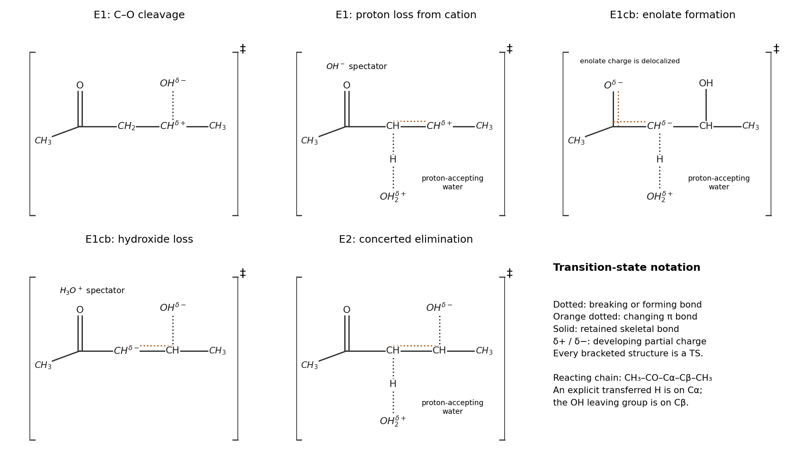

<h1 id="b10/a/solution">Solution</h1>

↑ **Parent:** [A](../a.md)

Label the [carbon](../../../../../carbon.md) next to the carbonyl $C_\alpha$ and the OH-bearing [carbon](../../../../../carbon.md) $C_\beta$. The three limiting routes are **E1, E1cb and [E2 elimination](../../../../../e2-elimination.md)**. They differ in whether C$_\beta$–O cleavage, C$_\alpha$–H cleavage, or both occur in the first elementary event. In the following original transition-state structures, dotted lines denote changing bonds, $\delta$ marks developing partial charge, and the bracketed structures carry $\ddagger$. Unmarked skeletal bonds remain present. The dotted line parallel to C$_\alpha$–C$_\beta$ denotes the developing [pi bond](../../../../../pi-bond.md), in addition to its existing [sigma bond](../../../../../sigma-bond.md).

**[Figure 6](#b10/a/image-the-five-transition-states-in-e1-e1cb-and-concerted-e2-limiting-elimination-pathways). The five transition states in E1, E1cb and concerted E2 limiting elimination pathways**.

For **E1**, C$_\beta$–OH heterolysis occurs first. The [electron pair](../../../../../electron-pair.md) in that bond goes to O, producing $\mathrm{CH_3COCH_2C^+(H)CH_3+OH^-}$. Its first [transition state](../../../../../transition-state.md) has a partly broken C$_\beta$–O bond, developing positive charge on C$_\beta$ and negative charge on the leaving O. Next, [water](../../../../../water.md) uses a [lone pair](../../../../../lone-pair.md) to remove the alpha proton; the C$_\alpha$–H [electron pair](../../../../../electron-pair.md) forms the C$_\alpha$=C$_\beta$ [pi bond](../../../../../pi-bond.md). This second [transition state](../../../../../transition-state.md) has partly broken C$_\alpha$–H, partly formed water-O–H, and a partly formed C$_\alpha$–C$_\beta$ [pi bond](../../../../../pi-bond.md). Positive charge is transferred from the organic [cation](../../../../../cation.md) toward the incoming [water](../../../../../water.md)/[hydronium](../../../../../hydronium.md) unit. [hydroxide](../../../../../hydroxide.md) from the first step is a spectator in the second.

For **E1cb**, [water](../../../../../water.md) first removes the alpha proton to form a resonance-stabilized [enolate](../../../../../enolate.md) plus [hydronium](../../../../../hydronium.md):

$$
\mathrm{CH_3C(O^-){=}CHCH(OH)CH_3\ \leftrightarrow\ CH_3COC^-(H)CH(OH)CH_3}.
$$

The first [transition state](../../../../../transition-state.md) has partly broken C$_\alpha$–H and partly formed O$_{\rm water}$–H, with developing negative charge delocalized over the alpha-carbon/carbonyl-oxygen system and positive charge on the proton-accepting [water](../../../../../water.md) unit. The [enolate](../../../../../enolate.md) then expels [hydroxide](../../../../../hydroxide.md): use the carbon-centred contributor to send its alpha-carbon [lone pair](../../../../../lone-pair.md) into C$_\alpha$–C$_\beta$, while the C$_\beta$–O pair goes to [oxygen](../../../../../oxygen.md). This second [transition state](../../../../../transition-state.md) has a partly formed [alkene](../../../../../alkene.md) [pi bond](../../../../../pi-bond.md) and partly broken C$_\beta$–O, with negative charge moving from the [enolate](../../../../../enolate.md) framework onto the departing [hydroxide](../../../../../hydroxide.md). [hydronium](../../../../../hydronium.md) is a spectator in this second step.

For **E2**, [water](../../../../../water.md) removes the alpha proton as [hydroxide](../../../../../hydroxide.md) leaves in the same elementary step. Three electron-pair movements are simultaneous: [water](../../../../../water.md) [lone pair](../../../../../lone-pair.md) to H$_\alpha$, C$_\alpha$–H to the C$_\alpha$–C$_\beta$ [pi bond](../../../../../pi-bond.md), and C$_\beta$–O to O. Its single [transition state](../../../../../transition-state.md) therefore contains **all three changing bonds**: C$_\alpha$–H, water-O–H and C$_\beta$–O, together with the developing [pi bond](../../../../../pi-bond.md). The departing O becomes negative, the proton-accepting [water](../../../../../water.md) unit becomes positive, and partial charge at [carbon](../../../../../carbon.md) depends on the synchrony of proton loss and leaving-group departure. The reacting [conformation](../../../../../conformation.md) should align C$_\alpha$–H and C$_\beta$–O approximately in an [antiperiplanar conformation](../../../../../antiperiplanar-conformation.md) for efficient elimination.

These are formal limiting pathways for the displayed net process, not three claims of equal [reaction rates](../../../../../reaction-rate.md) in neutral [water](../../../../../water.md). In particular, unassisted loss of OH$^-$ to a secondary [carbocation](../../../../../carbocation.md) is strongly disfavoured, and [water](../../../../../water.md) is a weak base for making an [enolate](../../../../../enolate.md). The [enolate](../../../../../enolate.md) pathway benefits from resonance stabilization and the final product is a conjugated [enone](../../../../../enone.md), but actual rate and dominant pathway depend on chemical conditions. The displayed [hydroxide](../../../../../hydroxide.md) and [hydronium](../../../../../hydronium.md) also rapidly neutralize each other; retaining them separately here tracks which bond cleavage supplied each species. No biological [catalysis](../../../../../catalysis.md) is needed to describe these chemical mechanisms.

## ↑ Ancestors (13)

1. [A](../a.md)
2. [B10](../../b10.md)
3. [Paper 2](../../../paper-2-split.md)
4. [2022](../../../split.md)
5. [Past exam of the chemistry B course of the University of Cambridge](../../../../split.md)
6. [Chemistry B course of the University of Cambridge](../../../../../chemistry-b-course-of-the-university-of-cambridge.md)
7. [Year 2 of the natural sciences course of the University of Cambridge](../../../../../year-2-of-the-natural-sciences-course-of-the-university-of-cambridge.md)
8. [Year of the natural sciences course of the University of Cambridge](../../../../../year-of-the-natural-sciences-course-of-the-university-of-cambridge.md)
9. [Natural sciences course of the University of Cambridge](../../../../../natural-sciences-course-of-the-university-of-cambridge.md)
10. [Course of the University of Cambridge](../../../../../course-of-the-university-of-cambridge.md)
11. [University of Cambridge](../../../../../university-of-cambridge-split.md)
12. [List of universities](../../../../../list-of-universities.md)
13. [Codex Wiki](../../../../../split.md)
