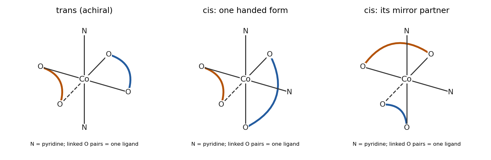

<h1 id="b6/b/iv/solution">Solution</h1>

↑ **Parent:** [Iv](../iv.md)

Treat each [semiquinonate ligand](../../../../../../semiquinonate-ligand.md) as a symmetric O,O [chelate](../../../../../../chelate.md), with the [free radical](../../../../../../radical-chemistry.md) delocalized over the dioxolene framework. The ideal octahedral donor-connectivity structures are **one trans form and two mirror-related cis forms**, giving **three [stereoisomers](../../../../../../stereoisomer.md)**. Trans refers to the two [pyridine](../../../../../../pyridine.md) N donors, not to the two O atoms of a [chelate](../../../../../../chelate.md), which must remain adjacent.

**[Figure 2](#b6/b/iv/image-the-achiral-trans-arrangement-and-the-two-mirror-related-cis-donor-arrangements). The achiral trans arrangement and the two mirror-related cis donor arrangements**.

In the diagram, coloured curves join the two O donors belonging to one ligand. For an unambiguous coordinate specification, the trans form has Py at $+z,-z$, with [chelate](../../../../../../chelate.md) pairs $(+x,+y)$ and $(-x,-y)$. A cis pair has Py at $+z,+x$, with [chelates](../../../../../../chelate.md) $(-z,+y)$ and $(-x,-y)$; reflecting $y\mapsto-y$ gives the other cis form. Proper rotations cannot superpose those two cis arrangements. Ring [conformations](../../../../../../conformation.md) and [pyridine](../../../../../../pyridine.md) rotations are not extra donor-connectivity [isomers](../../../../../../isomer.md).

## ↑ Ancestors (14)

1. [Iv](../iv.md)
2. [B](../../b.md)
3. [B6](../../../b6.md)
4. [Paper 2](../../../../paper-2-split.md)
5. [2022](../../../../split.md)
6. [Past exam of the chemistry B course of the University of Cambridge](../../../../../split.md)
7. [Chemistry B course of the University of Cambridge](../../../../../../chemistry-b-course-of-the-university-of-cambridge.md)
8. [Year 2 of the natural sciences course of the University of Cambridge](../../../../../../year-2-of-the-natural-sciences-course-of-the-university-of-cambridge.md)
9. [Year of the natural sciences course of the University of Cambridge](../../../../../../year-of-the-natural-sciences-course-of-the-university-of-cambridge.md)
10. [Natural sciences course of the University of Cambridge](../../../../../../natural-sciences-course-of-the-university-of-cambridge.md)
11. [Course of the University of Cambridge](../../../../../../course-of-the-university-of-cambridge.md)
12. [University of Cambridge](../../../../../../university-of-cambridge-split.md)
13. [List of universities](../../../../../../list-of-universities.md)
14. [Codex Wiki](../../../../../../split.md)
