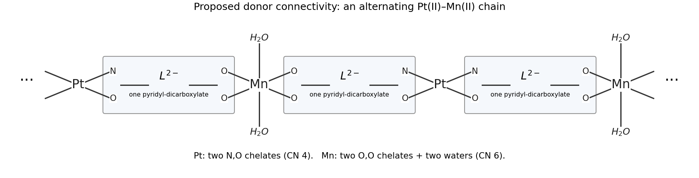

<h1 id="b6/c/solution">Solution</h1>

↑ **Parent:** [C](../c.md)

Four equivalents of base remove the four carboxylic-acid protons from two ligand molecules, giving two dianionic [pyridine-2,5-dicarboxylate](../../../../../pyridine-2-5-dicarboxylate.md) linkers per Pt/Mn pair. The ring [nitrogen](../../../../../nitrogen.md) and neighbouring 2-carboxylate supply a five-membered N,O [chelate](../../../../../chelate.md). A consistent chain has **Pt(II), N$_2$O$_2$, with [square planar molecular geometry](../../../../../square-planar-molecular-geometry.md), and Mn(II), O$_6$, with [octahedral molecular geometry](../../../../../octahedral-molecular-geometry.md)**.

At each Pt, two ligands bind through their ring N and one O of the adjacent 2-carboxylate; their remote 5-carboxylates point toward successive Mn sites. At each Mn, a remote [carboxylate](../../../../../carboxylate.md) from each of two neighbouring Pt-containing units binds through both O atoms. Two coordinated [water](../../../../../water.md) molecules complete Mn's six-coordinate sphere. The repeating connectivity, with each bracket denoting a single organic linker, is

$$
\cdots\mathrm{Pt}\;\underbrace{\bigl[\kappa^2(N,O)\!:\!L^{2-}\!:\!\kappa^2(O,O)\bigr]}_{\text{one linker}}\;\mathrm{Mn(H_2O)_2}\;\bigl[\kappa^2(O,O)\!:\!L^{2-}\!:\!\kappa^2(N,O)\bigr]\;\mathrm{Pt}\cdots .
$$

Each Pt has a second N,O [chelate](../../../../../chelate.md) extending in the opposite chain direction; each Mn similarly receives two [carboxylate](../../../../../carboxylate.md) [chelates](../../../../../chelate.md). The original donor-connectivity diagram makes those counts explicit.

**[Figure 3](#b6/c/image-a-charge-balanced-pt-mn-chain-model-with-n-o-chelates-at-pt-and-oxygen-donors-at-mn). A charge-balanced Pt–Mn chain model with N,O chelates at Pt and oxygen donors at Mn**.

Pt(II) is $5d^8$ and strongly favours [square planar molecular geometry](../../../../../square-planar-molecular-geometry.md). Its affinity for the pyridyl N donor and the [chelate effect](../../../../../chelate-effect.md) select the mixed N,O pocket. Mn(II) is high-spin $3d^5$, is harder, and favours the [carboxylate](../../../../../carboxylate.md) and [water](../../../../../water.md) O donors; six-coordinate [octahedral molecular geometry](../../../../../octahedral-molecular-geometry.md) is natural in [water](../../../../../water.md). Charge balance per repeat is $+2+2+2(-2)=0$. A suitable repeat formulation is $\mathrm{[PtMn(L)_2(H_2O)_2]_n}$. This is a justified proposed coordination chain, not a unique crystal structure established from [stoichiometry](../../../../../stoichiometry.md) alone; [water](../../../../../water.md) content, [carboxylate](../../../../../carboxylate.md) bridging modes and actual porosity require structural characterization.

## ↑ Ancestors (13)

1. [C](../c.md)
2. [B6](../../b6.md)
3. [Paper 2](../../../paper-2-split.md)
4. [2022](../../../split.md)
5. [Past exam of the chemistry B course of the University of Cambridge](../../../../split.md)
6. [Chemistry B course of the University of Cambridge](../../../../../chemistry-b-course-of-the-university-of-cambridge.md)
7. [Year 2 of the natural sciences course of the University of Cambridge](../../../../../year-2-of-the-natural-sciences-course-of-the-university-of-cambridge.md)
8. [Year of the natural sciences course of the University of Cambridge](../../../../../year-of-the-natural-sciences-course-of-the-university-of-cambridge.md)
9. [Natural sciences course of the University of Cambridge](../../../../../natural-sciences-course-of-the-university-of-cambridge.md)
10. [Course of the University of Cambridge](../../../../../course-of-the-university-of-cambridge.md)
11. [University of Cambridge](../../../../../university-of-cambridge-split.md)
12. [List of universities](../../../../../list-of-universities.md)
13. [Codex Wiki](../../../../../split.md)
