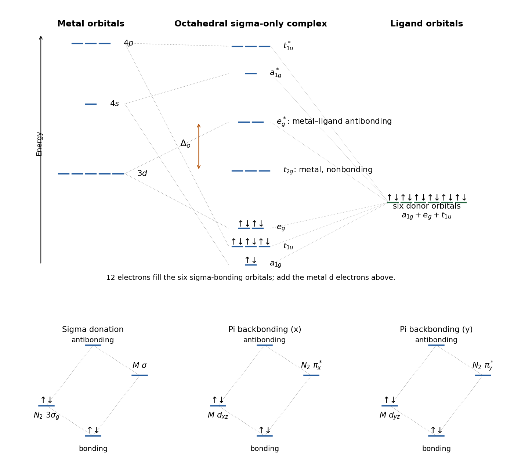

<h1 id="b8/a/i/solution">Solution</h1>

↑ **Parent:** [I](../i.md)

Choose $z$ along M–N–N. The occupied dinitrogen $3\sigma_g$ orbital, with amplitude on the terminal N atoms, overlaps an empty [metal](../../../../../../metal.md) orbital of sigma symmetry to give **N$_2$-to-metal [sigma donation](../../../../../../sigma-donation.md)**. Filled [metal](../../../../../../metal.md) $d_{xz}$ and $d_{yz}$ orbitals separately overlap the two empty N$_2$ $\pi_g^*$ orbitals, giving **metal-to-N$_2$ [pi backbonding](../../../../../../pi-backbonding.md)**. The lower-energy combination of each interacting pair is bonding and the higher is antibonding; each donation channel starts with two [electrons](../../../../../../electron.md) in the occupied fragment orbital. The lower panel of the original orbital diagram shows these three channels.

**[Figure 4](#b8/a/i/image-orbital-symmetry-channels-for-sigma-donation-and-two-perpendicular-pi-backbonding-interactions). Orbital-symmetry channels for sigma donation and two perpendicular pi-backbonding interactions**.

As for a terminal [carbonyl ligand](../../../../../../carbonyl-ligand.md), the donor and acceptor interactions reinforce one another: [sigma donation](../../../../../../sigma-donation.md) helps make [electron density](../../../../../../electron-density.md) available at the [metal](../../../../../../metal.md), while [pi backbonding](../../../../../../pi-backbonding.md) strengthens M–N and weakens N–N. For conventional [electron counting](../../../../../../electron-counting.md) an intact end-on neutral N$_2$ ligand is an L-type two-electron donor; counting the backbonded [electrons](../../../../../../electron.md) a second time as extra donated ligand [electrons](../../../../../../electron.md) would double count them.

## ↑ Ancestors (14)

1. [I](../i.md)
2. [A](../../a.md)
3. [B8](../../../b8.md)
4. [Paper 2](../../../../paper-2-split.md)
5. [2022](../../../../split.md)
6. [Past exam of the chemistry B course of the University of Cambridge](../../../../../split.md)
7. [Chemistry B course of the University of Cambridge](../../../../../../chemistry-b-course-of-the-university-of-cambridge.md)
8. [Year 2 of the natural sciences course of the University of Cambridge](../../../../../../year-2-of-the-natural-sciences-course-of-the-university-of-cambridge.md)
9. [Year of the natural sciences course of the University of Cambridge](../../../../../../year-of-the-natural-sciences-course-of-the-university-of-cambridge.md)
10. [Natural sciences course of the University of Cambridge](../../../../../../natural-sciences-course-of-the-university-of-cambridge.md)
11. [Course of the University of Cambridge](../../../../../../course-of-the-university-of-cambridge.md)
12. [University of Cambridge](../../../../../../university-of-cambridge-split.md)
13. [List of universities](../../../../../../list-of-universities.md)
14. [Codex Wiki](../../../../../../split.md)
