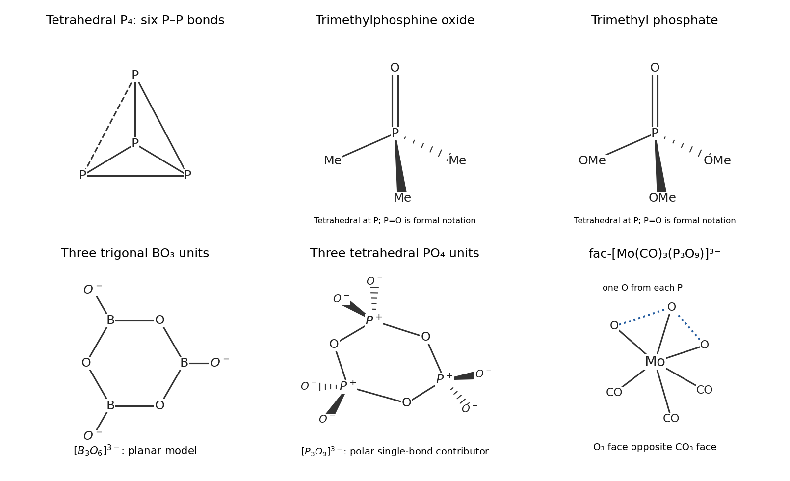

<h1 id="b9/a/i/solution">Solution</h1>

↑ **Parent:** [I](../i.md)

**P$_4$ is a tetrahedron of four [phosphorus](../../../../../../phosphorus.md) atoms, with a P–P bond along every edge.** Each P has three P–P [sigma bonds](../../../../../../sigma-bond.md) and one [lone pair](../../../../../../lone-pair.md). The P–P–P angles are $60^\circ$, so these are strained, bent bonds rather than four independent tetrahedral electron-pair arrangements with ideal [bond angles](../../../../../../bond-angle.md). This molecular unit is characteristic of [white phosphorus](../../../../../../white-phosphorus.md).

**[Figure 5](#b9/a/i/image-original-structures-of-p4-the-two-phosphoryl-compounds-cyclic-triborate-and-trimetaphosphate). Original structures of P4, the two phosphoryl compounds, cyclic triborate and trimetaphosphate**.

## ↑ Ancestors (14)

1. [I](../i.md)
2. [A](../../a.md)
3. [B9](../../../b9.md)
4. [Paper 2](../../../../paper-2-split.md)
5. [2022](../../../../split.md)
6. [Past exam of the chemistry B course of the University of Cambridge](../../../../../split.md)
7. [Chemistry B course of the University of Cambridge](../../../../../../chemistry-b-course-of-the-university-of-cambridge.md)
8. [Year 2 of the natural sciences course of the University of Cambridge](../../../../../../year-2-of-the-natural-sciences-course-of-the-university-of-cambridge.md)
9. [Year of the natural sciences course of the University of Cambridge](../../../../../../year-of-the-natural-sciences-course-of-the-university-of-cambridge.md)
10. [Natural sciences course of the University of Cambridge](../../../../../../natural-sciences-course-of-the-university-of-cambridge.md)
11. [Course of the University of Cambridge](../../../../../../course-of-the-university-of-cambridge.md)
12. [University of Cambridge](../../../../../../university-of-cambridge-split.md)
13. [List of universities](../../../../../../list-of-universities.md)
14. [Codex Wiki](../../../../../../split.md)
