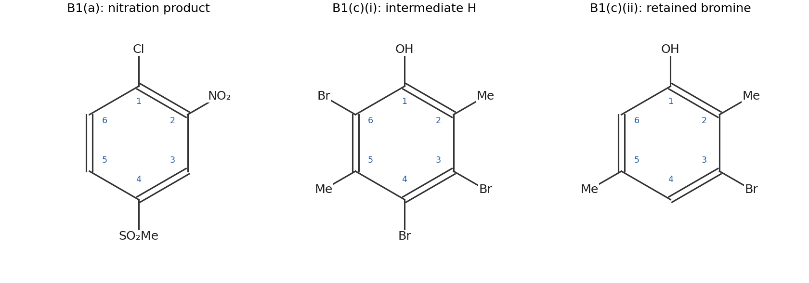
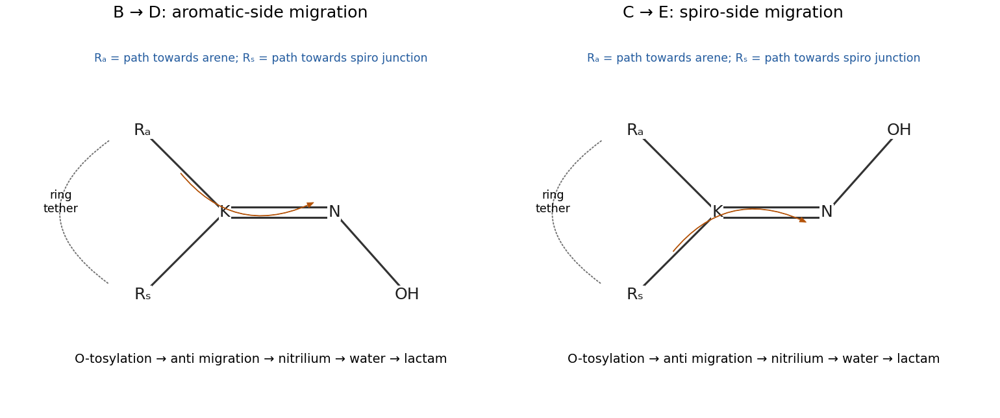

# Paper 1

↑ **Parent:** [2023](../2023.md)

[Original paper, released PDF pages 118–127](https://www.whatdotheyknow.com/request/request_for_nst_past_papers/response/3572306/attach/4/FOI%202026%20862%20Stack%20materials.pdf?cookie_passthrough=1#page=118)

**Table of contents**

- [B1](#b1)
  - [a](#b1/a)
    - [Solution](#b1/a/solution)
  - [b](#b1/b)
    - [i](#b1/b/i)
      - [Solution](#b1/b/i/solution)
    - [ii](#b1/b/ii)
      - [Solution](#b1/b/ii/solution)
    - [iii](#b1/b/iii)
      - [Solution](#b1/b/iii/solution)
  - [c](#b1/c)
    - [i](#b1/c/i)
      - [Solution](#b1/c/i/solution)
    - [ii](#b1/c/ii)
      - [Solution](#b1/c/ii/solution)
- [B2](#b2)
  - [a](#b2/a)
    - [Solution](#b2/a/solution)
  - [b](#b2/b)
    - [i](#b2/b/i)
      - [Solution](#b2/b/i/solution)
    - [ii](#b2/b/ii)
      - [Solution](#b2/b/ii/solution)
    - [iii](#b2/b/iii)
      - [Solution](#b2/b/iii/solution)
  - [c](#b2/c)
    - [i](#b2/c/i)
      - [Solution](#b2/c/i/solution)
    - [ii](#b2/c/ii)
      - [Solution](#b2/c/ii/solution)
    - [iii](#b2/c/iii)
      - [Solution](#b2/c/iii/solution)
- [B3](#b3)
  - [a](#b3/a)
    - [i](#b3/a/i)
      - [Solution](#b3/a/i/solution)
    - [ii](#b3/a/ii)
      - [Solution](#b3/a/ii/solution)
  - [b](#b3/b)
    - [Solution](#b3/b/solution)
  - [c](#b3/c)
    - [Solution](#b3/c/solution)
  - [d](#b3/d)
    - [Solution](#b3/d/solution)
- [B4](#b4)
  - [a](#b4/a)
    - [i](#b4/a/i)
      - [Solution](#b4/a/i/solution)
    - [ii](#b4/a/ii)
      - [Solution](#b4/a/ii/solution)
    - [iii](#b4/a/iii)
      - [Solution](#b4/a/iii/solution)
  - [b](#b4/b)
    - [i](#b4/b/i)
      - [Solution](#b4/b/i/solution)
    - [ii](#b4/b/ii)
      - [Solution](#b4/b/ii/solution)
- [B5](#b5)
  - [a](#b5/a)
    - [i](#b5/a/i)
      - [Solution](#b5/a/i/solution)
    - [ii](#b5/a/ii)
      - [Solution](#b5/a/ii/solution)
    - [iii](#b5/a/iii)
      - [Solution](#b5/a/iii/solution)
  - [b](#b5/b)
    - [i](#b5/b/i)
      - [Solution](#b5/b/i/solution)
    - [ii](#b5/b/ii)
      - [Solution](#b5/b/ii/solution)
  - [c](#b5/c)
    - [i](#b5/c/i)
      - [Solution](#b5/c/i/solution)
    - [ii](#b5/c/ii)
      - [Solution](#b5/c/ii/solution)

## B1

↑ **Parent:** [Paper 1](paper-1.md)

<h3 id="b1/a">a</h3>

↑ **Parent:** [B1](#b1)

<h4 id="b1/a/solution">Solution</h4>

↑ **Parent:** [A](#b1/a)

Number the ring with [chlorine](../../chemical-substance.md#chlorine) at C1 and the methylsulfonyl group at C4. **The new [nitro group](../../chemistry.md#nitro-group) is at C2, equivalently C6 by the starting ring's symmetry:** the [product](../../chemical-reaction.md#product-chemistry) is 1-chloro-2-nitro-4-(methylsulfonyl)[benzene](../../chemical-substance.md#benzene). Both [substituents](../../stereochemistry.md#substituent) favour this site. Although [chlorine](../../chemical-substance.md#chlorine) deactivates the ring inductively, its [lone pair](../../covalent-bond.md#lone-pair) donation stabilizes ortho/para [Wheland intermediates](../../chemical-reaction.md#arenium-ion). The [sulfone](../../chemistry.md#sulfone) is strongly [electron](../../physics.md#electron) withdrawing and meta directing; attack ortho or para to it produces especially unfavourable cationic contributors to [resonance in chemistry](../../chemical-bond.md#resonance-in-chemistry). C2 is ortho to [chlorine](../../chemical-substance.md#chlorine) and meta to [sulfone](../../chemistry.md#sulfone), whereas C3 has the opposite, less favourable relationship.

[sulfuric acid](../../chemical-substance.md#sulfuric-acid) protonates [nitric acid](../../chemical-substance.md#nitric-acid), followed by loss of [water](../../chemical-substance.md#water) to produce the [nitronium ion](../../chemistry.md#nitronium-ion). A ring [pi bond](../../covalent-bond.md#pi-bond) attacks [nitrogen](../../chemical-substance.md#nitrogen), giving the [Wheland intermediate](../../chemical-reaction.md#arenium-ion) with the new C–N bond. [deprotonation](../../acid-base-chemistry.md#deprotonation) at the attacked [carbon](../../chemical-substance.md#carbon) restores [aromaticity](../../molecule.md#aromaticity). This is [electrophilic aromatic substitution](../../chemical-reaction.md#electrophilic-aromatic-substitution): the aryl [chloride](../../chemistry.md#chloride) and the [sulfone](../../chemistry.md#sulfone) both remain attached. The formula check is $\mathrm{C_7H_7ClO_2S+NO_2-H=C_7H_6ClNO_4S}$. It confirms replacement of one ring [hydrogen](../../chemical-substance.md#hydrogen) rather than [chlorine](../../chemical-substance.md#chlorine), but directing effects, rather than the formula alone, establish the position.

**[Figure 1](#b1/a/image-independently-drawn-aromatic-substitution-products-and-the-sites-selected-by-protodebromination). Independently drawn aromatic substitution products and the sites selected by protodebromination**.

<h3 id="b1/b">b</h3>

↑ **Parent:** [B1](#b1)

<h4 id="b1/b/i">i</h4>

↑ **Parent:** [B](#b1/b)

<h5 id="b1/b/i/solution">Solution</h5>

↑ **Parent:** [I](#b1/b/i)

**The [malonate](../../chemical-substance.md#malonate) [carbon](../../chemical-substance.md#carbon) receives two [allyl groups](../../chemistry.md#allyl-group).** With $L=\mathrm{CH_2CH{=}CH_2}$, attached through its first [carbon](../../chemical-substance.md#carbon), the [product](../../chemical-reaction.md#product-chemistry) is

$$
\boxed{D=\mathrm{EtO_2C{-}C(L)_2{-}CO_2Et}}.
$$

[sodium hydride](../../chemical-substance.md#sodium-hydride) removes a methylene [proton](../../physics.md#proton) from [diethyl malonate](../../chemical-substance.md#diethyl-malonate); [molecular hydrogen](../../chemical-substance.md#molecular-hydrogen) formation accompanies production of an [enolate](../../chemical-substance.md#enolate) stabilized by [resonance in chemistry](../../chemical-bond.md#resonance-in-chemistry). Its [carbon](../../chemical-substance.md#carbon) attacks the bromomethylene [carbon](../../chemical-substance.md#carbon) of [allyl bromide](../../chemical-substance.md#allyl-bromide) in an [SN2 reaction](../../chemical-reaction.md#sn2-reaction), expelling [bromide](../../chemistry.md#bromide). The monoalkylated [malonate](../../chemical-substance.md#malonate) still has one [hydrogen](../../chemical-substance.md#hydrogen) between the [carbonyls](../../chemical-bond.md#carbonyl-group). Excess [base](../../acid-base-chemistry.md#base-chemistry) removes that [hydrogen](../../chemical-substance.md#hydrogen), and a second equivalent of [allyl bromide](../../chemical-substance.md#allyl-bromide) produces a second [carbon](../../chemical-substance.md#carbon)–[carbon](../../chemical-substance.md#carbon) bond. The final [malonate](../../chemical-substance.md#malonate) [carbon](../../chemical-substance.md#carbon) has no remaining [hydrogen](../../chemical-substance.md#hydrogen) and cannot undergo a third analogous [deprotonation](../../acid-base-chemistry.md#deprotonation) there.

The two [alkenes](../../chemical-substance.md#alkene) are preserved because the substitution occurs at the primary [carbon](../../chemical-substance.md#carbon) bearing [bromine](../../chemical-substance.md#bromine). Counting the introduced groups gives **$\mathrm{C_{13}H_{20}O_4}$** for the diallylated diethyl [ester](../../chemical-substance.md#ester). Its two identical [allyl groups](../../chemistry.md#allyl-group) also mean that the central [carbon](../../chemical-substance.md#carbon) is not a [stereocenter](../../stereochemistry.md#stereocenter). This stage is the [alkylation](../../chemical-reaction.md#alkylation) portion of the [malonic ester synthesis](../../chemical-reaction.md#malonic-ester-synthesis).

<h4 id="b1/b/ii">ii</h4>

↑ **Parent:** [B](#b1/b)

<h5 id="b1/b/ii/solution">Solution</h5>

↑ **Parent:** [Ii](#b1/b/ii)

[hydroxide](../../chemistry.md#hydroxide) attacks an [ester](../../chemical-substance.md#ester) [carbonyl](../../chemical-bond.md#carbonyl-group) to form a [tetrahedral intermediate](../../chemical-kinetics.md#tetrahedral-intermediate). Collapse expels ethoxide, and [acid](../../acid-base-chemistry.md#acid-chemistry)–[base](../../acid-base-chemistry.md#base-chemistry) transfer gives the [carboxylate](../../chemical-substance.md#carboxylate) and [ethanol](../../biology.md#ethanol). Repeating this [nucleophilic acyl substitution](../../chemical-reaction.md#nucleophilic-acyl-substitution) at the other [ester](../../chemical-substance.md#ester) produces the [malonate](../../chemical-substance.md#malonate) dianion; [acid](../../acid-base-chemistry.md#acid-chemistry) workup gives $\mathrm{HO_2C{-}C(L)_2{-}CO_2H}$, with $L=\mathrm{CH_2CH{=}CH_2}$ as defined above.

On heating, one [carboxylic acid](../../chemical-substance.md#carboxylic-acid) group is lost through a six-membered cyclic [proton](../../physics.md#proton)-transfer/bond-cleavage arrangement. A [carbonyl](../../chemical-bond.md#carbonyl-group) [oxygen](../../chemical-substance.md#oxygen) of the retained group accepts the [proton](../../physics.md#proton) from the departing carboxyl OH as its C–C bond breaks and [carbon dioxide](../../chemical-substance.md#carbon-dioxide) forms; [electron](../../physics.md#electron) redistribution gives the [enol](../../chemical-substance.md#enol)-like form of the retained [acid](../../acid-base-chemistry.md#acid-chemistry). [proton transfer](../../acid-base-chemistry.md#proton-transfer)/[tautomerization](../../chemical-reaction.md#tautomerization) then produces

$$
\boxed{E=\mathrm{HO_2C{-}CH(L)_2}}.
$$

The net [decarboxylation](../../chemical-reaction.md#decarboxylation) is $\mathrm{C_9H_{12}O_4\to C_8H_{12}O_2+CO_2}$. The central [carbon](../../chemical-substance.md#carbon) gains a [hydrogen](../../chemical-substance.md#hydrogen), both allyl [substituents](../../stereochemistry.md#substituent) survive, and only one carboxyl group is removed. It would be incorrect to draw [hydrolysis](../../chemical-reaction.md#hydrolysis) directly giving the final [acid](../../acid-base-chemistry.md#acid-chemistry) without accounting for this [carbon](../../chemical-substance.md#carbon) loss. The favourable cyclic pathway is characteristic of [malonic acid decarboxylation](../../chemical-reaction.md#malonic-acid-decarboxylation).

<h4 id="b1/b/iii">iii</h4>

↑ **Parent:** [B](#b1/b)

<h5 id="b1/b/iii/solution">Solution</h5>

↑ **Parent:** [Iii](#b1/b/iii)

**The first [base](../../acid-base-chemistry.md#base-chemistry) equivalent removes O–H; the second removes the alpha C–H.** The first equivalent of [lithium diisopropylamide](../../chemical-substance.md#lithium-diisopropylamide) converts the [carboxylic acid](../../chemical-substance.md#carboxylic-acid) to its [lithium](../../chemical-substance.md#lithium) [carboxylate](../../chemical-substance.md#carboxylate). A further equivalent removes the remaining [hydrogen](../../chemical-substance.md#hydrogen) on the [carbon](../../chemical-substance.md#carbon) between the two [allyl groups](../../chemistry.md#allyl-group), giving a [carboxylic acid dianion](../../chemical-substance.md#carboxylic-acid-dianion):

$$
\mathrm{HO_2C{-}CH(L)_2\longrightarrow {}^-O_2C{-}CH(L)_2\longrightarrow {}^-O_2C{-}C^-(L)_2}.
$$

The second negative charge has [enolate](../../chemical-substance.md#enolate)-like delocalization into the carboxyl group; [lithium](../../chemical-substance.md#lithium) coordination and aggregation are not represented by this simple charge-bookkeeping structure. The [carbon](../../chemical-substance.md#carbon) [nucleophile](../../chemical-reaction.md#nucleophile) attacks [methyl iodide](../../chemical-substance.md#methyl-iodide) with C–I bond cleavage, forming the new C–Me bond. [acid](../../acid-base-chemistry.md#acid-chemistry) workup reprotonates the [carboxylate](../../chemical-substance.md#carboxylate), giving **$F=\mathrm{HO_2C{-}C(Me)(L)_2}$**. The two equivalents are therefore chemically necessary for the stated [carbon](../../chemical-substance.md#carbon) [alkylation](../../chemical-reaction.md#alkylation) rather than simply an arbitrary excess. A single equivalent is consumed predominantly by the much more acidic carboxylic [proton](../../physics.md#proton). The [product](../../chemical-reaction.md#product-chemistry) has formula $\mathrm{C_9H_{14}O_2}$ and still has two identical [allyl groups](../../chemistry.md#allyl-group), so this methylation does not create a [stereocenter](../../stereochemistry.md#stereocenter).

<h3 id="b1/c">c</h3>

↑ **Parent:** [B1](#b1)

<h4 id="b1/c/i">i</h4>

↑ **Parent:** [C](#b1/c)

<h5 id="b1/c/i/solution">Solution</h5>

↑ **Parent:** [I](#b1/c/i)

Number the phenolic [carbon](../../chemical-substance.md#carbon) C1, with methyl groups at C2 and C5. **All three remaining aromatic [hydrogens](../../chemical-substance.md#hydrogen) are replaced: $H$ is 3,4,6-tribromo-2,5-dimethylphenol.** The starting [phenol](../../chemical-substance.md#phenol) is $\mathrm{C_8H_{10}O}$; replacing three [hydrogens](../../chemical-substance.md#hydrogen) gives $\mathrm{C_8H_7Br_3O}$, agreeing with the intermediate's composition. Bromination of methyl side chains would not follow the stated [Lewis acid](../../acid-base-chemistry.md#lewis-acid)-promoted aromatic pathway.

[aluminium tribromide](../../acid-base-chemistry.md#aluminium-tribromide) polarizes Br–Br. The [aromatic ring](../../molecule.md#aromatic-ring) attacks the [electrophilic](../../chemical-reaction.md#electrophilicity) [bromine](../../chemical-substance.md#bromine) end, forming a [Wheland intermediate](../../chemical-reaction.md#arenium-ion); removal of the [proton](../../physics.md#proton) on the attacked [carbon](../../chemical-substance.md#carbon) restores [aromaticity](../../molecule.md#aromaticity). Repetition fills C4 and C6, the available para and ortho positions activated by OH, and C3, which is activated by the methyl [substituents](../../stereochemistry.md#substituent) when the other positions are occupied. The formula fixes the extent of substitution without requiring an experimentally unreported order for the individual brominations. The preparative perbromination/selective-debromination sequence is documented in the primary synthetic work.[2019, Scheme 6, upper route from 2,5-xylenol](../../chemistry-bibliography.md#total-synthesis-of-nor-illudalane-sesquiterpenes-based-on-a-c-sp3-h-activation-strategy-by-romain-melot-and-others)

<h4 id="b1/c/ii">ii</h4>

↑ **Parent:** [C](#b1/c)

<h5 id="b1/c/ii/solution">Solution</h5>

↑ **Parent:** [Ii](#b1/c/ii)

**The [bromines](../../chemical-substance.md#bromine) ortho and para to OH are removed, leaving the meta [bromine](../../chemical-substance.md#bromine) at C3.** A suitable polar mechanism begins with [electrophilic](../../chemical-reaction.md#electrophilicity) ipso [protonation](../../chemical-reaction.md#protonation) of a brominated [carbon](../../chemical-substance.md#carbon). [protonation](../../chemical-reaction.md#protonation) at C4 or C6 gives a [Wheland intermediate](../../chemical-reaction.md#arenium-ion) stabilized by donation of the phenolic [oxygen](../../chemical-substance.md#oxygen) [lone pair](../../covalent-bond.md#lone-pair); an important contributor has an O-protonated cyclohexadienone-like framework. Corresponding [protonation](../../chemical-reaction.md#protonation) at C3 lacks this direct stabilization by [resonance in chemistry](../../chemical-bond.md#resonance-in-chemistry) from OH.

[iodide](../../chemical-substance.md#iodide) can capture/reduce the departing [electrophilic](../../chemical-reaction.md#electrophilicity) [bromine](../../chemical-substance.md#bromine) as the C–Br bond [electrons](../../physics.md#electron) restore the aromatic pi system. Thus the incoming [hydrogen](../../chemical-substance.md#hydrogen) remains on [carbon](../../chemical-substance.md#carbon) while [bromine](../../chemical-substance.md#bromine) is removed, unlike ordinary [electrophilic substitution](../../chemical-reaction.md#electrophilic-substitution) in which the incoming [electrophile](../../chemical-reaction.md#electrophile) remains and a [proton](../../physics.md#proton) leaves. [bromine](../../chemical-substance.md#bromine) trapping can be represented through IBr formation followed by reaction with further [iodide](../../chemical-substance.md#iodide) to give [iodine](../../chemical-substance.md#iodine) and [bromide](../../chemistry.md#bromide). For each replacement the balanced net [reduction](../../chemical-reaction.md#reduction-chemistry) is

$$
\mathrm{ArBr+2HI\longrightarrow ArH+HBr+I_2}.
$$

Applying it at C4 and C6 gives **3-bromo-2,5-dimethylphenol**, with formula $\mathrm{C_8H_9BrO}$. This explains why the position least activated by OH is the one at which [bromine](../../chemical-substance.md#bromine) survives. It is a proposed [acid](../../acid-base-chemistry.md#acid-chemistry)-assisted [protodebromination](../../chemical-reaction.md#protodebromination) mechanism consistent with the selectivity; the preparative sequence alone does not prove every [proton](../../physics.md#proton)-transfer or [halogen](../../chemical-substance.md#halogen)-transfer intermediate. It should not be drawn as [iodide](../../chemical-substance.md#iodide) simply displacing [bromide](../../chemistry.md#bromide) from an unactivated aryl [carbon](../../chemical-substance.md#carbon).

## B2

↑ **Parent:** [Paper 1](paper-1.md)

<h3 id="b2/a">a</h3>

↑ **Parent:** [B2](#b2)

<h4 id="b2/a/solution">Solution</h4>

↑ **Parent:** [A](#b2/a)

The first [reagent](../../chemical-reaction.md#reagent) supplies a vinyl [nucleophile](../../chemical-reaction.md#nucleophile), $\mathrm{CH_2{=}CH{-}}$, rather than an [allyl group](../../chemistry.md#allyl-group). **Two successive [conjugate additions](../../chemical-reaction.md#conjugate-addition) install vinyl at C2 and a 2-formylethyl chain at C1.** Number the original nitro-bearing [alkene](../../chemical-substance.md#alkene) [carbon](../../chemical-substance.md#carbon) C1. Vinylmagnesium [bromide](../../chemistry.md#bromide) attacks the beta [carbon](../../chemical-substance.md#carbon) C2 of the [nitroalkene](../../chemical-substance.md#nitroalkene), shifting the original C1=C2 [electrons](../../physics.md#electron) into a [magnesium](../../chemical-substance.md#magnesium) [nitronate](../../chemistry.md#nitronate). The new C2–vinyl bond remains intact during the second stage; its terminal double bond is not the [electrophilic](../../chemical-reaction.md#electrophilicity) site in that stage.

The [carbon](../../chemical-substance.md#carbon) end of the [nitronate](../../chemistry.md#nitronate) at C1 then attacks the terminal beta [carbon](../../chemical-substance.md#carbon) of [acrolein](../../chemical-substance.md#acrolein). Move the [acrolein](../../chemical-substance.md#acrolein) C=C [electrons](../../physics.md#electron) towards its [carbonyl](../../chemical-bond.md#carbonyl-group) and the C=O [electrons](../../physics.md#electron) onto [oxygen](../../chemical-substance.md#oxygen). This forms the C1–CH2CH2CHO connectivity through an [aldehyde](../../chemical-substance.md#aldehyde) [enolate](../../chemical-substance.md#enolate); [protonation](../../chemical-reaction.md#protonation) by [methanol](../../chemical-substance.md#methanol) and [tautomerization](../../chemical-reaction.md#tautomerization) restore the [aldehyde](../../chemical-substance.md#aldehyde). The [nitronate](../../chemistry.md#nitronate) returns to a neutral [nitro group](../../chemistry.md#nitro-group) as it makes the second C–C bond. Thus the chain is attached through the [carbon](../../chemical-substance.md#carbon) formerly beta to the [acrolein](../../chemical-substance.md#acrolein) [carbonyl](../../chemical-bond.md#carbonyl-group), rather than by a direct addition to its [aldehyde](../../chemical-substance.md#aldehyde) [carbon](../../chemical-substance.md#carbon).

After the first addition, C2 bears the [vinyl group](../../chemistry.md#vinyl-group) while the [nitronate](../../chemistry.md#nitronate) [carbon](../../chemical-substance.md#carbon) C1 remains approximately planar. Approach of the second [electrophile](../../chemical-reaction.md#electrophile) to the less crowded face, opposite the adjacent vinyl [substituent](../../stereochemistry.md#substituent), gives the new formylethyl chain trans to vinyl. Consequently **nitro and vinyl are cis**, as depicted: at C1 the chain and [nitro group](../../chemistry.md#nitro-group) occupy opposite faces. This is a [substrate](../../chemical-reaction.md#substrate-chemistry)-controlled [diastereoselective](../../stereochemistry.md#diastereoselectivity) [tandem Michael addition](../../chemical-reaction.md#tandem-michael-addition). The [reagents](../../chemical-reaction.md#reagent) and starting material contain no [chiral](../../stereochemistry.md#chirality-chemistry) source, so the depicted [product](../../chemical-reaction.md#product-chemistry) represents a racemic pair rather than an enantioselective synthesis. Steric facial selection explains the relative configuration without requiring a uniquely established [magnesium](../../chemical-substance.md#magnesium) aggregate or transition-state [conformation](../../stereochemistry.md#conformation).

<h3 id="b2/b">b</h3>

↑ **Parent:** [B2](#b2)

<h4 id="b2/b/i">i</h4>

↑ **Parent:** [B](#b2/b)

<h5 id="b2/b/i/solution">Solution</h5>

↑ **Parent:** [I](#b2/b/i)

The [cyclohexanone](../../chemical-substance.md#cyclohexanone) [enamine](../../chemical-substance.md#enamine) attacks the beta [carbon](../../chemical-substance.md#carbon) of the cyclopentenone. Its [nitrogen](../../chemical-substance.md#nitrogen) [lone pair](../../covalent-bond.md#lone-pair) forms an [iminium](../../chemical-substance.md#iminium) C=N bond as the [enamine](../../chemical-substance.md#enamine) [pi bond](../../covalent-bond.md#pi-bond) forms the new C–C bond; simultaneously the [enone](../../chemical-substance.md#enone) pi system shifts onto its [oxygen](../../chemical-substance.md#oxygen). [proton transfer](../../acid-base-chemistry.md#proton-transfer) converts the resulting cyclopentanone [enolate](../../chemical-substance.md#enolate) back to the [ketone](../../chemical-substance.md#ketone).

A final [iminium](../../chemical-substance.md#iminium) [deprotonation](../../acid-base-chemistry.md#deprotonation) regenerates an [enamine](../../chemical-substance.md#enamine), but the position of its double bond matters. Label the [nitrogen](../../chemical-substance.md#nitrogen)-bearing [cyclohexane](../../chemical-substance.md#cyclohexane) [carbon](../../chemical-substance.md#carbon) $h_1$, its initially nucleophilic neighbour $h_2$, and the other neighbour $h_6$. After addition, $h_2$ bears the cyclopentanone [substituent](../../stereochemistry.md#substituent). **[deprotonation](../../acid-base-chemistry.md#deprotonation) at $h_6$ gives $h_1{=}h_6$, the less substituted, less hindered [enamine](../../chemical-substance.md#enamine) drawn in A.** Merely restoring the original $h_1{=}h_2$ bond would give a different regioisomer. Interconversion through the [iminium ion](../../chemical-substance.md#iminium) permits this [enamine regioisomerization](../../chemical-substance.md#enamine-regioisomerization) under the reaction conditions. The methyl and [mesylate](../../chemical-substance.md#mesylate) [substituents](../../stereochemistry.md#substituent) are spectators during this first [Michael addition](../../chemical-reaction.md#michael-addition).

<h4 id="b2/b/ii">ii</h4>

↑ **Parent:** [B](#b2/b)

<h5 id="b2/b/ii/solution">Solution</h5>

↑ **Parent:** [Ii](#b2/b/ii)

Number the cyclopentanone ring $p_1$ at its [carbonyl](../../chemical-bond.md#carbonyl-group), then $p_2$ at the methyl-bearing [carbon](../../chemical-substance.md#carbon), $p_3$ at the [mesylate](../../chemical-substance.md#mesylate)-bearing [carbon](../../chemical-substance.md#carbon), $p_4$ at the [carbon](../../chemical-substance.md#carbon) joined to [cyclohexane](../../chemical-substance.md#cyclohexane) $h_2$, and $p_5$ at the remaining methylene. **B has a $p_2{=}p_3$ [enone](../../chemical-substance.md#enone) and the $h_1{=}h_6$ [enamine](../../chemical-substance.md#enamine).** [triethylamine](../../chemical-substance.md#triethylamine) removes the [hydrogen](../../chemical-substance.md#hydrogen) at $p_2$ while the $p_3$–O bond breaks to release [mesylate](../../chemical-substance.md#mesylate). An [E2 elimination](../../chemical-reaction.md#e2-elimination), with approximately [antiperiplanar geometry](../../stereochemistry.md#antiperiplanar-geometry) in the puckered ring, gives the conjugated cyclopentenone. Elimination towards $p_4$ instead would give a nonconjugated [alkene](../../chemical-substance.md#alkene).

The [enamine](../../chemical-substance.md#enamine) [carbon](../../chemical-substance.md#carbon) $h_6$ now attacks [enone](../../chemical-substance.md#enone) beta [carbon](../../chemical-substance.md#carbon) $p_3$ intramolecularly. [nitrogen](../../chemical-substance.md#nitrogen) donates into $h_1$ to give the [iminium ion](../../chemical-substance.md#iminium), while the [enone](../../chemical-substance.md#enone) [electrons](../../physics.md#electron) move onto the [ketone](../../chemical-substance.md#ketone) [oxygen](../../chemical-substance.md#oxygen). [protonation](../../chemical-reaction.md#protonation) of the [ketone](../../chemical-substance.md#ketone) [enolate](../../chemical-substance.md#enolate) gives C. **The second new bond is $h_6{-}p_3$; the first was $h_2{-}p_4$.** These two connections account for the bridged skeleton without a concerted [cycloaddition](../../chemical-reaction.md#cycloaddition) or an aldol step. The formula of B is $\mathrm{C_{16}H_{23}NO}$: relative to A, elimination removes $\mathrm{CH_4O_3S}$ overall, namely methanesulfonic [acid](../../acid-base-chemistry.md#acid-chemistry) after [proton transfers](../../acid-base-chemistry.md#proton-transfer).

**[Figure 2](#b2/b/ii/image-original-atom-numbered-reconstruction-of-intermediate-b-and-the-diaryl-ether-g-coloured-bonds-identify-the-subsequent-cyclization-and-aryl-migration). Original atom-numbered reconstruction of intermediate B and the diaryl ether G; coloured bonds identify the subsequent cyclization and aryl migration**.

<h4 id="b2/b/iii">iii</h4>

↑ **Parent:** [B](#b2/b)

<h5 id="b2/b/iii/solution">Solution</h5>

↑ **Parent:** [Iii](#b2/b/iii)

**Warm C with dilute aqueous [acid](../../acid-base-chemistry.md#acid-chemistry) to hydrolyse the [iminium ion](../../chemical-substance.md#iminium) to the second [ketone](../../chemical-substance.md#ketone).** [water](../../chemical-substance.md#water) attacks the [iminium](../../chemical-substance.md#iminium) [carbon](../../chemical-substance.md#carbon), [proton transfers](../../acid-base-chemistry.md#proton-transfer) give a [carbinolamine](../../chemical-substance.md#carbinolamine), and C–N cleavage releases [pyrrolidine](../../chemical-substance.md#pyrrolidine), present predominantly as its [ammonium](../../chemistry.md#ammonium) salt in the acidic medium. The two [carbon](../../chemical-substance.md#carbon)–[carbon](../../chemical-substance.md#carbon) bonds constructed in the preceding Michael additions remain intact. This replaces the [iminium](../../chemical-substance.md#iminium) [nitrogen](../../chemical-substance.md#nitrogen) [substituent](../../stereochemistry.md#substituent) by [oxygen](../../chemical-substance.md#oxygen) and gives the diketone D; neither [oxidation](../../chemical-reaction.md#oxidation) of the skeleton nor [reduction](../../chemical-reaction.md#reduction-chemistry) of the original [ketone](../../chemical-substance.md#ketone) is required.

<h3 id="b2/c">c</h3>

↑ **Parent:** [B2](#b2)

<h4 id="b2/c/i">i</h4>

↑ **Parent:** [C](#b2/c)

<h5 id="b2/c/i/solution">Solution</h5>

↑ **Parent:** [I](#b2/c/i)

**The phenolic O–H is most acidic; the benzylic CH2 adjacent to the [amide](../../chemical-substance.md#amide) [carbonyl](../../chemical-bond.md#carbonyl-group) is second.** Phenolic [deprotonation](../../acid-base-chemistry.md#deprotonation) gives a [phenoxide](../../chemistry.md#phenoxide) stabilized by [resonance in chemistry](../../chemical-bond.md#resonance-in-chemistry). Removing an alpha-[amide](../../chemical-substance.md#amide) C–H gives an [enolate](../../chemical-substance.md#enolate)/carbanion stabilized by the [carbonyl](../../chemical-bond.md#carbonyl-group) and the adjoining aryl group, but requires substantially stronger basicity for a comparable equilibrium concentration. The morpholine [nitrogen](../../chemical-substance.md#nitrogen) is an acylated tertiary [amide](../../chemical-substance.md#amide) [nitrogen](../../chemical-substance.md#nitrogen) and has no N–H [proton](../../physics.md#proton). The other morpholine and aromatic C–H positions do not have the same direct [carbonyl](../../chemical-bond.md#carbonyl-group) stabilization.

<h4 id="b2/c/ii">ii</h4>

↑ **Parent:** [C](#b2/c)

<h5 id="b2/c/ii/solution">Solution</h5>

↑ **Parent:** [Ii](#b2/c/ii)

**G is the diaryl [ether](../../chemical-substance.md#ether) $\mathrm{(2{-}NO_2C_6H_4){-}O{-}(2{-}CH_2C(=O)N_{morph}C_6H_4)}$.** Here $N_{morph}$ denotes the [nitrogen](../../chemical-substance.md#nitrogen) of the intact morpholine ring; the phenoxy [oxygen](../../chemical-substance.md#oxygen) and phenylacetamide chain are ortho on their original ring. [potassium](../../chemical-substance.md#potassium) [carbonate](../../chemistry.md#carbonate) first generates [phenoxide](../../chemistry.md#phenoxide) from F. Its [oxygen](../../chemical-substance.md#oxygen) attacks the [fluorine](../../chemical-substance.md#fluorine)-bearing [carbon](../../chemical-substance.md#carbon) of 1-fluoro-2-[nitrobenzene](../../chemical-substance.md#nitrobenzene), forming a [Meisenheimer complex](../../chemical-reaction.md#meisenheimer-complex). Delocalization of its negative charge into the ortho [nitro group](../../chemistry.md#nitro-group) stabilizes this addition intermediate. Fluoride elimination restores [aromaticity](../../molecule.md#aromaticity) and completes [nucleophilic aromatic substitution](../../chemical-reaction.md#nucleophilic-aromatic-substitution).

This first step forms an O–aryl bond, rather than immediately arylating the less acidic alpha [carbon](../../chemical-substance.md#carbon). The neutral [product](../../chemical-reaction.md#product-chemistry) has formula $\mathrm{C_{18}H_{18}N_2O_5}$, obtained from the two [substrate](../../chemical-reaction.md#substrate-chemistry)s by net loss of HF. The connectivity is shown beside B in the independently drawn diagram above. The [amide](../../chemical-substance.md#amide)-[substrate](../../chemical-reaction.md#substrate-chemistry) O-to-C migration strategy has direct primary precedent.[2014, pp. 1925–1934, amide substrates and five-membered rearrangement pathways](../../chemistry-bibliography.md#developing-the-scope-of-o→c-aryl-migrations-exploring-amide-substrates-as-potential-precursors-for-asymmetric-reactions-by-dana-ameen-and-timothy-j-snape)

<h4 id="b2/c/iii">iii</h4>

↑ **Parent:** [C](#b2/c)

<h5 id="b2/c/iii/solution">Solution</h5>

↑ **Parent:** [Iii](#b2/c/iii)

[base](../../acid-base-chemistry.md#base-chemistry) removes an alpha-[amide](../../chemical-substance.md#amide) [proton](../../physics.md#proton) from G, giving a [carbon](../../chemical-substance.md#carbon) [nucleophile](../../chemical-reaction.md#nucleophile). Its intramolecular attack on the nitroaryl ipso [carbon](../../chemical-substance.md#carbon), which currently bears the [ether](../../chemical-substance.md#ether) [oxygen](../../chemical-substance.md#oxygen), forms a five-membered cyclic [Meisenheimer complex](../../chemical-reaction.md#meisenheimer-complex). Count its atoms along the existing tether: alpha [carbon](../../chemical-substance.md#carbon), the original phenyl [carbon](../../chemical-substance.md#carbon) bearing the side chain, its adjacent phenoxy [carbon](../../chemical-substance.md#carbon), [ether](../../chemical-substance.md#ether) [oxygen](../../chemical-substance.md#oxygen), and attacked nitroaryl ipso [carbon](../../chemical-substance.md#carbon). The ortho [nitro group](../../chemistry.md#nitro-group) again stabilizes the temporarily dearomatized [anion](../../chemistry.md#anion).

Rearomatization now breaks the nitroaryl–O bond, leaving [phenoxide](../../chemistry.md#phenoxide) on the original ring. [proton transfer](../../acid-base-chemistry.md#proton-transfer) gives **$\mathrm{(2{-}HOC_6H_4){-}CH(2{-}NO_2C_6H_4){-}C(=O)N_{morph}}$**. This is a [Truce-Smiles rearrangement](../../chemical-reaction.md#truce-smiles-rearrangement): the nitroaryl group migrates from [oxygen](../../chemical-substance.md#oxygen) to [carbon](../../chemical-substance.md#carbon), while the original phenoxy [oxygen](../../chemical-substance.md#oxygen) stays on its original ring and becomes OH. No nitro-group migration or [amide](../../chemical-substance.md#amide) cleavage is needed. G and H have identical formulas; only the bond connections and a [proton](../../physics.md#proton) position change. [carbonate](../../chemistry.md#carbonate) need not produce a high equilibrium [enolate](../../chemical-substance.md#enolate) concentration: a small population can be consumed by favourable intramolecular cyclization and rearomatization. The specified transformation alone does not establish its detailed [proton](../../physics.md#proton)-transfer sequence.

## B3

↑ **Parent:** [Paper 1](paper-1.md)

<h3 id="b3/a">a</h3>

↑ **Parent:** [B3](#b3)

<h4 id="b3/a/i">i</h4>

↑ **Parent:** [A](#b3/a)

<h5 id="b3/a/i/solution">Solution</h5>

↑ **Parent:** [I](#b3/a/i)

**A and C are [chiral](../../stereochemistry.md#chirality-chemistry); B is [achiral](../../stereochemistry.md#achirality).** In A, a [quaternary ammonium stereocenter](../../stereochemistry.md#quaternary-ammonium-stereocenter) occurs because [nitrogen](../../chemical-substance.md#nitrogen) has four different [substituents](../../stereochemistry.md#substituent): phenyl, methyl, ethyl, and the sulfinylethyl chain. It has no [nitrogen](../../chemical-substance.md#nitrogen) [lone pair](../../covalent-bond.md#lone-pair) available for ordinary [pyramidal inversion](../../stereochemistry.md#pyramidal-inversion) of an [amine](../../chemical-substance.md#amine). The [sulfoxide](../../chemistry.md#sulfoxide) [sulfur](../../chemical-substance.md#sulfur) is also stereogenic: its pyramidal arrangement distinguishes [oxygen](../../chemical-substance.md#oxygen), methyl, the [nitrogen](../../chemical-substance.md#nitrogen)-containing chain, and the lone-pair direction. There are two independent [stereocenters](../../stereochemistry.md#stereocenter) and no internal symmetry, giving four configurations in two pairs of [enantiomers](../../stereochemistry.md#enantiomer). This is [chirality](../../stereochemistry.md#chirality-chemistry) of the [cation](../../chemistry.md#cation); a [bromide](../../chemistry.md#bromide) [counterion](../../chemistry.md#counterion) does not remove it.

B can adopt a trans-1,4-dimethylcyclohexane chair with both methyl groups equatorial. An [inversion centre](../../physics.md#inversion-centre) at the chair centre exchanges its opposite [carbon](../../chemical-substance.md#carbon) atoms and methyl groups. Its mirror image is therefore superposable: trans [substituents](../../stereochemistry.md#substituent) in a flat ring drawing do not by themselves prove [chirality](../../stereochemistry.md#chirality-chemistry). [ring inversion](../../stereochemistry.md#ring-inversion) gives the less favourable diaxial conformer without changing the [trans configuration](../../stereochemistry.md#trans-configuration).

In C, tetrahedral [phosphorus](../../chemical-substance.md#phosphorus) has four different [substituent](../../stereochemistry.md#substituent) directions: oxo, methoxy, ethoxy, and phenoxy. **C has a [phosphorus stereocenter](../../stereochemistry.md#phosphorus-stereocenter).** Delocalization in the P–O bonds does not make these four ligand environments identical. A tetrahedral drawing and its mirror cannot be superposed without exchanging two ligands.

**[Figure 3](#b3/a/i/image-original-three-dimensional-models-of-the-two-stereocenters-in-a-the-inversion-symmetry-of-trans-1-4-dimethylcyclohexane-and-tetrahedral-phosphorus-in-c). Original three-dimensional models of the two stereocenters in A, the inversion symmetry of trans-1,4-dimethylcyclohexane, and tetrahedral phosphorus in C**.

<h4 id="b3/a/ii">ii</h4>

↑ **Parent:** [A](#b3/a)

<h5 id="b3/a/ii/solution">Solution</h5>

↑ **Parent:** [Ii](#b3/a/ii)

The bridged, sterically hindered [biphenyl](../../chemical-substance.md#biphenyl) framework is twisted and does not rapidly interconvert the two faces of each [methylene group](../../chemistry.md#methylene-group) on the [NMR](../../nuclear-magnetic-resonance.md) timescale. Label one [hydrogen](../../chemical-substance.md#hydrogen) on each CH2 $H_A$ and the other $H_B$. Replacing $H_A$ versus $H_B$ by a test [substituent](../../stereochemistry.md#substituent) gives diastereomeric environments, so these [hydrogens](../../chemical-substance.md#hydrogen) are [diastereotopic](../../stereochemistry.md#diastereotopic) and need not have equal [chemical shifts](../../nuclear-magnetic-resonance.md#chemical-shift) even in an [achiral](../../stereochemistry.md#achirality) solvent. Molecular symmetry relates the two $H_A$ sites to each other and the two $H_B$ sites to each other.

Each methylene [hydrogen](../../chemical-substance.md#hydrogen) undergoes [geminal coupling](../../nuclear-magnetic-resonance.md#geminal-coupling) to its partner, giving the two doublets, each accounting for two [hydrogens](../../chemical-substance.md#hydrogen) overall. Their separation is $0.21$ ppm; at operating frequency $\nu_0$ in MHz it corresponds to $0.21\nu_0$ Hz. This separation is not the [geminal coupling](../../nuclear-magnetic-resonance.md#geminal-coupling) constant, which must be measured from the line spacing within a doublet. If the shift separation is not large compared with that coupling, an AB pattern with second-order distortion is expected rather than ideal first-order doublets. A racemic pair of twisted [conformations](../../stereochemistry.md#conformation) still has these signals: [enantiomers](../../stereochemistry.md#enantiomer) have the same spectrum in an [achiral](../../stereochemistry.md#achirality) medium, while the two [hydrogen](../../chemical-substance.md#hydrogen) environments within each [molecule](../../molecule.md) remain different.

<h3 id="b3/b">b</h3>

↑ **Parent:** [B3](#b3)

<h4 id="b3/b/solution">Solution</h4>

↑ **Parent:** [B](#b3/b)

In both cases the [alkene](../../chemical-substance.md#alkene) undergoes concerted [oxygen](../../chemical-substance.md#oxygen) transfer from [metachloroperbenzoic acid](../../chemical-substance.md#metachloroperbenzoic-acid). The [alkene](../../chemical-substance.md#alkene) [pi bond](../../covalent-bond.md#pi-bond) forms one C–O bond to the terminal [peroxide](../../chemical-substance.md#peroxide) [oxygen](../../chemical-substance.md#oxygen); [electron](../../physics.md#electron) redistribution forms the second C–O bond, breaks O–O, and transfers the peracid [proton](../../physics.md#proton) to its [carbonyl](../../chemical-bond.md#carbonyl-group) [oxygen](../../chemical-substance.md#oxygen) as the [carboxylic acid](../../chemical-substance.md#carboxylic-acid) [product](../../chemical-reaction.md#product-chemistry) forms. This cyclic [epoxidation](../../chemical-reaction.md#epoxidation) pathway delivers both C–O bonds from one face, without a freely rotating [carbon](../../chemical-substance.md#carbon) intermediate.

For 1-methylcyclohexene, the two [alkene](../../chemical-substance.md#alkene) faces are [enantiotopic](../../stereochemistry.md#enantiotopicity). Attack from opposite faces gives the two mirror-related [epoxides](../../chemical-substance.md#epoxide), and an [achiral](../../stereochemistry.md#achirality) peracid in an [achiral](../../stereochemistry.md#achirality) environment cannot distinguish their [Gibbs energies of activation](../../chemical-kinetics.md#gibbs-energy-of-activation). **The [product](../../chemical-reaction.md#product-chemistry) is racemic, 1:1.**

For the cis-fused bicyclic [alkene](../../chemical-substance.md#alkene), the junction configuration and its puckered ring [conformation](../../stereochemistry.md#conformation) make approach from the two faces sterically different. The folded saturated ring shields the concave face; [oxygen](../../chemical-substance.md#oxygen) transfer preferentially approaches the more exposed convex face, directed away from that ring. The alternative attack places the incoming peracid closer to the folded skeleton. **The 95:5 ratio represents facial [diastereoselectivity](../../stereochemistry.md#diastereoselectivity)**, while concerted syn [oxygen](../../chemical-substance.md#oxygen) delivery is retained for either [product](../../chemical-reaction.md#product-chemistry). It should not be explained by free rotation or by one [epoxide](../../chemical-substance.md#epoxide) subsequently changing configuration. For scale only, if this ratio were measured under irreversible kinetic conditions at 298 K, it would correspond to $RT\ln(95/5)\simeq7.30\ \mathrm{kJ\,mol^{-1}}$ difference between the competing [Gibbs energies of activation](../../chemical-kinetics.md#gibbs-energy-of-activation); the exam does not specify that [temperature](../../temperature.md).

<h3 id="b3/c">c</h3>

↑ **Parent:** [B3](#b3)

<h4 id="b3/c/solution">Solution</h4>

↑ **Parent:** [C](#b3/c)

**E, with the axial anomeric [acetate](../../chemical-substance.md#acetate), hydrolyses faster.** The tert-butyl [substituent](../../stereochemistry.md#substituent) strongly favours the chair in which it is equatorial, so the two [substrate](../../chemical-reaction.md#substrate-chemistry)s cannot freely interchange axial and equatorial [acetate](../../chemical-substance.md#acetate) simply by an inexpensive [ring inversion](../../stereochemistry.md#ring-inversion). [protonation](../../chemical-reaction.md#protonation) activates the anomeric acetoxy leaving group. As its C–O bond cleaves to release [acetic acid](../../chemical-substance.md#acetic-acid), a [lone pair](../../covalent-bond.md#lone-pair) on the endocyclic [oxygen](../../chemical-substance.md#oxygen) donates into the developing anomeric orbital, producing an [oxocarbenium ion](../../chemical-substance.md#oxocarbenium-ion). [water](../../chemical-substance.md#water) attacks that [carbon](../../chemical-substance.md#carbon), and [deprotonation](../../acid-base-chemistry.md#deprotonation) gives the cyclic [hemiacetal](../../chemical-substance.md#hemiacetal). Attack from either face accounts for the unspecified anomeric configuration of OH in the [product](../../chemical-reaction.md#product-chemistry).

The axial C–OAc bond in E can adopt [antiperiplanar geometry](../../stereochemistry.md#antiperiplanar-geometry) relative to an endocyclic [oxygen](../../chemical-substance.md#oxygen) [lone pair](../../covalent-bond.md#lone-pair). This favourable $n_O\rightarrow\sigma^*_{C-O}$ interaction assists departure in the ionization [transition state](../../chemical-kinetics.md#transition-state). The corresponding bond in F is poorly aligned in its preferred chair; achieving comparable overlap requires an unfavourable chair change, placing tert-butyl axial, or substantial ring distortion. The distinction is [stereoelectronic control of acetal hydrolysis](../../chemical-reaction.md#stereoelectronic-control-of-acetal-hydrolysis), rather than merely counting steric crowding in the [product](../../chemical-reaction.md#product-chemistry)s.

An axial [acetal](../../chemical-substance.md#acetal) can itself receive ground-state stabilization from the anomeric effect, so “axial means unstable” is not an adequate rate argument. What matters is the relative [Gibbs energy of activation](../../chemical-kinetics.md#gibbs-energy-of-activation) for the departing bond and the geometry of lone-pair assistance. Conformationally locked model [acetals](../../chemical-substance.md#acetal) experimentally demonstrate faster [acid](../../acid-base-chemistry.md#acid-chemistry)-catalysed cleavage of the axially oriented [isomer](../../chemistry.md#isomer), although their numerical rate ratios should not be transferred to these different [substrate](../../chemical-reaction.md#substrate-chemistry)s.[1983, abstract and pp. 1627–1632, acid-catalysed axial/equatorial comparison](../../chemistry-bibliography.md#stereoelectronic-control-of-the-hydrolysis-of-a-conformationally-locked-acetal-by-anthony-j-kirby-and-robert-j-martin)

<h3 id="b3/d">d</h3>

↑ **Parent:** [B3](#b3)

<h4 id="b3/d/solution">Solution</h4>

↑ **Parent:** [D](#b3/d)

With [triethylamine](../../chemical-substance.md#triethylamine) present, [proton transfer](../../acid-base-chemistry.md#proton-transfer) from [thiophenol](../../chemical-substance.md#thiophenol) produces a more nucleophilic [thiolate](../../chemistry.md#thiolate) population. [sulfur](../../chemical-substance.md#sulfur) attacks the anomeric [epoxide](../../chemical-substance.md#epoxide) [carbon](../../chemical-substance.md#carbon) C1 from the face opposite its [epoxide](../../chemical-substance.md#epoxide) C–O bond. Displacement by [backside attack](../../chemical-reaction.md#backside-attack) opens the [epoxide](../../chemical-substance.md#epoxide), breaks C1–O, and leaves the former [epoxide](../../chemical-substance.md#epoxide) [oxygen](../../chemical-substance.md#oxygen) attached to C2. [protonation](../../chemical-reaction.md#protonation) of that alkoxide by [thiophenol](../../chemical-substance.md#thiophenol) or triethylammonium gives **G: SPh at C1 on the front face and OH at C2 on the back face**, a trans relationship. This is inversion at C1 with retention of the C2 C–O bond; there is no need to invert every stereocentre. Rapid [protonation](../../chemical-reaction.md#protonation) also suppresses competing silyl transfer by the alkoxide.

Without added [base](../../acid-base-chemistry.md#base-chemistry), neutral [thiophenol](../../chemical-substance.md#thiophenol) is less nucleophilic. [acid](../../acid-base-chemistry.md#acid-chemistry)-assisted cleavage at the anomeric [epoxide](../../chemical-substance.md#epoxide) bond can instead be accompanied by donation from the ring [oxygen](../../chemical-substance.md#oxygen), giving an [oxocarbenium ion](../../chemical-substance.md#oxocarbenium-ion) with charge shared with the ring oxygen. [thiophenol](../../chemical-substance.md#thiophenol) capture from the face that puts SPh back on the original [epoxide](../../chemical-substance.md#epoxide) face, followed by [deprotonation](../../acid-base-chemistry.md#deprotonation), gives **H with SPh and C2–OH both on the back face**, the net-retention pathway. An ion-pair or highly asynchronous opening can provide this outcome; the drawing does not establish a long-lived free [carbocation](../../chemical-substance.md#carbocation).

The distinction is configuration, not a mandatory fixed chair. For the closely matching trisilylated [substrate](../../chemical-reaction.md#substrate-chemistry), the primary study obtained both [anomers](../../stereochemistry.md#anomer) with [thiophenol](../../chemical-substance.md#thiophenol) alone, and established an unusual inverted chair for the alpha [thioglycoside](../../chemical-substance.md#thioglycoside) by [NMR](../../nuclear-magnetic-resonance.md) and [crystallography](../../physical-chemistry.md#crystallography). Thus H should be explained as an accessible [product](../../chemical-reaction.md#product-chemistry), not asserted to be the sole [product](../../chemical-reaction.md#product-chemistry) or necessarily to have axial SPh in its preferred [conformation](../../stereochemistry.md#conformation).[1997, Schemes 1–2 and Figure 1; neutral reaction mixture and configuration/conformation assignment](../../chemistry-bibliography.md#reaction-of-thiophenol-with-glucal-epoxides-x-ray-structure-of-3-4-6-tri-o-tert-butyldimethylsilyl-1-s-phenyl-1-thio-alpha-d-glucopyranoside-by-caroline-walford-and-others)

## B4

↑ **Parent:** [Paper 1](paper-1.md)

<h3 id="b4/a">a</h3>

↑ **Parent:** [B4](#b4)

<h4 id="b4/a/i">i</h4>

↑ **Parent:** [A](#b4/a)

<h5 id="b4/a/i/solution">Solution</h5>

↑ **Parent:** [I](#b4/a/i)

**B and C are the two geometrical [ketoxime](../../chemical-substance.md#ketoxime) [isomers](../../chemistry.md#isomer)**, formed by replacing the reactive ring C=O with C=N–OH. The separate [spiroacetal](../../chemical-substance.md#spiroacetal) remains intact. Define $K$ as the original [ketone](../../chemical-substance.md#ketone) [carbon](../../chemical-substance.md#carbon), $R_a$ as the adjacent ring path towards the [aromatic ring](../../molecule.md#aromatic-ring), and $R_s$ as the adjacent path towards the [spiroacetal](../../chemical-substance.md#spiroacetal)-bearing junction. These are the two [carbon](../../chemical-substance.md#carbon) [substituents](../../stereochemistry.md#substituent) directly bonded to $K$, not detachable independent fragments.

In **B, N–OH is anti to the $K{-}R_a$ bond** across C=N; in **C, N–OH is anti to $K{-}R_s$**. Those geometries predict exactly the respective [nitrogen](../../chemical-substance.md#nitrogen) insertions in D and E. Both [product](../../chemical-reaction.md#product-chemistry)s have formula $\mathrm{C_{18}H_{21}NO_5}$: condensation adds NH2OH to $\mathrm{C_{18}H_{20}O_5}$ and removes H2O. An alternative ring regioisomer or reaction at the protected [ketone](../../chemical-substance.md#ketone) would not represent the pair of [oxime](../../chemical-substance.md#oxime) [geometrical isomers](../../stereochemistry.md#geometrical-isomer).

**[Figure 4](#b4/a/i/image-original-local-structures-of-the-two-ketoximes-and-their-anti-migrating-ring-bonds-the-remaining-scaffold-joins-the-two-labelled-ring-paths). Original local structures of the two ketoximes and their anti-migrating ring bonds; the remaining scaffold joins the two labelled ring paths**.

<h4 id="b4/a/ii">ii</h4>

↑ **Parent:** [A](#b4/a)

<h5 id="b4/a/ii/solution">Solution</h5>

↑ **Parent:** [Ii](#b4/a/ii)

Both permitted alternatives follow the same condensation–activation–migration sequence. [sodium](../../chemical-substance.md#sodium) [acetate](../../chemical-substance.md#acetate) liberates a useful concentration of [hydroxylamine](../../chemical-substance.md#hydroxylamine) from its hydrochloride while providing a buffered medium. [nitrogen](../../chemical-substance.md#nitrogen) of NH2OH attacks the [ketone](../../chemical-substance.md#ketone) [carbonyl](../../chemical-bond.md#carbonyl-group); [proton transfer](../../acid-base-chemistry.md#proton-transfer) gives a [carbinolamine](../../chemical-substance.md#carbinolamine). [protonation](../../chemical-reaction.md#protonation) of its [carbon](../../chemical-substance.md#carbon)-derived OH and loss of [water](../../chemical-substance.md#water), with [nitrogen](../../chemical-substance.md#nitrogen) lone-pair donation, then gives the [oxime](../../chemical-substance.md#oxime) after [deprotonation](../../acid-base-chemistry.md#deprotonation). The two C=N geometries can be separated.

For the **B-to-D route**, [oxime O-tosylation](../../chemical-substance.md#oxime-o-tosylation) begins when [oxime](../../chemical-substance.md#oxime) [oxygen](../../chemical-substance.md#oxygen) attacks [sulfur](../../chemical-substance.md#sulfur) of [tosyl chloride](../../chemical-substance.md#tosyl-chloride) and [chloride](../../chemistry.md#chloride) leaves; [triethylamine](../../chemical-substance.md#triethylamine) accepts the released [proton](../../physics.md#proton). The resulting O-tosyl [oxime](../../chemical-substance.md#oxime) has an excellent leaving group. The $K{-}R_a$ bond, anti to N–OTs, migrates to [nitrogen](../../chemical-substance.md#nitrogen) while N–O cleaves, giving a ring-expanded [nitrilium ion](../../chemistry.md#nitrilium-ion). Its local connectivity is $R_s{-}K\equiv N^+{-}R_a$, with the existing scaffold still joining the two paths. [water](../../chemical-substance.md#water) attacks the nitrilium [carbon](../../chemical-substance.md#carbon) $K$. [proton transfers](../../acid-base-chemistry.md#proton-transfer) and imidic-[acid](../../acid-base-chemistry.md#acid-chemistry)/[amide](../../chemical-substance.md#amide) [tautomerization](../../chemical-reaction.md#tautomerization) produce D, with [nitrogen](../../chemical-substance.md#nitrogen) inserted on the aromatic side of the old [carbonyl](../../chemical-bond.md#carbonyl-group).

For the **C-to-E route**, the same O-tosylation activates the other [oxime](../../chemical-substance.md#oxime) geometry. Now the anti bond is $K{-}R_s$; its migration gives $R_a{-}K\equiv N^+{-}R_s$, and aqueous trapping produces E, with [nitrogen](../../chemical-substance.md#nitrogen) inserted on the spiro-junction side. **Each [Beckmann rearrangement](../../chemical-reaction.md#beckmann-rearrangement) expands the [ketone](../../chemical-substance.md#ketone)'s six-membered ring to a seven-membered [lactam](../../chemical-substance.md#lactam).** The original [carbonyl](../../chemical-bond.md#carbonyl-group) [carbon](../../chemical-substance.md#carbon) remains the [amide](../../chemical-substance.md#amide) [carbonyl](../../chemical-bond.md#carbonyl-group) [carbon](../../chemical-substance.md#carbon); [nitrogen](../../chemical-substance.md#nitrogen) is the inserted atom. In this mechanism the [ketone](../../chemical-substance.md#ketone) [oxygen](../../chemical-substance.md#oxygen) is lost during [oxime](../../chemical-substance.md#oxime) condensation, the [oxime](../../chemical-substance.md#oxime) [oxygen](../../chemical-substance.md#oxygen) leaves with the [sulfonate](../../chemistry.md#sulfonate) group, and [water](../../chemical-substance.md#water) supplies the new [amide](../../chemical-substance.md#amide) [oxygen](../../chemical-substance.md#oxygen).

<h4 id="b4/a/iii">iii</h4>

↑ **Parent:** [A](#b4/a)

<h5 id="b4/a/iii/solution">Solution</h5>

↑ **Parent:** [Iii](#b4/a/iii)

**The C–C bond anti to the activated N–O bond migrates.** This is [antiperiplanar migration in the Beckmann rearrangement](../../chemical-reaction.md#antiperiplanar-migration-in-the-beckmann-rearrangement). Donation from that [sigma bond](../../covalent-bond.md#sigma-bond) into the developing [electron](../../physics.md#electron) deficiency at [nitrogen](../../chemical-substance.md#nitrogen) requires the appropriate [antiperiplanar geometry](../../stereochemistry.md#antiperiplanar-geometry). Migration and leaving-group departure are coupled, giving a [nitrilium ion](../../chemistry.md#nitrilium-ion) rather than an equilibrating free [carbon](../../chemical-substance.md#carbon) [carbocation](../../chemical-substance.md#carbocation). B places the aromatic-side bond in the migrating orientation and therefore gives D; C places the spiro-side bond in that orientation and gives E. The two [product](../../chemical-reaction.md#product-chemistry)s consequently record the [oxime](../../chemical-substance.md#oxime) geometries. A rule based only on which group seems intrinsically more [electron](../../physics.md#electron) rich would miss this geometric constraint; retention of configuration in a migrating group is also consistent with concerted bond migration.

<h3 id="b4/b">b</h3>

↑ **Parent:** [B4](#b4)

<h4 id="b4/b/i">i</h4>

↑ **Parent:** [B](#b4/b)

<h5 id="b4/b/i/solution">Solution</h5>

↑ **Parent:** [I](#b4/b/i)

The [lactol](../../chemical-substance.md#lactol) is a cyclic [hemiacetal](../../chemical-substance.md#hemiacetal) and can open to **$\mathrm{HOCH_2CH_2{-}CH(OBn){-}CHO}$**, retaining its pre-existing alkoxy-bearing stereocentre. Its two [anomers](../../stereochemistry.md#anomer) lose their anomeric configuration on opening to the planar [aldehyde](../../chemical-substance.md#aldehyde), so both can feed the same addition pathway. A first equivalent of decylmagnesium [bromide](../../chemistry.md#bromide) can be consumed by the free OH, producing decane and a [magnesium](../../chemical-substance.md#magnesium) alkoxide; the excess [reagent](../../chemical-reaction.md#reagent) supplies the [carbon](../../chemical-substance.md#carbon) [nucleophile](../../chemical-reaction.md#nucleophile) for addition.

[magnesium](../../chemical-substance.md#magnesium) can coordinate both the [aldehyde](../../chemical-substance.md#aldehyde) [oxygen](../../chemical-substance.md#oxygen) and the adjacent benzyloxy [oxygen](../../chemical-substance.md#oxygen). This produces a five-membered chelate, with ring sequence Mg–O([carbonyl](../../chemical-bond.md#carbonyl-group))–C([aldehyde](../../chemical-substance.md#aldehyde))–C(alpha)–O(benzyloxy), that restricts rotation about the [aldehyde](../../chemical-substance.md#aldehyde)–alpha-[carbon](../../chemical-substance.md#carbon) bond. Decyl attack on the less crowded face, away from the alpha-[carbon](../../chemical-substance.md#carbon)'s hydroxyethyl chain in the chelated arrangement, forms the new C–C bond and a [magnesium](../../chemical-substance.md#magnesium) alkoxide at the former [aldehyde](../../chemical-substance.md#aldehyde) [carbon](../../chemical-substance.md#carbon). Acidic workup protonates both alkoxides to give G. The OBn bond is retained; it is not displaced by the [Grignard reagent](../../chemical-substance.md#grignard-reagent).

**The [product](../../chemical-reaction.md#product-chemistry) configuration is the one with OBn and the newly formed OH both projecting forward in the specified zigzag chain**, while the opposite configuration at the new [alcohol](../../chemical-substance.md#alcohol) [carbon](../../chemical-substance.md#carbon) is disfavoured. This is the [Cram chelation model](../../stereochemistry.md#cram-chelation-model) for an alpha-alkoxy [aldehyde](../../chemical-substance.md#aldehyde), rather than [stereochemical](../../stereochemistry.md) memory of the starting [lactol](../../chemical-substance.md#lactol) OH. Coordination is a mechanistic explanation consistent with MgBr2 and the [product](../../chemical-reaction.md#product-chemistry); the scheme does not quantify individual organomagnesium aggregates.[p. 3, section 2, Chelation and Addition–Cram Chelate Rule](../../chemistry-bibliography.md#felkin-anh-and-cram-chelate-by-university-of-windsor) The relevant primary synthetic sequence is documented independently.[2022, synthetic sequence leading through the protected oxygen heterocycle](../../chemistry-bibliography.md#highly-stereoselective-asymmetric-total-synthesis-of-minus-jimenezin-via-sequential-intramolecular-amide-enolate-alkylation-by-thien-nhan-lu-and-others)

<h4 id="b4/b/ii">ii</h4>

↑ **Parent:** [B](#b4/b)

<h5 id="b4/b/ii/solution">Solution</h5>

↑ **Parent:** [Ii](#b4/b/ii)

Write the reacting terminus as $R{-}\mathrm{CH_2{-}CH{=}CH_2}$, where $R$ includes the pre-existing stereocentres and the intact $\mathrm{OCH_2C(=O)NMe_2}$ [substituent](../../stereochemistry.md#substituent). [ozone](../../chemical-substance.md#ozone) undergoes 1,3-dipolar [cycloaddition](../../chemical-reaction.md#cycloaddition) across the [terminal alkene](../../chemical-substance.md#terminal-alkene) to give a [molozonide](../../chemical-substance.md#molozonide). In a resonance description of [ozone](../../chemical-substance.md#ozone) as $\mathrm{O^-{-}O^+{=}O}$, the alkene pi pair bonds to one terminal oxygen while the other terminal oxygen forms the second C–O bond and the ozone pi bond shifts onto its central oxygen. Cleavage of this unstable primary [ozonide](../../chemical-substance.md#ozonide) produces a [carbonyl](../../chemical-bond.md#carbonyl-group) compound and a [carbonyl oxide](../../chemical-substance.md#carbonyl-oxide), which recombine to form the secondary [ozonide](../../chemical-substance.md#ozonide). Reductive workup breaks the [peroxide](../../chemical-substance.md#peroxide) bonds and gives the [carbonyl](../../chemical-bond.md#carbonyl-group) fragments $R{-}\mathrm{CH_2CHO}$ and [formaldehyde](../../chemical-substance.md#formaldehyde).

Excess [sodium borohydride](../../chemical-substance.md#sodium-borohydride) also reduces the newly formed [aldehyde](../../chemical-substance.md#aldehyde): [hydride](../../chemical-substance.md#hydride) attacks its [carbonyl](../../chemical-bond.md#carbonyl-group) [carbon](../../chemical-substance.md#carbon), shifting the pi [electrons](../../physics.md#electron) onto [oxygen](../../chemical-substance.md#oxygen), and the final acidic workup protonates the alkoxide. Thus **the retained chain becomes $R{-}\mathrm{CH_2CH_2OH}$**. The [terminal alkene](../../chemical-substance.md#terminal-alkene) [carbon](../../chemical-substance.md#carbon) becomes [formaldehyde](../../chemical-substance.md#formaldehyde) and can be reduced to [methanol](../../chemical-substance.md#methanol); it is no longer part of the main [product](../../chemical-reaction.md#product-chemistry). This accounts for the one-[carbon](../../chemical-substance.md#carbon) shortening of the retained skeleton.

The original [amide](../../chemical-substance.md#amide) [carbonyl](../../chemical-bond.md#carbonyl-group) is present in both H and I and is not reduced under the ordinary borohydride workup. The existing [stereocenters](../../stereochemistry.md#stereocenter) and benzyl [ether](../../chemical-substance.md#ether) are retained. Stopping the mechanism at an [aldehyde](../../chemical-substance.md#aldehyde), or deleting the [amide](../../chemical-substance.md#amide) C=O when reading the smaller printed scheme, would give the wrong [product](../../chemical-reaction.md#product-chemistry). The new terminal [alcohol](../../chemical-substance.md#alcohol) [carbon](../../chemical-substance.md#carbon) is CH2 and therefore adds no [stereocenter](../../stereochemistry.md#stereocenter).

## B5

↑ **Parent:** [Paper 1](paper-1.md)

<h3 id="b5/a">a</h3>

↑ **Parent:** [B5](#b5)

<h4 id="b5/a/i">i</h4>

↑ **Parent:** [A](#b5/a)

<h5 id="b5/a/i/solution">Solution</h5>

↑ **Parent:** [I](#b5/a/i)

The acceptor-strength trend is **[amide](../../chemical-substance.md#amide) [oxygen](../../chemical-substance.md#oxygen) and [amine](../../chemical-substance.md#amine) [nitrogen](../../chemical-substance.md#nitrogen) strongest, [ketone](../../chemical-substance.md#ketone) [oxygen](../../chemical-substance.md#oxygen) weaker, [hydrocarbon](../../chemical-substance.md#hydrocarbon) essentially nonaccepting**. [trimethylamine](../../chemical-substance.md#trimethylamine) and [isopropylamine](../../chemical-substance.md#isopropylamine) each provide a relatively available [nitrogen](../../chemical-substance.md#nitrogen) [lone pair](../../covalent-bond.md#lone-pair); adding N–H bonds changes donor ability much more conspicuously than it changes the acceptor ranking in this comparison. Alkyl substitution and [solvation](../../ionic-bonding.md#solvation) modify the precise values, so the matching [amine](../../chemical-substance.md#amine) parameters should be read as the stated empirical strengths rather than a universal equality of all [amines](../../chemical-substance.md#amine).

In [acetamide](../../chemical-substance.md#acetamide), [nitrogen](../../chemical-substance.md#nitrogen) lone-pair donation contributes an $\mathrm{O^-{-}C{=}N^+}$ form contributing to [resonance in chemistry](../../chemical-bond.md#resonance-in-chemistry), increasing [electron density](../../chemistry.md#electron-density) at [oxygen](../../chemical-substance.md#oxygen) and making it a strong [hydrogen bond acceptor](../../chemical-bond.md#hydrogen-bond-acceptor). **The [amide](../../chemical-substance.md#amide) acceptor is [oxygen](../../chemical-substance.md#oxygen), not [nitrogen](../../chemical-substance.md#nitrogen)**: the [nitrogen](../../chemical-substance.md#nitrogen) [lone pair](../../covalent-bond.md#lone-pair) is delocalized into the [carbonyl](../../chemical-bond.md#carbonyl-group). [acetone](../../chemical-substance.md#acetone) also accepts at [oxygen](../../chemical-substance.md#oxygen), but lacks this [nitrogen](../../chemical-substance.md#nitrogen)-to-[carbonyl](../../chemical-bond.md#carbonyl-group) donation and has the smaller [hydrogen-bond acceptor parameter](../../chemical-bond.md#hydrogen-bond-acceptor-parameter). [isobutane](../../chemical-substance.md#isobutane) has neither a heteroatom [lone pair](../../covalent-bond.md#lone-pair) nor a comparable acceptor site; its zero value is consistent with the absence of an ordinary directional [hydrogen bond acceptor](../../chemical-bond.md#hydrogen-bond-acceptor).

<h4 id="b5/a/ii">ii</h4>

↑ **Parent:** [A](#b5/a)

<h5 id="b5/a/ii/solution">Solution</h5>

↑ **Parent:** [Ii](#b5/a/ii)

The clearest comparison is between the two [amines](../../chemical-substance.md#amine), which have the same [molecular formula](../../chemical-substance.md#molecular-formula) and [molar mass](../../chemistry.md#molar-mass). **[isopropylamine](../../chemical-substance.md#isopropylamine) can donate N–H [hydrogen bonds](../../chemical-bond.md#hydrogen-bond) to neighbouring [nitrogen](../../chemical-substance.md#nitrogen) [lone pairs](../../covalent-bond.md#lone-pair); [trimethylamine](../../chemical-substance.md#trimethylamine) has no N–H donor.** The resulting intermolecular association raises the [primary amine](../../chemical-substance.md#primary-amine)'s boiling point, allowing it to remain liquid at room [temperature](../../temperature.md), whereas [trimethylamine](../../chemical-substance.md#trimethylamine) is gaseous. Independent phase-change data place their normal boiling points on opposite sides of room [temperature](../../temperature.md).[trimethylamine, CAS 75-50-3, and isopropylamine, CAS 75-31-0, phase-change data](../../chemistry-bibliography.md#nist-chemistry-webbook-srd-69)

[acetone](../../chemical-substance.md#acetone) has a substantial [carbonyl](../../chemical-bond.md#carbonyl-group) dipole and London dispersion forces sufficient for a room-[temperature](../../temperature.md) liquid, even though it cannot build a strong donor–acceptor [hydrogen bond](../../chemical-bond.md#hydrogen-bond) network by itself. [isobutane](../../chemical-substance.md#isobutane) has mainly London dispersion forces and a compact shape and remains gaseous. [acetamide](../../chemical-substance.md#acetamide) combines [carbonyl](../../chemical-bond.md#carbonyl-group) acceptors with two N–H donors, allowing an extended, directionally bonded crystal lattice; favourable packing as well as intermolecular association stabilizes its solid state.

These compounds have similar molar masses, so mass alone cannot explain the differences. The [hydrogen-bond acceptor parameter](../../chemical-bond.md#hydrogen-bond-acceptor-parameter) also cannot predict the phase on its own: a pure substance needs complementary donors to exploit strong acceptor sites, and freezing additionally depends on crystal packing and [entropy](../../entropy.md). A stronger acceptor does not automatically imply a higher melting point for arbitrary [molecules](../../molecule.md).

<h4 id="b5/a/iii">iii</h4>

↑ **Parent:** [A](#b5/a)

<h5 id="b5/a/iii/solution">Solution</h5>

↑ **Parent:** [Iii](#b5/a/iii)

**Transfer is favourable when new [water](../../chemical-substance.md#water)–solute interactions compensate the cavity and reorganization costs of accommodating the solute.** The [Gibbs energy](../../thermodynamic-potential.md#gibbs-free-energy) also includes the loss of solute–[alkane](../../chemical-substance.md#alkane) interactions; it is not simply a count of [hydrogen bonds](../../chemical-bond.md#hydrogen-bond). [isobutane](../../chemical-substance.md#isobutane) cannot compensate those costs with strong directional interactions, explaining its positive [transfer Gibbs energy](../../thermodynamic-potential.md#transfer-gibbs-energy). [acetone](../../chemical-substance.md#acetone) and both [amines](../../chemical-substance.md#amine) can accept [hydrogen bonds](../../chemical-bond.md#hydrogen-bond) from [water](../../chemical-substance.md#water) and have favourable electrostatic [solvation](../../ionic-bonding.md#solvation), making their transfer moderately favourable. [isopropylamine](../../chemical-substance.md#isopropylamine) can additionally donate to [water](../../chemical-substance.md#water), consistent with a somewhat greater preference for [water](../../chemical-substance.md#water) than [trimethylamine](../../chemical-substance.md#trimethylamine).

[acetamide](../../chemical-substance.md#acetamide) combines a strong [carbonyl](../../chemical-bond.md#carbonyl-group) acceptor with N–H donors and has the most favourable hydration in the group, accounting for its much more negative [transfer Gibbs energy](../../thermodynamic-potential.md#transfer-gibbs-energy). Its pure solid lattice is not an extra sublimation penalty to insert here: the stated process starts from a dilute [alkane](../../chemical-substance.md#alkane) solution and ends in dilute [water](../../chemical-substance.md#water), rather than dissolving the pure crystal. The nonmonotonic relationship between [hydrogen-bond acceptor parameter](../../chemical-bond.md#hydrogen-bond-acceptor-parameter) and [transfer Gibbs energy](../../thermodynamic-potential.md#transfer-gibbs-energy) is expected because donor strength, nonpolar surface, [solvent cavity formation](../../ionic-bonding.md#solvent-cavity-formation), and all other [solvation](../../ionic-bonding.md#solvation) contributions also enter.

For matched [standard states](../../chemical-potential.md#standard-state), $\Delta G^\circ_{\mathrm{tr}}=-RT\ln K_{\mathrm{tr}}$, with $K_{\mathrm{tr}}$ the [water](../../chemical-substance.md#water)-to-[alkane](../../chemical-substance.md#alkane) activity ratio. As an illustrative 298 K calculation, the [hydrocarbon](../../chemical-substance.md#hydrocarbon) value implies $K_{\mathrm{tr}}\simeq7.0\times10^{-4}$, whereas the [amide](../../chemical-substance.md#amide) value implies approximately $3.6\times10^4$. These are standard-state partition preferences, not absolute aqueous solubilities. [amine](../../chemical-substance.md#amine) [protonation](../../chemical-reaction.md#protonation) could introduce an additional pH-dependent contribution to an experimentally measured [distribution coefficient](../../ionic-bonding.md#distribution-coefficient), but no such speciation information is supplied and it is not needed for the molecular comparison.

<h3 id="b5/b">b</h3>

↑ **Parent:** [B5](#b5)

<h4 id="b5/b/i">i</h4>

↑ **Parent:** [B](#b5/b)

<h5 id="b5/b/i/solution">Solution</h5>

↑ **Parent:** [I](#b5/b/i)

**User-deferred: biology-related part.** This part is left unsolved under the instruction to skip biology, including oligonucleotide assembly and protein-receptor recognition. No answer or associated concept research has been added.

<h4 id="b5/b/ii">ii</h4>

↑ **Parent:** [B](#b5/b)

<h5 id="b5/b/ii/solution">Solution</h5>

↑ **Parent:** [Ii](#b5/b/ii)

**User-deferred: biology-related part.** This part is left unsolved under the instruction to skip biology, including oligonucleotide assembly and protein-receptor recognition. No answer or associated concept research has been added.

<h3 id="b5/c">c</h3>

↑ **Parent:** [B5](#b5)

<h4 id="b5/c/i">i</h4>

↑ **Parent:** [C](#b5/c)

<h5 id="b5/c/i/solution">Solution</h5>

↑ **Parent:** [I](#b5/c/i)

**User-deferred: biology-related part.** This part is left unsolved under the instruction to skip biology, including oligonucleotide assembly and protein-receptor recognition. No answer or associated concept research has been added.

<h4 id="b5/c/ii">ii</h4>

↑ **Parent:** [C](#b5/c)

<h5 id="b5/c/ii/solution">Solution</h5>

↑ **Parent:** [Ii](#b5/c/ii)

**User-deferred: biology-related part.** This part is left unsolved under the instruction to skip biology, including oligonucleotide assembly and protein-receptor recognition. No answer or associated concept research has been added.

## ↑ Ancestors (10)

1. [2023](../2023.md)
2. [Past exam of the chemistry B course of the University of Cambridge](../../past-exam-of-the-chemistry-b-course-of-the-university-of-cambridge.md)
3. [Chemistry B course of the University of Cambridge](../../university-of-cambridge.md#chemistry-b-course-of-the-university-of-cambridge)
4. [Year 2 of the natural sciences course of the University of Cambridge](../../university-of-cambridge.md#year-2-of-the-natural-sciences-course-of-the-university-of-cambridge)
5. [Year of the natural sciences course of the University of Cambridge](../../university-of-cambridge.md#year-of-the-natural-sciences-course-of-the-university-of-cambridge)
6. [Natural sciences course of the University of Cambridge](../../university-of-cambridge.md#natural-sciences-course-of-the-university-of-cambridge)
7. [Course of the University of Cambridge](../../university-of-cambridge.md#course-of-the-university-of-cambridge)
8. [University of Cambridge](../../university-of-cambridge.md)
9. [List of universities](../../README.md#list-of-universities)
10. [Codex Wiki](../../README.md)
