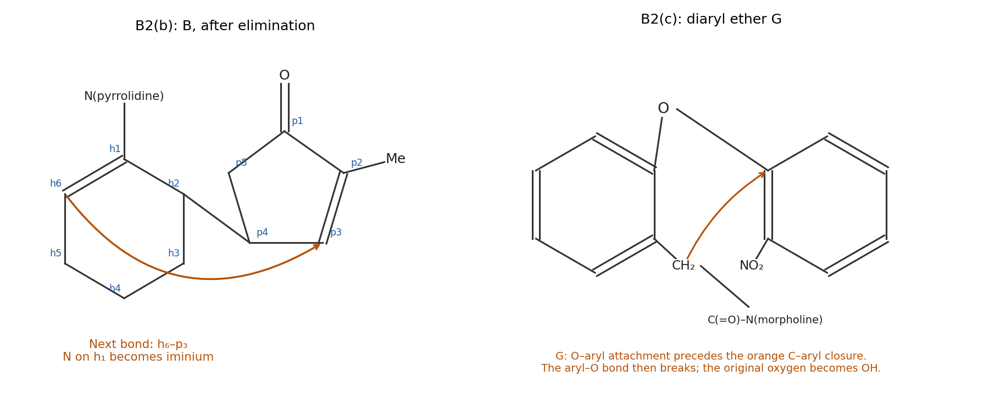

<h1 id="b2/b/ii/solution">Solution</h1>

↑ **Parent:** [Ii](../ii.md)

Number the cyclopentanone ring $p_1$ at its [carbonyl](../../../../../../carbonyl-group.md), then $p_2$ at the methyl-bearing [carbon](../../../../../../carbon.md), $p_3$ at the [mesylate](../../../../../../mesylate.md)-bearing [carbon](../../../../../../carbon.md), $p_4$ at the [carbon](../../../../../../carbon.md) joined to [cyclohexane](../../../../../../cyclohexane.md) $h_2$, and $p_5$ at the remaining methylene. **B has a $p_2{=}p_3$ [enone](../../../../../../enone.md) and the $h_1{=}h_6$ [enamine](../../../../../../enamine.md).** [triethylamine](../../../../../../triethylamine.md) removes the [hydrogen](../../../../../../hydrogen.md) at $p_2$ while the $p_3$–O bond breaks to release [mesylate](../../../../../../mesylate.md). An [E2 elimination](../../../../../../e2-elimination.md), with approximately [antiperiplanar geometry](../../../../../../antiperiplanar-geometry.md) in the puckered ring, gives the conjugated cyclopentenone. Elimination towards $p_4$ instead would give a nonconjugated [alkene](../../../../../../alkene.md).

The [enamine](../../../../../../enamine.md) [carbon](../../../../../../carbon.md) $h_6$ now attacks [enone](../../../../../../enone.md) beta [carbon](../../../../../../carbon.md) $p_3$ intramolecularly. [nitrogen](../../../../../../nitrogen.md) donates into $h_1$ to give the [iminium ion](../../../../../../iminium.md), while the [enone](../../../../../../enone.md) [electrons](../../../../../../electron.md) move onto the [ketone](../../../../../../ketone.md) [oxygen](../../../../../../oxygen.md). [protonation](../../../../../../protonation.md) of the [ketone](../../../../../../ketone.md) [enolate](../../../../../../enolate.md) gives C. **The second new bond is $h_6{-}p_3$; the first was $h_2{-}p_4$.** These two connections account for the bridged skeleton without a concerted [cycloaddition](../../../../../../cycloaddition.md) or an aldol step. The formula of B is $\mathrm{C_{16}H_{23}NO}$: relative to A, elimination removes $\mathrm{CH_4O_3S}$ overall, namely methanesulfonic [acid](../../../../../../acid-chemistry.md) after [proton transfers](../../../../../../proton-transfer.md).

**[Figure 2](#b2/b/ii/image-original-atom-numbered-reconstruction-of-intermediate-b-and-the-diaryl-ether-g-coloured-bonds-identify-the-subsequent-cyclization-and-aryl-migration). Original atom-numbered reconstruction of intermediate B and the diaryl ether G; coloured bonds identify the subsequent cyclization and aryl migration**.

## ↑ Ancestors (14)

1. [Ii](../ii.md)
2. [B](../../b.md)
3. [B2](../../../b2.md)
4. [Paper 1](../../../../paper-1-split.md)
5. [2023](../../../../split.md)
6. [Past exam of the chemistry B course of the University of Cambridge](../../../../../split.md)
7. [Chemistry B course of the University of Cambridge](../../../../../../chemistry-b-course-of-the-university-of-cambridge.md)
8. [Year 2 of the natural sciences course of the University of Cambridge](../../../../../../year-2-of-the-natural-sciences-course-of-the-university-of-cambridge.md)
9. [Year of the natural sciences course of the University of Cambridge](../../../../../../year-of-the-natural-sciences-course-of-the-university-of-cambridge.md)
10. [Natural sciences course of the University of Cambridge](../../../../../../natural-sciences-course-of-the-university-of-cambridge.md)
11. [Course of the University of Cambridge](../../../../../../course-of-the-university-of-cambridge.md)
12. [University of Cambridge](../../../../../../university-of-cambridge-split.md)
13. [List of universities](../../../../../../list-of-universities.md)
14. [Codex Wiki](../../../../../../split.md)
