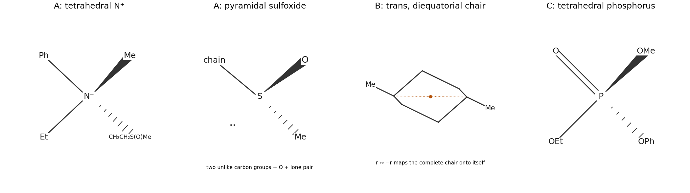

<h1 id="b3/a/i/solution">Solution</h1>

↑ **Parent:** [I](../i.md)

**A and C are [chiral](../../../../../../chirality-chemistry.md); B is [achiral](../../../../../../achirality.md).** In A, a [quaternary ammonium stereocenter](../../../../../../quaternary-ammonium-stereocenter.md) occurs because [nitrogen](../../../../../../nitrogen.md) has four different [substituents](../../../../../../substituent.md): phenyl, methyl, ethyl, and the sulfinylethyl chain. It has no [nitrogen](../../../../../../nitrogen.md) [lone pair](../../../../../../lone-pair.md) available for ordinary [pyramidal inversion](../../../../../../pyramidal-inversion.md) of an [amine](../../../../../../amine.md). The [sulfoxide](../../../../../../sulfoxide.md) [sulfur](../../../../../../sulfur.md) is also stereogenic: its pyramidal arrangement distinguishes [oxygen](../../../../../../oxygen.md), methyl, the [nitrogen](../../../../../../nitrogen.md)-containing chain, and the lone-pair direction. There are two independent [stereocenters](../../../../../../stereocenter.md) and no internal symmetry, giving four configurations in two pairs of [enantiomers](../../../../../../enantiomer.md). This is [chirality](../../../../../../chirality-chemistry.md) of the [cation](../../../../../../cation.md); a [bromide](../../../../../../bromide.md) [counterion](../../../../../../counterion.md) does not remove it.

B can adopt a trans-1,4-dimethylcyclohexane chair with both methyl groups equatorial. An [inversion centre](../../../../../../inversion-centre.md) at the chair centre exchanges its opposite [carbon](../../../../../../carbon.md) atoms and methyl groups. Its mirror image is therefore superposable: trans [substituents](../../../../../../substituent.md) in a flat ring drawing do not by themselves prove [chirality](../../../../../../chirality-chemistry.md). [ring inversion](../../../../../../ring-inversion.md) gives the less favourable diaxial conformer without changing the [trans configuration](../../../../../../trans-configuration.md).

In C, tetrahedral [phosphorus](../../../../../../phosphorus.md) has four different [substituent](../../../../../../substituent.md) directions: oxo, methoxy, ethoxy, and phenoxy. **C has a [phosphorus stereocenter](../../../../../../phosphorus-stereocenter.md).** Delocalization in the P–O bonds does not make these four ligand environments identical. A tetrahedral drawing and its mirror cannot be superposed without exchanging two ligands.

**[Figure 3](#b3/a/i/image-original-three-dimensional-models-of-the-two-stereocenters-in-a-the-inversion-symmetry-of-trans-1-4-dimethylcyclohexane-and-tetrahedral-phosphorus-in-c). Original three-dimensional models of the two stereocenters in A, the inversion symmetry of trans-1,4-dimethylcyclohexane, and tetrahedral phosphorus in C**.

## ↑ Ancestors (14)

1. [I](../i.md)
2. [A](../../a.md)
3. [B3](../../../b3.md)
4. [Paper 1](../../../../paper-1-split.md)
5. [2023](../../../../split.md)
6. [Past exam of the chemistry B course of the University of Cambridge](../../../../../split.md)
7. [Chemistry B course of the University of Cambridge](../../../../../../chemistry-b-course-of-the-university-of-cambridge.md)
8. [Year 2 of the natural sciences course of the University of Cambridge](../../../../../../year-2-of-the-natural-sciences-course-of-the-university-of-cambridge.md)
9. [Year of the natural sciences course of the University of Cambridge](../../../../../../year-of-the-natural-sciences-course-of-the-university-of-cambridge.md)
10. [Natural sciences course of the University of Cambridge](../../../../../../natural-sciences-course-of-the-university-of-cambridge.md)
11. [Course of the University of Cambridge](../../../../../../course-of-the-university-of-cambridge.md)
12. [University of Cambridge](../../../../../../university-of-cambridge-split.md)
13. [List of universities](../../../../../../list-of-universities.md)
14. [Codex Wiki](../../../../../../split.md)
