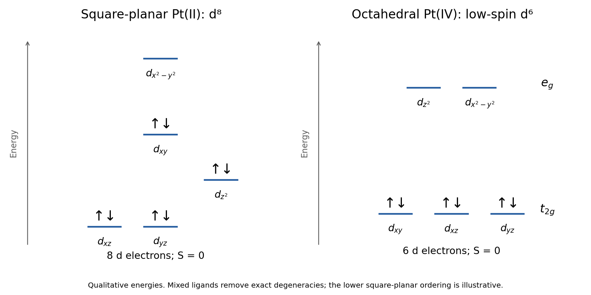

# Paper 2

↑ **Parent:** [2023](../2023.md)

[Original paper, released PDF pages 128–135](https://www.whatdotheyknow.com/request/request_for_nst_past_papers/response/3572306/attach/4/FOI%202026%20862%20Stack%20materials.pdf?cookie_passthrough=1#page=128)

**Table of contents**

- [B6](#b6)
  - [a](#b6/a)
    - [i](#b6/a/i)
      - [Solution](#b6/a/i/solution)
    - [ii](#b6/a/ii)
      - [Solution](#b6/a/ii/solution)
    - [iii](#b6/a/iii)
      - [Solution](#b6/a/iii/solution)
    - [iv](#b6/a/iv)
      - [Solution](#b6/a/iv/solution)
  - [b](#b6/b)
    - [i](#b6/b/i)
      - [Solution](#b6/b/i/solution)
    - [ii](#b6/b/ii)
      - [Solution](#b6/b/ii/solution)
  - [c](#b6/c)
    - [Solution](#b6/c/solution)
  - [d](#b6/d)
    - [Solution](#b6/d/solution)
- [B7](#b7)
  - [a](#b7/a)
    - [Solution](#b7/a/solution)
  - [b](#b7/b)
    - [i](#b7/b/i)
      - [Solution](#b7/b/i/solution)
    - [ii](#b7/b/ii)
      - [Solution](#b7/b/ii/solution)
  - [c](#b7/c)
    - [i](#b7/c/i)
      - [Solution](#b7/c/i/solution)
    - [ii](#b7/c/ii)
      - [Solution](#b7/c/ii/solution)
    - [iii](#b7/c/iii)
      - [Solution](#b7/c/iii/solution)
- [B8](#b8)
  - [a](#b8/a)
    - [i](#b8/a/i)
      - [Solution](#b8/a/i/solution)
    - [ii](#b8/a/ii)
      - [Solution](#b8/a/ii/solution)
  - [b](#b8/b)
    - [i](#b8/b/i)
      - [Solution](#b8/b/i/solution)
    - [ii](#b8/b/ii)
      - [Solution](#b8/b/ii/solution)
  - [c](#b8/c)
    - [i](#b8/c/i)
      - [Solution](#b8/c/i/solution)
    - [ii](#b8/c/ii)
      - [Solution](#b8/c/ii/solution)
- [B9](#b9)
  - [a](#b9/a)
    - [i](#b9/a/i)
      - [Solution](#b9/a/i/solution)
    - [ii](#b9/a/ii)
      - [Solution](#b9/a/ii/solution)
    - [iii](#b9/a/iii)
      - [Solution](#b9/a/iii/solution)
    - [iv](#b9/a/iv)
      - [Solution](#b9/a/iv/solution)
  - [b](#b9/b)
    - [i](#b9/b/i)
      - [Solution](#b9/b/i/solution)
    - [ii](#b9/b/ii)
      - [Solution](#b9/b/ii/solution)
    - [iii](#b9/b/iii)
      - [Solution](#b9/b/iii/solution)
  - [c](#b9/c)
    - [Solution](#b9/c/solution)
  - [d](#b9/d)
    - [Solution](#b9/d/solution)
- [B10](#b10)
  - [a](#b10/a)
    - [Solution](#b10/a/solution)
  - [b](#b10/b)
    - [i](#b10/b/i)
      - [Solution](#b10/b/i/solution)
    - [ii](#b10/b/ii)
      - [Solution](#b10/b/ii/solution)
    - [iii](#b10/b/iii)
      - [Solution](#b10/b/iii/solution)
    - [iv](#b10/b/iv)
      - [Solution](#b10/b/iv/solution)
    - [v](#b10/b/v)
      - [Solution](#b10/b/v/solution)

## B6

↑ **Parent:** [Paper 2](paper-2.md)

<h3 id="b6/a">a</h3>

↑ **Parent:** [B6](#b6)

<h4 id="b6/a/i">i</h4>

↑ **Parent:** [A](#b6/a)

<h5 id="b6/a/i/solution">Solution</h5>

↑ **Parent:** [I](#b6/a/i)

[ammonia](../../chemical-substance.md#ammonia) and [cyclohexylamine](../../chemical-substance.md#cyclohexylamine) are neutral donors, whereas each coordinated [chloride](../../chemistry.md#chloride) and [acetate](../../chemical-substance.md#acetate) has charge $-1$. Charge balance therefore gives **Pt(II) in [cisplatin](../../chemistry.md#cisplatin) and Pt(IV) in [satraplatin](../../chemistry.md#satraplatin)**:

$$
x_{\rm cisplatin}-2=0,\qquad x_{\rm satraplatin}-2-2=0.
$$

The two [acetate](../../chemical-substance.md#acetate) groups count once each; their carbonyl and alkoxy [oxygen](../../chemical-substance.md#oxygen) atoms do not make each ligand doubly charged.

<h4 id="b6/a/ii">ii</h4>

↑ **Parent:** [A](#b6/a)

<h5 id="b6/a/ii/solution">Solution</h5>

↑ **Parent:** [Ii](#b6/a/ii)

[cisplatin](../../chemistry.md#cisplatin) has [square planar molecular geometry](../../molecule.md#square-planar-molecular-geometry) and a $5d^8$ [metal](../../chemical-substance.md#metal) centre. Choose $x$ and $y$ along the four Pt–donor directions. The strongly antibonding $d_{x^2-y^2}$ orbital is highest and remains empty; the other four [d orbitals](../../chemistry.md#d-orbital) are doubly occupied. The [square-planar splitting](../../chemistry.md#square-planar-splitting) is represented by the conventional qualitative order

$$
(d_{xz},d_{yz})^4\,(d_{z^2})^2\,(d_{xy})^2\,(d_{x^2-y^2})^0.
$$

The ordering among the lower occupied levels can depend on the ligand set, and the cis arrangement removes exact fourfold symmetry. The robust result is the filled lower four levels and empty highest level.

[satraplatin](../../chemistry.md#satraplatin) has approximately [octahedral molecular geometry](../../molecule.md#octahedral-molecular-geometry) around Pt(IV), $5d^6$. Its large [octahedral splitting](../../chemistry.md#octahedral-splitting) favours a [low-spin complex](../../chemistry.md#low-spin-complex):

$$
\boxed{t_{2g}^6e_g^0.}
$$

All three $t_{2g}$ orbitals are paired. Mixed ligands remove exact degeneracies, but do not change this qualitative occupancy.

**[Figure 1](#b6/a/ii/image-filled-and-empty-d-orbitals-for-the-square-planar-d8-and-octahedral-low-spin-d6-platinum-centres). Filled and empty d orbitals for the square-planar d8 and octahedral low-spin d6 platinum centres**.

<h4 id="b6/a/iii">iii</h4>

↑ **Parent:** [A](#b6/a)

<h5 id="b6/a/iii/solution">Solution</h5>

↑ **Parent:** [Iii](#b6/a/iii)

[platinum](../../chemical-substance.md#platinum) is in group 10, so subtracting its [oxidation state](../../chemical-reaction.md#oxidation-state) gives **$d^8$ for Pt(II) and $d^6$ for Pt(IV)**. Adding two [electrons](../../physics.md#electron) from each coordinated donor gives the local valence [electron counting](../../chemistry.md#electron-counting) results

$$
\boxed{\begin{aligned}
\mathrm{cisplatin}:&\quad8+2(2)_{\rm NH_3}+2(2)_{\rm Cl}=16,\\
\mathrm{satraplatin}:&\quad6+2(2)_{\rm amine}+2(2)_{\rm Cl}+2(2)_{\rm OAc}=18.
\end{aligned}}
$$

Each [acetate](../../chemical-substance.md#acetate) in the depicted structure is monodentate, binding through one [oxygen](../../chemical-substance.md#oxygen). The 16-electron count of the square-planar complex is normal for a low-spin late-metal $d^8$ centre; it is not a missing ligand inferred from the [18-electron rule](../../chemistry.md#18-electron-rule).

<h4 id="b6/a/iv">iv</h4>

↑ **Parent:** [A](#b6/a)

<h5 id="b6/a/iv/solution">Solution</h5>

↑ **Parent:** [Iv](#b6/a/iv)

Both complexes have all their $d$ [electrons](../../physics.md#electron) paired, so $S=0$. Their [spin-only magnetic moment](../../electromagnetism.md#spin-only-magnetic-moment) is therefore

$$
\boxed{\mu_{\rm eff}=2\sqrt{S(S+1)}\,\mu_{\rm B}=0\ \mathrm{B.M.}\quad\text{for both complexes}.}
$$

They exhibit [diamagnetism](../../electromagnetism.md#diamagnetism). The formula describes the spin contribution; it does not say that a closed-shell sample has no diamagnetic response to an applied field.

<h3 id="b6/b">b</h3>

↑ **Parent:** [B6](#b6)

<h4 id="b6/b/i">i</h4>

↑ **Parent:** [B](#b6/b)

<h5 id="b6/b/i/solution">Solution</h5>

↑ **Parent:** [I](#b6/b/i)

**[ammonia](../../chemical-substance.md#ammonia) and [cyclohexylamine](../../chemical-substance.md#cyclohexylamine) are [sigma-donor ligands](../../chemistry.md#sigma-donor-ligand); [chloride](../../chemistry.md#chloride) and [acetate](../../chemical-substance.md#acetate) are sigma- and [pi-donor ligands](../../chemistry.md#pi-donor-ligand).** The [nitrogen](../../chemical-substance.md#nitrogen) [lone pair](../../covalent-bond.md#lone-pair) of each [amine](../../chemical-substance.md#amine) points toward the [metal](../../chemical-substance.md#metal) and forms the donor interaction. These saturated [amines](../../chemical-substance.md#amine) have no low-lying conjugated acceptor system that would make them conventional [pi-acceptor ligands](../../chemistry.md#pi-acceptor-ligand).

[chloride](../../chemistry.md#chloride) uses a [lone pair](../../covalent-bond.md#lone-pair) for [sigma donation](../../covalent-bond.md#sigma-donation) and has additional occupied $p$ orbitals perpendicular to the bond that can donate with pi symmetry. An oxygen-bound [acetate](../../chemical-substance.md#acetate) similarly has occupied oxygen-centred orbitals available for sigma and [pi donation](../../covalent-bond.md#pi-donation), although its carboxylate [resonance in chemistry](../../chemical-bond.md#resonance-in-chemistry) changes their energies and distribution. Neither should be classified as a pi acceptor merely because its bonding can be drawn with multiple bonds or [resonance in chemistry](../../chemical-bond.md#resonance-in-chemistry) contributors. **None of these four is a standard sigma-donor/[pi-acceptor ligand](../../chemistry.md#pi-acceptor-ligand).**

<h4 id="b6/b/ii">ii</h4>

↑ **Parent:** [B](#b6/b)

<h5 id="b6/b/ii/solution">Solution</h5>

↑ **Parent:** [Ii](#b6/b/ii)

**[cyclohexylamine](../../chemical-substance.md#cyclohexylamine) is expected highest in the [spectrochemical series](../../chemistry.md#spectrochemical-series) for comparable [metal](../../chemical-substance.md#metal) environments.** Its alkyl substituent increases the electron-donating ability of [nitrogen](../../chemical-substance.md#nitrogen) relative to [ammonia](../../chemical-substance.md#ammonia), strengthening the sigma interaction and raising the [metal](../../chemical-substance.md#metal)–ligand sigma-antibonding levels. The anionic pi donors tend to raise occupied [metal](../../chemical-substance.md#metal) $d_\pi$ levels and give smaller splittings. Steric effects and the [metal](../../chemical-substance.md#metal) can modify the exact ordering, so the comparison is a [ligand field](../../chemistry.md#ligand-field) trend rather than a universal basicity-to-splitting identity.

<h3 id="b6/c">c</h3>

↑ **Parent:** [B6](#b6)

<h4 id="b6/c/solution">Solution</h4>

↑ **Parent:** [C](#b6/c)

The average Pt [oxidation state](../../chemical-reaction.md#oxidation-state) is $+3$, since six [bromides](../../chemistry.md#bromide) balance the two [metal](../../chemical-substance.md#metal) atoms. A natural [mixed valence](../../chemistry.md#mixed-valence) assignment is **alternating Pt(II), $d^8$, and Pt(IV), $d^6$**, rather than two equivalent Pt(III) sites. Use neutral square-planar $\mathrm{Pt^{II}(NH_3)_2Br_2}$ units and octahedral $\mathrm{Pt^{IV}(NH_3)_2Br_4}$ units. At every site place two [ammonia](../../chemical-substance.md#ammonia) and two [bromide](../../chemistry.md#bromide) ligands in an equatorial plane; the Pt(IV) sites have two additional axial [bromides](../../chemistry.md#bromide) pointing toward the adjacent Pt(II) sites.

Along the chain the connectivity is

$$
\cdots\mathrm{Pt^{II}\ \cdots Br{-}Pt^{IV}{-}Br\cdots\ Pt^{II}\ \cdots Br{-}Pt^{IV}{-}Br}\cdots.
$$

Every Pt–Br–Pt bridge is **asymmetric: short to Pt(IV), long to Pt(II)**. The latter contact is a secondary axial interaction, consistent with the preference of Pt(II) for a square-planar primary [coordination sphere](../../chemistry.md#coordination-sphere). The Pt(IV) site is smaller and more strongly attracts the bridging [bromides](../../chemistry.md#bromide). A drawing with all axial distances identical would obscure the distinct local environments.

There are four equatorial [bromides](../../chemistry.md#bromide) and two axial bridging [bromides](../../chemistry.md#bromide) per two-Pt repeat, giving precisely $\mathrm{Pt_2(NH_3)_4Br_6}$. A direct Pt–Pt bond is not required. This is a proposed structure consistent with the stated composition and two environments; the formula alone does not determine every equatorial cis/trans arrangement or numerical bond length.

**[Figure 2](#b6/c/image-proposed-asymmetric-platinum-chain-and-octahedral-hydration-isomer-connectivities-for-nickel). Proposed asymmetric platinum chain and octahedral hydration-isomer connectivities for nickel**.

<h3 id="b6/d">d</h3>

↑ **Parent:** [B6](#b6)

<h4 id="b6/d/solution">Solution</h4>

↑ **Parent:** [D](#b6/d)

The more radially extended Pt $5d$ orbitals give strong [metal](../../chemical-substance.md#metal)–ligand overlap and covalent bonding. This helps compensate the energetic cost of reaching Pt(IV), and the large octahedral [ligand field](../../chemistry.md#ligand-field) splitting strongly stabilizes its low-spin $d^6$ configuration, with a [crystal field stabilization energy](../../chemistry.md#crystal-field-stabilization-energy) contribution $-2.4\Delta_o$ before separately counting pairing and the full bond energies. Ni $3d$ bonding is less effective in this respect; Pd $4d$ compounds also generally favour the very stable $d^8$ M(II) arrangement more strongly than Pt does. **The stronger bonding and large ligand-field stabilization available to Pt(IV) make oxidation to $+4$ more favourable relative to its congeners.** This is a comparative trend, not a claim that Ni(IV) or Pd(IV) complexes cannot exist.

## B7

↑ **Parent:** [Paper 2](paper-2.md)

<h3 id="b7/a">a</h3>

↑ **Parent:** [B7](#b7)

<h4 id="b7/a/solution">Solution</h4>

↑ **Parent:** [A](#b7/a)

For the usual **octahedral Ni(II) hydration-isomer series**, distinguish coordinated [water](../../chemical-substance.md#water) from [water](../../chemical-substance.md#water) of crystallization:

$$
\boxed{\begin{aligned}
&[\mathrm{Ni(H_2O)_6}]\mathrm{Cl_2},\\
&[\mathrm{NiCl(H_2O)_5}]\mathrm{Cl}\cdot\mathrm{H_2O},\\
&\mathrm{cis}\! -[\mathrm{NiCl_2(H_2O)_4}]\cdot2\mathrm{H_2O},\\
&\mathrm{trans}\! -[\mathrm{NiCl_2(H_2O)_4}]\cdot2\mathrm{H_2O}.
\end{aligned}}
$$

The first two [coordination spheres](../../chemistry.md#coordination-sphere) have no cis/trans choice because they contain zero or one [chloride](../../chemistry.md#chloride). The last hydration class has two [geometrical isomers](../../stereochemistry.md#geometrical-isomer): the [chlorides](../../chemistry.md#chloride) occupy adjacent or opposite octahedral positions. Thus there are **three hydration classes and four structures when cis/trans isomerism is included**. Every formula retains two [chlorides](../../chemistry.md#chloride) and six [waters](../../chemical-substance.md#water) overall; the [coordination number](../../ionic-bonding.md#coordination-number) remains six. The schematic in B6(c) displays the distinct octahedral connectivities. This enumeration states the usual six-coordinate interpretation, rather than treating unspecified changes in [coordination number](../../ionic-bonding.md#coordination-number) as further members of the same elementary series.

<h3 id="b7/b">b</h3>

↑ **Parent:** [B7](#b7)

<h4 id="b7/b/i">i</h4>

↑ **Parent:** [B](#b7/b)

<h5 id="b7/b/i/solution">Solution</h5>

↑ **Parent:** [I](#b7/b/i)

The neutral product is **cis-$[\mathrm{NiCl_2(dppe)}]$**, and the displaced material is **six [waters](../../chemical-substance.md#water) per [nickel](../../chemical-substance.md#nickel)**:

$$
\mathrm{NiCl_2\cdot6H_2O+dppe\longrightarrow[NiCl_2(dppe)]+6H_2O}.
$$

The two [phosphorus](../../chemical-substance.md#phosphorus) donors of [dppe](../../chemistry.md#1-2-bis-diphenylphosphino-ethane) chelate the same [metal](../../chemical-substance.md#metal), forcing adjacent donor positions. The [diamagnetism](../../electromagnetism.md#diamagnetism) identifies a square-planar, paired $d^8$ Ni(II) centre rather than a tetrahedral high-spin $d^8$ centre. Its valence count is $8+4_{\rm P,P}+4_{\rm Cl,Cl}=16$ [electrons](../../physics.md#electron). The reaction is [ligand substitution](../../chemistry.md#ligand-substitution), not reduction of Ni(II).

<h4 id="b7/b/ii">ii</h4>

↑ **Parent:** [B](#b7/b)

<h5 id="b7/b/ii/solution">Solution</h5>

↑ **Parent:** [Ii](#b7/b/ii)

The relevant chelate rings contain **four atoms for [dppm](../../chemistry.md#bis-diphenylphosphino-methane), five for [dppe](../../chemistry.md#1-2-bis-diphenylphosphino-ethane), and six for [dppp](../../chemistry.md#1-3-bis-diphenylphosphino-propane)**, counting the [nickel](../../chemical-substance.md#nickel) and both [phosphorus](../../chemical-substance.md#phosphorus) atoms. The one-carbon bridge in [dppm](../../chemistry.md#bis-diphenylphosphino-methane) forces a compact ring and the small [bite angle](../../chemistry.md#bite-angle) $75.62^\circ$. A two-carbon tether accommodates a five-membered chelate closer to the preferred square-planar cis angle, giving $86.99^\circ$. The more flexible three-carbon tether can open slightly beyond $90^\circ$, giving $91.77^\circ$.

For a simplified symmetric chelate with Ni–P distance $r$ and P–P donor separation $d$,

$$
d=2r\sin(\beta/2).
$$

Increasing the accessible donor separation therefore increases the [bite angle](../../chemistry.md#bite-angle) $\beta$. The ligand is a three-dimensional tether, so ring puckering and substituent crowding matter as well as the number of methylene groups. This geometrical explanation does not require different formal [oxidation states](../../chemical-reaction.md#oxidation-state) or [electron](../../physics.md#electron) counts for the three complexes.

<h3 id="b7/c">c</h3>

↑ **Parent:** [B7](#b7)

<h4 id="b7/c/i">i</h4>

↑ **Parent:** [C](#b7/c)

<h5 id="b7/c/i/solution">Solution</h5>

↑ **Parent:** [I](#b7/c/i)

**[zinc](../../chemical-substance.md#zinc) reduction is required in A, C and F.** Reading the drawn ligands with consistent ionic bookkeeping gives

$$
\boxed{\begin{array}{c|c|c}
\text{step}&\text{nickel change}&\text{electrons accepted per Ni}\\\hline
\mathrm A&\mathrm{Ni^{II}\to Ni^0}&2\\
\mathrm C&\mathrm{Ni^{II}\to Ni^I}&1\\
\mathrm F&\mathrm{Ni^I\to Ni^0}&1
\end{array}}
$$

In A the two [chlorides](../../chemistry.md#chloride) of the precursor are removed and neutral [solvent](../../mixture.md#solvent) donors occupy the reduced centre. In C the [bromide](../../chemistry.md#bromide) is removed while the [aryl ligand](../../chemistry.md#aryl-ligand) remains and the neutral [alkyne](../../chemical-substance.md#alkyne) coordinates; the drawn neutral intermediate has Ni(I). In F an anionic alkoxide-derived product is released and the neutral solvated Ni(0) complex is regenerated. [zinc](../../chemical-substance.md#zinc) supplies [electrons](../../physics.md#electron) by oxidation to Zn(II); halide and [alkoxide](../../mathematical-biology.md#alkoxide) ions can be taken up in zinc-containing products.

A is [precatalyst](../../chemical-kinetics.md#precatalyst) activation. The two one-electron reductions C and F together require two [electrons](../../physics.md#electron) per catalytic turnover, corresponding to one Zn atom if its oxidation ends at $+2$. The diagram does not establish whether each formal reduction is a single elementary electron-transfer event or a sequence of surface reactions and ligand transfers.

<h4 id="b7/c/ii">ii</h4>

↑ **Parent:** [C](#b7/c)

<h5 id="b7/c/ii/solution">Solution</h5>

↑ **Parent:** [Ii](#b7/c/ii)

**B is [oxidative addition](../../chemical-reaction.md#oxidative-addition); D is [alkyne](../../chemical-substance.md#alkyne) insertion into Ni–aryl followed by carbonyl-oxygen coordination; E is carbonyl insertion into Ni–alkenyl.** The distinction is visible from the bonds made and from consistent [electron counting](../../chemistry.md#electron-counting).

For B the depicted Ni(0) starting complex has two phosphine and two MeCN donors, giving $10+4+4=18$ [electrons](../../physics.md#electron). Addition across the aryl C–Br bond produces two X-type ligands and Ni(II). The drawn product has lost the two [solvent](../../mixture.md#solvent) donors, giving $8+4+2+2=16$ [electrons](../../physics.md#electron). Intrinsic [oxidative addition](../../chemical-reaction.md#oxidative-addition) to the unsolvated 14-electron $\mathrm{Ni^0(dppe)}$ fragment raises its count to 16; the overall drawn $18\to16$ change also includes loss of four solvent-donor [electrons](../../physics.md#electron). **A falling displayed count does not turn this [oxidative addition](../../chemical-reaction.md#oxidative-addition) into a [reductive elimination](../../chemical-reaction.md#reductive-elimination).**

Before D, the aryl–[alkyne](../../chemical-substance.md#alkyne) intermediate is Ni(I), $d^9$, with $9+4_{\rm P,P}+2_{\rm aryl}+2_{\rm alkyne}=17$ [electrons](../../physics.md#electron). Syn migration couples aryl [carbon](../../chemical-substance.md#carbon) to one [alkyne](../../chemical-substance.md#alkyne) [carbon](../../chemical-substance.md#carbon) and leaves a Ni–alkenyl bond. Insertion alone removes the separate two-electron [alkyne](../../chemical-substance.md#alkyne) donor and would give a 15-electron alkenyl fragment. The ester carbonyl [oxygen](../../chemical-substance.md#oxygen) then binds, as drawn, restoring the count to $9+4+2_{\rm alkenyl}+2_{\rm O}=17$. Ni remains $+1$.

In E the Ni-bound alkenyl [carbon](../../chemical-substance.md#carbon) attacks the coordinated ester carbonyl [carbon](../../chemical-substance.md#carbon), forming the new ring-closing C–C bond. The C=O pi [electrons](../../physics.md#electron) move to [oxygen](../../chemical-substance.md#oxygen), and an Ni–O [alkoxide](../../mathematical-biology.md#alkoxide) bond replaces Ni–C. This is carbonyl [migratory insertion](../../chemical-reaction.md#migratory-insertion), equivalently intramolecular addition to a coordinated carbonyl. A neutral O donor plus an alkenyl X ligand become one [alkoxide](../../mathematical-biology.md#alkoxide) X ligand, so the drawn count falls **$17\to15$**, while Ni remains **$+1$**. A solvating molecule could fill the resulting vacancy, but it is not shown and should not be silently added to the stated count.

<h4 id="b7/c/iii">iii</h4>

↑ **Parent:** [C](#b7/c)

<h5 id="b7/c/iii/solution">Solution</h5>

↑ **Parent:** [Iii](#b7/c/iii)

**The favoured insertion leaves [nickel](../../chemical-substance.md#nickel) attached to the methyl-substituted [alkyne](../../chemical-substance.md#alkyne) [carbon](../../chemical-substance.md#carbon); the aryl group bonds to the SiMe$_3$-substituted [carbon](../../chemical-substance.md#carbon).** This is the connectivity leading to the illustrated ring-closed product: the [carbon](../../chemical-substance.md#carbon) carrying methyl subsequently attacks the ester carbonyl.

The bulky trimethylsilyl substituent is kept away from the crowded phosphine-ligated [nickel](../../chemical-substance.md#nickel) centre in the insertion arrangement. The alternative orientation would place Ni next to the more demanding SiMe$_3$ end. [regioselectivity](../../chemical-reaction.md#regioselectivity) can also reflect electronic polarization of a silyl-substituted [alkyne](../../chemical-substance.md#alkyne) and stabilization of the resulting alkenyl complex. The ortho ester helps capture the insertion product by [oxygen](../../chemical-substance.md#oxygen) coordination and subsequent ring closure. **Steric discrimination at insertion, reinforced by the accessible intramolecular cyclization, accounts for the observed direction**; the product drawing alone is not a quantitative separation of steric and electronic contributions.

## B8

↑ **Parent:** [Paper 2](paper-2.md)

<h3 id="b8/a">a</h3>

↑ **Parent:** [B8](#b8)

<h4 id="b8/a/i">i</h4>

↑ **Parent:** [A](#b8/a)

<h5 id="b8/a/i/solution">Solution</h5>

↑ **Parent:** [I](#b8/a/i)

The [Dewar-Chatt-Duncanson model](../../chemistry.md#dewar-chatt-duncanson-model) has two complementary interactions. **The filled [alkene](../../chemical-substance.md#alkene) $\pi$ orbital donates to an empty [metal](../../chemical-substance.md#metal) orbital, and an occupied [metal](../../chemical-substance.md#metal) $d_\pi$ orbital back-donates into the empty [alkene](../../chemical-substance.md#alkene) $\pi^*$ orbital.** The [metal](../../chemical-substance.md#metal) acceptor has the symmetry of the sum of the two ligand lobes facing it; the back-donor has opposite phases at the two [carbon](../../chemical-substance.md#carbon) positions and matches the antisymmetric $\pi^*$ combination.

$$
\pi(\mathrm{C=C})\longrightarrow\mathrm M,\qquad
\mathrm M(d_\pi)\longrightarrow\pi^*(\mathrm{C=C}).
$$

Both channels strengthen [metal](../../chemical-substance.md#metal)–[alkene](../../chemical-substance.md#alkene) attachment. Donation removes some [electron density](../../chemistry.md#electron-density) from the internal bonding orbital, while back-donation populates its antibonding partner, so coordination generally reduces C–C bond order. The schematic shows orbital phase signs, not positive and negative electric charges.

**[Figure 3](#b8/a/i/image-symmetry-matched-alkene-donation-and-backbonding-and-the-in-plane-bonding-channel-of-a-coordinated-aryne). Symmetry-matched alkene donation and backbonding, and the in-plane bonding channel of a coordinated aryne**.

<h4 id="b8/a/ii">ii</h4>

↑ **Parent:** [A](#b8/a)

<h5 id="b8/a/ii/solution">Solution</h5>

↑ **Parent:** [Ii](#b8/a/ii)

The [chloride](../../chemistry.md#chloride) complex has Pt(II), $d^8$, whereas the neutral bis(phosphine) complex has Pt(0), $d^{10}$ in the neutral-ethene assignment. **The lower-valent, phosphine-supported Pt(0) centre back-donates more strongly into [ethene](../../polymer.md#ethylene) $\pi^*$**, weakening and lengthening its internal C–C bond. This accounts for the longer $1.430\,\text{Å}$ distance compared with $1.375\,\text{Å}$ in the Pt(II) complex.

Both are formally 16-electron complexes: $8+3(2)+2=16$ for the [chloride](../../chemistry.md#chloride) species and $10+2(2)+2=16$ for the phosphine species. Thus the difference is not simply a difference in total valence count. It reflects the energies and occupations of the [metal](../../chemical-substance.md#metal)–ligand [molecular orbitals](../../chemistry.md#molecular-orbital). The increased reduction of the [ethene](../../polymer.md#ethylene) ligand gives the Pt(0) complex more [metallacyclopropane](../../chemical-substance.md#metallacyclopropane) character; the two descriptions are bonding limits, not distinct products inferred from the distances alone.

<h3 id="b8/b">b</h3>

↑ **Parent:** [B8](#b8)

<h4 id="b8/b/i">i</h4>

↑ **Parent:** [B](#b8/b)

<h5 id="b8/b/i/solution">Solution</h5>

↑ **Parent:** [I](#b8/b/i)

The [metal](../../chemical-substance.md#metal) interacts with the **extra in-plane bonding system of [benzyne](../../chemical-substance.md#benzyne)**, not by replacing the ordinary out-of-plane aromatic pi system. Take the ring and [metal](../../chemical-substance.md#metal) to lie in the $xz$ plane, with the metal-to-C–C-midpoint direction along $z$ and C1–C2 along $x$. The [carbon](../../chemical-substance.md#carbon) orbitals directed toward the [metal](../../chemical-substance.md#metal) form an occupied symmetric combination and an empty antisymmetric combination.

The occupied in-plane $\pi$ combination donates into an empty [metal](../../chemical-substance.md#metal) orbital of matching symmetry. An occupied [metal](../../chemical-substance.md#metal) $d_{xz}$-type [orbital overlaps](../../chemistry.md#orbital-overlap) with the in-plane $\pi^*$ combination, providing back-donation. These are the same symmetry principles as [alkene](../../chemical-substance.md#alkene) binding, rotated into the plane of the ring. The [carbon](../../chemical-substance.md#carbon) $p_y$ orbitals perpendicular to the ring continue to participate in its aromatic system. **The strained formal triple bond therefore does not supply two independent, ordinary out-of-plane [alkene](../../chemical-substance.md#alkene) interactions.**

Strong population of the in-plane acceptor can be described as reduction of the aryne to a dianionic, metallacyclopropene-like ligand. That description emphasizes two M–C [sigma bonds](../../covalent-bond.md#sigma-bond) and loss of the extra C–C [pi bond](../../covalent-bond.md#pi-bond). It is particularly useful for early-metal aryne complexes. The lower panels of the orbital schematic distinguish the interacting in-plane orbitals from the perpendicular aromatic set.

<h4 id="b8/b/ii">ii</h4>

↑ **Parent:** [B](#b8/b)

<h5 id="b8/b/ii/solution">Solution</h5>

↑ **Parent:** [Ii](#b8/b/ii)

A useful strongly bound limit is **Zr(IV), $d^0$, and Ta(V), $d^0$, with an aryne dianion in each complex**. Charge balance uses two Cp$^-$ ligands for [zirconium](../../chemical-substance.md#zirconium), and Cp\*$^-$ plus two [methyl ligands](../../chemistry.md#methyl-ligand) for [tantalum](../../chemical-substance.md#tantalum):

$$
x_{\rm Zr}-2-2=0,\qquad x_{\rm Ta}-1-2-2=0.
$$

Equivalently, an unreduced neutral-aryne description starts from Zr(II) and Ta(III), both $d^2$, and transfers that pair strongly into the aryne acceptor. These are alternative bookkeeping limits for the same covalent interaction; saying that a formal $d^0$ assignment has no available [electrons](../../physics.md#electron) must not erase the strong [metal](../../chemical-substance.md#metal)–[carbon](../../chemical-substance.md#carbon) bonds in the reduced-ligand description.

Both ligands have therefore lost much of the extra in-plane C–C bonding of free [benzyne](../../chemical-substance.md#benzyne) and approach the same reduced, approximately double-bond-length C1–C2 framework. **Their identical $1.364\,\text{Å}$ C–C distances are consistent with similar aryne reduction in both complexes.** The distance is intermediate in a delocalized ring, so it should not be converted into an exact integer bond order.

The M–C distances depend additionally on [metal](../../chemical-substance.md#metal) size, effective nuclear attraction and [orbital overlap](../../chemistry.md#orbital-overlap). The high formal charge of Ta(V), the size effects associated with the [lanthanide contraction](../../chemical-substance.md#lanthanide-contraction), and effective $5d$ covalent bonding favour shorter Ta–C contacts than Zr–C contacts. This is consistent with $2.075$ versus $2.250\,\text{Å}$. Different coordination envelopes and ancillary ligands also contribute, so this pair is not a controlled measurement of a radius or a [metal](../../chemical-substance.md#metal)–[carbon](../../chemical-substance.md#carbon) bond energy. **Similar internal ligand bond order can coexist with different [metal](../../chemical-substance.md#metal)–ligand distances.**

<h3 id="b8/c">c</h3>

↑ **Parent:** [B8](#b8)

<h4 id="b8/c/i">i</h4>

↑ **Parent:** [C](#b8/c)

<h5 id="b8/c/i/solution">Solution</h5>

↑ **Parent:** [I](#b8/c/i)

**A neutral, simple $\mu_2$-NO contributes three [electrons](../../physics.md#electron) to the two-metal unit overall.** In neutral bookkeeping it is an LX-type bridge: a two-electron donor component plus the odd [electron](../../physics.md#electron) of neutral NO. For a symmetric bridge, this can be apportioned as $1.5$ [electrons](../../physics.md#electron) to each [metal](../../chemical-substance.md#metal) in a covalent count; it is **not three [electrons](../../physics.md#electron) independently to each [metal](../../chemical-substance.md#metal)**.

An equivalent ionic description represents the bridge as NO$^-$ donating two [electrons](../../physics.md#electron) to each [metal](../../chemical-substance.md#metal), four overall. The extra negative ligand charge must then be included when assigning [metal](../../chemical-substance.md#metal) [oxidation states](../../chemical-reaction.md#oxidation-state). Mixing the four-electron ionic donation with a neutral-NO charge assignment would double-count an [electron](../../physics.md#electron).

<h4 id="b8/c/ii">ii</h4>

↑ **Parent:** [C](#b8/c)

<h5 id="b8/c/ii/solution">Solution</h5>

↑ **Parent:** [Ii](#b8/c/ii)

**The terminal nitrosyls are linear in both proposed electron-precise structures; the formal M–M bond orders are V–V double and Fe–Fe single.** Use three-electron terminal linear NO donors, three-electron $\mu_2$-NO bridges, and five-electron neutral Cp donors in covalent counting.

For the [vanadium](../../chemical-substance.md#vanadium) dimer the two [metal](../../chemical-substance.md#metal) fragments together contain

$$
N_{\rm frag}=2(5)_{\rm V}+2(5)_{\rm Cp}+2(3)_{\rm terminal\ NO}+2(3)_{\mu\rm NO}=32.
$$

A [metal](../../chemical-substance.md#metal)–[metal](../../chemical-substance.md#metal) bond of order $b$ adds $b$ to each local count, so $32+2b=36$ gives **$b=2$** and 18 [electrons](../../physics.md#electron) per V. For an ionic cross-check, Cp is $-1$, each linear terminal NO is conventionally NO$^+$, and each bridge is represented as NO$^-$. Thus

$$
2x-2+2-2=0,\qquad\boxed{x_{\rm V}=+1,\quad d^4.}
$$

Each V then has $4+6_{\rm Cp}+2_{\rm terminal\ NO}+4_{\rm two\ bridges}+2_{\rm V=V}=18$ [electrons](../../physics.md#electron).

The [iron](../../chemical-substance.md#iron) species is **monoanionic**, and $\mathrm L^-$ is a [pyrazolate](../../chemistry.md#pyrazolate) bridge binding through its two [nitrogens](../../chemical-substance.md#nitrogen). This is a four-electron donor overall in ionic counting, or three overall in neutral counting. The carbonyl bridge supplies two [electrons](../../physics.md#electron) overall. The covalent fragment total is consequently

$$
N_{\rm frag}=2(8)_{\rm Fe}+4(3)_{\rm terminal\ NO}+2_{\mu\rm CO}+3_{\mu\rm L}+1_{\rm anion}=34.
$$

Therefore $34+2b=36$ gives **$b=1$**. In the formal NO$^+$ description,

$$
2x+4-1=-1,\qquad\boxed{x_{\rm Fe}=-2,\quad d^{10}.}
$$

Each Fe receives $10+4_{\rm two\ NO}+2_{\rm pyrazolate\ N}+1_{\mu\rm CO}+1_{\rm Fe-Fe}=18$ [electrons](../../physics.md#electron). The negative formal [oxidation state](../../chemical-reaction.md#oxidation-state) follows from the chosen nitrosyl assignment and the overall charge; omitting that charge would change the count.

Bent terminal NO ligands would supply fewer neutral-count [electrons](../../physics.md#electron) and demand much higher formal M–M bond orders to attain 18-electron counts. The linear assignments give the ordinary double and single bond solutions. Since NO is a [non-innocent ligand](../../chemistry.md#non-innocent-ligand), these [oxidation states](../../chemical-reaction.md#oxidation-state) are formal bookkeeping limits, not measured [metal](../../chemical-substance.md#metal) charges; actual nitrosyl bending and M–M bond strengths require structural and spectroscopic evidence.[Coordination Chemistry Reviews 13, pp. 339–406; formal nitrosyl assignments and distinction from actual electron distribution](../../chemistry-bibliography.md#principles-of-structure-bonding-and-reactivity-for-metal-nitrosyl-complexes-by-john-h-enemark-and-richard-d-feltham)

## B9

↑ **Parent:** [Paper 2](paper-2.md)

<h3 id="b9/a">a</h3>

↑ **Parent:** [B9](#b9)

<h4 id="b9/a/i">i</h4>

↑ **Parent:** [A](#b9/a)

<h5 id="b9/a/i/solution">Solution</h5>

↑ **Parent:** [I](#b9/a/i)

**The unequal P–N distances reflect unequal local bonding interactions in the alternating-chain [conformation](../../stereochemistry.md#conformation), rather than an extended conducting P=N pi system.** [nitrogen](../../chemical-substance.md#nitrogen) is much more electronegative than [phosphorus](../../chemical-substance.md#phosphorus), so the backbone [sigma bonds](../../covalent-bond.md#sigma-bond) are strongly polar. [nitrogen](../../chemical-substance.md#nitrogen) lone-pair density can also donate into appropriately oriented antibonding P–substituent orbitals: [negative hyperconjugation](../../chemical-bond.md#negative-hyperconjugation), schematically

$$
n(\mathrm N)\longrightarrow\sigma^*(\mathrm{P{-}R}).
$$

The strengths of these interactions depend on the orientation of the donor and acceptor orbitals. In a planar cis–trans backbone, the P–N links are not all geometrically equivalent. Different overlap and charge redistribution give alternating greater and smaller effective P–N bond orders, hence shorter and longer bonds. A formal alternating P=N/P–N drawing is a useful shorthand for this inequality, but does not imply that isolated textbook single and double bonds are present with no electronic communication.

The historical island picture captures the limitation of pi interaction to local P–N–P regions rather than a continuous band along the whole chain. A modern description need not invoke strong [phosphorus](../../chemical-substance.md#phosphorus) $3d$–[nitrogen](../../chemical-substance.md#nitrogen) $2p$ bonding; polar bonding and donation into sigma-star orbitals provide the useful explanation. Calculations on oligomers found bond alternation for planar cis–trans [conformations](../../stereochemistry.md#conformation) but not for optimized helices. **Bond alternation is therefore [conformation](../../stereochemistry.md#conformation) dependent, not a universal consequence of the repeat formula alone.**[JACS 119, pp. 3611–3618; conformation-dependent bond alternation, ionic sigma bonding and N-to-P–X sigma-star donation](../../chemistry-bibliography.md#molecular-structures-and-conformations-of-polyphosphazenes-a-study-based-on-density-functional-calculations-of-oligomers-by-huai-sun)

<h4 id="b9/a/ii">ii</h4>

↑ **Parent:** [A](#b9/a)

<h5 id="b9/a/ii/solution">Solution</h5>

↑ **Parent:** [Ii](#b9/a/ii)

**Successive Si–O links have the same local bonding role**, unlike the unequal links selected by an alternating [phosphazene](../../chemical-substance.md#phosphazene) [conformation](../../stereochemistry.md#conformation). The [polysiloxane](../../polymer.md#polysiloxane) backbone is described primarily by polar Si–O [sigma bonds](../../covalent-bond.md#sigma-bond), with local [oxygen](../../chemical-substance.md#oxygen) lone-pair interactions rather than a localized single/double-bond sequence. There is therefore no alternating Si–O bond-order pattern that requires two characteristic distances. Equal chemical environments give equal bond lengths in the ideal repeating structure; local strain or packing can perturb individual distances.

<h4 id="b9/a/iii">iii</h4>

↑ **Parent:** [A](#b9/a)

<h5 id="b9/a/iii/solution">Solution</h5>

↑ **Parent:** [Iii](#b9/a/iii)

**Neither backbone has a partially filled, extended electronic band available for easy charge transport.** In [polysiloxanes](../../polymer.md#polysiloxane) the bonding and nonbonding states are filled and separated from empty states by a large [band gap](../../bloch-s-theorem.md#band-gap). [phosphazene](../../chemical-substance.md#phosphazene) local lone-pair interactions do not create the continuously delocalized, partially occupied pi band suggested by a naive P=N drawing. Their flexibility or formal multiple-bond notation does not imply electronic conductivity. This comparison concerns the undoped materials, not conductivity supplied by added mobile ions.

<h4 id="b9/a/iv">iv</h4>

↑ **Parent:** [A](#b9/a)

<h5 id="b9/a/iv/solution">Solution</h5>

↑ **Parent:** [Iv](#b9/a/iv)

[polysulfur](../../polymer.md#polysulfur) has a chain of S–S [sigma bonds](../../covalent-bond.md#sigma-bond) with filled lone-pair orbitals. Its occupied states do not supply a partly filled delocalized band, so the chain is an [electrical insulator](../../permittivity.md#electrical-insulator).

In [polythiazyl](../../polymer.md#polythiazyl), an approximately planar S–N chain permits overlap of orbitals perpendicular to the backbone. In an elementary [pi bond](../../covalent-bond.md#pi-bond) [electron](../../physics.md#electron) picture, [nitrogen](../../chemical-substance.md#nitrogen) supplies one [electron](../../physics.md#electron) and [sulfur](../../chemical-substance.md#sulfur) two to this manifold: **three pi [electrons](../../physics.md#electron) per SN unit**, rather than a completely filled, isolated two-centre bonding pair. The extended states are therefore not all fully occupied. More realistic descriptions include the crystallographic repeat, interchain interactions and overlapping bands crossing the [Fermi level](../../quantum-ideal-gas-statistics.md#fermi-level); the odd [electron](../../physics.md#electron) count of a chosen chemical repeat is suggestive, not by itself a proof of metallicity.

The essential distinction is **occupied, localized bonding/lone-pair states in [sulfur](../../chemical-substance.md#sulfur) chains versus available extended states at the [Fermi level](../../quantum-ideal-gas-statistics.md#fermi-level) in crystalline [sulfur](../../chemical-substance.md#sulfur) nitride**. The measured high conductivity along the [polymer](../../polymer.md) fibres and its metallic temperature dependence provide the experimental basis, alongside the structural evidence for the chain. Conductivity depends on order and defects as well as chemical composition.[J. Chem. Soc., Chem. Commun., pp. 476–477; X-ray structure and chain-direction metallic conductivity](../../chemistry-bibliography.md#synthesis-and-structure-of-the-polymeric-metal-sn-x-and-its-precursor-s2n2-by-alan-g-macdiarmid-and-others)

<h3 id="b9/b">b</h3>

↑ **Parent:** [B9](#b9)

<h4 id="b9/b/i">i</h4>

↑ **Parent:** [B](#b9/b)

<h5 id="b9/b/i/solution">Solution</h5>

↑ **Parent:** [I](#b9/b/i)

First hydrolyse both Si–Cl groups to give a [silanol](../../chemical-substance.md#silanol) of [monomer functionality](../../polymer.md#monomer-functionality) two, then condense Si–OH groups to form the Si–O–Si backbone:

$$
\mathrm{R_2SiCl_2+2H_2O\longrightarrow R_2Si(OH)_2+2HCl},
$$

$$
\mathrm{{\equiv}Si{-}OH+HO{-}Si{\equiv}\longrightarrow{\equiv}Si{-}O{-}Si{\equiv}+H_2O}.
$$

**[monomer functionality](../../polymer.md#monomer-functionality) two favours chains, with cyclic oligomers also possible.** Removal of condensation products or equilibration under appropriate conditions favours high [molar mass](../../chemistry.md#molar-mass). The [hydrolysis](../../chemical-reaction.md#hydrolysis) and condensation can overlap in a one-pot process; the equations distinguish their chemical functions rather than requiring isolation of every silanediol.

<h4 id="b9/b/ii">ii</h4>

↑ **Parent:** [B](#b9/b)

<h5 id="b9/b/ii/solution">Solution</h5>

↑ **Parent:** [Ii](#b9/b/ii)

**R$_3$SiCl acts as a monofunctional [chain termination](../../polymer.md#chain-termination) reagent.** [hydrolysis](../../chemical-reaction.md#hydrolysis) gives R$_3$SiOH, which forms a terminal R$_3$Si–O unit but cannot continue growth through a second [silanol](../../chemical-substance.md#silanol) group. Increasing its proportion therefore increases the number of capped ends and lowers the attainable average chain length. The resulting material generally has lower viscosity and less chain entanglement, rather than acquiring a cross-linked network merely from end-capping.

<h4 id="b9/b/iii">iii</h4>

↑ **Parent:** [B](#b9/b)

<h5 id="b9/b/iii/solution">Solution</h5>

↑ **Parent:** [Iii](#b9/b/iii)

**RSiCl$_3$ introduces branching and, at sufficient conversion and loading, [cross-links](../../polymer.md#cross-link).** [hydrolysis](../../chemical-reaction.md#hydrolysis) gives RSi(OH)$_3$, with three possible siloxane connections per [silicon](../../chemical-substance.md#silicon). Incorporation links chains into a network, suppressing flow and usually increasing stiffness and dimensional retention. A sufficiently connected permanent network behaves as a [thermoset](../../polymer.md#thermoset) or cross-linked [elastomer](../../polymer.md#elastomer) rather than an ordinary flowing linear [polymer](../../polymer.md). A small concentration need not immediately produce a macroscopic gel; conversion and network connectivity matter.

<h3 id="b9/c">c</h3>

↑ **Parent:** [B9](#b9)

<h4 id="b9/c/solution">Solution</h4>

↑ **Parent:** [C](#b9/c)

Prepare a chlorophosphazene ring from [phosphorus pentachloride](../../chemical-substance.md#phosphorus-pentachloride) and [ammonium chloride](../../chemical-substance.md#ammonium-chloride), isolate the cyclic trimer, open the rings to make the linear chloropolymer, and finally replace P–Cl by P–OEt:

$$
\mathrm{3PCl_5+3NH_4Cl\longrightarrow(NPCl_2)_3+12HCl},
$$

$$
\mathrm{m(NPCl_2)_3\xrightarrow{\text{controlled heating}}[NPCl_2]_{3m}},
$$

$$
\mathrm{[NPCl_2]_n+2nNaOEt\longrightarrow[NP(OEt)_2]_n+2nNaCl}.
$$

The first stage can produce a mixture of cyclic oligomers, so isolation of [hexachlorocyclotriphosphazene](../../chemical-substance.md#hexachlorocyclotriphosphazene) is important. Controlled thermal [ring-opening polymerization](../../polymer.md#ring-opening-polymerization), conventionally around $250\,{}^\circ\mathrm C$ for the classical route, gives soluble linear [polydichlorophosphazene](../../chemical-substance.md#polydichlorophosphazene) before excessive cross-linking. Moisture exclusion avoids uncontrolled [hydrolysis](../../chemical-reaction.md#hydrolysis) of the reactive P–Cl precursor.

The target is [poly\[bis(ethoxy)phosphazene\]](../../chemical-substance.md#poly-bis-ethoxy-phosphazene). The final step is [nucleophilic substitution](../../chemical-reaction.md#nucleophilic-substitution) with an [ethoxide](../../mathematical-biology.md#ethoxide) salt in a compatible dry medium, replacing two [chlorides](../../chemistry.md#chloride) per [phosphorus](../../chemical-substance.md#phosphorus). **Polymerize the chlorinated ring first, then substitute the linear [polymer](../../polymer.md)**: complete ethoxylation of the isolated ring does not by itself produce the requested high [polymer](../../polymer.md). The primary macromolecular-substitution work explicitly includes the ethoxy derivative.[Inorganic Chemistry 5, pp. 1709–1715; alkoxide substitution of linear polydichlorophosphazene, including ethoxy derivatives](../../chemistry-bibliography.md#phosphonitrilic-compounds-vi-high-molecular-weight-poly-alkoxy-and-aryloxyphosphazenes-by-harry-r-allcock-and-others)

<h3 id="b9/d">d</h3>

↑ **Parent:** [B9](#b9)

<h4 id="b9/d/solution">Solution</h4>

↑ **Parent:** [D](#b9/d)

**The chemical requirement for permanence is retention of the backbone and network in a wet environment.** A suitably prepared [polysiloxane](../../polymer.md#polysiloxane) has strong Si–O bonding, relatively slow backbone cleavage under mild aqueous conditions, and flexible chains that can be retained in a cross-linked elastic network. In the comparison intended here, [hydrolysis](../../chemical-reaction.md#hydrolysis) of susceptible [phosphazene](../../chemical-substance.md#phosphazene) substituents and P–N linkages leads to [chain scission](../../polymer.md#chain-scission), reduced [molar mass](../../chemistry.md#molar-mass) and loss of mechanical integrity, which conflicts with permanence.

This is a comparison of chemical durability, not a universal statement that every [polyphosphazene](../../chemical-substance.md#polyphosphazene) degrades rapidly or that every [polysiloxane](../../polymer.md#polysiloxane) is indefinitely inert. [phosphazene](../../chemical-substance.md#phosphazene) side groups can strongly change access of [water](../../chemical-substance.md#water) and [hydrolysis](../../chemical-reaction.md#hydrolysis) rates; siloxanes can also be cleaved under sufficiently acidic or basic conditions. Those structural and kinetic qualifications matter even before any biological suitability is considered.

## B10

↑ **Parent:** [Paper 2](paper-2.md)

<h3 id="b10/a">a</h3>

↑ **Parent:** [B10](#b10)

<h4 id="b10/a/solution">Solution</h4>

↑ **Parent:** [A](#b10/a)

**[water](../../chemical-substance.md#water) stabilizes the planar [amide](../../chemical-substance.md#amide) more strongly relative to the twisted rotational transition region, increasing the free-energy barrier.** [nitrogen](../../chemical-substance.md#nitrogen) lone-pair donation into the carbonyl gives the C–N bond partial double-bond character through [amide resonance](../../chemical-substance.md#amide-resonance), represented by

$$
\mathrm{O=C{-}NR_2\ \leftrightarrow\ {}^-O{-}C= N^+R_2}.
$$

[amide bond rotation](../../chemical-substance.md#amide-bond-rotation) between the two [amide](../../chemical-substance.md#amide) [conformations](../../stereochemistry.md#conformation) requires loss of favourable overlap. Near a strongly twisted geometry the [nitrogen](../../chemical-substance.md#nitrogen) [lone pair](../../covalent-bond.md#lone-pair) is less conjugated with C=O, and the charge-separated [resonance in chemistry](../../chemical-bond.md#resonance-in-chemistry) contribution is reduced. Polar [water](../../chemical-substance.md#water), a [hydrogen bond donor](../../chemical-bond.md#hydrogen-bond-donor), preferentially stabilizes the planar starting structures, including their polar carbonyl/resonance distribution, compared with this less conjugated rotational region. [chloroform](../../chemical-substance.md#chloroform) provides less of that differential stabilization. What controls the rate is the **difference between the starting minimum and the [transition state](../../chemical-kinetics.md#transition-state)**, not the absolute stabilization of either one in isolation.

For a first-order interpretation of the [half-lives](../../analysis.md#half-life), the characteristic [rate constants](../../chemical-kinetics.md#rate-constant) are

$$
k_{\rm CHCl_3}=\frac{\ln2}{2\,\mathrm s}=0.3466\,\mathrm{s^{-1}},\qquad
k_{\rm water}=\frac{\ln2}{50\,\mathrm s}=0.01386\,\mathrm{s^{-1}}.
$$

Thus the interconversion is **25 times slower in [water](../../chemical-substance.md#water)**. With comparable [Eyring equation](../../chemical-kinetics.md#eyring-equation) prefactors at the same temperature,

$$
\boxed{\Delta G^\ddagger_{\rm water}-\Delta G^\ddagger_{\rm CHCl_3}=RT\ln25,}
$$

which is about $8.0\,\mathrm{kJ\,mol^{-1}}$ at $298\,\mathrm K$. This temperature is illustrative because none is specified for the measurements.

**[Figure 4](#b10/a/image-relative-amide-rotation-barriers-in-two-solvents-with-an-illustrative-water-increment-rt-ln-25). Relative amide-rotation barriers in two solvents, with an illustrative water increment RT ln 25**.

The two endpoint [conformations](../../stereochemistry.md#conformation) remain minima separated by a twisted barrier in each [solvent](../../mixture.md#solvent). The profiles are schematic, with arbitrary absolute barriers; the [half-life](../../analysis.md#half-life) ratio supports the relative kinetic comparison. If the quoted [half-lives](../../analysis.md#half-life) describe relaxation of a reversible cis/trans mixture, $k_{\rm obs}=k_f+k_r$, so the ratio directly concerns relaxation rates. Assigning the full $RT\ln25$ difference to one microscopic forward barrier additionally requires comparable equilibrium populations or directional-rate information.

<h3 id="b10/b">b</h3>

↑ **Parent:** [B10](#b10)

<h4 id="b10/b/i">i</h4>

↑ **Parent:** [B](#b10/b)

<h5 id="b10/b/i/solution">Solution</h5>

↑ **Parent:** [I](#b10/b/i)

**TODO (user-deferred: biology).** This subpart is outside the current non-biology scope.

<h4 id="b10/b/ii">ii</h4>

↑ **Parent:** [B](#b10/b)

<h5 id="b10/b/ii/solution">Solution</h5>

↑ **Parent:** [Ii](#b10/b/ii)

**TODO (user-deferred: biology).** This subpart is outside the current non-biology scope.

<h4 id="b10/b/iii">iii</h4>

↑ **Parent:** [B](#b10/b)

<h5 id="b10/b/iii/solution">Solution</h5>

↑ **Parent:** [Iii](#b10/b/iii)

**TODO (user-deferred: biology).** This subpart is outside the current non-biology scope.

<h4 id="b10/b/iv">iv</h4>

↑ **Parent:** [B](#b10/b)

<h5 id="b10/b/iv/solution">Solution</h5>

↑ **Parent:** [Iv](#b10/b/iv)

**TODO (user-deferred: biology).** This subpart is outside the current non-biology scope.

<h4 id="b10/b/v">v</h4>

↑ **Parent:** [B](#b10/b)

<h5 id="b10/b/v/solution">Solution</h5>

↑ **Parent:** [V](#b10/b/v)

**TODO (user-deferred: biology).** This subpart is outside the current non-biology scope.

## ↑ Ancestors (10)

1. [2023](../2023.md)
2. [Past exam of the chemistry B course of the University of Cambridge](../../past-exam-of-the-chemistry-b-course-of-the-university-of-cambridge.md)
3. [Chemistry B course of the University of Cambridge](../../university-of-cambridge.md#chemistry-b-course-of-the-university-of-cambridge)
4. [Year 2 of the natural sciences course of the University of Cambridge](../../university-of-cambridge.md#year-2-of-the-natural-sciences-course-of-the-university-of-cambridge)
5. [Year of the natural sciences course of the University of Cambridge](../../university-of-cambridge.md#year-of-the-natural-sciences-course-of-the-university-of-cambridge)
6. [Natural sciences course of the University of Cambridge](../../university-of-cambridge.md#natural-sciences-course-of-the-university-of-cambridge)
7. [Course of the University of Cambridge](../../university-of-cambridge.md#course-of-the-university-of-cambridge)
8. [University of Cambridge](../../university-of-cambridge.md)
9. [List of universities](../../README.md#list-of-universities)
10. [Codex Wiki](../../README.md)
