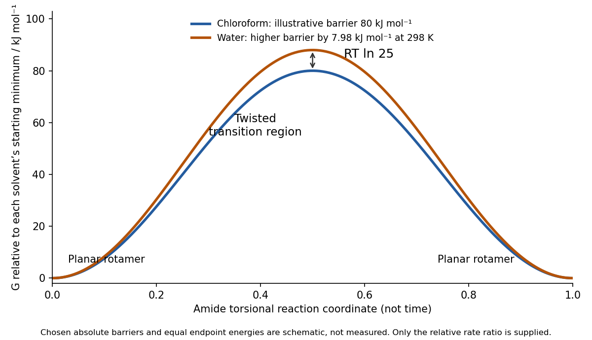

<h1 id="b10/a/solution">Solution</h1>

↑ **Parent:** [A](../a.md)

**[water](../../../../../water.md) stabilizes the planar [amide](../../../../../amide.md) more strongly relative to the twisted rotational transition region, increasing the free-energy barrier.** [nitrogen](../../../../../nitrogen.md) lone-pair donation into the carbonyl gives the C–N bond partial double-bond character through [amide resonance](../../../../../amide-resonance.md), represented by

$$
\mathrm{O=C{-}NR_2\ \leftrightarrow\ {}^-O{-}C= N^+R_2}.
$$

[amide bond rotation](../../../../../amide-bond-rotation.md) between the two [amide](../../../../../amide.md) [conformations](../../../../../conformation.md) requires loss of favourable overlap. Near a strongly twisted geometry the [nitrogen](../../../../../nitrogen.md) [lone pair](../../../../../lone-pair.md) is less conjugated with C=O, and the charge-separated [resonance in chemistry](../../../../../resonance-in-chemistry.md) contribution is reduced. Polar [water](../../../../../water.md), a [hydrogen bond donor](../../../../../hydrogen-bond-donor.md), preferentially stabilizes the planar starting structures, including their polar carbonyl/resonance distribution, compared with this less conjugated rotational region. [chloroform](../../../../../chloroform.md) provides less of that differential stabilization. What controls the rate is the **difference between the starting minimum and the [transition state](../../../../../transition-state.md)**, not the absolute stabilization of either one in isolation.

For a first-order interpretation of the [half-lives](../../../../../half-life.md), the characteristic [rate constants](../../../../../rate-constant.md) are

$$
k_{\rm CHCl_3}=\frac{\ln2}{2\,\mathrm s}=0.3466\,\mathrm{s^{-1}},\qquad
k_{\rm water}=\frac{\ln2}{50\,\mathrm s}=0.01386\,\mathrm{s^{-1}}.
$$

Thus the interconversion is **25 times slower in [water](../../../../../water.md)**. With comparable [Eyring equation](../../../../../eyring-equation.md) prefactors at the same temperature,

$$
\boxed{\Delta G^\ddagger_{\rm water}-\Delta G^\ddagger_{\rm CHCl_3}=RT\ln25,}
$$

which is about $8.0\,\mathrm{kJ\,mol^{-1}}$ at $298\,\mathrm K$. This temperature is illustrative because none is specified for the measurements.

**[Figure 4](#b10/a/image-relative-amide-rotation-barriers-in-two-solvents-with-an-illustrative-water-increment-rt-ln-25). Relative amide-rotation barriers in two solvents, with an illustrative water increment RT ln 25**.

The two endpoint [conformations](../../../../../conformation.md) remain minima separated by a twisted barrier in each [solvent](../../../../../solvent.md). The profiles are schematic, with arbitrary absolute barriers; the [half-life](../../../../../half-life.md) ratio supports the relative kinetic comparison. If the quoted [half-lives](../../../../../half-life.md) describe relaxation of a reversible cis/trans mixture, $k_{\rm obs}=k_f+k_r$, so the ratio directly concerns relaxation rates. Assigning the full $RT\ln25$ difference to one microscopic forward barrier additionally requires comparable equilibrium populations or directional-rate information.

## ↑ Ancestors (13)

1. [A](../a.md)
2. [B10](../../b10.md)
3. [Paper 2](../../../paper-2-split.md)
4. [2023](../../../split.md)
5. [Past exam of the chemistry B course of the University of Cambridge](../../../../split.md)
6. [Chemistry B course of the University of Cambridge](../../../../../chemistry-b-course-of-the-university-of-cambridge.md)
7. [Year 2 of the natural sciences course of the University of Cambridge](../../../../../year-2-of-the-natural-sciences-course-of-the-university-of-cambridge.md)
8. [Year of the natural sciences course of the University of Cambridge](../../../../../year-of-the-natural-sciences-course-of-the-university-of-cambridge.md)
9. [Natural sciences course of the University of Cambridge](../../../../../natural-sciences-course-of-the-university-of-cambridge.md)
10. [Course of the University of Cambridge](../../../../../course-of-the-university-of-cambridge.md)
11. [University of Cambridge](../../../../../university-of-cambridge-split.md)
12. [List of universities](../../../../../list-of-universities.md)
13. [Codex Wiki](../../../../../split.md)
