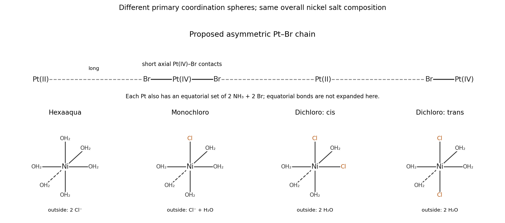

<h1 id="b6/c/solution">Solution</h1>

↑ **Parent:** [C](../c.md)

The average Pt [oxidation state](../../../../../oxidation-state.md) is $+3$, since six [bromides](../../../../../bromide.md) balance the two [metal](../../../../../metal.md) atoms. A natural [mixed valence](../../../../../mixed-valence.md) assignment is **alternating Pt(II), $d^8$, and Pt(IV), $d^6$**, rather than two equivalent Pt(III) sites. Use neutral square-planar $\mathrm{Pt^{II}(NH_3)_2Br_2}$ units and octahedral $\mathrm{Pt^{IV}(NH_3)_2Br_4}$ units. At every site place two [ammonia](../../../../../ammonia.md) and two [bromide](../../../../../bromide.md) ligands in an equatorial plane; the Pt(IV) sites have two additional axial [bromides](../../../../../bromide.md) pointing toward the adjacent Pt(II) sites.

Along the chain the connectivity is

$$
\cdots\mathrm{Pt^{II}\ \cdots Br{-}Pt^{IV}{-}Br\cdots\ Pt^{II}\ \cdots Br{-}Pt^{IV}{-}Br}\cdots.
$$

Every Pt–Br–Pt bridge is **asymmetric: short to Pt(IV), long to Pt(II)**. The latter contact is a secondary axial interaction, consistent with the preference of Pt(II) for a square-planar primary [coordination sphere](../../../../../coordination-sphere.md). The Pt(IV) site is smaller and more strongly attracts the bridging [bromides](../../../../../bromide.md). A drawing with all axial distances identical would obscure the distinct local environments.

There are four equatorial [bromides](../../../../../bromide.md) and two axial bridging [bromides](../../../../../bromide.md) per two-Pt repeat, giving precisely $\mathrm{Pt_2(NH_3)_4Br_6}$. A direct Pt–Pt bond is not required. This is a proposed structure consistent with the stated composition and two environments; the formula alone does not determine every equatorial cis/trans arrangement or numerical bond length.

**[Figure 2](#b6/c/image-proposed-asymmetric-platinum-chain-and-octahedral-hydration-isomer-connectivities-for-nickel). Proposed asymmetric platinum chain and octahedral hydration-isomer connectivities for nickel**.

## ↑ Ancestors (13)

1. [C](../c.md)
2. [B6](../../b6.md)
3. [Paper 2](../../../paper-2-split.md)
4. [2023](../../../split.md)
5. [Past exam of the chemistry B course of the University of Cambridge](../../../../split.md)
6. [Chemistry B course of the University of Cambridge](../../../../../chemistry-b-course-of-the-university-of-cambridge.md)
7. [Year 2 of the natural sciences course of the University of Cambridge](../../../../../year-2-of-the-natural-sciences-course-of-the-university-of-cambridge.md)
8. [Year of the natural sciences course of the University of Cambridge](../../../../../year-of-the-natural-sciences-course-of-the-university-of-cambridge.md)
9. [Natural sciences course of the University of Cambridge](../../../../../natural-sciences-course-of-the-university-of-cambridge.md)
10. [Course of the University of Cambridge](../../../../../course-of-the-university-of-cambridge.md)
11. [University of Cambridge](../../../../../university-of-cambridge-split.md)
12. [List of universities](../../../../../list-of-universities.md)
13. [Codex Wiki](../../../../../split.md)
