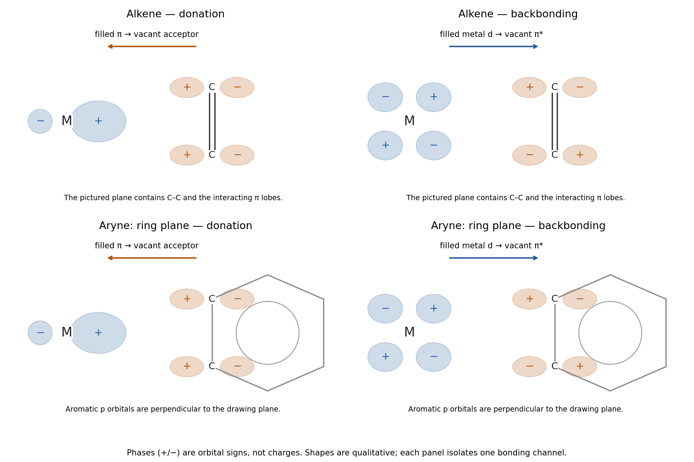

<h1 id="b8/a/i/solution">Solution</h1>

↑ **Parent:** [I](../i.md)

The [Dewar-Chatt-Duncanson model](../../../../../../dewar-chatt-duncanson-model.md) has two complementary interactions. **The filled [alkene](../../../../../../alkene.md) $\pi$ orbital donates to an empty [metal](../../../../../../metal.md) orbital, and an occupied [metal](../../../../../../metal.md) $d_\pi$ orbital back-donates into the empty [alkene](../../../../../../alkene.md) $\pi^*$ orbital.** The [metal](../../../../../../metal.md) acceptor has the symmetry of the sum of the two ligand lobes facing it; the back-donor has opposite phases at the two [carbon](../../../../../../carbon.md) positions and matches the antisymmetric $\pi^*$ combination.

$$
\pi(\mathrm{C=C})\longrightarrow\mathrm M,\qquad
\mathrm M(d_\pi)\longrightarrow\pi^*(\mathrm{C=C}).
$$

Both channels strengthen [metal](../../../../../../metal.md)–[alkene](../../../../../../alkene.md) attachment. Donation removes some [electron density](../../../../../../electron-density.md) from the internal bonding orbital, while back-donation populates its antibonding partner, so coordination generally reduces C–C bond order. The schematic shows orbital phase signs, not positive and negative electric charges.

**[Figure 3](#b8/a/i/image-symmetry-matched-alkene-donation-and-backbonding-and-the-in-plane-bonding-channel-of-a-coordinated-aryne). Symmetry-matched alkene donation and backbonding, and the in-plane bonding channel of a coordinated aryne**.

## ↑ Ancestors (14)

1. [I](../i.md)
2. [A](../../a.md)
3. [B8](../../../b8.md)
4. [Paper 2](../../../../paper-2-split.md)
5. [2023](../../../../split.md)
6. [Past exam of the chemistry B course of the University of Cambridge](../../../../../split.md)
7. [Chemistry B course of the University of Cambridge](../../../../../../chemistry-b-course-of-the-university-of-cambridge.md)
8. [Year 2 of the natural sciences course of the University of Cambridge](../../../../../../year-2-of-the-natural-sciences-course-of-the-university-of-cambridge.md)
9. [Year of the natural sciences course of the University of Cambridge](../../../../../../year-of-the-natural-sciences-course-of-the-university-of-cambridge.md)
10. [Natural sciences course of the University of Cambridge](../../../../../../natural-sciences-course-of-the-university-of-cambridge.md)
11. [Course of the University of Cambridge](../../../../../../course-of-the-university-of-cambridge.md)
12. [University of Cambridge](../../../../../../university-of-cambridge-split.md)
13. [List of universities](../../../../../../list-of-universities.md)
14. [Codex Wiki](../../../../../../split.md)
