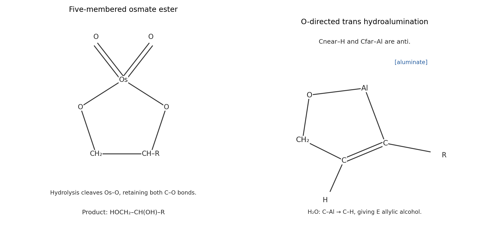
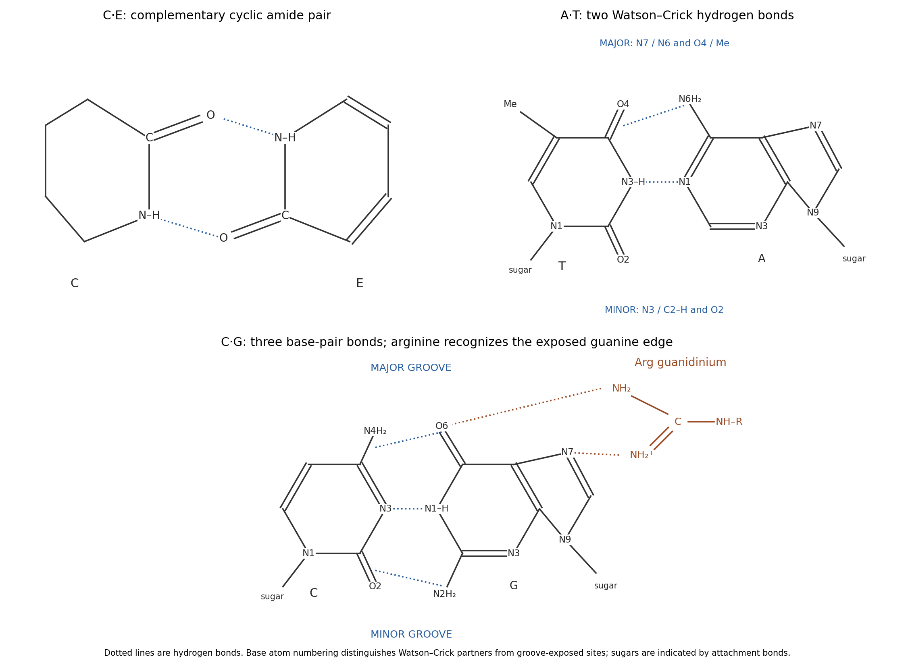

# Paper 1

↑ **Parent:** [2024](../2024.md)

[Original paper, released PDF pages 150–158](https://www.whatdotheyknow.com/request/request_for_nst_past_papers/response/3572306/attach/4/FOI%202026%20862%20Stack%20materials.pdf?cookie_passthrough=1#page=150)

**Table of contents**

- [B1](#b1)
  - [a](#b1/a)
    - [i](#b1/a/i)
      - [Solution](#b1/a/i/solution)
    - [ii](#b1/a/ii)
      - [Solution](#b1/a/ii/solution)
    - [iii](#b1/a/iii)
      - [Solution](#b1/a/iii/solution)
    - [iv](#b1/a/iv)
      - [Solution](#b1/a/iv/solution)
  - [b](#b1/b)
    - [i](#b1/b/i)
      - [Solution](#b1/b/i/solution)
    - [ii](#b1/b/ii)
      - [Solution](#b1/b/ii/solution)
- [B2](#b2)
  - [a](#b2/a)
    - [Solution](#b2/a/solution)
  - [b](#b2/b)
    - [i](#b2/b/i)
      - [Solution](#b2/b/i/solution)
    - [ii](#b2/b/ii)
      - [Solution](#b2/b/ii/solution)
  - [c](#b2/c)
    - [i](#b2/c/i)
      - [Solution](#b2/c/i/solution)
    - [ii](#b2/c/ii)
      - [Solution](#b2/c/ii/solution)
- [B3](#b3)
  - [a](#b3/a)
    - [Solution](#b3/a/solution)
  - [b](#b3/b)
    - [Solution](#b3/b/solution)
  - [c](#b3/c)
    - [i](#b3/c/i)
      - [Solution](#b3/c/i/solution)
    - [ii](#b3/c/ii)
      - [Solution](#b3/c/ii/solution)
    - [iii](#b3/c/iii)
      - [Solution](#b3/c/iii/solution)
  - [d](#b3/d)
    - [Solution](#b3/d/solution)
- [B4](#b4)
  - [a](#b4/a)
    - [Solution](#b4/a/solution)
  - [b](#b4/b)
    - [Solution](#b4/b/solution)
  - [c](#b4/c)
    - [Solution](#b4/c/solution)
  - [d](#b4/d)
    - [Solution](#b4/d/solution)
  - [e](#b4/e)
    - [Solution](#b4/e/solution)
- [B5](#b5)
  - [a](#b5/a)
    - [i](#b5/a/i)
      - [Solution](#b5/a/i/solution)
    - [ii](#b5/a/ii)
      - [Solution](#b5/a/ii/solution)
    - [iii](#b5/a/iii)
      - [Solution](#b5/a/iii/solution)
  - [b](#b5/b)
    - [i](#b5/b/i)
      - [Solution](#b5/b/i/solution)
    - [ii](#b5/b/ii)
      - [Solution](#b5/b/ii/solution)
  - [c](#b5/c)
    - [Solution](#b5/c/solution)

## B1

↑ **Parent:** [Paper 1](paper-1.md)

<h3 id="b1/a">a</h3>

↑ **Parent:** [B1](#b1)

<h4 id="b1/a/i">i</h4>

↑ **Parent:** [A](#b1/a)

<h5 id="b1/a/i/solution">Solution</h5>

↑ **Parent:** [I](#b1/a/i)

An [enolate](../../chemical-substance.md#enolate) is an [ambident nucleophile](../../chemical-reaction.md#ambident-nucleophile): the negative charge is concentrated toward [oxygen](../../chemical-substance.md#oxygen), while its occupied conjugated orbital also has substantial reactive amplitude at the alpha [carbon](../../chemical-substance.md#carbon). An alkyl [iodide](../../chemical-substance.md#iodide) presents an accessible, polarizable [carbon](../../chemical-substance.md#carbon) [electrophile](../../chemical-reaction.md#electrophile). [carbon](../../chemical-substance.md#carbon) attack through an [SN2 reaction](../../chemical-reaction.md#sn2-reaction) is generally kinetically favorable, while the more strongly charged [oxygen](../../chemical-substance.md#oxygen) is often coordinated to the [counterion](../../chemistry.md#counterion) or solvated. The [carbonyl](../../chemical-bond.md#carbonyl-group) reforms as the new C–C bond is made.

$$
\mathrm{R{-}C(O^-){=}CHR'+MeI}\longrightarrow\mathrm{R{-}C(O){-}CH(Me)R'+I^-}.
$$

**[carbon](../../chemical-substance.md#carbon) alkylation restores the [carbonyl](../../chemical-bond.md#carbonyl-group) and makes the new C–C bond.** [oxygen](../../chemical-substance.md#oxygen) alkylation instead gives an enol [ether](../../chemical-substance.md#ether). The two outcomes are not resonance contributors of one product, and their ratio is not determined just by where the largest formal negative charge is drawn. [electrophile](../../chemical-reaction.md#electrophile), [counterion](../../chemistry.md#counterion), solvent and aggregation can change selectivity; hard [silicon](../../chemical-substance.md#silicon) [electrophiles](../../chemical-reaction.md#electrophile) and suitable acylating reagents often favor [oxygen](../../chemical-substance.md#oxygen) trapping. Product stability alone would not explain an irreversible kinetic choice.

<h4 id="b1/a/ii">ii</h4>

↑ **Parent:** [A](#b1/a)

<h5 id="b1/a/ii/solution">Solution</h5>

↑ **Parent:** [Ii](#b1/a/ii)

[Lithium diisopropylamide](../../chemical-substance.md#lithium-diisopropylamide) removes an alpha [proton](../../physics.md#proton) from the ethyl side of the [ketone](../../chemical-substance.md#ketone). The C–H [electrons](../../physics.md#electron) form the C=C part of a [lithium](../../chemical-substance.md#lithium) [enolate](../../chemical-substance.md#enolate), while the C=O pi [electrons](../../physics.md#electron) move to [oxygen](../../chemical-substance.md#oxygen). The phenyl side has no competing alpha C–H site. Diisopropylamine is the conjugate-acid byproduct.

$$
\mathrm{PhCOCH_2Me}\xrightarrow{\mathrm{LDA}}\mathrm{PhC(O^-Li^+){=}CHMe}.
$$

The [carbon](../../chemical-substance.md#carbon) end of this [enolate](../../chemical-substance.md#enolate) attacks the primary [carbon](../../chemical-substance.md#carbon) bearing iodine in $\mathrm{ICH_2CH_2CH_2OMe}$. The C–I bond breaks to [iodide](../../chemical-substance.md#iodide) in an [SN2 reaction](../../chemical-reaction.md#sn2-reaction), and [carbonyl](../../chemical-bond.md#carbonyl-group) reformation gives

$$
\boxed{\mathrm{PhCOCH(Me)CH_2CH_2CH_2OMe}.}
$$

Thus **a three-[carbon](../../chemical-substance.md#carbon) methoxypropyl chain is attached at the [ketone](../../chemical-substance.md#ketone) alpha [carbon](../../chemical-substance.md#carbon)**. The remote methyl [ether](../../chemical-substance.md#ether) survives. The hindered [amide](../../chemical-substance.md#amide) base is chosen to generate the [enolate](../../chemical-substance.md#enolate) rather than to add to the [carbonyl](../../chemical-bond.md#carbonyl-group). No absolute stereochemical preference is specified for the new [stereocenter](../../stereochemistry.md#stereocenter) under these [achiral](../../stereochemistry.md#achirality) conditions.

<h4 id="b1/a/iii">iii</h4>

↑ **Parent:** [A](#b1/a)

<h5 id="b1/a/iii/solution">Solution</h5>

↑ **Parent:** [Iii](#b1/a/iii)

The initial [nucleophile](../../chemical-reaction.md#nucleophile) attacks **[silicon](../../chemical-substance.md#silicon)**, not the nitrile or an [alkene](../../chemical-substance.md#alkene) [carbon](../../chemical-substance.md#carbon). Each trimethylsilyl group has an electrophilic Si center. A methyl group from [methyllithium](../../chemical-substance.md#methyllithium) attacks Si, passing through a pentacoordinate [silicon](../../chemical-substance.md#silicon) arrangement; Si–O cleavage releases $\mathrm{SiMe_4}$ and the [lithium](../../chemical-substance.md#lithium) salt of the [oxygen](../../chemical-substance.md#oxygen)-containing fragment. Cleaving the [silyl enol ether](../../chemical-substance.md#silyl-enol-ether) generates a [lithium](../../chemical-substance.md#lithium) [enolate](../../chemical-substance.md#enolate); cleaving the aryl [silyl ether](../../chemical-substance.md#silyl-ether) generates a [phenoxide](../../chemistry.md#phenoxide). Neither operation needs a new [deprotonation](../../acid-base-chemistry.md#deprotonation) at a [carbon](../../chemical-substance.md#carbon) [stereocenter](../../stereochemistry.md#stereocenter).

$$
\mathrm{R{-}O{-}SiMe_3+MeLi\longrightarrow R{-}O^-Li^++SiMe_4}.
$$

Here $R{-}O^-$ represents either the [phenoxide](../../chemistry.md#phenoxide) or the [oxygen](../../chemical-substance.md#oxygen)-centered [enolate](../../chemical-substance.md#enolate) contributor. Excess reagent permits both cleavages. The pre-existing methyl/nitrile [stereocenter](../../stereochemistry.md#stereocenter) retains its [configuration](../../classical-mechanics.md#mechanical-configuration): it has no [hydrogen](../../chemical-substance.md#hydrogen) to remove, and neither bond attached to that center is broken.

After [HMPA](../../chemical-substance.md#hexamethylphosphoramide) is added, each anionic [oxygen](../../chemical-substance.md#oxygen) attacks the [carbonyl](../../chemical-bond.md#carbonyl-group) [carbon](../../chemical-substance.md#carbon) of [allyl chloroformate](../../chemical-substance.md#allyl-chloroformate). The C=O pi [electrons](../../physics.md#electron) move to the [carbonyl](../../chemical-bond.md#carbonyl-group) [oxygen](../../chemical-substance.md#oxygen), giving a [tetrahedral intermediate](../../chemical-kinetics.md#tetrahedral-intermediate); collapse expels [chloride](../../chemistry.md#chloride). **The [enolate](../../chemical-substance.md#enolate) becomes an allyl [enol carbonate](../../chemical-substance.md#enol-carbonate), and the [phenoxide](../../chemistry.md#phenoxide) becomes an aryl allyl carbonate**, each containing $\mathrm{O{-}C(O){-}OCH_2CH{=}CH_2}$. [oxygen](../../chemical-substance.md#oxygen) acylation accounts for preservation of the enol double bond and for the two newly installed carbonate groups. [carbon](../../chemical-substance.md#carbon) attack would give a different [carbon](../../chemical-substance.md#carbon) skeleton. The two oxygens are trapped because they were selectively unmasked by [desilylation](../../chemical-reaction.md#desilylation), rather than because every [ether](../../chemical-substance.md#ether) [oxygen](../../chemical-substance.md#oxygen) in the molecule is equally reactive.

**[Figure 1](#b1/a/iii/image-silicon-cleavage-and-oxygen-acylation-in-the-two-site-trapping-sequence). Silicon cleavage and oxygen acylation in the two-site trapping sequence**.

<h4 id="b1/a/iv">iv</h4>

↑ **Parent:** [A](#b1/a)

<h5 id="b1/a/iv/solution">Solution</h5>

↑ **Parent:** [Iv](#b1/a/iv)

**[HMPA](../../chemical-substance.md#hexamethylphosphoramide) coordinates Li$^+$ through its phosphoryl [oxygen](../../chemical-substance.md#oxygen) and makes the anionic [oxygen](../../chemical-substance.md#oxygen) sites more available for acylation.** Strong cation solvation changes contact [ion pairing](../../ionic-bonding.md#ion-pair), chelation and aggregate structure. It can therefore accelerate trapping of both the [enolate](../../chemical-substance.md#enolate) and [phenoxide](../../chemistry.md#phenoxide) by the [chloroformate](../../chemical-substance.md#chloroformate), helping realize the observed O-acylation pathway.

It is too strong to assert that [HMPA](../../chemical-substance.md#hexamethylphosphoramide) necessarily produces completely free, monomeric anions. In a primary study of a [lithium](../../chemical-substance.md#lithium) [enolate](../../chemical-substance.md#enolate) in [THF](../../chemical-substance.md#tetrahydrofuran), low-temperature multinuclear [NMR](../../nuclear-magnetic-resonance.md) and reaction kinetics identified an [HMPA](../../chemical-substance.md#hexamethylphosphoramide)-coordinated dimer as the reactive form, even with excess [HMPA](../../chemical-substance.md#hexamethylphosphoramide).[2004, pp. 259–268, HMPA titration, aggregate assignment and alkylation kinetics](../../chemistry-bibliography.md#effects-of-hmpa-on-the-structure-and-reactivity-of-the-lithium-enolate-of-cyclopentanone-in-thf-the-dimer-is-responsible-for-alkylation-and-proton-exchange-reactions-by-masaaki-suzuki-and-others) The useful conclusion here is altered [lithium](../../chemical-substance.md#lithium) coordination and enhanced [oxygen](../../chemical-substance.md#oxygen) accessibility; the exact aggregate of this bifunctional substrate is not supplied.

<h3 id="b1/b">b</h3>

↑ **Parent:** [B1](#b1)

<h4 id="b1/b/i">i</h4>

↑ **Parent:** [B](#b1/b)

<h5 id="b1/b/i/solution">Solution</h5>

↑ **Parent:** [I](#b1/b/i)

The [carbamate](../../chemical-substance.md#carbamate) [carbonyl](../../chemical-bond.md#carbonyl-group) [oxygen](../../chemical-substance.md#oxygen) attacks electrophilic [sulfur](../../chemical-substance.md#sulfur) of [triflic anhydride](../../chemical-substance.md#triflic-anhydride), with cleavage of the anhydride S–O bond to release [triflate](../../chemistry.md#triflate). Donation of the [nitrogen](../../chemical-substance.md#nitrogen) [lone pair](../../covalent-bond.md#lone-pair) toward the [carbonyl](../../chemical-bond.md#carbonyl-group) [carbon](../../chemical-substance.md#carbon) then gives the indicated imidoyl-type cation: the former [carbonyl](../../chemical-bond.md#carbonyl-group) [oxygen](../../chemical-substance.md#oxygen) now bears Tf, and the N–H [nitrogen](../../chemical-substance.md#nitrogen) participates in a C=N$^+$ bond. This converts a relatively unreactive [carbamate](../../chemical-substance.md#carbamate) [carbonyl](../../chemical-bond.md#carbonyl-group) into a strongly electrophilic [carbon](../../chemical-substance.md#carbon) bearing an excellent leaving group.

The aromatic pi bond para to ethoxy attacks that [carbon](../../chemical-substance.md#carbon). The C=N pi [electrons](../../physics.md#electron) move to [nitrogen](../../chemical-substance.md#nitrogen) as the new aryl–[carbon](../../chemical-substance.md#carbon) bond forms. Loss of the aromatic [proton](../../physics.md#proton) restores [aromaticity](../../molecule.md#aromaticity); [nitrogen](../../chemical-substance.md#nitrogen) donation and departure of the O-triflylated group restore the imine bond. [proton](../../physics.md#proton) transfers during the sequence and carbonate workup remove the remaining N–H [proton](../../physics.md#proton). The surviving five-membered ring is an oxazoline: **the product is 2-(4-ethoxyphenyl)-[2-Oxazoline](../../molecule.md#2-oxazoline)**. An equivalent arrow order can eliminate the triflyloxy leaving group before arene capture; these are limiting descriptions of the activated [electrophile](../../chemical-reaction.md#electrophile), not a need to postulate an unactivated [carbamate](../../chemical-substance.md#carbamate) undergoing ordinary Friedel–Crafts acylation.

Ethoxy donates a [lone pair](../../covalent-bond.md#lone-pair) into the ring, stabilizing the ortho and para [Wheland intermediates](../../chemical-reaction.md#arenium-ion). The para pathway avoids the crowding of an incoming heterocycle beside ethoxy, giving the observed position. Mechanistic experiments on this transformation include in situ [carbon](../../chemical-substance.md#carbon) [NMR](../../nuclear-magnetic-resonance.md) of the activated reagent, competition experiments and isotope-effect measurements supporting [electrophilic aromatic substitution](../../chemical-reaction.md#electrophilic-aromatic-substitution); they do not directly image every intermediate.[2023, Figure 7 and supporting information, product 3a and electrophilic-substitution evidence](../../chemistry-bibliography.md#simple-and-efficient-aromatic-c-h-oxazolination-by-qiu-shi-and-others)

**[Figure 2](#b1/b/i/image-activated-cyclic-carbamate-and-para-substituted-oxazoline-products). Activated cyclic carbamate and para-substituted oxazoline products**.

<h4 id="b1/b/ii">ii</h4>

↑ **Parent:** [B](#b1/b)

<h5 id="b1/b/ii/solution">Solution</h5>

↑ **Parent:** [Ii](#b1/b/ii)

**Oxazolination occurs para to [oxygen](../../chemical-substance.md#oxygen) on the ring that does not bear [bromine](../../chemical-substance.md#bromine).** The product is 2-\[4-(4-bromophenoxy)phenyl\]-[2-Oxazoline](../../molecule.md#2-oxazoline), shown in the final panel above. The brominated ring retains its para [bromine](../../chemical-substance.md#bromine); the other ring receives the new oxazolinyl group at its open para position.

The diaryl [ether](../../chemical-substance.md#ether) [oxygen](../../chemical-substance.md#oxygen) activates both rings toward [electrophilic aromatic substitution](../../chemical-reaction.md#electrophilic-aromatic-substitution). On the brominated ring, its least crowded para position is blocked, and [bromine](../../chemical-substance.md#bromine) also decreases ring reactivity inductively. The unbrominated ring has an accessible para position, favored over its ortho sites by steric effects. This is substitution of an aromatic [hydrogen](../../chemical-substance.md#hydrogen), not displacement of the aryl bromide.

The formula provides a useful consistency check: $\mathrm{C_{12}H_9BrO}$ loses one aromatic H and acquires $\mathrm{C_3H_4NO}$, giving **$\mathrm{C_{15}H_{12}BrNO_2}$**. It cannot by itself distinguish positional isomers; the directing and steric arguments select the connectivity.

## B2

↑ **Parent:** [Paper 1](paper-1.md)

<h3 id="b2/a">a</h3>

↑ **Parent:** [B2](#b2)

<h4 id="b2/a/solution">Solution</h4>

↑ **Parent:** [A](#b2/a)

In the strongly acidic nitrating mixture, the dimethylamino [nitrogen](../../chemical-substance.md#nitrogen) is predominantly protonated. The substituent is therefore $\mathrm{-NMe_2H^+}$ during aromatic substitution, rather than the neutral [electron](../../physics.md#electron)-donating $\mathrm{-NMe_2}$ group. Its [lone pair](../../covalent-bond.md#lone-pair) is unavailable for conjugation. Ortho or para attack would generate a sigma-complex contributor with positive ring charge at the [carbon](../../chemical-substance.md#carbon) attached to an already positive [nitrogen](../../chemical-substance.md#nitrogen); meta attack avoids that especially unfavorable contributor.

Sulfuric acid protonates nitric acid, and loss of [water](../../chemical-substance.md#water) produces the [nitronium ion](../../chemistry.md#nitronium-ion). Aromatic attack at a meta position forms a [Wheland intermediate](../../chemical-reaction.md#arenium-ion); [deprotonation](../../acid-base-chemistry.md#deprotonation) restores [aromaticity](../../molecule.md#aromaticity). The bicarbonate workup then returns the amino group to its neutral form. **$A$ is 3-nitro-N,N-[dimethylaniline](../../chemical-substance.md#dimethylaniline).**

There are six inequivalent aromatic carbons in this unsymmetrical meta-disubstituted ring and one [carbon](../../chemical-substance.md#carbon) environment for the two equivalent N-methyl groups, giving **seven [carbon](../../chemical-substance.md#carbon) [NMR](../../nuclear-magnetic-resonance.md) signals**. The para isomer would have only four aromatic environments plus the methyl environment. An ortho isomer could also give seven signals, so signal counting supports but does not alone establish the meta assignment; [protonation](../../chemical-reaction.md#protonation)-dependent directing effects are essential.

<h3 id="b2/b">b</h3>

↑ **Parent:** [B2](#b2)

<h4 id="b2/b/i">i</h4>

↑ **Parent:** [B](#b2/b)

<h5 id="b2/b/i/solution">Solution</h5>

↑ **Parent:** [I](#b2/b/i)

tert-Butoxide removes the acidic [hydrogen](../../chemical-substance.md#hydrogen) from $\mathrm{PhCH(OPh)CN}$. The resulting [carbon](../../chemical-substance.md#carbon) anion is stabilized by the nitrile group and the phenyl substituent. It attacks the aromatic [carbon](../../chemical-substance.md#carbon) bearing fluorine, giving a Meisenheimer addition intermediate. Ring pi bonds shift toward the para [nitro group](../../chemistry.md#nitro-group), where the negative charge can be delocalized onto [oxygen](../../chemical-substance.md#oxygen).

Loss of fluoride restores [aromaticity](../../molecule.md#aromaticity) and gives **$\mathrm{p{-}NO_2C_6H_4{-}C(Ph)(OPh)CN}$**. This is an addition–elimination [nucleophilic aromatic substitution](../../chemical-reaction.md#nucleophilic-aromatic-substitution). The phenoxy group remains attached to the incoming [carbon](../../chemical-substance.md#carbon). The ipso aromatic [carbon](../../chemical-substance.md#carbon) already has a leaving group, so rearomatization can occur by fluoride departure without removing [phenoxide](../../chemistry.md#phenoxide). Acid workup neutralizes residual anions; it is not a separate step that replaces the aryl fluoride.

**[Figure 3](#b2/b/i/image-contrasting-fluoride-substitution-and-vicarious-hydrogen-substitution). Contrasting fluoride substitution and vicarious hydrogen substitution**.

<h4 id="b2/b/ii">ii</h4>

↑ **Parent:** [B](#b2/b)

<h5 id="b2/b/ii/solution">Solution</h5>

↑ **Parent:** [Ii](#b2/b/ii)

The same base first makes $\mathrm{PhC^-(OPh)CN}$. This time addition occurs at a [carbon](../../chemical-substance.md#carbon) bearing [hydrogen](../../chemical-substance.md#hydrogen) para to the [nitro group](../../chemistry.md#nitro-group), giving a [sigma-H adduct](../../chemical-reaction.md#sigma-h-adduct). The attacked [carbon](../../chemical-substance.md#carbon) temporarily bears both its original H and the new [carbon](../../chemical-substance.md#carbon) substituent. Negative charge is again delocalized through the ring toward the nitro oxygens.

A further base removes the [hydrogen](../../chemical-substance.md#hydrogen) on that aromatic addition site. Its C–H [electrons](../../physics.md#electron) form an exocyclic bond toward the incoming [carbon](../../chemical-substance.md#carbon), while that [carbon](../../chemical-substance.md#carbon) expels [phenoxide](../../chemistry.md#phenoxide). This is a base-induced elimination across the new ring–side-chain bond. Redistribution of the [nitronate](../../chemistry.md#nitronate)/quinoid pi system restores an [aromatic ring](../../molecule.md#aromatic-ring) and gives the side-chain carbanion $\mathrm{p{-}NO_2C_6H_4{-}C^-(Ph)CN}$. [protonation](../../chemical-reaction.md#protonation) during acidic workup yields **$\mathrm{p{-}NO_2C_6H_4{-}CH(Ph)CN}$**.

This is [vicarious nucleophilic substitution](../../chemical-reaction.md#vicarious-nucleophilic-substitution): the ring loses [hydrogen](../../chemical-substance.md#hydrogen) while the [nucleophile](../../chemical-reaction.md#nucleophile) sacrifices its phenoxy leaving group. **[hydrogen](../../chemical-substance.md#hydrogen) is not expelled as hydride**, and the product's side-chain [hydrogen](../../chemical-substance.md#hydrogen) can be supplied on workup rather than moving directly from the ring in a compulsory hydride shift. Base and isotope experiments in the primary mechanistic work support reversible addition followed by base-induced elimination, while not uniquely choosing every E2/E1cb limit.[1983, pp. 3860–3861, isotope effects, base dependence and hydrogen/halogen competition](../../chemistry-bibliography.md#reaction-of-organic-anions-part-108-on-the-mechanism-of-the-vicarious-nucleophilic-substitution-of-hydrogen-in-nitroarenes-by-mieczyslaw-makosza-and-tomasz-glinka) The displayed para product is consistent with access to the less crowded activated position.

<h3 id="b2/c">c</h3>

↑ **Parent:** [B2](#b2)

<h4 id="b2/c/i">i</h4>

↑ **Parent:** [C](#b2/c)

<h5 id="b2/c/i/solution">Solution</h5>

↑ **Parent:** [I](#b2/c/i)

Hydroxide initially deprotonates a little [thiophenol](../../chemical-substance.md#thiophenol), generating the reactive [thiolate](../../chemistry.md#thiolate) $\mathrm{PhS^-}$. Number the extended conjugated system $\mathrm{O{=}C1{-}C2{=}C3{-}C4{=}C5}$, where C1–C2–C3 is the ring enone and C4=C5 is the attached vinyl group. [sulfur](../../chemical-substance.md#sulfur) attacks the terminal delta [carbon](../../chemical-substance.md#carbon) C5. The pi bonds relay toward [oxygen](../../chemical-substance.md#oxygen), generating an extended [enolate](../../chemical-substance.md#enolate).

[proton](../../physics.md#proton) transfer at C4, either directly from [thiophenol](../../chemical-substance.md#thiophenol) or through solvent-mediated enolization, gives the product retaining the conjugated ring enone. **The product is 3-\[2-(phenylsulfanyl)ethyl\]cyclohex-2-en-1-one**, drawn below. Its side chain is $\mathrm{-CH_2CH_2SPh}$; the ring C2=C3 double bond remains. This is net [sulfur](../../chemical-substance.md#sulfur)/[hydrogen](../../chemical-substance.md#hydrogen) addition to the terminal part of the extended system, proceeding through [1,6-Conjugate addition](../../chemical-reaction.md#1-6-conjugate-addition) and [protonation](../../chemical-reaction.md#protonation) of the extended [enolate](../../chemical-substance.md#enolate).

The terminal site is less crowded than the ring beta [carbon](../../chemical-substance.md#carbon), and the isolated product retains favorable [carbonyl](../../chemical-bond.md#carbonyl-group)–[alkene](../../chemical-substance.md#alkene) conjugation. Reversible [proton](../../physics.md#proton) transfers and [conjugate addition](../../chemical-reaction.md#conjugate-addition) under [thiolate](../../chemistry.md#thiolate) catalysis can favor that product over an unconjugated enone-derived alternative. Transfer of a [proton](../../physics.md#proton) from another PhSH molecule regenerates PhS$^-$, explaining why a catalytic quantity of hydroxide suffices. The net balance is one [thiophenol](../../chemical-substance.md#thiophenol) added, **$\mathrm{C_8H_{10}O+C_6H_6S=C_{14}H_{16}OS}$**; [carbonyl](../../chemical-bond.md#carbonyl-group) 1,2 addition would instead produce a different functional group and is not favored for this soft [sulfur](../../chemical-substance.md#sulfur) [nucleophile](../../chemical-reaction.md#nucleophile).

**[Figure 4](#b2/c/i/image-regioselective-sulfur-addition-to-an-extended-enone-and-an-activated-allene). Regioselective sulfur addition to an extended enone and an activated allene**.

<h4 id="b2/c/ii">ii</h4>

↑ **Parent:** [C](#b2/c)

<h5 id="b2/c/ii/solution">Solution</h5>

↑ **Parent:** [Ii](#b2/c/ii)

Base again generates $\mathrm{PhS^-}$ catalytically. In $\mathrm{Ph_2P(O){-}CH{=}C{=}CH_2}$, attack at the central [allene](../../chemical-substance.md#allene) [carbon](../../chemical-substance.md#carbon) moves the adjacent C=C pi [electrons](../../physics.md#electron) onto the [phosphorus](../../chemical-substance.md#phosphorus)-bearing [carbon](../../chemical-substance.md#carbon). This makes the stabilized alpha-phosphoryl carbanion

$$
\mathrm{Ph_2P(O){-}C^-H{-}C(SPh){=}CH_2}.
$$

[protonation](../../chemical-reaction.md#protonation) at that [carbon](../../chemical-substance.md#carbon) gives **$\mathrm{Ph_2P(O){-}CH_2{-}C(SPh){=}CH_2}$**, the second product drawn above. The remaining double bond is terminal, so no E/Z pair is possible. The new [sulfur](../../chemical-substance.md#sulfur) bond is at the central [carbon](../../chemical-substance.md#carbon) of the original [allene](../../chemical-substance.md#allene), not at the terminal methylene.

This regiochemistry places the developing negative charge beside the [electron](../../physics.md#electron)-withdrawing phosphine-oxide group, instead of at a less stabilized vinylic position. It is an ionic addition/[proton](../../physics.md#proton)-transfer cycle, rather than radical [thiol](../../chemical-substance.md#thiol)–ene chemistry. [proton](../../physics.md#proton) donation by another [thiophenol](../../chemical-substance.md#thiophenol) molecule regenerates [thiolate](../../chemistry.md#thiolate). One [thiophenol](../../chemical-substance.md#thiophenol) is incorporated without loss of atoms, giving **$\mathrm{C_{21}H_{19}OPS}$**.

## B3

↑ **Parent:** [Paper 1](paper-1.md)

<h3 id="b3/a">a</h3>

↑ **Parent:** [B3](#b3)

<h4 id="b3/a/solution">Solution</h4>

↑ **Parent:** [A](#b3/a)

**The depicted trans-fused $A$ is [chiral](../../stereochemistry.md#chirality-chemistry); cis-fused $B$ is [achiral](../../stereochemistry.md#achirality) as a configurational species.** The unsaturated ring makes the two sides of the fused system constitutionally different. At the trans junctions of $A$, the mirror image cannot be superposed by a proper rotation; there is no surviving mirror plane or inversion center that exchanges the two distinct rings correctly. A twofold rotational relationship is compatible with chirality and does not remove it. This is why simply importing the chirality conclusion for fully saturated trans-[decalin](../../chemical-substance.md#decalin) would be unsafe.

For $B$, interchange of the two junction ends relates the opposite local stereochemical senses. An individual folded cis conformer may look [chiral](../../stereochemistry.md#chirality-chemistry), but [ring inversion](../../stereochemistry.md#ring-inversion) interconverts its mirror-related [conformations](../../stereochemistry.md#conformation) without changing junction [configuration](../../classical-mechanics.md#mechanical-configuration). The configurations therefore describe a meso/[achiral](../../stereochemistry.md#achirality) species rather than a persistent enantiomeric pair. The conformational sketches below distinguish the rigid trans arrangement from the two accessible cis folds; the [alkene](../../chemical-substance.md#alkene) ring is represented schematically as a half-chair-like unit.

**[Figure 5](#b3/a/image-fused-ring-conformations-and-the-stereochemical-consequences-of-anti-bromination). Fused-ring conformations and the stereochemical consequences of anti bromination**.

<h3 id="b3/b">b</h3>

↑ **Parent:** [B3](#b3)

<h4 id="b3/b/solution">Solution</h4>

↑ **Parent:** [B](#b3/b)

For both substrates, the [alkene](../../chemical-substance.md#alkene) pi bond attacks [bromine](../../chemical-substance.md#bromine) and polarizes/breaks Br–Br. A [bromine](../../chemical-substance.md#bromine) [lone pair](../../covalent-bond.md#lone-pair) completes a three-membered [bromonium ion](../../chemistry.md#bromonium-ion), and bromide subsequently attacks a [carbon](../../chemical-substance.md#carbon) from the opposite face, cleaving that C–Br bridge bond. **The two new C–Br bonds are anti.** A free carbocation that rotates before capture is not needed.

In trans-fused $A$, the fixed [conformation](../../stereochemistry.md#conformation) makes the alternative anti-opening pathways diastereomeric. A chair-like, trans-diaxial opening is favored over a geometrically strained alternative that requires a twist/boat-like arrangement of the six-membered ring. The [Fürst-Plattner rule](../../stereochemistry.md#furst-plattner-rule) describes this conformational preference. **One depicted [enantiomer](../../stereochemistry.md#enantiomer) of $A$ therefore gives essentially one dibromide [diastereomer](../../stereochemistry.md#diastereomer)**, with the two bromines occupying the trans-diaxial arrangement in its favored chair. If a racemic sample of $A$ were used, its other [enantiomer](../../stereochemistry.md#enantiomer) would of course give the mirror product as well.

For cis-fused $B$, the accessible mirror-related folds and the equivalent anti pathways produce mirror-related dibromides with equal rates in an [achiral](../../stereochemistry.md#achirality) environment. Adding the two bromines destroys the symmetry that made the starting [configuration](../../classical-mechanics.md#mechanical-configuration) [achiral](../../stereochemistry.md#achirality). **$B$ gives a racemic dibromide pair.** The racemate follows from equivalent [enantiomer](../../stereochemistry.md#enantiomer)-forming pathways, not from a loss of anti stereospecificity.

<h3 id="b3/c">c</h3>

↑ **Parent:** [B3](#b3)

<h4 id="b3/c/i">i</h4>

↑ **Parent:** [C](#b3/c)

<h5 id="b3/c/i/solution">Solution</h5>

↑ **Parent:** [I](#b3/c/i)

Number the dioxane O1–C2–O3–C4–C5–C6, with methyl at C2 and tert-butyl at C5. Their cis relationship is maintained on [ring inversion](../../stereochemistry.md#ring-inversion), but because they occupy opposite ring positions, one is axial and the other equatorial in either chair. The two alternatives are **C2–Me equatorial/C5–tert-butyl axial**, and **C2–Me axial/C5–tert-butyl equatorial**.

The key signal is **U, the C5 methine, with only small [vicinal couplings](../../nuclear-magnetic-resonance.md#vicinal-coupling), 3.7 and 1.3 Hz**. An axial H5 would have large trans-diaxial couplings to axial [hydrogens](../../chemical-substance.md#hydrogen) on C4 and C6. Their absence identifies H5 as equatorial, hence **the preferred conformer has axial tert-butyl and equatorial methyl**. It is not sufficient to guess from tert-butyl bulk. The tert-butyl singlet itself supplies no vicinal H–H coupling information about its orientation.

**[Figure 6](#b3/c/i/image-preferred-and-alternative-dioxane-chairs-proton-assignments-and-the-o-inside-fused-ring-preference). Preferred and alternative dioxane chairs, proton assignments and the O-inside fused-ring preference**.

<h4 id="b3/c/ii">ii</h4>

↑ **Parent:** [C](#b3/c)

<h5 id="b3/c/ii/solution">Solution</h5>

↑ **Parent:** [Ii](#b3/c/ii)

The axial penalties depend on the ring position. An axial methyl at C2 encounters the axial [hydrogens](../../chemical-substance.md#hydrogen) on C4 and C6. The short C–O links and dioxane geometry make these [1,3-Diaxial interactions](../../stereochemistry.md#1-3-diaxial-interaction) particularly unfavorable. In contrast, an axial substituent at C5 points toward ring oxygens O1 and O3 rather than toward axial C–H groups at those positions. Those [oxygen](../../chemical-substance.md#oxygen) sites present much less steric obstruction than axial [hydrogens](../../chemical-substance.md#hydrogen) on [carbon](../../chemical-substance.md#carbon).

**Avoiding the expensive axial C2 methyl outweighs the cost of axial tert-butyl at C5.** Transferring cyclohexane tert-butyl preferences unchanged would therefore give the wrong answer. This is primarily a position-dependent steric comparison, not the usual anomeric preference for an axial electronegative substituent at an acetal [carbon](../../chemical-substance.md#carbon). Primary [NMR](../../nuclear-magnetic-resonance.md) work on substituted dioxanes documents this axial C5 tert-butyl conformer.[1971, pp. 4772–4777, discussion of cis-2-methyl-5-tert-butyl-1,3-dioxane](../../chemistry-bibliography.md#carbon-13-magnetic-resonance-conformation-in-some-tert-butyl-1-3-dioxanes-by-alan-j-jones-and-others)

<h4 id="b3/c/iii">iii</h4>

↑ **Parent:** [C](#b3/c)

<h5 id="b3/c/iii/solution">Solution</h5>

↑ **Parent:** [Iii](#b3/c/iii)

**P is H2**, the acetal methine between two oxygens; its only resolved coupling is to the attached methyl, giving the quartet. **S is that C2 methyl**, whose doublet has the same 6.9 Hz coupling. **T is tert-butyl**, integrating to nine equivalent [hydrogens](../../chemical-substance.md#hydrogen) with no adjacent [carbon](../../chemical-substance.md#carbon)-bound methine [proton](../../physics.md#proton) across its quaternary attachment.

**U is equatorial H5**, coupled to the four [hydrogens](../../chemical-substance.md#hydrogen) at C4 and C6. The two equivalent equatorial methylene [hydrogens](../../chemical-substance.md#hydrogen) are **Q**, each a doublet of doublets with a 12.3 Hz [geminal coupling](../../nuclear-magnetic-resonance.md#geminal-coupling) to its axial partner and a 1.3 Hz coupling to H5. The two equivalent axial methylene [hydrogens](../../chemical-substance.md#hydrogen) are **R**, each with the same 12.3 Hz [geminal coupling](../../nuclear-magnetic-resonance.md#geminal-coupling) and a 3.7 Hz [vicinal coupling](../../nuclear-magnetic-resonance.md#vicinal-coupling) to H5. Equivalence between C4 and C6 makes two pairs rather than four separately shifted methylene [hydrogens](../../chemical-substance.md#hydrogen).

$$
\boxed{\begin{aligned}
J_{P,S}&=6.9\ \mathrm{Hz},\\
|J_{Q_4,R_4}|=|J_{Q_6,R_6}|&=12.3\ \mathrm{Hz},\\
J_{U,R_4}=J_{U,R_6}&=3.7\ \mathrm{Hz},\\
J_{U,Q_4}=J_{U,Q_6}&=1.3\ \mathrm{Hz}.
\end{aligned}}
$$

Coupling U to two equivalent R [hydrogens](../../chemical-substance.md#hydrogen) and two equivalent Q [hydrogens](../../chemical-substance.md#hydrogen) produces its triplet of triplets. The different small [vicinal couplings](../../nuclear-magnetic-resonance.md#vicinal-coupling) are consistent with oblique H–C–C–H torsions for equatorial H5; the 12.3 Hz value is geminal and must not be mistaken for a large vicinal trans-diaxial coupling.

<h3 id="b3/d">d</h3>

↑ **Parent:** [B3](#b3)

<h4 id="b3/d/solution">Solution</h4>

↑ **Parent:** [D](#b3/d)

The cis fusion admits two chair–chair conformers, related by simultaneous [ring inversion](../../stereochemistry.md#ring-inversion). The bridgehead [hydrogens](../../chemical-substance.md#hydrogen) remain cis, while their axial/equatorial descriptions exchange. In one fold the [oxygen](../../chemical-substance.md#oxygen) next to the fusion occupies the concave, inside position; in the other, the corresponding inside position is occupied by a methylene group. Both chair-only structures are shown in the lower panels of the dioxane diagram.

**The O-inside chair–chair conformer is strongly favored.** In the unfavorable fold, the inward methylene and its C–H bonds create close nonbonded contacts with the other ring, analogous to costly 1,3-diaxial/gauche contacts in cis-[decalin](../../chemical-substance.md#decalin). Placing [oxygen](../../chemical-substance.md#oxygen) in that location removes the corresponding [carbon](../../chemical-substance.md#carbon)-bound [hydrogens](../../chemical-substance.md#hydrogen) and reduces the obstruction. The comparison is between the two conformers of the same cis [configuration](../../classical-mechanics.md#mechanical-configuration); making the fusion trans would be a configurational change, not a chair flip. Nor is it appropriate to flatten both six-membered rings into regular hexagons, which would hide the decisive inside contacts.

## B4

↑ **Parent:** [Paper 1](paper-1.md)

<h3 id="b4/a">a</h3>

↑ **Parent:** [B4](#b4)

<h4 id="b4/a/solution">Solution</h4>

↑ **Parent:** [A](#b4/a)

The [alkene](../../chemical-substance.md#alkene) undergoes concerted [oxygen](../../chemical-substance.md#oxygen) transfer from the terminal peroxide [oxygen](../../chemical-substance.md#oxygen) of [mCPBA](../../chemical-substance.md#metachloroperbenzoic-acid). In the cyclic [electron](../../physics.md#electron)-flow description, the [alkene](../../chemical-substance.md#alkene) pi bond begins one C–O bond, the peroxide [oxygen](../../chemical-substance.md#oxygen) supplies the second, O–O breaks, and [proton](../../physics.md#proton) transfer/carboxyl rearrangement gives m-chlorobenzoic acid. Both C–O bonds are installed from the same [alkene](../../chemical-substance.md#alkene) face, so the [alkene](../../chemical-substance.md#alkene)'s relative substituent geometry is retained in the [epoxide](../../chemical-substance.md#epoxide). There is no freely rotating carbocation intermediate.

The neighboring free OH [hydrogen](../../chemical-substance.md#hydrogen)-bonds to the approaching peracid and favors a cyclic, organized transition-state geometry. **[oxygen](../../chemical-substance.md#oxygen) is delivered from the OH-directed face, giving the indicated syn relationship between [epoxide](../../chemical-substance.md#epoxide) [oxygen](../../chemical-substance.md#oxygen) and the allylic hydroxyl.** In the supplied projection, the [epoxide](../../chemical-substance.md#epoxide) C–O bonds and the original C–OH bond are on the rear/hashed face. Steric interactions still influence the preferred [hydrogen](../../chemical-substance.md#hydrogen)-bonded conformer, but “attack from the least hindered face” alone misses the positive directing role of OH. The distant benzyl [ether](../../chemical-substance.md#ether) is not the directing free hydroxyl.

The classical experimental comparison of allylic alcohols and protected derivatives established this directing principle; it supports the mechanistic interpretation without itself measuring the selectivity of this acyclic substrate.[1957, pp. 1958–1965, hydroxyl-directed peracid epoxidation](../../chemistry-bibliography.md#376-aspects-of-stereochemistry-part-i-stereospecificity-in-formation-of-epoxides-from-cyclic-allylic-alcohols-by-h-b-henbest-and-r-a-l-wilson)

**[Figure 7](#b4/a/image-hydroxyl-directed-oxygen-transfer-and-stereoretentive-acetonide-formation). Hydroxyl-directed oxygen transfer and stereoretentive acetonide formation**.

<h3 id="b4/b">b</h3>

↑ **Parent:** [B4](#b4)

<h4 id="b4/b/solution">Solution</h4>

↑ **Parent:** [B](#b4/b)

Acid protonates one methoxy group of [2,2-Dimethoxypropane](../../chemical-substance.md#2-2-dimethoxypropane). [methanol](../../chemical-substance.md#methanol) departure gives the oxocarbenium species $\mathrm{Me_2C(OMe)^+}$, which is captured by one diol [oxygen](../../chemical-substance.md#oxygen). After [proton](../../physics.md#proton) transfer, [protonation](../../chemical-reaction.md#protonation) and loss of the remaining methoxy group generate a second oxocarbenium center. Intramolecular attack by the other diol [oxygen](../../chemical-substance.md#oxygen) closes the five-membered ring; [deprotonation](../../acid-base-chemistry.md#deprotonation) regenerates acid. The net [transacetalization](../../chemical-reaction.md#transacetalization) exchanges two methoxy groups for the two diol oxygens, releasing two [methanol](../../chemical-substance.md#methanol) molecules.

**The two starred [carbon](../../chemical-substance.md#carbon) centers retain their original configurations, and the two [carbon](../../chemical-substance.md#carbon) side chains on the [acetonide](../../chemical-substance.md#acetonide) are trans.** No C–O bond at either original [stereocenter](../../stereochemistry.md#stereocenter) is broken; reaction takes place at the reagent-derived CMe$_2$ acetal [carbon](../../chemical-substance.md#carbon). The apparent change in wedge/dash presentation comes from redrawing the backbone into the five-membered ring, not inversion at a starred center. In the planar pentagon used in the diagram, draw the alkynyl-bearing side chain behind and the $\mathrm{CH_2OPMB}$ side chain in front. The unstarred methyl-bearing center also retains its [configuration](../../classical-mechanics.md#mechanical-configuration). The acetal [carbon](../../chemical-substance.md#carbon) itself is not stereogenic because its two methyl substituents are identical.

<h3 id="b4/c">c</h3>

↑ **Parent:** [B4](#b4)

<h4 id="b4/c/solution">Solution</h4>

↑ **Parent:** [C](#b4/c)

The reacting [alkene](../../chemical-substance.md#alkene) pi bond and two Os=O units undergo a concerted cycloaddition to give a five-membered [cyclic osmate ester](../../chemical-reaction.md#cyclic-osmate-ester). Both new [carbon](../../chemical-substance.md#carbon)–[oxygen](../../chemical-substance.md#oxygen) bonds form on the same face. Hydrolysis and [proton](../../physics.md#proton) transfer cleave the Os–O attachments, releasing the vicinal diol and a reduced osmium-containing species.

**This is syn [dihydroxylation](../../chemical-reaction.md#dihydroxylation) of the terminal [alkene](../../chemical-substance.md#alkene).** The terminal [carbon](../../chemical-substance.md#carbon) becomes $\mathrm{CH_2OH}$, and the adjacent [carbon](../../chemical-substance.md#carbon) becomes $\mathrm{CH(OH)}$; the remote vinyl [chloride](../../chemistry.md#chloride) remains as drawn. The protected region denoted by $R$ is a spectator for this local mechanism. No explanation of [alkene](../../chemical-substance.md#alkene) chemoselectivity is required here. Since no terminal reoxidant is specified, do not invent a catalytic regeneration step for Os(VIII); osmium reduction and product release suffice for the stated transformation.

<h3 id="b4/d">d</h3>

↑ **Parent:** [B4](#b4)

<h4 id="b4/d/solution">Solution</h4>

↑ **Parent:** [D](#b4/d)

The free propargylic OH first reacts with an aluminium hydride, releasing [hydrogen](../../chemical-substance.md#hydrogen) and forming an O–Al bond. Coordination of the nearby [alkyne](../../chemical-substance.md#alkyne) to this aluminium center organizes a five-membered O–C–C–C–Al unit. Hydride addition from the opposite side of the activated [alkyne](../../chemical-substance.md#alkyne) gives a cyclic [alkenyl aluminate](../../chemical-substance.md#alkenyl-aluminate): aluminium bonds to the distal [alkyne](../../chemical-substance.md#alkyne) [carbon](../../chemical-substance.md#carbon), while hydride is delivered to the [carbon](../../chemical-substance.md#carbon) nearer $\mathrm{CH_2O}$.

**The key step is directed trans [hydroalumination](../../chemical-reaction.md#hydroalumination).** The new C–H and C–Al bonds are anti. Aqueous workup protonolyzes C–Al with retention of its [alkene](../../chemical-substance.md#alkene) geometry and hydrolyzes the O–Al attachment. Replacing that C–Al bond by C–H therefore produces the **E allylic alcohol**, with $\mathrm{CH_2OH}$ and the rest of the chain on opposite [alkene](../../chemical-substance.md#alkene) sides. A generic syn [hydroalumination](../../chemical-reaction.md#hydroalumination) drawing followed by simple [protonation](../../chemical-reaction.md#protonation) would predict the wrong geometry.

The free OH provides the directing tether; the silyl-protected [oxygen](../../chemical-substance.md#oxygen) is not equivalently available. Primary [electrophile](../../chemical-reaction.md#electrophile)-trapping studies of [Red-Al](../../chemical-substance.md#red-al)-treated [propargylic alcohols](../../chemical-substance.md#propargylic-alcohol) support the alkenyl-alanate description.[2006, pp. 3761–3764, trans-hydroalumination and trapping of alkenyl alanates](../../chemistry-bibliography.md#trans-hydroalumination-alkylation-one-pot-synthesis-of-trisubstituted-allylic-alcohols-by-neil-f-langille-and-timothy-f-jamison)

**[Figure 8](#b4/d/image-cyclic-intermediates-in-osmium-dihydroxylation-and-directed-trans-hydroalumination). Cyclic intermediates in osmium dihydroxylation and directed trans hydroalumination**.

<h3 id="b4/e">e</h3>

↑ **Parent:** [B4](#b4)

<h4 id="b4/e/solution">Solution</h4>

↑ **Parent:** [E](#b4/e)

The alcohol [oxygen](../../chemical-substance.md#oxygen) attacks [sulfur](../../chemical-substance.md#sulfur) of [methanesulfonic anhydride](../../chemical-substance.md#methanesulfonic-anhydride). Cleavage of the anhydride S–O bond releases methanesulfonate, and the [amine](../../chemical-substance.md#amine) base removes the O–H [proton](../../physics.md#proton), giving the corresponding [mesylate](../../chemical-substance.md#mesylate). This activation preserves the substrate C–O bond while replacing the poor hydroxide leaving group by $\mathrm{OSO_2Me}$.

The base then removes a [hydrogen](../../chemical-substance.md#hydrogen) from the adjacent methylene on the side toward the vinyl [chloride](../../chemistry.md#chloride). In a favorable antiperiplanar arrangement, C–H [electrons](../../physics.md#electron) form the new C=C bond while the C–OMs bond breaks. **An [E2 elimination](../../chemical-reaction.md#e2-elimination) creates the [alkene](../../chemical-substance.md#alkene) between the former alcohol [carbon](../../chemical-substance.md#carbon) and that methylene.** It links the two neighboring unsaturated regions into the extended conjugated triene segment, while the pre-existing [carbon](../../chemical-substance.md#carbon) skeleton and vinyl [chloride](../../chemistry.md#chloride) are retained.

$$
\mathrm{{-}C(Me){=}CH{-}CH(OH){-}CH_2{-}CH{=}C(Cl)R}
\longrightarrow
\mathrm{{-}C(Me){=}CH{-}CH{=}CH{-}CH{=}C(Cl)R}.
$$

The left-hand polyenoate portion is unchanged. The base is [diisopropylethylamine](../../chemical-substance.md#diisopropylethylamine); it accepts acid during [mesylation](../../chemical-reaction.md#mesylation) and promotes elimination. The product's E/Z mixture concerns the newly formed [alkene](../../chemical-substance.md#alkene), and no single geometry needs to be assigned.

## B5

↑ **Parent:** [Paper 1](paper-1.md)

<h3 id="b5/a">a</h3>

↑ **Parent:** [B5](#b5)

<h4 id="b5/a/i">i</h4>

↑ **Parent:** [A](#b5/a)

<h5 id="b5/a/i/solution">Solution</h5>

↑ **Parent:** [I](#b5/a/i)

**A: [aldehyde](../../chemical-substance.md#aldehyde) [oxygen](../../chemical-substance.md#oxygen) is the best acceptor; there is no conventional strong O–H or N–H donor.** The N-methylpyrrole [nitrogen](../../chemical-substance.md#nitrogen) contributes its [lone pair](../../covalent-bond.md#lone-pair) to aromatic bonding and is not an ordinary [amine](../../chemical-substance.md#amine) acceptor. A formyl C–H or ring C–H can participate in weak contacts, but is not comparable to the donors in B and C.

**B: [pyridine](../../chemical-substance.md#pyridine) [nitrogen](../../chemical-substance.md#nitrogen) is the best acceptor and the phenolic OH is the best donor.** Its [oxygen](../../chemical-substance.md#oxygen) can accept more weakly, but [nitrogen](../../chemical-substance.md#nitrogen) provides the primary basic site in the depicted hydroxypyridine form.

**C: lactam [carbonyl](../../chemical-bond.md#carbonyl-group) [oxygen](../../chemical-substance.md#oxygen) is the best acceptor and the [amide](../../chemical-substance.md#amide) N–H is the donor.** [amide](../../chemical-substance.md#amide) [nitrogen](../../chemical-substance.md#nitrogen) is not a useful acceptor because its [lone pair](../../covalent-bond.md#lone-pair) is delocalized toward the [carbonyl](../../chemical-bond.md#carbonyl-group).

**D: the secondary [amine](../../chemical-substance.md#amine) [nitrogen](../../chemical-substance.md#nitrogen) is the best acceptor, and its N–H is the only conventional donor, but a weak one here.** Its [ketone](../../chemical-substance.md#ketone) [oxygen](../../chemical-substance.md#oxygen) is also an acceptor, although weaker than the [amine](../../chemical-substance.md#amine) site in this comparison. These assignments distinguish functional-group identity and lone-pair availability, rather than counting heteroatoms.

<h4 id="b5/a/ii">ii</h4>

↑ **Parent:** [A](#b5/a)

<h5 id="b5/a/ii/solution">Solution</h5>

↑ **Parent:** [Ii](#b5/a/ii)

4-Fluorophenol probes acceptor strength because it donates its OH [hydrogen](../../chemical-substance.md#hydrogen). The qualitative order is **C $>$ D $>$ B $>$ A**: the [electron](../../physics.md#electron)-rich lactam [oxygen](../../chemical-substance.md#oxygen) is the strongest acceptor here, the secondary [amine](../../chemical-substance.md#amine) is next, [pyridine](../../chemical-substance.md#pyridine) [nitrogen](../../chemical-substance.md#nitrogen) is intermediate, and [aldehyde](../../chemical-substance.md#aldehyde) [oxygen](../../chemical-substance.md#oxygen) is weakest. Resonance donation from [amide](../../chemical-substance.md#amide) [nitrogen](../../chemical-substance.md#nitrogen) increases the lactam [oxygen](../../chemical-substance.md#oxygen)'s basicity relative to an ordinary [aldehyde](../../chemical-substance.md#aldehyde) or [ketone](../../chemical-substance.md#ketone) [oxygen](../../chemical-substance.md#oxygen). The N-methylpyrrole site in A does not add an independent [amine](../../chemical-substance.md#amine)-like acceptor.

N-Methylpyrrolidin-2-one is a [carbonyl](../../chemical-bond.md#carbonyl-group) acceptor without N–H, so it instead probes the solute's donor ability. **B $>$ C $\gg$ A and D**: B's phenolic OH is a strong donor, the lactam N–H of C is appreciable, A lacks a conventional donor, and D's neutral secondary-[amine](../../chemical-substance.md#amine) N–H is weak. The [amine](../../chemical-substance.md#amine) can be a good acceptor and a poor donor at the same time; the two properties are not opposites on one scale.

These are association equilibria in cyclohexane, where solvent competition for [hydrogen bonds](../../chemical-bond.md#hydrogen-bond) is weak. The quoted constants should be compared within each probe series, not treated as solvent-independent measures. At 298 K, as an illustrative common temperature, a tenfold increase in $K_a$ corresponds to a binding free-energy advantage $RT\ln10\simeq5.7\ \mathrm{kJ\,mol^{-1}}$. This does not imply the experiment's temperature was specified, nor that every difference is the energy of one isolated [hydrogen bond](../../chemical-bond.md#hydrogen-bond).

<h4 id="b5/a/iii">iii</h4>

↑ **Parent:** [A](#b5/a)

<h5 id="b5/a/iii/solution">Solution</h5>

↑ **Parent:** [Iii](#b5/a/iii)

**C is the best geometrical match for a strongly bound 1:1 complex with E.** Both have an adjacent [amide](../../chemical-substance.md#amide) donor–acceptor edge. Arrange them head-to-tail so that the N–H of E donates to the [carbonyl](../../chemical-bond.md#carbonyl-group) [oxygen](../../chemical-substance.md#oxygen) of C, and the N–H of C donates to the [carbonyl](../../chemical-bond.md#carbonyl-group) [oxygen](../../chemical-substance.md#oxygen) of E. This closes the familiar two-[hydrogen](../../chemical-substance.md#hydrogen)-bond cyclic [amide](../../chemical-substance.md#amide) motif, illustrated below.

C combines a strong acceptor with a useful donor in the correct spacing. B has a stronger individual donor, but its [pyridine](../../chemical-substance.md#pyridine) N and OH are separated around the ring and do not reproduce the compact adjacent [amide](../../chemical-substance.md#amide) edge of E. A lacks a matching donor, and D's N–H is weak and has the wrong geometry for the same [amide](../../chemical-substance.md#amide)–[amide](../../chemical-substance.md#amide) motif. **Site strength and spatial complementarity must be considered together**; multiplying two isolated probe constants is not a reliable prediction of the complete association equilibrium. Self-association of C or E can compete and must be included in a quantitative binding analysis.

**[Figure 9](#b5/a/iii/image-complementary-amide-hydrogen-bonds-watson-crick-pairs-and-guanine-recognition). Complementary amide hydrogen bonds, Watson–Crick pairs and guanine recognition**.

<h3 id="b5/b">b</h3>

↑ **Parent:** [B5](#b5)

<h4 id="b5/b/i">i</h4>

↑ **Parent:** [B](#b5/b)

<h5 id="b5/b/i/solution">Solution</h5>

↑ **Parent:** [I](#b5/b/i)

Use the standard Watson–Crick edges, with the glycosidic attachments at purine N9 and pyrimidine N1. The A–T pair has **two [hydrogen bonds](../../chemical-bond.md#hydrogen-bond)**: [adenine](../../molecule.md#adenine) N6–H donates to [thymine](../../molecule.md#thymine) O4, and [thymine](../../molecule.md#thymine) N3–H donates to [adenine](../../molecule.md#adenine) N1. The C–G pair has **three**: [cytosine](../../molecule.md#cytosine) N4–H donates to [guanine](../../molecule.md#guanine) O6, [guanine](../../molecule.md#guanine) N1–H donates to [cytosine](../../molecule.md#cytosine) N3, and [guanine](../../molecule.md#guanine) N2–H donates to [cytosine](../../molecule.md#cytosine) O2. The middle and right panels above show these atoms and the sugar-attachment directions.

The major-groove side is the edge toward purine N7 and toward [thymine](../../molecule.md#thymine) O4/its methyl group or [cytosine](../../molecule.md#cytosine) N4. The minor-groove side is toward purine N3 and [adenine](../../molecule.md#adenine) C2–H or [guanine](../../molecule.md#guanine) N2, and toward pyrimidine O2 and the sugar attachments. Groove labels refer to the exposed outer edges of the paired bases; the [hydrogen bonds](../../chemical-bond.md#hydrogen-bond) joining the bases are not themselves empty grooves. The resulting patterns differ even when the bases remain paired inside duplex [DNA](../../polymer.md#deoxyribonucleic-acid).

<h4 id="b5/b/ii">ii</h4>

↑ **Parent:** [B](#b5/b)

<h5 id="b5/b/ii/solution">Solution</h5>

↑ **Parent:** [Ii](#b5/b/ii)

At ordinary physiological pH, the [arginine](../../chemical-substance.md#arginine) side chain is predominantly [guanidinium](../../chemistry.md#guanidinium). Its N–H groups are donors, and its positive charge can reinforce favorable electrostatic interactions. **[guanine](../../molecule.md#guanine) exposes adjacent O6 and N7 acceptors in the [major groove](../../polymer.md#major-groove)**, allowing two [guanidinium](../../chemistry.md#guanidinium) N–H donors to make a paired interaction without breaking Watson–Crick pairing. The diagram places this [arginine](../../chemical-substance.md#arginine) contact on the exposed [guanine](../../molecule.md#guanine) edge, not between the paired bases.

[adenine](../../molecule.md#adenine) also exposes N7, but at the corresponding neighboring position it has the exocyclic N6 amino donor rather than a [carbonyl](../../chemical-bond.md#carbonyl-group) acceptor. It therefore cannot make the same donor-to-two-acceptors match with [guanidinium](../../chemistry.md#guanidinium). A single N7 contact would be less discriminating. The classic structural recognition analysis explicitly proposed paired [arginine](../../chemical-substance.md#arginine)–[guanine](../../molecule.md#guanine) contacts in the [major groove](../../polymer.md#major-groove).[1976, pp. 804–808, major-groove arginine–guanine recognition model](../../biology-bibliography.md#sequence-specific-recognition-of-double-helical-nucleic-acids-by-proteins-by-nadrian-c-seeman-and-others) [protein](../../protein.md) geometry, hydration and phosphate contacts also affect sequence recognition; this local motif explains a preference rather than guaranteeing that every [arginine](../../chemical-substance.md#arginine)-containing [protein](../../protein.md) recognizes every G–C site.

<h3 id="b5/c">c</h3>

↑ **Parent:** [B5](#b5)

<h4 id="b5/c/solution">Solution</h4>

↑ **Parent:** [C](#b5/c)

View the backbone along N–C$_\alpha$ to display $\phi=\angle(C'_{i-1},N_i,C_{\alpha i},C'_i)$ in a [Newman projection](../../stereochemistry.md#newman-projection). The front [amide](../../chemical-substance.md#amide) [nitrogen](../../chemical-substance.md#nitrogen) carries the preceding [carbonyl](../../chemical-bond.md#carbonyl-group) and H, while the back C$_\alpha$ carries the next [carbonyl](../../chemical-bond.md#carbonyl-group), H and side chain. Rotation changes the contacts among these groups. A corresponding view along C$_\alpha$–C$'$ displays $\psi$. The [peptide](../../protein.md#peptide) C$'$–N bond itself is approximately planar and is not the freely rotating bond in either definition.

**[Figure 10](#b5/c/image-newman-views-of-backbone-torsions-and-the-contrasting-restrictions-of-glycine-and-proline). Newman views of backbone torsions and the contrasting restrictions of glycine and proline**.

**[glycine](../../protein.md#glycine) replaces the side chain by a second [hydrogen](../../chemical-substance.md#hydrogen).** Removing C$_\beta$ removes many contacts that exclude backbone arrangements for other residues, so its allowed $\phi,\psi$ region is much broader and includes substantial positive-$\phi$ space. Its alpha [carbon](../../chemical-substance.md#carbon) is also [achiral](../../stereochemistry.md#achirality), so the steric map is approximately mirror-symmetric between positive and negative torsions in the simple isolated-residue model.

**[proline](../../chemical-substance.md#proline) closes a five-membered ring from C$_\alpha$ through three methylenes back to [nitrogen](../../chemical-substance.md#nitrogen).** In the N–C$_\alpha$ projection, the [nitrogen](../../chemical-substance.md#nitrogen)'s side-chain arm and C$_\alpha$'s C$_\beta$ arm are tied together, preventing unrestricted relative rotation. Its $\phi$ is consequently confined near the usual negative-$60^\circ$ region rather than exploring the broad range of an acyclic [amino acid](../../chemical-substance.md#amino-acid). [proline](../../chemical-substance.md#proline) also lacks a backbone N–H donor when incorporated into an ordinary internal [peptide](../../protein.md#peptide). Ring closure restricts $\phi$ strongly, but does not freeze every backbone or ring degree of freedom. These differences are naturally represented by distinct [Ramachandran plots](../../protein.md#ramachandran-plot); the original torsion/steric analysis established the basis for such comparisons.[1963, pp. 95–99, backbone torsions and steric restrictions](../../chemistry-bibliography.md#stereochemistry-of-polypeptide-chain-configurations-by-g-n-ramachandran-and-others)

## ↑ Ancestors (10)

1. [2024](../2024.md)
2. [Past exam of the chemistry B course of the University of Cambridge](../../past-exam-of-the-chemistry-b-course-of-the-university-of-cambridge.md)
3. [Chemistry B course of the University of Cambridge](../../university-of-cambridge.md#chemistry-b-course-of-the-university-of-cambridge)
4. [Year 2 of the natural sciences course of the University of Cambridge](../../university-of-cambridge.md#year-2-of-the-natural-sciences-course-of-the-university-of-cambridge)
5. [Year of the natural sciences course of the University of Cambridge](../../university-of-cambridge.md#year-of-the-natural-sciences-course-of-the-university-of-cambridge)
6. [Natural sciences course of the University of Cambridge](../../university-of-cambridge.md#natural-sciences-course-of-the-university-of-cambridge)
7. [Course of the University of Cambridge](../../university-of-cambridge.md#course-of-the-university-of-cambridge)
8. [University of Cambridge](../../university-of-cambridge.md)
9. [List of universities](../../README.md#list-of-universities)
10. [Codex Wiki](../../README.md)
