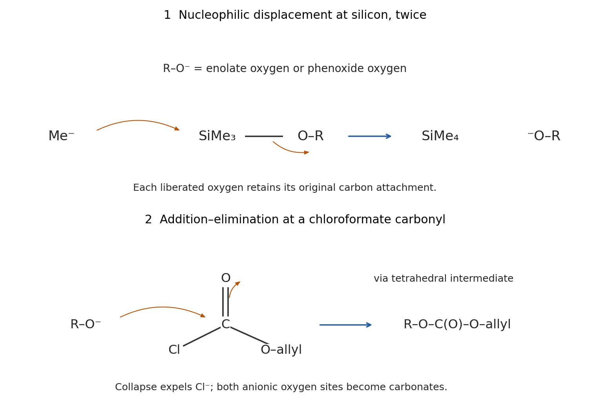

<h1 id="b1/a/iii/solution">Solution</h1>

↑ **Parent:** [Iii](../iii.md)

The initial [nucleophile](../../../../../../nucleophile.md) attacks **[silicon](../../../../../../silicon.md)**, not the nitrile or an [alkene](../../../../../../alkene.md) [carbon](../../../../../../carbon.md). Each trimethylsilyl group has an electrophilic Si center. A methyl group from [methyllithium](../../../../../../methyllithium.md) attacks Si, passing through a pentacoordinate [silicon](../../../../../../silicon.md) arrangement; Si–O cleavage releases $\mathrm{SiMe_4}$ and the [lithium](../../../../../../lithium.md) salt of the [oxygen](../../../../../../oxygen.md)-containing fragment. Cleaving the [silyl enol ether](../../../../../../silyl-enol-ether.md) generates a [lithium](../../../../../../lithium.md) [enolate](../../../../../../enolate.md); cleaving the aryl [silyl ether](../../../../../../silyl-ether.md) generates a [phenoxide](../../../../../../phenoxide.md). Neither operation needs a new [deprotonation](../../../../../../deprotonation.md) at a [carbon](../../../../../../carbon.md) [stereocenter](../../../../../../stereocenter.md).

$$
\mathrm{R{-}O{-}SiMe_3+MeLi\longrightarrow R{-}O^-Li^++SiMe_4}.
$$

Here $R{-}O^-$ represents either the [phenoxide](../../../../../../phenoxide.md) or the [oxygen](../../../../../../oxygen.md)-centered [enolate](../../../../../../enolate.md) contributor. Excess reagent permits both cleavages. The pre-existing methyl/nitrile [stereocenter](../../../../../../stereocenter.md) retains its [configuration](../../../../../../mechanical-configuration.md): it has no [hydrogen](../../../../../../hydrogen.md) to remove, and neither bond attached to that center is broken.

After [HMPA](../../../../../../hexamethylphosphoramide.md) is added, each anionic [oxygen](../../../../../../oxygen.md) attacks the [carbonyl](../../../../../../carbonyl-group.md) [carbon](../../../../../../carbon.md) of [allyl chloroformate](../../../../../../allyl-chloroformate.md). The C=O pi [electrons](../../../../../../electron.md) move to the [carbonyl](../../../../../../carbonyl-group.md) [oxygen](../../../../../../oxygen.md), giving a [tetrahedral intermediate](../../../../../../tetrahedral-intermediate.md); collapse expels [chloride](../../../../../../chloride.md). **The [enolate](../../../../../../enolate.md) becomes an allyl [enol carbonate](../../../../../../enol-carbonate.md), and the [phenoxide](../../../../../../phenoxide.md) becomes an aryl allyl carbonate**, each containing $\mathrm{O{-}C(O){-}OCH_2CH{=}CH_2}$. [oxygen](../../../../../../oxygen.md) acylation accounts for preservation of the enol double bond and for the two newly installed carbonate groups. [carbon](../../../../../../carbon.md) attack would give a different [carbon](../../../../../../carbon.md) skeleton. The two oxygens are trapped because they were selectively unmasked by [desilylation](../../../../../../desilylation.md), rather than because every [ether](../../../../../../ether.md) [oxygen](../../../../../../oxygen.md) in the molecule is equally reactive.

**[Figure 1](#b1/a/iii/image-silicon-cleavage-and-oxygen-acylation-in-the-two-site-trapping-sequence). Silicon cleavage and oxygen acylation in the two-site trapping sequence**.

## ↑ Ancestors (14)

1. [Iii](../iii.md)
2. [A](../../a.md)
3. [B1](../../../b1.md)
4. [Paper 1](../../../../paper-1-split.md)
5. [2024](../../../../split.md)
6. [Past exam of the chemistry B course of the University of Cambridge](../../../../../split.md)
7. [Chemistry B course of the University of Cambridge](../../../../../../chemistry-b-course-of-the-university-of-cambridge.md)
8. [Year 2 of the natural sciences course of the University of Cambridge](../../../../../../year-2-of-the-natural-sciences-course-of-the-university-of-cambridge.md)
9. [Year of the natural sciences course of the University of Cambridge](../../../../../../year-of-the-natural-sciences-course-of-the-university-of-cambridge.md)
10. [Natural sciences course of the University of Cambridge](../../../../../../natural-sciences-course-of-the-university-of-cambridge.md)
11. [Course of the University of Cambridge](../../../../../../course-of-the-university-of-cambridge.md)
12. [University of Cambridge](../../../../../../university-of-cambridge-split.md)
13. [List of universities](../../../../../../list-of-universities.md)
14. [Codex Wiki](../../../../../../split.md)
