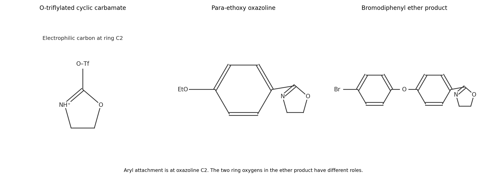

<h1 id="b1/b/i/solution">Solution</h1>

↑ **Parent:** [I](../i.md)

The [carbamate](../../../../../../carbamate.md) [carbonyl](../../../../../../carbonyl-group.md) [oxygen](../../../../../../oxygen.md) attacks electrophilic [sulfur](../../../../../../sulfur.md) of [triflic anhydride](../../../../../../triflic-anhydride.md), with cleavage of the anhydride S–O bond to release [triflate](../../../../../../triflate.md). Donation of the [nitrogen](../../../../../../nitrogen.md) [lone pair](../../../../../../lone-pair.md) toward the [carbonyl](../../../../../../carbonyl-group.md) [carbon](../../../../../../carbon.md) then gives the indicated imidoyl-type cation: the former [carbonyl](../../../../../../carbonyl-group.md) [oxygen](../../../../../../oxygen.md) now bears Tf, and the N–H [nitrogen](../../../../../../nitrogen.md) participates in a C=N$^+$ bond. This converts a relatively unreactive [carbamate](../../../../../../carbamate.md) [carbonyl](../../../../../../carbonyl-group.md) into a strongly electrophilic [carbon](../../../../../../carbon.md) bearing an excellent leaving group.

The aromatic pi bond para to ethoxy attacks that [carbon](../../../../../../carbon.md). The C=N pi [electrons](../../../../../../electron.md) move to [nitrogen](../../../../../../nitrogen.md) as the new aryl–[carbon](../../../../../../carbon.md) bond forms. Loss of the aromatic [proton](../../../../../../proton.md) restores [aromaticity](../../../../../../aromaticity.md); [nitrogen](../../../../../../nitrogen.md) donation and departure of the O-triflylated group restore the imine bond. [proton](../../../../../../proton.md) transfers during the sequence and carbonate workup remove the remaining N–H [proton](../../../../../../proton.md). The surviving five-membered ring is an oxazoline: **the product is 2-(4-ethoxyphenyl)-[2-Oxazoline](../../../../../../2-oxazoline.md)**. An equivalent arrow order can eliminate the triflyloxy leaving group before arene capture; these are limiting descriptions of the activated [electrophile](../../../../../../electrophile.md), not a need to postulate an unactivated [carbamate](../../../../../../carbamate.md) undergoing ordinary Friedel–Crafts acylation.

Ethoxy donates a [lone pair](../../../../../../lone-pair.md) into the ring, stabilizing the ortho and para [Wheland intermediates](../../../../../../arenium-ion.md). The para pathway avoids the crowding of an incoming heterocycle beside ethoxy, giving the observed position. Mechanistic experiments on this transformation include in situ [carbon](../../../../../../carbon.md) [NMR](../../../../../../nuclear-magnetic-resonance-split.md) of the activated reagent, competition experiments and isotope-effect measurements supporting [electrophilic aromatic substitution](../../../../../../electrophilic-aromatic-substitution.md); they do not directly image every intermediate.[2023, Figure 7 and supporting information, product 3a and electrophilic-substitution evidence](../../../../../../simple-and-efficient-aromatic-c-h-oxazolination-by-qiu-shi-and-others.md)

**[Figure 2](#b1/b/i/image-activated-cyclic-carbamate-and-para-substituted-oxazoline-products). Activated cyclic carbamate and para-substituted oxazoline products**.

## ↑ Ancestors (14)

1. [I](../i.md)
2. [B](../../b.md)
3. [B1](../../../b1.md)
4. [Paper 1](../../../../paper-1-split.md)
5. [2024](../../../../split.md)
6. [Past exam of the chemistry B course of the University of Cambridge](../../../../../split.md)
7. [Chemistry B course of the University of Cambridge](../../../../../../chemistry-b-course-of-the-university-of-cambridge.md)
8. [Year 2 of the natural sciences course of the University of Cambridge](../../../../../../year-2-of-the-natural-sciences-course-of-the-university-of-cambridge.md)
9. [Year of the natural sciences course of the University of Cambridge](../../../../../../year-of-the-natural-sciences-course-of-the-university-of-cambridge.md)
10. [Natural sciences course of the University of Cambridge](../../../../../../natural-sciences-course-of-the-university-of-cambridge.md)
11. [Course of the University of Cambridge](../../../../../../course-of-the-university-of-cambridge.md)
12. [University of Cambridge](../../../../../../university-of-cambridge-split.md)
13. [List of universities](../../../../../../list-of-universities.md)
14. [Codex Wiki](../../../../../../split.md)
