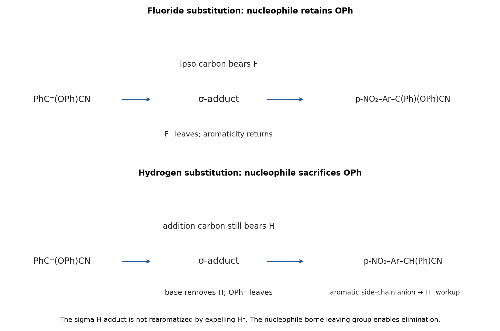

<h1 id="b2/b/i/solution">Solution</h1>

↑ **Parent:** [I](../i.md)

tert-Butoxide removes the acidic [hydrogen](../../../../../../hydrogen.md) from $\mathrm{PhCH(OPh)CN}$. The resulting [carbon](../../../../../../carbon.md) anion is stabilized by the nitrile group and the phenyl substituent. It attacks the aromatic [carbon](../../../../../../carbon.md) bearing fluorine, giving a Meisenheimer addition intermediate. Ring pi bonds shift toward the para [nitro group](../../../../../../nitro-group.md), where the negative charge can be delocalized onto [oxygen](../../../../../../oxygen.md).

Loss of fluoride restores [aromaticity](../../../../../../aromaticity.md) and gives **$\mathrm{p{-}NO_2C_6H_4{-}C(Ph)(OPh)CN}$**. This is an addition–elimination [nucleophilic aromatic substitution](../../../../../../nucleophilic-aromatic-substitution.md). The phenoxy group remains attached to the incoming [carbon](../../../../../../carbon.md). The ipso aromatic [carbon](../../../../../../carbon.md) already has a leaving group, so rearomatization can occur by fluoride departure without removing [phenoxide](../../../../../../phenoxide.md). Acid workup neutralizes residual anions; it is not a separate step that replaces the aryl fluoride.

**[Figure 3](#b2/b/i/image-contrasting-fluoride-substitution-and-vicarious-hydrogen-substitution). Contrasting fluoride substitution and vicarious hydrogen substitution**.

## ↑ Ancestors (14)

1. [I](../i.md)
2. [B](../../b.md)
3. [B2](../../../b2.md)
4. [Paper 1](../../../../paper-1-split.md)
5. [2024](../../../../split.md)
6. [Past exam of the chemistry B course of the University of Cambridge](../../../../../split.md)
7. [Chemistry B course of the University of Cambridge](../../../../../../chemistry-b-course-of-the-university-of-cambridge.md)
8. [Year 2 of the natural sciences course of the University of Cambridge](../../../../../../year-2-of-the-natural-sciences-course-of-the-university-of-cambridge.md)
9. [Year of the natural sciences course of the University of Cambridge](../../../../../../year-of-the-natural-sciences-course-of-the-university-of-cambridge.md)
10. [Natural sciences course of the University of Cambridge](../../../../../../natural-sciences-course-of-the-university-of-cambridge.md)
11. [Course of the University of Cambridge](../../../../../../course-of-the-university-of-cambridge.md)
12. [University of Cambridge](../../../../../../university-of-cambridge-split.md)
13. [List of universities](../../../../../../list-of-universities.md)
14. [Codex Wiki](../../../../../../split.md)
