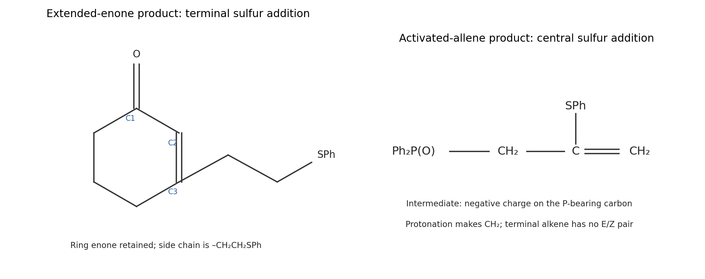

<h1 id="b2/c/i/solution">Solution</h1>

↑ **Parent:** [I](../i.md)

Hydroxide initially deprotonates a little [thiophenol](../../../../../../thiophenol.md), generating the reactive [thiolate](../../../../../../thiolate.md) $\mathrm{PhS^-}$. Number the extended conjugated system $\mathrm{O{=}C1{-}C2{=}C3{-}C4{=}C5}$, where C1–C2–C3 is the ring enone and C4=C5 is the attached vinyl group. [sulfur](../../../../../../sulfur.md) attacks the terminal delta [carbon](../../../../../../carbon.md) C5. The pi bonds relay toward [oxygen](../../../../../../oxygen.md), generating an extended [enolate](../../../../../../enolate.md).

[proton](../../../../../../proton.md) transfer at C4, either directly from [thiophenol](../../../../../../thiophenol.md) or through solvent-mediated enolization, gives the product retaining the conjugated ring enone. **The product is 3-\[2-(phenylsulfanyl)ethyl\]cyclohex-2-en-1-one**, drawn below. Its side chain is $\mathrm{-CH_2CH_2SPh}$; the ring C2=C3 double bond remains. This is net [sulfur](../../../../../../sulfur.md)/[hydrogen](../../../../../../hydrogen.md) addition to the terminal part of the extended system, proceeding through [1,6-Conjugate addition](../../../../../../1-6-conjugate-addition.md) and [protonation](../../../../../../protonation.md) of the extended [enolate](../../../../../../enolate.md).

The terminal site is less crowded than the ring beta [carbon](../../../../../../carbon.md), and the isolated product retains favorable [carbonyl](../../../../../../carbonyl-group.md)–[alkene](../../../../../../alkene.md) conjugation. Reversible [proton](../../../../../../proton.md) transfers and [conjugate addition](../../../../../../conjugate-addition.md) under [thiolate](../../../../../../thiolate.md) catalysis can favor that product over an unconjugated enone-derived alternative. Transfer of a [proton](../../../../../../proton.md) from another PhSH molecule regenerates PhS$^-$, explaining why a catalytic quantity of hydroxide suffices. The net balance is one [thiophenol](../../../../../../thiophenol.md) added, **$\mathrm{C_8H_{10}O+C_6H_6S=C_{14}H_{16}OS}$**; [carbonyl](../../../../../../carbonyl-group.md) 1,2 addition would instead produce a different functional group and is not favored for this soft [sulfur](../../../../../../sulfur.md) [nucleophile](../../../../../../nucleophile.md).

**[Figure 4](#b2/c/i/image-regioselective-sulfur-addition-to-an-extended-enone-and-an-activated-allene). Regioselective sulfur addition to an extended enone and an activated allene**.

## ↑ Ancestors (14)

1. [I](../i.md)
2. [C](../../c.md)
3. [B2](../../../b2.md)
4. [Paper 1](../../../../paper-1-split.md)
5. [2024](../../../../split.md)
6. [Past exam of the chemistry B course of the University of Cambridge](../../../../../split.md)
7. [Chemistry B course of the University of Cambridge](../../../../../../chemistry-b-course-of-the-university-of-cambridge.md)
8. [Year 2 of the natural sciences course of the University of Cambridge](../../../../../../year-2-of-the-natural-sciences-course-of-the-university-of-cambridge.md)
9. [Year of the natural sciences course of the University of Cambridge](../../../../../../year-of-the-natural-sciences-course-of-the-university-of-cambridge.md)
10. [Natural sciences course of the University of Cambridge](../../../../../../natural-sciences-course-of-the-university-of-cambridge.md)
11. [Course of the University of Cambridge](../../../../../../course-of-the-university-of-cambridge.md)
12. [University of Cambridge](../../../../../../university-of-cambridge-split.md)
13. [List of universities](../../../../../../list-of-universities.md)
14. [Codex Wiki](../../../../../../split.md)
