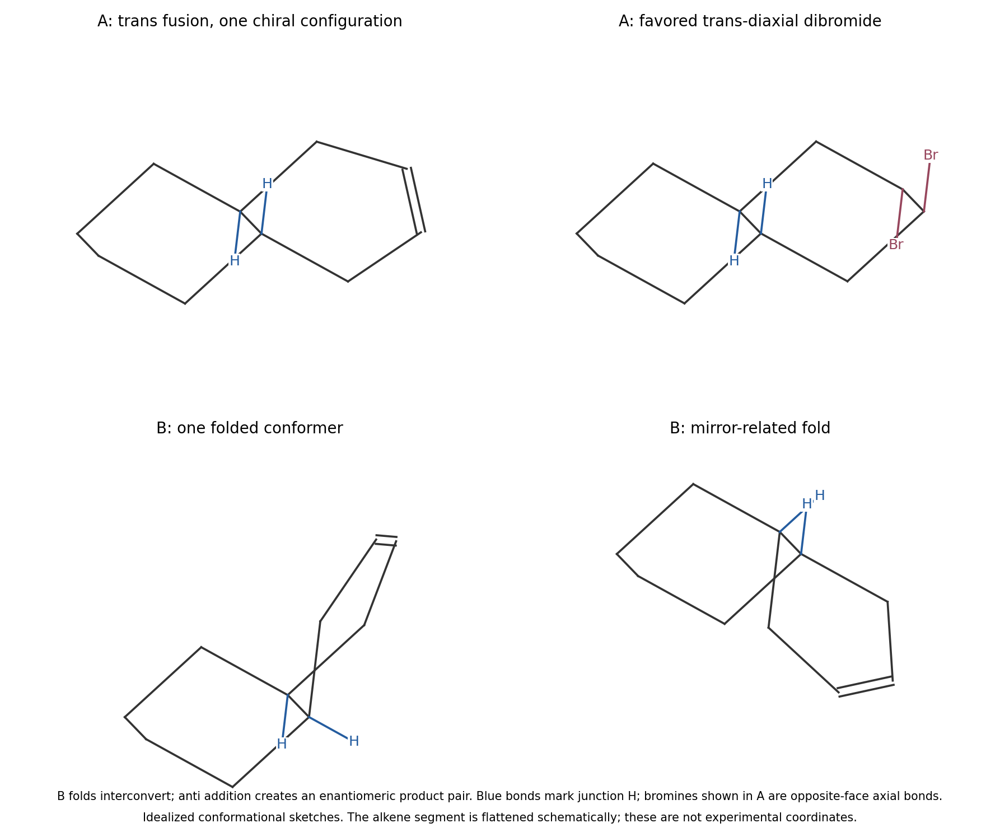

<h1 id="b3/a/solution">Solution</h1>

↑ **Parent:** [A](../a.md)

**The depicted trans-fused $A$ is [chiral](../../../../../chirality-chemistry.md); cis-fused $B$ is [achiral](../../../../../achirality.md) as a configurational species.** The unsaturated ring makes the two sides of the fused system constitutionally different. At the trans junctions of $A$, the mirror image cannot be superposed by a proper rotation; there is no surviving mirror plane or inversion center that exchanges the two distinct rings correctly. A twofold rotational relationship is compatible with chirality and does not remove it. This is why simply importing the chirality conclusion for fully saturated trans-[decalin](../../../../../decalin.md) would be unsafe.

For $B$, interchange of the two junction ends relates the opposite local stereochemical senses. An individual folded cis conformer may look [chiral](../../../../../chirality-chemistry.md), but [ring inversion](../../../../../ring-inversion.md) interconverts its mirror-related [conformations](../../../../../conformation.md) without changing junction [configuration](../../../../../mechanical-configuration.md). The configurations therefore describe a meso/[achiral](../../../../../achirality.md) species rather than a persistent enantiomeric pair. The conformational sketches below distinguish the rigid trans arrangement from the two accessible cis folds; the [alkene](../../../../../alkene.md) ring is represented schematically as a half-chair-like unit.

**[Figure 5](#b3/a/image-fused-ring-conformations-and-the-stereochemical-consequences-of-anti-bromination). Fused-ring conformations and the stereochemical consequences of anti bromination**.

## ↑ Ancestors (13)

1. [A](../a.md)
2. [B3](../../b3.md)
3. [Paper 1](../../../paper-1-split.md)
4. [2024](../../../split.md)
5. [Past exam of the chemistry B course of the University of Cambridge](../../../../split.md)
6. [Chemistry B course of the University of Cambridge](../../../../../chemistry-b-course-of-the-university-of-cambridge.md)
7. [Year 2 of the natural sciences course of the University of Cambridge](../../../../../year-2-of-the-natural-sciences-course-of-the-university-of-cambridge.md)
8. [Year of the natural sciences course of the University of Cambridge](../../../../../year-of-the-natural-sciences-course-of-the-university-of-cambridge.md)
9. [Natural sciences course of the University of Cambridge](../../../../../natural-sciences-course-of-the-university-of-cambridge.md)
10. [Course of the University of Cambridge](../../../../../course-of-the-university-of-cambridge.md)
11. [University of Cambridge](../../../../../university-of-cambridge-split.md)
12. [List of universities](../../../../../list-of-universities.md)
13. [Codex Wiki](../../../../../split.md)
