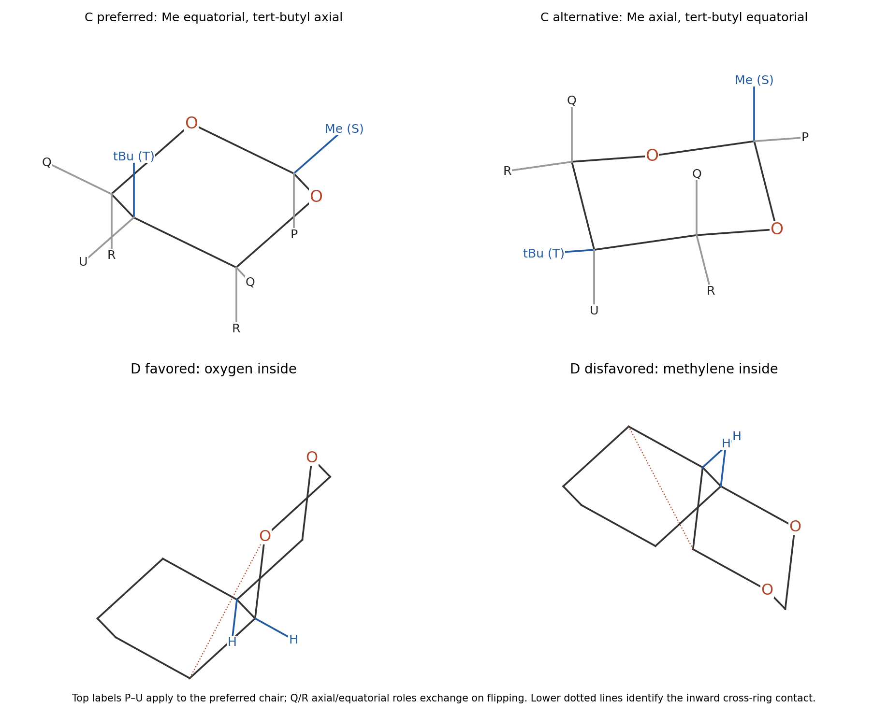

<h1 id="b3/c/i/solution">Solution</h1>

↑ **Parent:** [I](../i.md)

Number the dioxane O1–C2–O3–C4–C5–C6, with methyl at C2 and tert-butyl at C5. Their cis relationship is maintained on [ring inversion](../../../../../../ring-inversion.md), but because they occupy opposite ring positions, one is axial and the other equatorial in either chair. The two alternatives are **C2–Me equatorial/C5–tert-butyl axial**, and **C2–Me axial/C5–tert-butyl equatorial**.

The key signal is **U, the C5 methine, with only small [vicinal couplings](../../../../../../vicinal-coupling.md), 3.7 and 1.3 Hz**. An axial H5 would have large trans-diaxial couplings to axial [hydrogens](../../../../../../hydrogen.md) on C4 and C6. Their absence identifies H5 as equatorial, hence **the preferred conformer has axial tert-butyl and equatorial methyl**. It is not sufficient to guess from tert-butyl bulk. The tert-butyl singlet itself supplies no vicinal H–H coupling information about its orientation.

**[Figure 6](#b3/c/i/image-preferred-and-alternative-dioxane-chairs-proton-assignments-and-the-o-inside-fused-ring-preference). Preferred and alternative dioxane chairs, proton assignments and the O-inside fused-ring preference**.

## ↑ Ancestors (14)

1. [I](../i.md)
2. [C](../../c.md)
3. [B3](../../../b3.md)
4. [Paper 1](../../../../paper-1-split.md)
5. [2024](../../../../split.md)
6. [Past exam of the chemistry B course of the University of Cambridge](../../../../../split.md)
7. [Chemistry B course of the University of Cambridge](../../../../../../chemistry-b-course-of-the-university-of-cambridge.md)
8. [Year 2 of the natural sciences course of the University of Cambridge](../../../../../../year-2-of-the-natural-sciences-course-of-the-university-of-cambridge.md)
9. [Year of the natural sciences course of the University of Cambridge](../../../../../../year-of-the-natural-sciences-course-of-the-university-of-cambridge.md)
10. [Natural sciences course of the University of Cambridge](../../../../../../natural-sciences-course-of-the-university-of-cambridge.md)
11. [Course of the University of Cambridge](../../../../../../course-of-the-university-of-cambridge.md)
12. [University of Cambridge](../../../../../../university-of-cambridge-split.md)
13. [List of universities](../../../../../../list-of-universities.md)
14. [Codex Wiki](../../../../../../split.md)
