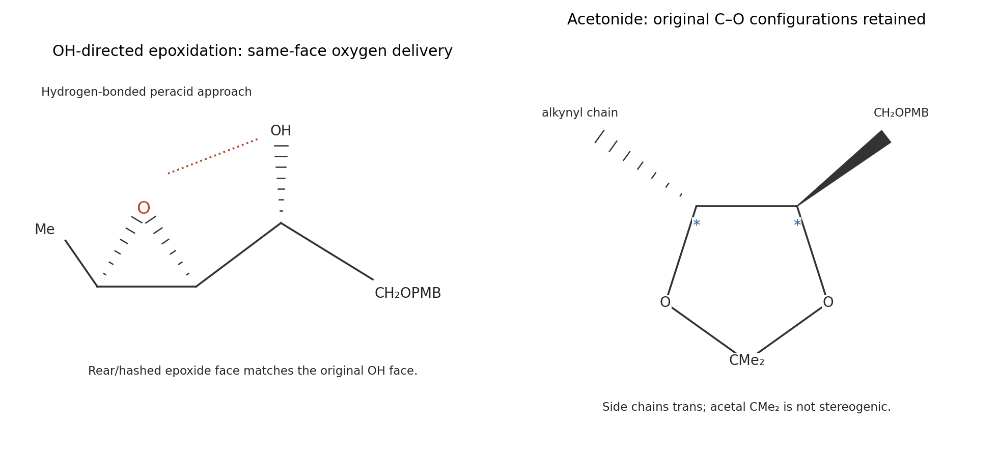

<h1 id="b4/a/solution">Solution</h1>

↑ **Parent:** [A](../a.md)

The [alkene](../../../../../alkene.md) undergoes concerted [oxygen](../../../../../oxygen.md) transfer from the terminal peroxide [oxygen](../../../../../oxygen.md) of [mCPBA](../../../../../metachloroperbenzoic-acid.md). In the cyclic [electron](../../../../../electron.md)-flow description, the [alkene](../../../../../alkene.md) pi bond begins one C–O bond, the peroxide [oxygen](../../../../../oxygen.md) supplies the second, O–O breaks, and [proton](../../../../../proton.md) transfer/carboxyl rearrangement gives m-chlorobenzoic acid. Both C–O bonds are installed from the same [alkene](../../../../../alkene.md) face, so the [alkene](../../../../../alkene.md)'s relative substituent geometry is retained in the [epoxide](../../../../../epoxide.md). There is no freely rotating carbocation intermediate.

The neighboring free OH [hydrogen](../../../../../hydrogen.md)-bonds to the approaching peracid and favors a cyclic, organized transition-state geometry. **[oxygen](../../../../../oxygen.md) is delivered from the OH-directed face, giving the indicated syn relationship between [epoxide](../../../../../epoxide.md) [oxygen](../../../../../oxygen.md) and the allylic hydroxyl.** In the supplied projection, the [epoxide](../../../../../epoxide.md) C–O bonds and the original C–OH bond are on the rear/hashed face. Steric interactions still influence the preferred [hydrogen](../../../../../hydrogen.md)-bonded conformer, but “attack from the least hindered face” alone misses the positive directing role of OH. The distant benzyl [ether](../../../../../ether.md) is not the directing free hydroxyl.

The classical experimental comparison of allylic alcohols and protected derivatives established this directing principle; it supports the mechanistic interpretation without itself measuring the selectivity of this acyclic substrate.[1957, pp. 1958–1965, hydroxyl-directed peracid epoxidation](../../../../../376-aspects-of-stereochemistry-part-i-stereospecificity-in-formation-of-epoxides-from-cyclic-allylic-alcohols-by-h-b-henbest-and-r-a-l-wilson.md)

**[Figure 7](#b4/a/image-hydroxyl-directed-oxygen-transfer-and-stereoretentive-acetonide-formation). Hydroxyl-directed oxygen transfer and stereoretentive acetonide formation**.

## ↑ Ancestors (13)

1. [A](../a.md)
2. [B4](../../b4.md)
3. [Paper 1](../../../paper-1-split.md)
4. [2024](../../../split.md)
5. [Past exam of the chemistry B course of the University of Cambridge](../../../../split.md)
6. [Chemistry B course of the University of Cambridge](../../../../../chemistry-b-course-of-the-university-of-cambridge.md)
7. [Year 2 of the natural sciences course of the University of Cambridge](../../../../../year-2-of-the-natural-sciences-course-of-the-university-of-cambridge.md)
8. [Year of the natural sciences course of the University of Cambridge](../../../../../year-of-the-natural-sciences-course-of-the-university-of-cambridge.md)
9. [Natural sciences course of the University of Cambridge](../../../../../natural-sciences-course-of-the-university-of-cambridge.md)
10. [Course of the University of Cambridge](../../../../../course-of-the-university-of-cambridge.md)
11. [University of Cambridge](../../../../../university-of-cambridge-split.md)
12. [List of universities](../../../../../list-of-universities.md)
13. [Codex Wiki](../../../../../split.md)
