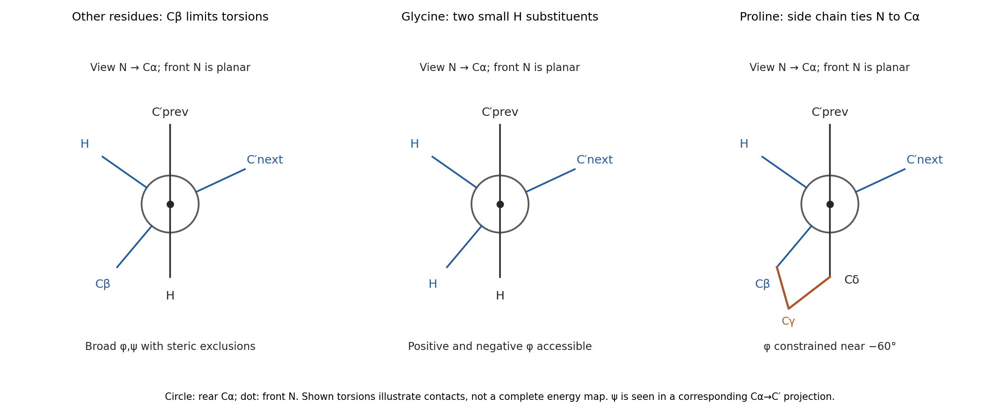

<h1 id="b5/c/solution">Solution</h1>

↑ **Parent:** [C](../c.md)

View the backbone along N–C$_\alpha$ to display $\phi=\angle(C'_{i-1},N_i,C_{\alpha i},C'_i)$ in a [Newman projection](../../../../../newman-projection.md). The front [amide](../../../../../amide.md) [nitrogen](../../../../../nitrogen.md) carries the preceding [carbonyl](../../../../../carbonyl-group.md) and H, while the back C$_\alpha$ carries the next [carbonyl](../../../../../carbonyl-group.md), H and side chain. Rotation changes the contacts among these groups. A corresponding view along C$_\alpha$–C$'$ displays $\psi$. The [peptide](../../../../../peptide.md) C$'$–N bond itself is approximately planar and is not the freely rotating bond in either definition.

**[Figure 10](#b5/c/image-newman-views-of-backbone-torsions-and-the-contrasting-restrictions-of-glycine-and-proline). Newman views of backbone torsions and the contrasting restrictions of glycine and proline**.

**[glycine](../../../../../glycine.md) replaces the side chain by a second [hydrogen](../../../../../hydrogen.md).** Removing C$_\beta$ removes many contacts that exclude backbone arrangements for other residues, so its allowed $\phi,\psi$ region is much broader and includes substantial positive-$\phi$ space. Its alpha [carbon](../../../../../carbon.md) is also [achiral](../../../../../achirality.md), so the steric map is approximately mirror-symmetric between positive and negative torsions in the simple isolated-residue model.

**[proline](../../../../../proline.md) closes a five-membered ring from C$_\alpha$ through three methylenes back to [nitrogen](../../../../../nitrogen.md).** In the N–C$_\alpha$ projection, the [nitrogen](../../../../../nitrogen.md)'s side-chain arm and C$_\alpha$'s C$_\beta$ arm are tied together, preventing unrestricted relative rotation. Its $\phi$ is consequently confined near the usual negative-$60^\circ$ region rather than exploring the broad range of an acyclic [amino acid](../../../../../amino-acid.md). [proline](../../../../../proline.md) also lacks a backbone N–H donor when incorporated into an ordinary internal [peptide](../../../../../peptide.md). Ring closure restricts $\phi$ strongly, but does not freeze every backbone or ring degree of freedom. These differences are naturally represented by distinct [Ramachandran plots](../../../../../ramachandran-plot.md); the original torsion/steric analysis established the basis for such comparisons.[1963, pp. 95–99, backbone torsions and steric restrictions](../../../../../stereochemistry-of-polypeptide-chain-configurations-by-g-n-ramachandran-and-others.md)

## ↑ Ancestors (13)

1. [C](../c.md)
2. [B5](../../b5.md)
3. [Paper 1](../../../paper-1-split.md)
4. [2024](../../../split.md)
5. [Past exam of the chemistry B course of the University of Cambridge](../../../../split.md)
6. [Chemistry B course of the University of Cambridge](../../../../../chemistry-b-course-of-the-university-of-cambridge.md)
7. [Year 2 of the natural sciences course of the University of Cambridge](../../../../../year-2-of-the-natural-sciences-course-of-the-university-of-cambridge.md)
8. [Year of the natural sciences course of the University of Cambridge](../../../../../year-of-the-natural-sciences-course-of-the-university-of-cambridge.md)
9. [Natural sciences course of the University of Cambridge](../../../../../natural-sciences-course-of-the-university-of-cambridge.md)
10. [Course of the University of Cambridge](../../../../../course-of-the-university-of-cambridge.md)
11. [University of Cambridge](../../../../../university-of-cambridge-split.md)
12. [List of universities](../../../../../list-of-universities.md)
13. [Codex Wiki](../../../../../split.md)
