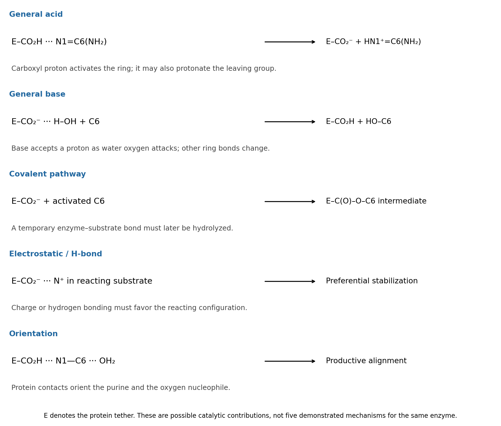

<h1 id="b10/b/solution">Solution</h1>

↑ **Parent:** [B](../b.md)

A [glutamic acid residue](../../../../../glutamic-acid-residue.md) supplies a carboxyl group whose [protonation](../../../../../protonation.md) state can change with the [active site](../../../../../active-site.md) environment. The following five schematic contributions are possible in a hypothetical [enzyme](../../../../../enzyme-split.md); they are alternatives and overlapping physical effects, rather than five independently established reactions of this [enzyme](../../../../../enzyme-split.md). In the diagrams $E$ is the protein tether, and $C6$ is the reacting [purine](../../../../../purine.md) [carbon](../../../../../carbon.md).

**[Figure 6](#b10/b/image-five-possible-catalytic-contributions-of-a-glutamate-side-chain-to-hydrolytic-deamination). Five possible catalytic contributions of a glutamate side chain to hydrolytic deamination**.

**[general acid catalysis](../../../../../general-acid-catalysis.md):** $\mathrm{E{-}CO_2H\cdots N1\to E{-}CO_2^-+H{-}N1^+}$. Donation of the carboxyl proton activates the amidine-like C6 center for [water](../../../../../water.md) attack. The same acid could instead assist the amino leaving group: $\mathrm{E{-}CO_2H+{-}NH_2\to E{-}CO_2^-+{-}NH_3^+}$. These are two locations for [general acid catalysis](../../../../../general-acid-catalysis.md), rather than two different categories.

**[general base catalysis](../../../../../general-base-catalysis.md):** $\mathrm{E{-}CO_2^-\cdots H{-}OH\to E{-}CO_2H+OH^-}$, coupled to [oxygen](../../../../../oxygen.md) attack on C6. Accepting a proton makes [water](../../../../../water.md) a more effective [nucleophile](../../../../../nucleophile.md). This does not require an appreciable pool of free [hydroxide](../../../../../hydroxide.md) in bulk solution.

**[covalent catalysis](../../../../../covalent-catalysis.md):** a glutamate [oxygen](../../../../../oxygen.md) can in principle attack activated C6 to form $\mathrm{C6{-}O{-}C(O){-}E}$. After addition/elimination replaces the amino group, [water](../../../../../water.md) must hydrolyze that transient [enzyme](../../../../../enzyme-split.md)–[substrate](../../../../../substrate-biochemistry.md) bond to release product and regenerate $\mathrm{E{-}CO_2H/CO_2^-}$. Such a pathway is a chemically distinct possibility, not established by the given structure.

**[electrostatic catalysis](../../../../../electrostatic-catalysis.md):** the [carboxylate](../../../../../carboxylate.md) can stabilize a developing positive charge, for example in a protonated [purine](../../../../../purine.md) or amino leaving group; a protonated carboxyl can also donate a [hydrogen bond](../../../../../hydrogen-bond.md) to an [oxygen](../../../../../oxygen.md) developing negative charge. This contributes only if the reacting configuration is stabilized relative to the bound starting state. A [carboxylate](../../../../../carboxylate.md) placed next to an [oxyanion](../../../../../oxyanion.md) without compensating geometry would instead be unfavorable.

**[proximity and orientation catalysis](../../../../../proximity-and-orientation-catalysis.md):** donor and acceptor [hydrogen bonds](../../../../../hydrogen-bond.md) can hold the [purine](../../../../../purine.md) and attacking [water](../../../../../water.md) in a productive arrangement, schematically $\mathrm{E{-}CO_2H\cdots N1{-}C6\cdots OH_2}$. Binding reduces unproductive orientations and can distort the [substrate](../../../../../substrate-biochemistry.md) toward a reactive geometry. This last contribution is sometimes described through [substrate](../../../../../substrate-biochemistry.md) binding or strain; a binding interaction is not automatically catalytic unless it improves access to the [transition state](../../../../../transition-state.md).

## ↑ Ancestors (13)

1. [B](../b.md)
2. [B10](../../b10.md)
3. [Paper 2](../../../paper-2-split.md)
4. [2024](../../../split.md)
5. [Past exam of the chemistry B course of the University of Cambridge](../../../../split.md)
6. [Chemistry B course of the University of Cambridge](../../../../../chemistry-b-course-of-the-university-of-cambridge.md)
7. [Year 2 of the natural sciences course of the University of Cambridge](../../../../../year-2-of-the-natural-sciences-course-of-the-university-of-cambridge.md)
8. [Year of the natural sciences course of the University of Cambridge](../../../../../year-of-the-natural-sciences-course-of-the-university-of-cambridge.md)
9. [Natural sciences course of the University of Cambridge](../../../../../natural-sciences-course-of-the-university-of-cambridge.md)
10. [Course of the University of Cambridge](../../../../../course-of-the-university-of-cambridge.md)
11. [University of Cambridge](../../../../../university-of-cambridge-split.md)
12. [List of universities](../../../../../list-of-universities.md)
13. [Codex Wiki](../../../../../split.md)
