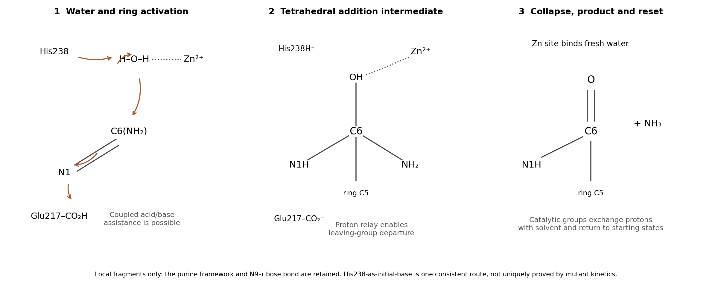

<h1 id="b10/e/solution">Solution</h1>

↑ **Parent:** [E](../e.md)

A chemically coherent mechanism combines zinc-activated [water](../../../../../water.md) addition with a [proton relay](../../../../../proton-relay.md) involving His238 and Glu217. In a simple route consistent with the displayed contacts, neutral His238 accepts a proton from zinc-bound [water](../../../../../water.md) while protonated Glu217 donates to [substrate](../../../../../substrate-biochemistry.md) N1. These transfers can be coupled to the bond-forming event rather than requiring accumulation of a free, doubly activated [substrate](../../../../../substrate-biochemistry.md). Zinc-bound [hydroxide](../../../../../hydroxide.md) attacks C6; the C6=N1 pi [electrons](../../../../../electron.md) move onto N1, yielding the tetrahedral C6 intermediate bearing OH and NH$_2$ while N1 bears H.

**[Figure 7](#b10/e/image-one-proton-relay-mechanism-consistent-with-water-derived-oxygen-and-the-catalytic-residues). One proton-relay mechanism consistent with water-derived oxygen and the catalytic residues**.

Next, the exocyclic amino group receives a proton, through His238, Glu217 and/or intervening [water](../../../../../water.md) as permitted by the changing geometry. The [oxygen](../../../../../oxygen.md) is deprotonated as it forms the C6 carbonyl, and the C6–N6 bond cleaves to release [ammonia](../../../../../ammonia.md). These transfers can be coupled in the collapse step, avoiding expulsion of $\mathrm{NH_2^-}$. Zinc stabilizes the reacting [oxygen](../../../../../oxygen.md) and the organized intermediate; the ring regains conjugation in the [inosine](../../../../../inosine.md) product. Product dissociation, fresh [water](../../../../../water.md) binding and proton exchange with solvent reset the catalytic groups.

**The core result is zinc-assisted addition–elimination, with acid/base [proton transfers](../../../../../proton-transfer.md) and [water](../../../../../water.md) supplying C6 [oxygen](../../../../../oxygen.md).** The contributions are [metal ion catalysis](../../../../../metal-ion-catalysis.md), [general base catalysis](../../../../../general-base-catalysis.md), [general acid catalysis](../../../../../general-acid-catalysis.md), [electrostatic catalysis](../../../../../electrostatic-catalysis.md) and [proximity and orientation catalysis](../../../../../proximity-and-orientation-catalysis.md). The proposed route does not require [covalent catalysis](../../../../../covalent-catalysis.md) by a protein side chain: a [substrate](../../../../../substrate-biochemistry.md)–[water](../../../../../water.md) C–O bond is not an [enzyme](../../../../../enzyme-split.md)–[substrate](../../../../../substrate-biochemistry.md) covalent linkage. Asp296 can retain a structural hydrogen-bonding role without acting as an indispensable acid/base.

The data establish the importance of His238 and Glu217 but do not uniquely assign the entire [proton relay](../../../../../proton-relay.md). In particular, an alternative has Glu217 first deprotonate [water](../../../../../water.md) and then deliver that proton to N1, with His238 assisting [hydroxide](../../../../../hydroxide.md) stabilization and later amino-group [protonation](../../../../../protonation.md). The primary observation that His238 substitution need not abolish analogue hydration cautions against calling its initial-base role proven.[1996, pp. 15019–15028, retained hydroxylate formation and proposed electrostatic contribution](../../../../../site-directed-mutagenesis-of-histidine-238-in-mouse-adenosine-deaminase-substitution-of-histidine-238-does-not-impede-hydroxylate-formation-by-v-sideraki-and-others.md) pH-rate profiles, solvent isotope effects and time-resolved intermediate experiments would discriminate these refinements. The diagram is a proposed catalytic route, not a structure directly observed by the crystal experiment.

## ↑ Ancestors (13)

1. [E](../e.md)
2. [B10](../../b10.md)
3. [Paper 2](../../../paper-2-split.md)
4. [2024](../../../split.md)
5. [Past exam of the chemistry B course of the University of Cambridge](../../../../split.md)
6. [Chemistry B course of the University of Cambridge](../../../../../chemistry-b-course-of-the-university-of-cambridge.md)
7. [Year 2 of the natural sciences course of the University of Cambridge](../../../../../year-2-of-the-natural-sciences-course-of-the-university-of-cambridge.md)
8. [Year of the natural sciences course of the University of Cambridge](../../../../../year-of-the-natural-sciences-course-of-the-university-of-cambridge.md)
9. [Natural sciences course of the University of Cambridge](../../../../../natural-sciences-course-of-the-university-of-cambridge.md)
10. [Course of the University of Cambridge](../../../../../course-of-the-university-of-cambridge.md)
11. [University of Cambridge](../../../../../university-of-cambridge-split.md)
12. [List of universities](../../../../../list-of-universities.md)
13. [Codex Wiki](../../../../../split.md)
