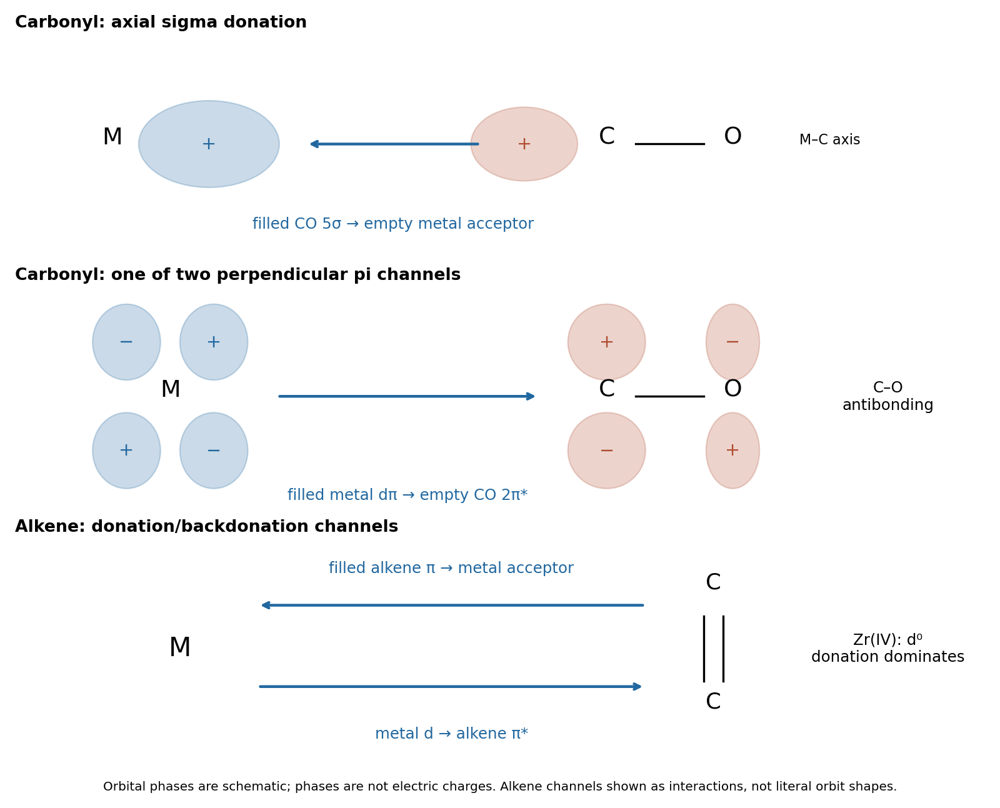

<h1 id="b6/a/solution">Solution</h1>

↑ **Parent:** [A](../a.md)

The [carbon](../../../../../carbon.md) end of a [carbonyl ligand](../../../../../carbonyl-ligand.md) has a filled $5\sigma$ [molecular orbital](../../../../../molecular-orbital.md) with an outward-facing lobe. Its overlap with a vacant [metal](../../../../../metal.md) orbital of the same axial symmetry gives CO-to-[metal](../../../../../metal.md) [sigma donation](../../../../../sigma-donation.md). Occupied [metal](../../../../../metal.md) $d_\pi$ orbitals can simultaneously overlap with the empty CO $2\pi^*$ [antibonding molecular orbitals](../../../../../antibonding-orbital.md), giving [metal](../../../../../metal.md)-to-CO [pi backbonding](../../../../../pi-backbonding.md). Two perpendicular pi channels are possible; the schematic represents one. Orbital signs indicate phase, not [electric charge](../../../../../electric-charge-split.md).

**[Figure 1](#b6/a/image-complementary-donation-and-backbonding-in-carbonyl-and-alkene-coordination). Complementary donation and backbonding in carbonyl and alkene coordination**.

The two interactions reinforce one another: [sigma donation](../../../../../sigma-donation.md) transfers density toward the [metal](../../../../../metal.md), and [pi backbonding](../../../../../pi-backbonding.md) distributes it into the ligand acceptor orbitals. **Both strengthen M–C attachment, while backbonding weakens C–O.** Occupation of CO $\pi^*$ decreases the internal C–O [bond order](../../../../../bond-order.md), generally increasing its [bond length](../../../../../bond-length.md) and lowering its stretching [spectroscopic wavenumber](../../../../../spectroscopic-wavenumber.md). This is why a strongly backbonded [carbonyl ligand](../../../../../carbonyl-ligand.md) can have a strong [metal](../../../../../metal.md)–[carbon](../../../../../carbon.md) bond and a weakened internal [carbon](../../../../../carbon.md)–[oxygen](../../../../../oxygen.md) bond at the same time.

## ↑ Ancestors (13)

1. [A](../a.md)
2. [B6](../../b6.md)
3. [Paper 2](../../../paper-2-split.md)
4. [2024](../../../split.md)
5. [Past exam of the chemistry B course of the University of Cambridge](../../../../split.md)
6. [Chemistry B course of the University of Cambridge](../../../../../chemistry-b-course-of-the-university-of-cambridge.md)
7. [Year 2 of the natural sciences course of the University of Cambridge](../../../../../year-2-of-the-natural-sciences-course-of-the-university-of-cambridge.md)
8. [Year of the natural sciences course of the University of Cambridge](../../../../../year-of-the-natural-sciences-course-of-the-university-of-cambridge.md)
9. [Natural sciences course of the University of Cambridge](../../../../../natural-sciences-course-of-the-university-of-cambridge.md)
10. [Course of the University of Cambridge](../../../../../course-of-the-university-of-cambridge.md)
11. [University of Cambridge](../../../../../university-of-cambridge-split.md)
12. [List of universities](../../../../../list-of-universities.md)
13. [Codex Wiki](../../../../../split.md)
