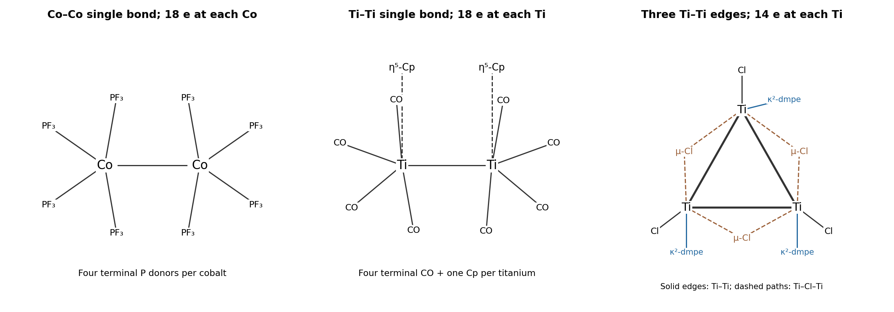

<h1 id="b6/b/i/solution">Solution</h1>

↑ **Parent:** [I](../i.md)

Place four terminal [trifluorophosphine](../../../../../../trifluorophosphine.md) donors on each [cobalt](../../../../../../cobalt.md) and join the [cobalt](../../../../../../cobalt.md) centers by a single [metal-metal bond](../../../../../../metal-metal-bond.md), as in the first panel. The P atoms bind to [cobalt](../../../../../../cobalt.md); the fluorines remain attached to [phosphorus](../../../../../../phosphorus.md). Each neutral donor supplies two [electrons](../../../../../../electron.md). Neutral [electron counting](../../../../../../electron-counting.md) gives

$$
\boxed{\mathrm{VE(Co)}=9+4(2)+1=18.}
$$

The ionic description is Co(0), $d^9$, with eight [electrons](../../../../../../electron.md) from the four donors and one from the Co–Co bond. **A Co–Co single bond supplies the missing [electron](../../../../../../electron.md) at each center.** No bridging PF$_3$ is required by this count.

**[Figure 2](#b6/b/i/image-proposed-metal-connectivity-and-ligand-arrangements-for-the-three-electron-counts). Proposed metal-connectivity and ligand arrangements for the three electron counts**.

## ↑ Ancestors (14)

1. [I](../i.md)
2. [B](../../b.md)
3. [B6](../../../b6.md)
4. [Paper 2](../../../../paper-2-split.md)
5. [2024](../../../../split.md)
6. [Past exam of the chemistry B course of the University of Cambridge](../../../../../split.md)
7. [Chemistry B course of the University of Cambridge](../../../../../../chemistry-b-course-of-the-university-of-cambridge.md)
8. [Year 2 of the natural sciences course of the University of Cambridge](../../../../../../year-2-of-the-natural-sciences-course-of-the-university-of-cambridge.md)
9. [Year of the natural sciences course of the University of Cambridge](../../../../../../year-of-the-natural-sciences-course-of-the-university-of-cambridge.md)
10. [Natural sciences course of the University of Cambridge](../../../../../../natural-sciences-course-of-the-university-of-cambridge.md)
11. [Course of the University of Cambridge](../../../../../../course-of-the-university-of-cambridge.md)
12. [University of Cambridge](../../../../../../university-of-cambridge-split.md)
13. [List of universities](../../../../../../list-of-universities.md)
14. [Codex Wiki](../../../../../../split.md)
