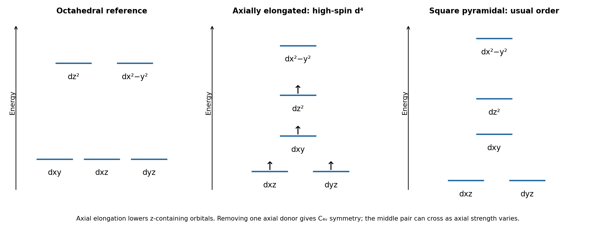

<h1 id="b7/a/iii/solution">Solution</h1>

↑ **Parent:** [Iii](../iii.md)

The [metal](../../../../../../metal.md) is Cr(II), $d^4$. A [chloride ligand](../../../../../../chloride-ligand.md) produces a relatively weak [ligand field](../../../../../../ligand-field.md), so the octahedral center is a [high-spin complex](../../../../../../high-spin-complex.md) with $t_{2g}^3e_g^1$, $S=2$. The singly occupied $e_g$ pair is orbitally degenerate: $d_{z^2}$ and $d_{x^2-y^2}$ cannot retain identical occupancies once the distortion selects one. This is a strong setting for the [Jahn-Teller effect](../../../../../../jahn-teller-effect.md).

On tetragonal elongation, the two axial Cr–Cl distances increase. Repulsion is reduced most for $d_{z^2}$, so it falls relative to $d_{x^2-y^2}$; $d_{xz},d_{yz}$ also fall relative to $d_{xy}$. The single $e_g$ [electron](../../../../../../electron.md) occupies the lower $d_{z^2}$-derived level. The electronic stabilization offsets an elastic cost until a distorted equilibrium geometry is reached. **The high-[spin](../../../../../../spin.md) $d^4$ occupancy drives an elongated, rather than regular, octahedron.** The three lower-set [electrons](../../../../../../electron.md) remain one per orbital in this simple diagram; it is primarily the unequal $e_g$ occupancy that produces the strong distortion.

**[Figure 3](#b7/a/iii/image-qualitative-d-orbital-correlations-for-axial-elongation-and-axial-ligand-removal). Qualitative d-orbital correlations for axial elongation and axial-ligand removal**.

## ↑ Ancestors (14)

1. [Iii](../iii.md)
2. [A](../../a.md)
3. [B7](../../../b7.md)
4. [Paper 2](../../../../paper-2-split.md)
5. [2024](../../../../split.md)
6. [Past exam of the chemistry B course of the University of Cambridge](../../../../../split.md)
7. [Chemistry B course of the University of Cambridge](../../../../../../chemistry-b-course-of-the-university-of-cambridge.md)
8. [Year 2 of the natural sciences course of the University of Cambridge](../../../../../../year-2-of-the-natural-sciences-course-of-the-university-of-cambridge.md)
9. [Year of the natural sciences course of the University of Cambridge](../../../../../../year-of-the-natural-sciences-course-of-the-university-of-cambridge.md)
10. [Natural sciences course of the University of Cambridge](../../../../../../natural-sciences-course-of-the-university-of-cambridge.md)
11. [Course of the University of Cambridge](../../../../../../course-of-the-university-of-cambridge.md)
12. [University of Cambridge](../../../../../../university-of-cambridge-split.md)
13. [List of universities](../../../../../../list-of-universities.md)
14. [Codex Wiki](../../../../../../split.md)
