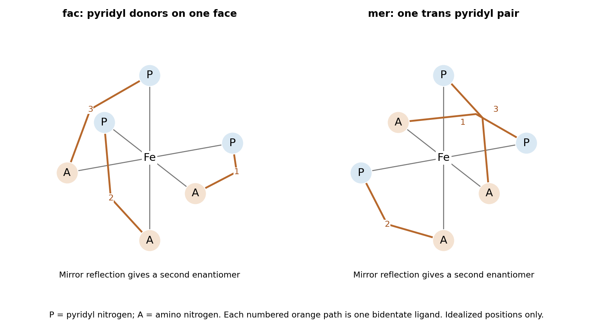

<h1 id="b8/a/i/solution">Solution</h1>

↑ **Parent:** [I](../i.md)

Treat the two donors of [2-Picolylamine](../../../../../../2-picolylamine.md) as distinct: $P$ denotes pyridyl N and $A$ denotes amino N. Each ligand must join two adjacent octahedral positions because its five-membered [chelate ring](../../../../../../chelate-ring.md) cannot span a trans pair. The three $P$ sites can either occupy a triangular face, giving a [facial isomer](../../../../../../facial-isomer.md), or a meridian containing a trans pair, giving a [meridional isomer](../../../../../../meridional-isomer.md). Each geometry has a pair of nonsuperposable mirror images. Therefore **there are four configurational [stereoisomers](../../../../../../stereoisomer.md): fac-$\Delta$, fac-$\Lambda$, mer-$\Delta$ and mer-$\Lambda$**. Rapid ring puckering or amine inversion does not introduce additional persistent configurations in this count.

**[Figure 4](#b8/a/i/image-distinct-fac-and-mer-arrangements-of-an-unsymmetrical-bidentate-ligand-each-has-a-mirror-partner). Distinct fac and mer arrangements of an unsymmetrical bidentate ligand; each has a mirror partner**.

**The mer geometry is the reasonable steric prediction for the more stable form.** It spreads the bulky pyridyl rings farther apart, allowing one pyridyl–pyridyl trans relationship, whereas the fac geometry groups all three pyridyl donors on one face. This is a qualitative preference, not a proof independent of [counterions](../../../../../../counterion.md) and solvent: hydrogen bonding and packing can favor the alternative. Primary structures of different salts contain both geometries, so neither should be claimed impossible.[2015, pp. 7857–7867, mer structures in compounds 1 and 2 and fac structure in compound 3](../../../../../../spin-crossover-in-fe-2-picolylamine-3-2-plus-adjusted-by-organosulfonate-anions-by-xin-hua-zhao-and-others.md)

## ↑ Ancestors (14)

1. [I](../i.md)
2. [A](../../a.md)
3. [B8](../../../b8.md)
4. [Paper 2](../../../../paper-2-split.md)
5. [2024](../../../../split.md)
6. [Past exam of the chemistry B course of the University of Cambridge](../../../../../split.md)
7. [Chemistry B course of the University of Cambridge](../../../../../../chemistry-b-course-of-the-university-of-cambridge.md)
8. [Year 2 of the natural sciences course of the University of Cambridge](../../../../../../year-2-of-the-natural-sciences-course-of-the-university-of-cambridge.md)
9. [Year of the natural sciences course of the University of Cambridge](../../../../../../year-of-the-natural-sciences-course-of-the-university-of-cambridge.md)
10. [Natural sciences course of the University of Cambridge](../../../../../../natural-sciences-course-of-the-university-of-cambridge.md)
11. [Course of the University of Cambridge](../../../../../../course-of-the-university-of-cambridge.md)
12. [University of Cambridge](../../../../../../university-of-cambridge-split.md)
13. [List of universities](../../../../../../list-of-universities.md)
14. [Codex Wiki](../../../../../../split.md)
