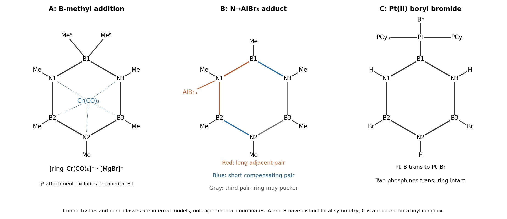

<h1 id="b9/b/i/solution">Solution</h1>

↑ **Parent:** [I](../i.md)

The methyl [nucleophile](../../../../../../nucleophile.md) attacks an electrophilic ring boron. That boron becomes tetrahedral, bearing its original methyl, the incoming methyl, and its two ring [nitrogen](../../../../../../nitrogen.md) neighbors. This interrupts its p-orbital participation, so the [metal](../../../../../../metal.md) attaches to the remaining five-atom conjugated segment. **$A$ is the anionic $\eta^5$ heptamethylated-ring Cr(CO)$_3$ complex**, paired formally with $[\mathrm{MgBr}]^+$; solvent ligation and ion pairing at magnesium are not specified by the spectrum. The original connectivity, with the attacked boron labeled $B_1$, is shown in the first panel below.

**[Figure 5](#b9/b/i/image-structures-inferred-from-nucleophilic-addition-lewis-acid-binding-and-b-br-oxidative-addition). Structures inferred from nucleophilic addition, Lewis-acid binding and B–Br oxidative addition**.

There are seven methyl groups. The two attached to tetrahedral $B_1$ are inequivalent because the [chromium](../../../../../../chromium.md)-bound face distinguishes their environments: one signal of relative integral one for each. The other two B–Me groups are equivalent to one another, giving a signal of integral two. The two N–Me groups adjacent to $B_1$ form another equivalent pair, while the N–Me opposite $B_1$ is unique. The predicted methyl-group multiplicities are therefore **$1,1,2,2,1$**, the same unordered set as the observed ratio. Multiplying by three gives proton integrals totaling 21. This assignment assumes no fast process interchanging the two $B_1$ methyl environments.

The six-[electron](../../../../../../electron.md) neutral $\eta^6$ ring donor has become an anionic six-[electron](../../../../../../electron.md) $\eta^5$ donor, so Cr(0) retains an 18-[electron](../../../../../../electron.md) count: $6_d+6_{\mathrm{ring}}+3(2)_{\mathrm{CO}}=18$. This [borazine dearomatization](../../../../../../borazine-dearomatization.md) explains both the changed [hapticity](../../../../../../hapticity.md) and the extra methyl without requiring attack at [chromium](../../../../../../chromium.md) or loss of a carbonyl.

## ↑ Ancestors (14)

1. [I](../i.md)
2. [B](../../b.md)
3. [B9](../../../b9.md)
4. [Paper 2](../../../../paper-2-split.md)
5. [2024](../../../../split.md)
6. [Past exam of the chemistry B course of the University of Cambridge](../../../../../split.md)
7. [Chemistry B course of the University of Cambridge](../../../../../../chemistry-b-course-of-the-university-of-cambridge.md)
8. [Year 2 of the natural sciences course of the University of Cambridge](../../../../../../year-2-of-the-natural-sciences-course-of-the-university-of-cambridge.md)
9. [Year of the natural sciences course of the University of Cambridge](../../../../../../year-of-the-natural-sciences-course-of-the-university-of-cambridge.md)
10. [Natural sciences course of the University of Cambridge](../../../../../../natural-sciences-course-of-the-university-of-cambridge.md)
11. [Course of the University of Cambridge](../../../../../../course-of-the-university-of-cambridge.md)
12. [University of Cambridge](../../../../../../university-of-cambridge-split.md)
13. [List of universities](../../../../../../list-of-universities.md)
14. [Codex Wiki](../../../../../../split.md)
