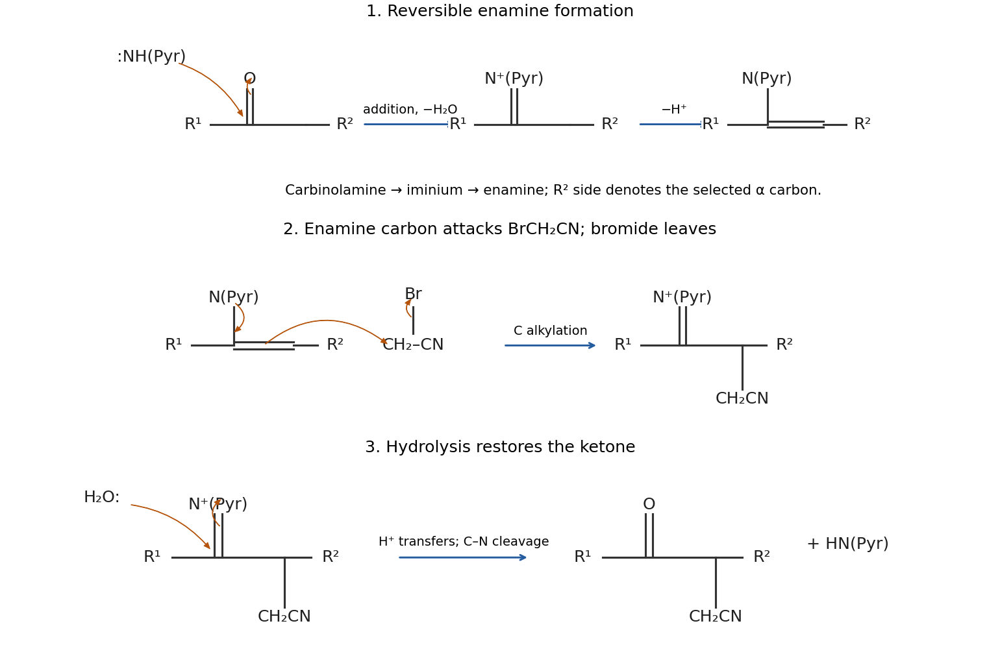
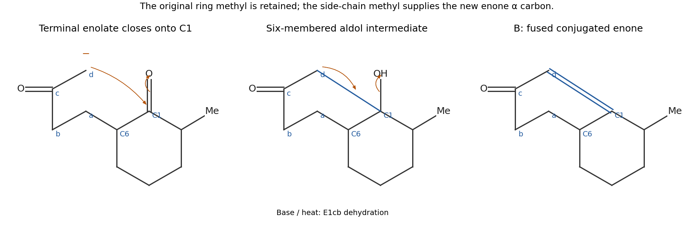
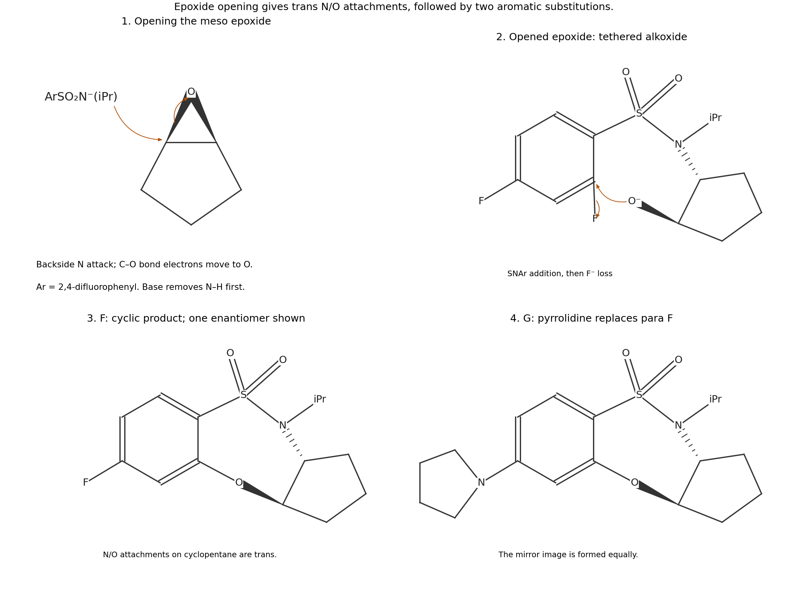
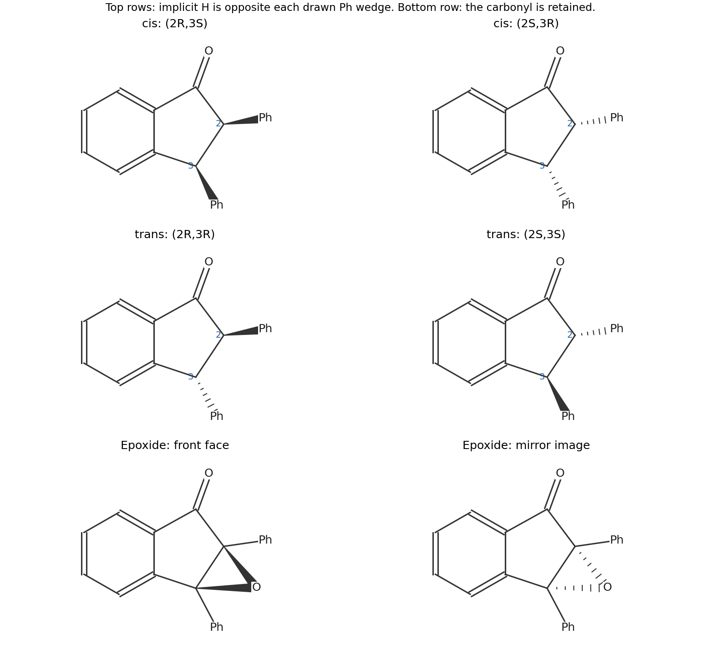
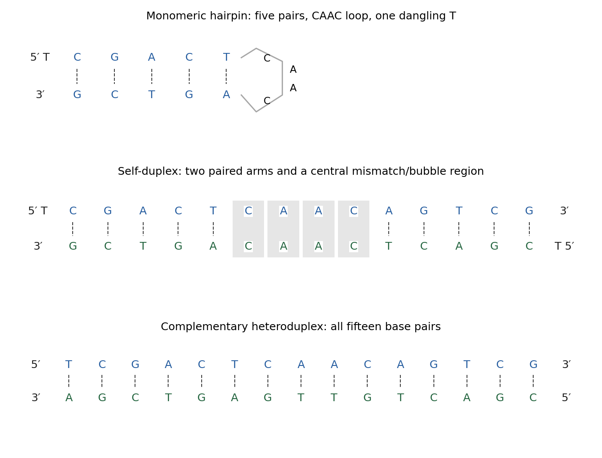

# Paper 1

↑ **Parent:** [2025](../2025.md)

[Original paper, released PDF pages 179–188](https://www.whatdotheyknow.com/request/request_for_nst_past_papers/response/3572306/attach/4/FOI%202026%20862%20Stack%20materials.pdf?cookie_passthrough=1#page=179)

**Table of contents**

- [B1](#b1)
  - [a](#b1/a)
    - [i](#b1/a/i)
      - [Solution](#b1/a/i/solution)
    - [ii](#b1/a/ii)
      - [Solution](#b1/a/ii/solution)
  - [b](#b1/b)
    - [i](#b1/b/i)
      - [Solution](#b1/b/i/solution)
    - [ii](#b1/b/ii)
      - [Solution](#b1/b/ii/solution)
- [B2](#b2)
  - [a](#b2/a)
    - [i](#b2/a/i)
      - [Solution](#b2/a/i/solution)
    - [ii](#b2/a/ii)
      - [Solution](#b2/a/ii/solution)
  - [b](#b2/b)
    - [i](#b2/b/i)
      - [Solution](#b2/b/i/solution)
    - [ii](#b2/b/ii)
      - [Solution](#b2/b/ii/solution)
  - [c](#b2/c)
    - [Solution](#b2/c/solution)
- [B3](#b3)
  - [a](#b3/a)
    - [Solution](#b3/a/solution)
  - [b](#b3/b)
    - [Solution](#b3/b/solution)
  - [c](#b3/c)
    - [i](#b3/c/i)
      - [Solution](#b3/c/i/solution)
    - [ii](#b3/c/ii)
      - [Solution](#b3/c/ii/solution)
  - [d](#b3/d)
    - [Solution](#b3/d/solution)
- [B4](#b4)
  - [a](#b4/a)
    - [Solution](#b4/a/solution)
  - [b](#b4/b)
    - [i](#b4/b/i)
      - [Solution](#b4/b/i/solution)
    - [ii](#b4/b/ii)
      - [Solution](#b4/b/ii/solution)
    - [iii](#b4/b/iii)
      - [Solution](#b4/b/iii/solution)
    - [iv](#b4/b/iv)
      - [Solution](#b4/b/iv/solution)
    - [v](#b4/b/v)
      - [Solution](#b4/b/v/solution)
- [B5](#b5)
  - [a](#b5/a)
    - [Solution](#b5/a/solution)
  - [b](#b5/b)
    - [Solution](#b5/b/solution)
  - [c](#b5/c)
    - [i](#b5/c/i)
      - [Solution](#b5/c/i/solution)
    - [ii](#b5/c/ii)
      - [Solution](#b5/c/ii/solution)
  - [d](#b5/d)
    - [Solution](#b5/d/solution)

## B1

↑ **Parent:** [Paper 1](paper-1.md)

<h3 id="b1/a">a</h3>

↑ **Parent:** [B1](#b1)

<h4 id="b1/a/i">i</h4>

↑ **Parent:** [A](#b1/a)

<h5 id="b1/a/i/solution">Solution</h5>

↑ **Parent:** [I](#b1/a/i)

Number the fused [heterocycle](../../molecule.md#heterocyclic-compound) as a 2,3-dihydrobenzofuran: [oxygen](../../chemical-substance.md#oxygen) is position 1 and the acetamido [substituent](../../stereochemistry.md#substituent) occupies aromatic position 6. **Position 5 is the preferred site of [electrophilic substitution](../../chemical-reaction.md#electrophilic-substitution).** It is para to the ring [oxygen](../../chemical-substance.md#oxygen) and ortho to the acetamido group, so both groups stabilize its [Wheland intermediate](../../chemical-reaction.md#arenium-ion) by [resonance donation](../../covalent-bond.md#resonance-donation). Position 7 also receives donation, but lies between the two [substituents](../../stereochemistry.md#substituent) and is more crowded. Position 4 lacks the same combination of directing effects.

The aryl [oxygen](../../chemical-substance.md#oxygen) donates a [lone pair](../../covalent-bond.md#lone-pair) into the aromatic system. The acetamido [nitrogen](../../chemical-substance.md#nitrogen) can also donate into the ring, although its [lone pair](../../covalent-bond.md#lone-pair) is shared with its own [carbonyl group](../../chemical-bond.md#carbonyl-group), so it is less activating than a free amino group. Comparing resonance-stabilized intermediates and steric accessibility gives the position-5 prediction; simply counting heteroatoms does not.

<h4 id="b1/a/ii">ii</h4>

↑ **Parent:** [A](#b1/a)

<h5 id="b1/a/ii/solution">Solution</h5>

↑ **Parent:** [Ii](#b1/a/ii)

The product is **N-\[5-(2-chloroacetyl)-2,3-dihydrobenzofuran-6-yl\]acetamide**, with an aromatic $-\mathrm{COCH_2Cl}$ [substituent](../../stereochemistry.md#substituent) at position 5. Substitution of one aromatic [hydrogen](../../chemical-substance.md#hydrogen) by $\mathrm{C_2H_2ClO}$ gives the stated molecular formula. This positional assignment also agrees with the isolated intermediate reported in the original process study.[Experimental section, N-(5-(2-chloroacetyl)-2,3-dihydrobenzofuran-6-yl)acetamide](../../chemistry-bibliography.md#process-development-to-synthesize-sgd-11275-utilizing-a-pd-catalyzed-acetamide-arylation-and-gallium-mediated-friedel-crafts-acylation-by-tristan-m-mcginnis-and-others)

[GaCl3](../../chemical-substance.md#gallium-trichloride) activates [chloroacetyl chloride](../../chemical-substance.md#chloroacetyl-chloride) by Lewis-acid coordination and chloride abstraction, represented by the acylium/contact-ion-pair limit $\mathrm{ClCH_2CO^+}$. The position-5 aromatic $\pi$ bond attacks the acyl [carbon](../../chemical-substance.md#carbon), giving a [Wheland intermediate](../../chemical-reaction.md#arenium-ion). Removal of the [proton](../../physics.md#proton) at that [carbon](../../chemical-substance.md#carbon) restores [aromaticity](../../molecule.md#aromaticity). Product–Lewis-acid coordination is reversed on work-up. The carbon-bound chlorine survives; the chlorine on the acyl [carbon](../../chemical-substance.md#carbon) is the leaving group.

**[Figure 1](#b1/a/ii/image-position-5-chloroacetylation-product-and-electron-flow-in-friedel-crafts-acylation). Position-5 chloroacetylation product and electron flow in Friedel-Crafts acylation**.

<h3 id="b1/b">b</h3>

↑ **Parent:** [B1](#b1)

<h4 id="b1/b/i">i</h4>

↑ **Parent:** [B](#b1/b)

<h5 id="b1/b/i/solution">Solution</h5>

↑ **Parent:** [I](#b1/b/i)

The first stage is a [Stork enamine reaction](../../chemical-reaction.md#stork-enamine-reaction). [Pyrrolidine](../../chemical-substance.md#pyrrolidine) attacks the [ketone](../../chemical-substance.md#ketone) [carbonyl](../../chemical-bond.md#carbonyl-group), and [proton](../../physics.md#proton) transfers give a [carbinolamine](../../chemical-substance.md#carbinolamine). Loss of [water](../../chemical-substance.md#water) gives an [iminium ion](../../chemical-substance.md#iminium); removal of the benzylic alpha [proton](../../physics.md#proton) produces the [enamine](../../chemical-substance.md#enamine) conjugated with the [aromatic ring](../../molecule.md#aromatic-ring). Removal of [water](../../chemical-substance.md#water) and prolonged heating favour this condensation. That conjugated [enamine](../../chemical-substance.md#enamine) is preferred over the alternative with its double bond on the other side of the original [carbonyl](../../chemical-bond.md#carbonyl-group).

The nucleophilic [enamine](../../chemical-substance.md#enamine) [carbon](../../chemical-substance.md#carbon) attacks the methylene [carbon](../../chemical-substance.md#carbon) of bromoacetonitrile by an [SN2 reaction](../../chemical-reaction.md#sn2-reaction), displacing bromide and making the [carbon](../../chemical-substance.md#carbon)–[carbon](../../chemical-substance.md#carbon) bond. It is the [carbon](../../chemical-substance.md#carbon) beside the aromatic fusion that acquires $\mathrm{CH_2CN}$, as in D. Finally, [water](../../chemical-substance.md#water) adds to the alkylated iminium [carbon](../../chemical-substance.md#carbon); [proton](../../physics.md#proton) transfers and cleavage of the C–N bond regenerate the [ketone](../../chemical-substance.md#ketone) and release [pyrrolidine](../../chemical-substance.md#pyrrolidine). This explains [carbon](../../chemical-substance.md#carbon) alkylation, its position, and restoration of the [carbonyl](../../chemical-bond.md#carbonyl-group) rather than treating the amine as a permanent [substituent](../../stereochemistry.md#substituent).

**[Figure 2](#b1/b/i/image-enamine-formation-carbon-alkylation-by-bromoacetonitrile-and-hydrolysis). Enamine formation, carbon alkylation by bromoacetonitrile, and hydrolysis**.

<h4 id="b1/b/ii">ii</h4>

↑ **Parent:** [B](#b1/b)

<h5 id="b1/b/ii/solution">Solution</h5>

↑ **Parent:** [Ii](#b1/b/ii)

Hydride removes the remaining alpha [proton](../../physics.md#proton) at the substituted benzylic [carbon](../../chemical-substance.md#carbon), releasing [hydrogen](../../chemical-substance.md#hydrogen) and forming the conjugated [enolate](../../chemical-substance.md#enolate). Its [oxygen](../../chemical-substance.md#oxygen) attacks the [carbonyl](../../chemical-bond.md#carbonyl-group) [carbon](../../chemical-substance.md#carbon) of allyl chloroformate. Collapse of the [tetrahedral intermediate](../../chemical-kinetics.md#tetrahedral-intermediate) expels chloride and gives the **allyl [enol carbonate](../../chemical-substance.md#enol-carbonate)**, with the double bond between the original [carbonyl](../../chemical-bond.md#carbonyl-group) [carbon](../../chemical-substance.md#carbon) and the cyanomethyl-bearing [carbon](../../chemical-substance.md#carbon).

This is [O-acylation of an enolate](../../chemical-substance.md#o-acylation-of-an-enolate): the [carbonyl](../../chemical-bond.md#carbonyl-group) [oxygen](../../chemical-substance.md#oxygen) is trapped as $\mathrm{OCO_2CH_2CH{=}CH_2}$, retaining the enol double bond. The competing carbon-centred resonance representation explains possible C-acylation in other circumstances, but it would give a different connectivity from E. The indicated product selects the oxygen-trapping pathway and the conjugated enolate regioisomer.

## B2

↑ **Parent:** [Paper 1](paper-1.md)

<h3 id="b2/a">a</h3>

↑ **Parent:** [B2](#b2)

<h4 id="b2/a/i">i</h4>

↑ **Parent:** [A](#b2/a)

<h5 id="b2/a/i/solution">Solution</h5>

↑ **Parent:** [I](#b2/a/i)

[Pyrrolidine](../../chemical-substance.md#pyrrolidine) and 2-methylcyclohexanone first form an [enamine](../../chemical-substance.md#enamine), through [carbonyl](../../chemical-bond.md#carbonyl-group) addition, [carbinolamine](../../chemical-substance.md#carbinolamine) formation, dehydration to an [iminium ion](../../chemical-substance.md#iminium), and alpha [deprotonation](../../acid-base-chemistry.md#deprotonation). The less hindered [enamine](../../chemical-substance.md#enamine) [carbon](../../chemical-substance.md#carbon) is on the side opposite the methyl-bearing alpha [carbon](../../chemical-substance.md#carbon). It attacks the terminal beta [carbon](../../chemical-substance.md#carbon) of [methyl vinyl ketone](../../chemical-substance.md#methyl-vinyl-ketone), while the conjugated $\pi$ system shifts to [oxygen](../../chemical-substance.md#oxygen). Protonation gives an alkylated iminium species; aqueous acid then hydrolyses it back to the [ketone](../../chemical-substance.md#ketone).

The result is a [Michael addition](../../chemical-reaction.md#michael-addition) product: the previously unsubstituted alpha [carbon](../../chemical-substance.md#carbon) bears $-\mathrm{CH_2CH_2COCH_3}$. In drawing the arrows, start the new C–C bond at the [enamine](../../chemical-substance.md#enamine) [carbon](../../chemical-substance.md#carbon), not at [nitrogen](../../chemical-substance.md#nitrogen). The iminium bond is restored during addition and removed by [hydrolysis](../../chemical-reaction.md#hydrolysis). The sequence is an enamine-mediated conjugate addition, rather than direct addition to the [methyl vinyl ketone](../../chemical-substance.md#methyl-vinyl-ketone) [carbonyl](../../chemical-bond.md#carbonyl-group).

<h4 id="b2/a/ii">ii</h4>

↑ **Parent:** [A](#b2/a)

<h5 id="b2/a/ii/solution">Solution</h5>

↑ **Parent:** [Ii](#b2/a/ii)

A undergoes a [Robinson annulation](../../chemical-reaction.md#robinson-annulation). For an unambiguous connectivity description, call the original ring [carbonyl](../../chemical-bond.md#carbonyl-group) [carbon](../../chemical-substance.md#carbon) C1 and the side-chain-bearing alpha [carbon](../../chemical-substance.md#carbon) C6. Label the appended chain $\mathrm{C6{-}a{-}b{-}c(=O){-}d}$, where d is initially methyl. Base makes the enolate at d, which attacks C1 intramolecularly to close the six-membered ring $\mathrm{C1{-}C6{-}a{-}b{-}c{-}d}$. The [carbonyl](../../chemical-bond.md#carbonyl-group) $\pi$ electrons move to [oxygen](../../chemical-substance.md#oxygen), and protonation gives the beta-hydroxy [ketone](../../chemical-substance.md#ketone).

An [E1cb elimination](../../chemical-reaction.md#e1cb-elimination) then removes the [proton](../../physics.md#proton) on d and the hydroxy group on C1, giving the conjugated enone **with C1=d and a [carbonyl](../../chemical-bond.md#carbonyl-group) at c**. The original ring methyl remains on the [carbon](../../chemical-substance.md#carbon) next to C1 on the other side. The two rings share the C1–C6 bond. The molecular formula is consistent with loss of one [water](../../chemical-substance.md#water) molecule from the diketone.

**[Figure 3](#b2/a/ii/image-numbered-fused-enone-product-and-the-ring-closing-aldol-step-in-the-robinson-annulation). Numbered fused enone product and the ring-closing aldol step in the Robinson annulation**.

<h3 id="b2/b">b</h3>

↑ **Parent:** [B2](#b2)

<h4 id="b2/b/i">i</h4>

↑ **Parent:** [B](#b2/b)

<h5 id="b2/b/i/solution">Solution</h5>

↑ **Parent:** [I](#b2/b/i)

The [aniline](../../chemical-substance.md#aniline) [nitrogen](../../chemical-substance.md#nitrogen) attacks the ipso [carbon](../../chemical-substance.md#carbon) bearing [fluorine](../../chemical-substance.md#fluorine). The aromatic $\pi$ electrons shift to give a [Meisenheimer complex](../../chemical-reaction.md#meisenheimer-complex), with negative charge delocalized to the positions ortho and para to the attacked [carbon](../../chemical-substance.md#carbon). At either nitro [substituent](../../stereochemistry.md#substituent), that charge can be delocalized further onto nitro [oxygen](../../chemical-substance.md#oxygen). Subsequent [proton](../../physics.md#proton) transfer and fluoride elimination restore [aromaticity](../../molecule.md#aromaticity) and give the diarylamine.

Both the ortho and para [nitro groups](../../chemistry.md#nitro-group) stabilize the addition intermediate in 1-fluoro-2,4-dinitrobenzene. The para-mononitro compound lacks the additional ortho stabilization, so addition is less favourable and generally slower under the stated conditions. This comparison concerns stabilization of the addition pathway; the presence of [fluorine](../../chemical-substance.md#fluorine) does not make the reaction an ordinary aliphatic [SN2 reaction](../../chemical-reaction.md#sn2-reaction).

<h4 id="b2/b/ii">ii</h4>

↑ **Parent:** [B](#b2/b)

<h5 id="b2/b/ii/solution">Solution</h5>

↑ **Parent:** [Ii](#b2/b/ii)

The qualitative [nucleophilicity](../../chemical-reaction.md#nucleophilicity) order is **$p$-OMe $>$ $p$-Me $>$ H $>$ $p$-Cl $\gg$ $p$-NO$_2$**, matching the product-yield order at the stated stopping time. Electron donation raises the availability of the [aniline](../../chemical-substance.md#aniline) [lone pair](../../covalent-bond.md#lone-pair) for attack. A para [methoxy group](../../chemistry.md#methoxy-group) donates by resonance, while methyl is a weaker donor. Chlorine withdraws inductively and gives an [aniline](../../chemical-substance.md#aniline) less nucleophilic than the unsubstituted compound. A para [nitro group](../../chemistry.md#nitro-group) strongly withdraws by resonance: electron flow from [nitrogen](../../chemical-substance.md#nitrogen) through the ring into the [nitro group](../../chemistry.md#nitro-group) stabilizes a charge-separated form and greatly reduces [nucleophilicity](../../chemical-reaction.md#nucleophilicity).

The key arrows for the nitroaniline comparison move the [nitrogen](../../chemical-substance.md#nitrogen) [lone pair](../../covalent-bond.md#lone-pair) into its own [aromatic ring](../../molecule.md#aromatic-ring), shift the ring $\pi$ bonds toward the para [nitro group](../../chemistry.md#nitro-group), and shift a nitro N=O bond toward [oxygen](../../chemical-substance.md#oxygen). The methoxy donor produces the opposite electronic bias. These are finite-time yields, so they support a kinetic explanation qualitatively; they are not by themselves measured [rate constants](../../chemical-kinetics.md#rate-constant) or [equilibrium constants](../../chemical-potential.md#equilibrium-constant).

<h3 id="b2/c">c</h3>

↑ **Parent:** [B2](#b2)

<h4 id="b2/c/solution">Solution</h4>

↑ **Parent:** [C](#b2/c)

Base deprotonates the [sulfonamide](../../chemical-substance.md#sulfonamide). Its [nitrogen](../../chemical-substance.md#nitrogen) attacks one [epoxide](../../chemical-substance.md#epoxide) [carbon](../../chemical-substance.md#carbon) from the back, breaking the C–O bond at that [carbon](../../chemical-substance.md#carbon) and producing an adjacent [alkoxide](../../mathematical-biology.md#alkoxide). The [nitrogen](../../chemical-substance.md#nitrogen) and [oxygen](../../chemical-substance.md#oxygen) attachments on the [cyclopentane](../../chemical-substance.md#cyclopentane) are therefore **trans**. The [alkoxide](../../mathematical-biology.md#alkoxide) then attacks the aromatic [carbon](../../chemical-substance.md#carbon) bearing the [fluorine](../../chemical-substance.md#fluorine) ortho to the sulfonyl group. Intramolecular [nucleophilic aromatic substitution](../../chemical-reaction.md#nucleophilic-aromatic-substitution) expels fluoride and closes a seven-membered [heterocycle](../../molecule.md#heterocyclic-compound) with the path $\mathrm{Ar{-}S{-}N{-}C_1{-}C_2{-}O{-}Ar}$. The para [fluorine](../../chemical-substance.md#fluorine) remains.

This tandem epoxide-opening/ring-closing pathway is required by the formula of F: simple [epoxide](../../chemical-substance.md#epoxide) addition would retain both [fluorines](../../chemical-substance.md#fluorine), whereas F contains only one. In the second stage, [pyrrolidine](../../chemical-substance.md#pyrrolidine) replaces the remaining para [fluorine](../../chemical-substance.md#fluorine) by another [nucleophilic aromatic substitution](../../chemical-reaction.md#nucleophilic-aromatic-substitution), producing G. The mass balance is F plus [pyrrolidine](../../chemical-substance.md#pyrrolidine) minus HF, as required by the given formula of G.

The meso [epoxide](../../chemical-substance.md#epoxide) has [enantiotopic](../../stereochemistry.md#enantiotopicity) ends. With achiral reagents, opening at either end gives an enantiomeric product, so **F is a racemic pair with the same trans relative configuration; G retains that configuration**.

**[Figure 4](#b2/c/image-trans-epoxide-opening-cascade-seven-membered-ring-closure-and-replacement-of-the-remaining-aryl-fluoride). Trans epoxide-opening cascade, seven-membered ring closure, and replacement of the remaining aryl fluoride**.

## B3

↑ **Parent:** [Paper 1](paper-1.md)

<h3 id="b3/a">a</h3>

↑ **Parent:** [B3](#b3)

<h4 id="b3/a/solution">Solution</h4>

↑ **Parent:** [A](#b3/a)

The relevant quantity is the H–C–C–H [dihedral angle](../../euclidean-geometry.md#dihedral-angle), through the [Karplus relation](../../nuclear-magnetic-resonance.md#karplus-equation), rather than the labels cis and trans alone. Couplings tend to be larger near eclipsed or antiperiplanar arrangements and smaller nearer a right angle. The observed value averages the accessible conformations.

In A, the saturated five-membered ring is puckered. A preferred envelope-like [conformation](../../stereochemistry.md#conformation) can place the trans [hydrogens](../../chemical-substance.md#hydrogen) closer to an antiperiplanar arrangement, giving a slightly larger coupling than the cis pair. In B, the double bond restricts ring geometry toward a flatter arrangement: the cis [hydrogens](../../chemical-substance.md#hydrogen) are more nearly eclipsed, whereas the trans pair has an oblique [dihedral angle](../../euclidean-geometry.md#dihedral-angle). The cis coupling is then larger. Approximate Newman projections illustrate these trends; exact angles cannot be recovered from four coupling constants without a calibrated relation and conformational populations.

**[Figure 5](#b3/a/image-illustrative-newman-projections-explaining-why-cis-trans-coupling-order-depends-on-five-membered-ring-geometry). Illustrative Newman projections explaining why cis/trans coupling order depends on five-membered ring geometry**.

<h3 id="b3/b">b</h3>

↑ **Parent:** [B3](#b3)

<h4 id="b3/b/solution">Solution</h4>

↑ **Parent:** [B](#b3/b)

Reduction makes [stereogenic centres](../../stereochemistry.md#stereocenter) at C2 and C3 of the indan-1-one framework. The four products are the **cis pair $(2R,3S)$ and $(2S,3R)$**, and the **trans pair $(2R,3R)$ and $(2S,3S)$**. Each pair consists of [enantiomers](../../stereochemistry.md#enantiomer); any cis member is diastereomeric to either trans member. There is no meso product because the carbonyl-containing and aromatic sides of the ring do not make C2 and C3 symmetry-equivalent.

For checking the [Cahn-Ingold-Prelog priority rules](../../stereochemistry.md#cahn-ingold-prelog-priority-rules), at C2 the order is carbonyl-side [carbon](../../chemical-substance.md#carbon) $>$ phenyl $>$ C3 $>$ H. At C3 it is fused aromatic [carbon](../../chemical-substance.md#carbon) $>$ phenyl $>$ C2 $>$ H. The fused aromatic path outranks the separate phenyl path because it reaches the carbonyl-containing part of the framework.

**[Figure 6](#b3/b/image-four-hydrogenation-stereoisomers-of-2-3-diphenylindan-1-one-and-the-two-enantiomeric-epoxides). Four hydrogenation stereoisomers of 2,3-diphenylindan-1-one and the two enantiomeric epoxides**.

<h3 id="b3/c">c</h3>

↑ **Parent:** [B3](#b3)

<h4 id="b3/c/i">i</h4>

↑ **Parent:** [C](#b3/c)

<h5 id="b3/c/i/solution">Solution</h5>

↑ **Parent:** [I](#b3/c/i)

At 400 MHz, a separation $\Delta\delta$ in ppm corresponds to $J=400\Delta\delta$ Hz. The two multiplets near 5.10 and 4.47 ppm each have a quoted separation of 0.02 ppm, giving **$J\simeq8$ Hz**. The multiplets near 4.625 and 3.865 ppm each have separation 0.01 ppm, giving **$J\simeq4$ Hz**. These are approximate values from the rounded peak labels.

The fused unsaturated/aromatic framework restricts the five-membered ring, as in the comparison in (a). Assign the larger coupling to **cis** and the smaller to **trans**. Matching equal couplings and integrals pairs the 5.10/4.47 signals with one another, and the 4.625/3.865 signals with one another. The integral ratio is

$$
\boxed{\mathrm{cis:trans}=0.7:1.0\simeq41:59}.
$$

With an achiral substrate and achiral catalytic environment, each [diastereomer](../../stereochemistry.md#diastereomer) is expected as a racemic enantiomeric pair: cis $(2R,3S)/(2S,3R)$ and trans $(2R,3R)/(2S,3S)$. The reported spectrum requires both [diastereomers](../../stereochemistry.md#diastereomer); the reagent label alone cannot override that evidence. Their ratio does not establish whether the selectivity arose in the initial surface addition or after product [epimerization](../../stereochemistry.md#epimerization).

<h4 id="b3/c/ii">ii</h4>

↑ **Parent:** [C](#b3/c)

<h5 id="b3/c/ii/solution">Solution</h5>

↑ **Parent:** [Ii](#b3/c/ii)

Only the low-coupling pair remains, so the detected product is the **trans [diastereomer](../../stereochemistry.md#diastereomer)**, with approximate coupling 4 Hz. The reaction is highly diastereoselective within the spectrum's detection limit. Its possible absolute configurations are $(2R,3R)$ and $(2S,3S)$.

A conventional [proton](../../physics.md#proton) NMR spectrum in an achiral environment cannot distinguish those [enantiomers](../../stereochemistry.md#enantiomer): they have the same shifts and couplings. Thus a chiral catalyst plus one set of resonances does **not establish an [enantiomeric excess](../../stereochemistry.md#enantiomeric-excess) or an [absolute configuration](../../stereochemistry.md#absolute-configuration)**. [Chiral chromatography](../../chromatography.md#chiral-chromatography), an appropriate chiral NMR method, or a calibrated stereochemical comparison would be needed.

<h3 id="b3/d">d</h3>

↑ **Parent:** [B3](#b3)

<h4 id="b3/d/solution">Solution</h4>

↑ **Parent:** [D](#b3/d)

The products are the two mirror-image **2,3-epoxy-2,3-diphenylindan-1-ones**, shown in the bottom row of the stereoisomer diagram. The original [carbonyl](../../chemical-bond.md#carbonyl-group) remains, and an additional [oxygen](../../chemical-substance.md#oxygen) bridges the former double bond, giving the stated formula.

In the [Weitz-Scheffer epoxidation](../../chemical-reaction.md#weitz-scheffer-reaction), hydroperoxide anion adds conjugatively to the enone. The resulting enolate closes onto the attached [peroxide](../../chemical-substance.md#peroxide) [oxygen](../../chemical-substance.md#oxygen) with O–O bond cleavage and loss of hydroxide. Attack on the two faces of the achiral planar substrate gives the two [enantiomers](../../stereochemistry.md#enantiomer) in equal amounts. This is a racemic [epoxide](../../chemical-substance.md#epoxide) pair, rather than a one-to-one mixture of different diastereomeric [epoxide](../../chemical-substance.md#epoxide) connectivities.

## B4

↑ **Parent:** [Paper 1](paper-1.md)

<h3 id="b4/a">a</h3>

↑ **Parent:** [B4](#b4)

<h4 id="b4/a/solution">Solution</h4>

↑ **Parent:** [A](#b4/a)

Apply the [Felkin-Anh model](../../stereochemistry.md#felkin-anh-model) to the stereocentre alpha to the [ketone](../../chemical-substance.md#ketone). Its large group is the chain continuing through the phenyl-bearing [carbon](../../chemical-substance.md#carbon), its medium group is methyl, and its small group is [hydrogen](../../chemical-substance.md#hydrogen). In the preferred transition-state arrangement, put the large group approximately perpendicular to C=O and approach from the opposite face, passing the small [hydrogen](../../chemical-substance.md#hydrogen) along a [Bürgi-Dunitz trajectory](../../chemical-reaction.md#burgi-dunitz-trajectory). The remote [ether](../../chemical-substance.md#ether) cannot form the usual small alpha-alkoxy chelate, and the coordinating [solvent](../../mixture.md#solvent) further supports using an open-addition prediction.[pp. 1–2: perpendicular large group and nucleophilic approach past the small group](../../chemistry-bibliography.md#felkin-anh-and-cram-chelate-by-university-of-windsor)

The predicted new stereocentre is **$S$**. In the question's zigzag projection, this corresponds to the new OH bond directed behind the page and the newly introduced methyl toward the reader, with the original stereocentres unchanged. The new-centre priority order is OH $>$ phenyl $>$ the substituted alpha-carbon chain $>$ methyl. This is a model-based major-product prediction, rather than a quantitative diastereomeric ratio.

**[Figure 7](#b4/a/image-felkin-anh-approach-past-the-small-alpha-hydrogen-and-the-predicted-s-configured-tertiary-alcohol). Felkin-Anh approach past the small alpha hydrogen and the predicted S-configured tertiary alcohol**.

<h3 id="b4/b">b</h3>

↑ **Parent:** [B4](#b4)

<h4 id="b4/b/i">i</h4>

↑ **Parent:** [B](#b4/b)

<h5 id="b4/b/i/solution">Solution</h5>

↑ **Parent:** [I](#b4/b/i)

Protonation of a [spiroacetal](../../chemical-substance.md#spiroacetal) [oxygen](../../chemical-substance.md#oxygen) makes the adjacent C–O bond easier to cleave. Reversible opening gives an [oxocarbenium ion](../../chemical-substance.md#oxocarbenium-ion), in which the spiro [carbon](../../chemical-substance.md#carbon) is locally planar. The tethered alcohol can attack either face; [deprotonation](../../acid-base-chemistry.md#deprotonation) closes the [acetal](../../chemical-substance.md#acetal) and regenerates acid. Repetition interconverts the spiro epimers while retaining the other [stereogenic centres](../../stereochemistry.md#stereocenter). Methanol can participate in reversible [proton](../../physics.md#proton) transfer or trapping, but there is no need to invert the remote [carbon](../../chemical-substance.md#carbon) centres.

<h4 id="b4/b/ii">ii</h4>

↑ **Parent:** [B](#b4/b)

<h5 id="b4/b/ii/solution">Solution</h5>

↑ **Parent:** [Ii](#b4/b/ii)

The diagnostic feature is the large [vicinal coupling](../../nuclear-magnetic-resonance.md#vicinal-coupling) characteristic of an axial–axial relationship in a chair. The td patterns for $H_a$ and $H_c$ contain two large couplings to neighbouring axial [hydrogens](../../chemical-substance.md#hydrogen), so both are axial. The ddd patterns for $H_b$ and $H_d$ also include a large ring [vicinal coupling](../../nuclear-magnetic-resonance.md#vicinal-coupling), with the smaller values reflecting the other ring [hydrogen](../../chemical-substance.md#hydrogen) and the [side chain](../../molecule.md#side-chain). The assignments are

$$
\boxed{H_a,\ H_b,\ H_c,\ H_d\ \text{all axial}.}
$$

The [chemical shifts](../../nuclear-magnetic-resonance.md#chemical-shift) alone do not determine this assignment. In particular, three unequal splittings of a methine are not a geminal-coupling pattern.

<h4 id="b4/b/iii">iii</h4>

↑ **Parent:** [B](#b4/b)

<h5 id="b4/b/iii/solution">Solution</h5>

↑ **Parent:** [Iii](#b4/b/iii)

Use the upper-ring chair placing $H_a$ or $H_c$ axial. The aryl ester [substituent](../../stereochemistry.md#substituent) on that [carbon](../../chemical-substance.md#carbon) is then equatorial. Use a lower-ring chair placing $H_b$ or $H_d$ axial, with the attached [side chain](../../molecule.md#side-chain) equatorial. The spiro configuration distinguishes the two structures: in **A**, the lower-ring [oxygen](../../chemical-substance.md#oxygen) bond is axial with respect to the upper ring, while the upper-ring [oxygen](../../chemical-substance.md#oxygen) bond is equatorial with respect to the lower ring. In **B**, those roles reverse.

Thus the [oxygen](../../chemical-substance.md#oxygen) placements at the shared spiro [carbon](../../chemical-substance.md#carbon) are **axial/equatorial for A and equatorial/axial for B**. Side-chain conformations are unnecessary, but changing the lower chair without tracking its [substituent](../../stereochemistry.md#substituent) positions would change this conclusion.

**[Figure 8](#b4/b/iii/image-chair-assignments-for-the-two-spiroacetals-axial-reporter-hydrogens-and-one-axial-exocyclic-oxygen-in-each-isomer). Chair assignments for the two spiroacetals: axial reporter hydrogens and one axial exocyclic oxygen in each isomer**.

<h4 id="b4/b/iv">iv</h4>

↑ **Parent:** [B](#b4/b)

<h5 id="b4/b/iv/solution">Solution</h5>

↑ **Parent:** [Iv](#b4/b/iv)

The [anomeric effect](../../stereochemistry.md#anomeric-effect) is the preference, in suitable cyclic [acetals](../../chemical-substance.md#acetal), for an electronegative [substituent](../../stereochemistry.md#substituent) at an anomeric [carbon](../../chemical-substance.md#carbon) to occupy an axial position even when simple steric reasoning favours equatorial. An important orbital contribution is donation from an endocyclic [oxygen](../../chemical-substance.md#oxygen) [lone pair](../../covalent-bond.md#lone-pair) into the [antibonding orbital](../../chemistry.md#antibonding-orbital) of the adjacent exocyclic C–O bond, $n_{\rm O}\to\sigma^*_{\rm C-O}$. The chair's axial arrangement supplies favourable antiperiplanar overlap. Electrostatic and [solvation](../../ionic-bonding.md#solvation) contributions can also affect the observed conformational preference.

<h4 id="b4/b/v">v</h4>

↑ **Parent:** [B](#b4/b)

<h5 id="b4/b/v/solution">Solution</h5>

↑ **Parent:** [V](#b4/b/v)

**Each isomer has one favourable anomeric interaction.** A has the favourable axial exocyclic [oxygen](../../chemical-substance.md#oxygen) in the upper-ring chair; B has it in the lower-ring chair. The NMR-constrained conformations therefore do not provide a doubly anomeric versus non-anomeric comparison.

Both can keep important [carbon](../../chemical-substance.md#carbon) [substituents](../../stereochemistry.md#substituent) equatorial and each obtains one anomeric stabilization. **Appreciable amounts of both are therefore a reasonable prediction**, rather than a strong preference based solely on counting anomeric interactions. The environments of the two ring [oxygens](../../chemical-substance.md#oxygen) are not identical, so this argument does not determine an exact one-to-one equilibrium ratio; quantitative preference would require further energetic information.

## B5

↑ **Parent:** [Paper 1](paper-1.md)

<h3 id="b5/a">a</h3>

↑ **Parent:** [B5](#b5)

<h4 id="b5/a/solution">Solution</h4>

↑ **Parent:** [A](#b5/a)

For hydrogen-bond acceptance, the three strongest groups are **the terminal [carboxylate](../../chemical-substance.md#carboxylate)**, **the Cys–CO–N(Pro) tertiary-amide [carbonyl](../../chemical-bond.md#carbonyl-group)**, and **the Pro–CO–NH(Tyr) secondary-amide [carbonyl](../../chemical-bond.md#carbonyl-group)**, in that qualitative order. Negative charge makes [carboxylate](../../chemical-substance.md#carboxylate) a particularly strong acceptor. Both [amide](../../chemical-substance.md#amide) [oxygens](../../chemical-substance.md#oxygen) accept strongly; greater [nitrogen](../../chemical-substance.md#nitrogen) alkyl donation generally makes a tertiary [amide](../../chemical-substance.md#amide) [oxygen](../../chemical-substance.md#oxygen) more basic than the comparable secondary-amide [oxygen](../../chemical-substance.md#oxygen). This last ordering is a functional-group estimate, not a precise calculation of a folded [tripeptide](../../protein.md#tripeptide)'s site parameters.

For donation, the order is **terminal ammonium $>$ [tyrosine](../../chemical-substance.md#tyrosine) phenolic OH $>$ the peptide NH between Pro and Tyr**. The [thiol](../../chemical-substance.md#thiol) is a weaker donor. Protonated ammonium has no available [lone pair](../../covalent-bond.md#lone-pair) to accept; the [proline](../../chemical-substance.md#proline) [amide](../../chemical-substance.md#amide) [nitrogen](../../chemical-substance.md#nitrogen) has no N–H bond to donate, and [amide](../../chemical-substance.md#amide) [nitrogen](../../chemical-substance.md#nitrogen) [lone pairs](../../covalent-bond.md#lone-pair) are delocalized into [carbonyl groups](../../chemical-bond.md#carbonyl-group). The [carboxylate](../../chemical-substance.md#carboxylate) has no O–H donor in the drawn protonation state.

<h3 id="b5/b">b</h3>

↑ **Parent:** [B5](#b5)

<h4 id="b5/b/solution">Solution</h4>

↑ **Parent:** [B](#b5/b)

The [functional group interaction profile](../../chemical-bond.md#functional-group-interaction-profile) compares donor strength $\alpha$ and acceptor strength $\beta$. In [water](../../chemical-substance.md#water), strong–strong contacts compensate for [desolvation](../../ionic-bonding.md#desolvation), giving the upper-right black region. Strong–weak contacts lose favourable [solvent](../../mixture.md#solvent) interactions without adequate replacement, giving the two grey regions. Weak–weak association gives the lower-left black region through the [hydrophobic effect](../../physical-chemistry.md#hydrophobic-effect).

Ethanol's ethyl groups preferentially solvate weakly polar sites, removing this incentive for their association: the lower-left region becomes approximately neutral. Its hydroxyl group retains competition for [hydrogen bonds](../../chemical-bond.md#hydrogen-bond) elsewhere in the profile.[Figures 4–5 and “Mixed polarity solvents”: water's hydrophobic quadrant and its elimination in ethanol](../../chemistry-bibliography.md#functional-group-interaction-profiles-a-general-treatment-of-solvent-effects-on-non-covalent-interactions-by-mark-d-driver-and-others)

<h3 id="b5/c">c</h3>

↑ **Parent:** [B5](#b5)

<h4 id="b5/c/i">i</h4>

↑ **Parent:** [C](#b5/c)

<h5 id="b5/c/i/solution">Solution</h5>

↑ **Parent:** [I](#b5/c/i)

There are three natural states: an unfolded single strand, a monomeric [DNA hairpin](../../polymer.md#dna-hairpin), and an intermolecular self-duplex. A useful parsing of the sequence is $\mathrm{T\ |\ CGACT\ |\ CAAC\ |\ AGTCG}$. The two five-base arms are [reverse complements](../../polymer.md#reverse-complement). They can form a hairpin with a five-base-pair stem, a four-base CAAC loop, and a dangling 5′ T.

Two copies can instead pair their arms intermolecularly. The self-duplex has two five-base-pair regions, a central noncomplementary internal region, and dangling T residues; it is not a perfectly paired 15-base-pair duplex. Low temperature favours pairing. At relatively low strand concentration, the unimolecular hairpin avoids the association-entropy cost of a dimer; at sufficiently high concentration, intermolecular pairing becomes more favourable. At high temperature, the unfolded state predominates. Actual crossover temperatures require salt conditions and sequence thermodynamics.

**[Figure 9](#b5/c/i/image-hairpin-self-duplex-and-fully-complementary-heteroduplex-for-the-dna-oligomers). Hairpin, self-duplex and fully complementary heteroduplex for the DNA oligomers**.

<h4 id="b5/c/ii">ii</h4>

↑ **Parent:** [C](#b5/c)

<h5 id="b5/c/ii/solution">Solution</h5>

↑ **Parent:** [Ii](#b5/c/ii)

The second strand is the complete [reverse complement](../../polymer.md#reverse-complement) of the first. They can therefore form a **fully matched antiparallel 15-base-pair heteroduplex**, replacing the less fully paired hairpin/self-duplex states under conditions supporting hybridization:

$$
\begin{array}{rcl}
5'&\mathrm{TCGACTCAACAGTCG}&3'\\
3'&\mathrm{AGCTGAGTTGTCAGC}&5'.
\end{array}
$$

The lower line is written antiparallel; read it from its own 5′ end to recover the added oligomer.

<h3 id="b5/d">d</h3>

↑ **Parent:** [B5](#b5)

<h4 id="b5/d/solution">Solution</h4>

↑ **Parent:** [D](#b5/d)

For a [carbonyl](../../chemical-bond.md#carbonyl-group) [oxygen](../../chemical-substance.md#oxygen) of residue $i$ accepting from the NH of a later residue, the possibilities are:

- $i\to i+1$: a very small four-membered hydrogen-bonded loop, incompatible with a favourable repeating peptide-backbone geometry.
- $i\to i+2$: a seven-membered loop associated with a [gamma turn](../../protein.md#gamma-turn); a long regular two-residue-per-turn structure is strongly constrained.
- $i\to i+3$: the ten-membered hydrogen-bonded rings of a [3-10 helix](../../protein.md#3-10-helix), with about three residues per turn.
- $i\to i+4$: the thirteen-membered rings of an [alpha helix](../../protein.md#alpha-helix), with about 3.6 residues per turn.
- $i\to i+5$: the sixteen-membered rings of a [pi helix](../../protein.md#pi-helix), with about 4.4 residues per turn.

**[Figure 10](#b5/d/image-top-view-side-chain-directions-in-3-10-alpha-and-pi-helices). Top-view side-chain directions in 3-10, alpha and pi helices**.

The [alpha helix](../../protein.md#alpha-helix) provides a favourable combination of allowed backbone torsions, reasonably linear [hydrogen bonds](../../chemical-bond.md#hydrogen-bond), and side-chain packing. Its successive [side chains](../../molecule.md#side-chain) advance by about $100^\circ$, rather than lining up in the three columns of the narrower [3-10 helix](../../protein.md#3-10-helix). Smaller repeating rings impose more severe backbone constraints; the wider [pi helix](../../protein.md#pi-helix) gives a different, generally less favourable packing arrangement. Short 3-10 and pi-helical segments can still occur in proteins, so this is a preference for a common extended secondary structure, not a prohibition of the alternatives. [Proline](../../chemical-substance.md#proline) and sequence-specific interactions can disrupt the idealized backbone donor pattern.

## ↑ Ancestors (10)

1. [2025](../2025.md)
2. [Past exam of the chemistry B course of the University of Cambridge](../../past-exam-of-the-chemistry-b-course-of-the-university-of-cambridge.md)
3. [Chemistry B course of the University of Cambridge](../../university-of-cambridge.md#chemistry-b-course-of-the-university-of-cambridge)
4. [Year 2 of the natural sciences course of the University of Cambridge](../../university-of-cambridge.md#year-2-of-the-natural-sciences-course-of-the-university-of-cambridge)
5. [Year of the natural sciences course of the University of Cambridge](../../university-of-cambridge.md#year-of-the-natural-sciences-course-of-the-university-of-cambridge)
6. [Natural sciences course of the University of Cambridge](../../university-of-cambridge.md#natural-sciences-course-of-the-university-of-cambridge)
7. [Course of the University of Cambridge](../../university-of-cambridge.md#course-of-the-university-of-cambridge)
8. [University of Cambridge](../../university-of-cambridge.md)
9. [List of universities](../../README.md#list-of-universities)
10. [Codex Wiki](../../README.md)
