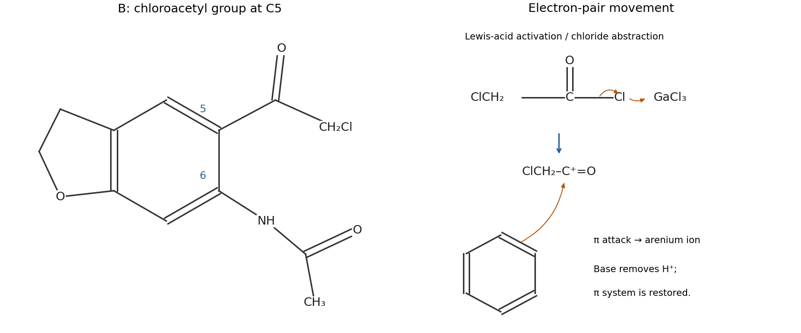

<h1 id="b1/a/ii/solution">Solution</h1>

↑ **Parent:** [Ii](../ii.md)

The product is **N-\[5-(2-chloroacetyl)-2,3-dihydrobenzofuran-6-yl\]acetamide**, with an aromatic $-\mathrm{COCH_2Cl}$ [substituent](../../../../../../substituent.md) at position 5. Substitution of one aromatic [hydrogen](../../../../../../hydrogen.md) by $\mathrm{C_2H_2ClO}$ gives the stated molecular formula. This positional assignment also agrees with the isolated intermediate reported in the original process study.[Experimental section, N-(5-(2-chloroacetyl)-2,3-dihydrobenzofuran-6-yl)acetamide](../../../../../../process-development-to-synthesize-sgd-11275-utilizing-a-pd-catalyzed-acetamide-arylation-and-gallium-mediated-friedel-crafts-acylation-by-tristan-m-mcginnis-and-others.md)

[GaCl3](../../../../../../gallium-trichloride.md) activates [chloroacetyl chloride](../../../../../../chloroacetyl-chloride.md) by Lewis-acid coordination and chloride abstraction, represented by the acylium/contact-ion-pair limit $\mathrm{ClCH_2CO^+}$. The position-5 aromatic $\pi$ bond attacks the acyl [carbon](../../../../../../carbon.md), giving a [Wheland intermediate](../../../../../../arenium-ion.md). Removal of the [proton](../../../../../../proton.md) at that [carbon](../../../../../../carbon.md) restores [aromaticity](../../../../../../aromaticity.md). Product–Lewis-acid coordination is reversed on work-up. The carbon-bound chlorine survives; the chlorine on the acyl [carbon](../../../../../../carbon.md) is the leaving group.

**[Figure 1](#b1/a/ii/image-position-5-chloroacetylation-product-and-electron-flow-in-friedel-crafts-acylation). Position-5 chloroacetylation product and electron flow in Friedel-Crafts acylation**.

## ↑ Ancestors (14)

1. [Ii](../ii.md)
2. [A](../../a.md)
3. [B1](../../../b1.md)
4. [Paper 1](../../../../paper-1-split.md)
5. [2025](../../../../split.md)
6. [Past exam of the chemistry B course of the University of Cambridge](../../../../../split.md)
7. [Chemistry B course of the University of Cambridge](../../../../../../chemistry-b-course-of-the-university-of-cambridge.md)
8. [Year 2 of the natural sciences course of the University of Cambridge](../../../../../../year-2-of-the-natural-sciences-course-of-the-university-of-cambridge.md)
9. [Year of the natural sciences course of the University of Cambridge](../../../../../../year-of-the-natural-sciences-course-of-the-university-of-cambridge.md)
10. [Natural sciences course of the University of Cambridge](../../../../../../natural-sciences-course-of-the-university-of-cambridge.md)
11. [Course of the University of Cambridge](../../../../../../course-of-the-university-of-cambridge.md)
12. [University of Cambridge](../../../../../../university-of-cambridge-split.md)
13. [List of universities](../../../../../../list-of-universities.md)
14. [Codex Wiki](../../../../../../split.md)
