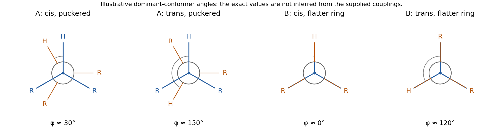

<h1 id="b3/a/solution">Solution</h1>

↑ **Parent:** [A](../a.md)

The relevant quantity is the H–C–C–H [dihedral angle](../../../../../dihedral-angle.md), through the [Karplus relation](../../../../../karplus-equation.md), rather than the labels cis and trans alone. Couplings tend to be larger near eclipsed or antiperiplanar arrangements and smaller nearer a right angle. The observed value averages the accessible conformations.

In A, the saturated five-membered ring is puckered. A preferred envelope-like [conformation](../../../../../conformation.md) can place the trans [hydrogens](../../../../../hydrogen.md) closer to an antiperiplanar arrangement, giving a slightly larger coupling than the cis pair. In B, the double bond restricts ring geometry toward a flatter arrangement: the cis [hydrogens](../../../../../hydrogen.md) are more nearly eclipsed, whereas the trans pair has an oblique [dihedral angle](../../../../../dihedral-angle.md). The cis coupling is then larger. Approximate Newman projections illustrate these trends; exact angles cannot be recovered from four coupling constants without a calibrated relation and conformational populations.

**[Figure 5](#b3/a/image-illustrative-newman-projections-explaining-why-cis-trans-coupling-order-depends-on-five-membered-ring-geometry). Illustrative Newman projections explaining why cis/trans coupling order depends on five-membered ring geometry**.

## ↑ Ancestors (13)

1. [A](../a.md)
2. [B3](../../b3.md)
3. [Paper 1](../../../paper-1-split.md)
4. [2025](../../../split.md)
5. [Past exam of the chemistry B course of the University of Cambridge](../../../../split.md)
6. [Chemistry B course of the University of Cambridge](../../../../../chemistry-b-course-of-the-university-of-cambridge.md)
7. [Year 2 of the natural sciences course of the University of Cambridge](../../../../../year-2-of-the-natural-sciences-course-of-the-university-of-cambridge.md)
8. [Year of the natural sciences course of the University of Cambridge](../../../../../year-of-the-natural-sciences-course-of-the-university-of-cambridge.md)
9. [Natural sciences course of the University of Cambridge](../../../../../natural-sciences-course-of-the-university-of-cambridge.md)
10. [Course of the University of Cambridge](../../../../../course-of-the-university-of-cambridge.md)
11. [University of Cambridge](../../../../../university-of-cambridge-split.md)
12. [List of universities](../../../../../list-of-universities.md)
13. [Codex Wiki](../../../../../split.md)
