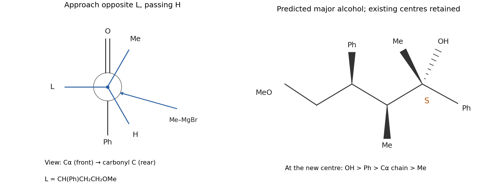

<h1 id="b4/a/solution">Solution</h1>

↑ **Parent:** [A](../a.md)

Apply the [Felkin-Anh model](../../../../../felkin-anh-model.md) to the stereocentre alpha to the [ketone](../../../../../ketone.md). Its large group is the chain continuing through the phenyl-bearing [carbon](../../../../../carbon.md), its medium group is methyl, and its small group is [hydrogen](../../../../../hydrogen.md). In the preferred transition-state arrangement, put the large group approximately perpendicular to C=O and approach from the opposite face, passing the small [hydrogen](../../../../../hydrogen.md) along a [Bürgi-Dunitz trajectory](../../../../../burgi-dunitz-trajectory.md). The remote [ether](../../../../../ether.md) cannot form the usual small alpha-alkoxy chelate, and the coordinating [solvent](../../../../../solvent.md) further supports using an open-addition prediction.[pp. 1–2: perpendicular large group and nucleophilic approach past the small group](../../../../../felkin-anh-and-cram-chelate-by-university-of-windsor.md)

The predicted new stereocentre is **$S$**. In the question's zigzag projection, this corresponds to the new OH bond directed behind the page and the newly introduced methyl toward the reader, with the original stereocentres unchanged. The new-centre priority order is OH $>$ phenyl $>$ the substituted alpha-carbon chain $>$ methyl. This is a model-based major-product prediction, rather than a quantitative diastereomeric ratio.

**[Figure 7](#b4/a/image-felkin-anh-approach-past-the-small-alpha-hydrogen-and-the-predicted-s-configured-tertiary-alcohol). Felkin-Anh approach past the small alpha hydrogen and the predicted S-configured tertiary alcohol**.

## ↑ Ancestors (13)

1. [A](../a.md)
2. [B4](../../b4.md)
3. [Paper 1](../../../paper-1-split.md)
4. [2025](../../../split.md)
5. [Past exam of the chemistry B course of the University of Cambridge](../../../../split.md)
6. [Chemistry B course of the University of Cambridge](../../../../../chemistry-b-course-of-the-university-of-cambridge.md)
7. [Year 2 of the natural sciences course of the University of Cambridge](../../../../../year-2-of-the-natural-sciences-course-of-the-university-of-cambridge.md)
8. [Year of the natural sciences course of the University of Cambridge](../../../../../year-of-the-natural-sciences-course-of-the-university-of-cambridge.md)
9. [Natural sciences course of the University of Cambridge](../../../../../natural-sciences-course-of-the-university-of-cambridge.md)
10. [Course of the University of Cambridge](../../../../../course-of-the-university-of-cambridge.md)
11. [University of Cambridge](../../../../../university-of-cambridge-split.md)
12. [List of universities](../../../../../list-of-universities.md)
13. [Codex Wiki](../../../../../split.md)
