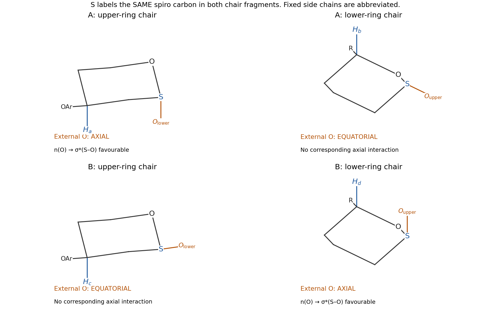

<h1 id="b4/b/iii/solution">Solution</h1>

↑ **Parent:** [Iii](../iii.md)

Use the upper-ring chair placing $H_a$ or $H_c$ axial. The aryl ester [substituent](../../../../../../substituent.md) on that [carbon](../../../../../../carbon.md) is then equatorial. Use a lower-ring chair placing $H_b$ or $H_d$ axial, with the attached [side chain](../../../../../../side-chain.md) equatorial. The spiro configuration distinguishes the two structures: in **A**, the lower-ring [oxygen](../../../../../../oxygen.md) bond is axial with respect to the upper ring, while the upper-ring [oxygen](../../../../../../oxygen.md) bond is equatorial with respect to the lower ring. In **B**, those roles reverse.

Thus the [oxygen](../../../../../../oxygen.md) placements at the shared spiro [carbon](../../../../../../carbon.md) are **axial/equatorial for A and equatorial/axial for B**. Side-chain conformations are unnecessary, but changing the lower chair without tracking its [substituent](../../../../../../substituent.md) positions would change this conclusion.

**[Figure 8](#b4/b/iii/image-chair-assignments-for-the-two-spiroacetals-axial-reporter-hydrogens-and-one-axial-exocyclic-oxygen-in-each-isomer). Chair assignments for the two spiroacetals: axial reporter hydrogens and one axial exocyclic oxygen in each isomer**.

## ↑ Ancestors (14)

1. [Iii](../iii.md)
2. [B](../../b.md)
3. [B4](../../../b4.md)
4. [Paper 1](../../../../paper-1-split.md)
5. [2025](../../../../split.md)
6. [Past exam of the chemistry B course of the University of Cambridge](../../../../../split.md)
7. [Chemistry B course of the University of Cambridge](../../../../../../chemistry-b-course-of-the-university-of-cambridge.md)
8. [Year 2 of the natural sciences course of the University of Cambridge](../../../../../../year-2-of-the-natural-sciences-course-of-the-university-of-cambridge.md)
9. [Year of the natural sciences course of the University of Cambridge](../../../../../../year-of-the-natural-sciences-course-of-the-university-of-cambridge.md)
10. [Natural sciences course of the University of Cambridge](../../../../../../natural-sciences-course-of-the-university-of-cambridge.md)
11. [Course of the University of Cambridge](../../../../../../course-of-the-university-of-cambridge.md)
12. [University of Cambridge](../../../../../../university-of-cambridge-split.md)
13. [List of universities](../../../../../../list-of-universities.md)
14. [Codex Wiki](../../../../../../split.md)
