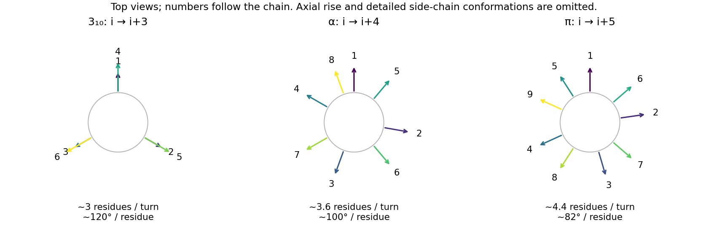

<h1 id="b5/d/solution">Solution</h1>

↑ **Parent:** [D](../d.md)

For a [carbonyl](../../../../../carbonyl-group.md) [oxygen](../../../../../oxygen.md) of residue $i$ accepting from the NH of a later residue, the possibilities are:

- $i\to i+1$: a very small four-membered hydrogen-bonded loop, incompatible with a favourable repeating peptide-backbone geometry.
- $i\to i+2$: a seven-membered loop associated with a [gamma turn](../../../../../gamma-turn.md); a long regular two-residue-per-turn structure is strongly constrained.
- $i\to i+3$: the ten-membered hydrogen-bonded rings of a [3-10 helix](../../../../../3-10-helix.md), with about three residues per turn.
- $i\to i+4$: the thirteen-membered rings of an [alpha helix](../../../../../alpha-helix.md), with about 3.6 residues per turn.
- $i\to i+5$: the sixteen-membered rings of a [pi helix](../../../../../pi-helix.md), with about 4.4 residues per turn.

**[Figure 10](#b5/d/image-top-view-side-chain-directions-in-3-10-alpha-and-pi-helices). Top-view side-chain directions in 3-10, alpha and pi helices**.

The [alpha helix](../../../../../alpha-helix.md) provides a favourable combination of allowed backbone torsions, reasonably linear [hydrogen bonds](../../../../../hydrogen-bond.md), and side-chain packing. Its successive [side chains](../../../../../side-chain.md) advance by about $100^\circ$, rather than lining up in the three columns of the narrower [3-10 helix](../../../../../3-10-helix.md). Smaller repeating rings impose more severe backbone constraints; the wider [pi helix](../../../../../pi-helix.md) gives a different, generally less favourable packing arrangement. Short 3-10 and pi-helical segments can still occur in proteins, so this is a preference for a common extended secondary structure, not a prohibition of the alternatives. [Proline](../../../../../proline.md) and sequence-specific interactions can disrupt the idealized backbone donor pattern.

## ↑ Ancestors (13)

1. [D](../d.md)
2. [B5](../../b5.md)
3. [Paper 1](../../../paper-1-split.md)
4. [2025](../../../split.md)
5. [Past exam of the chemistry B course of the University of Cambridge](../../../../split.md)
6. [Chemistry B course of the University of Cambridge](../../../../../chemistry-b-course-of-the-university-of-cambridge.md)
7. [Year 2 of the natural sciences course of the University of Cambridge](../../../../../year-2-of-the-natural-sciences-course-of-the-university-of-cambridge.md)
8. [Year of the natural sciences course of the University of Cambridge](../../../../../year-of-the-natural-sciences-course-of-the-university-of-cambridge.md)
9. [Natural sciences course of the University of Cambridge](../../../../../natural-sciences-course-of-the-university-of-cambridge.md)
10. [Course of the University of Cambridge](../../../../../course-of-the-university-of-cambridge.md)
11. [University of Cambridge](../../../../../university-of-cambridge-split.md)
12. [List of universities](../../../../../list-of-universities.md)
13. [Codex Wiki](../../../../../split.md)
