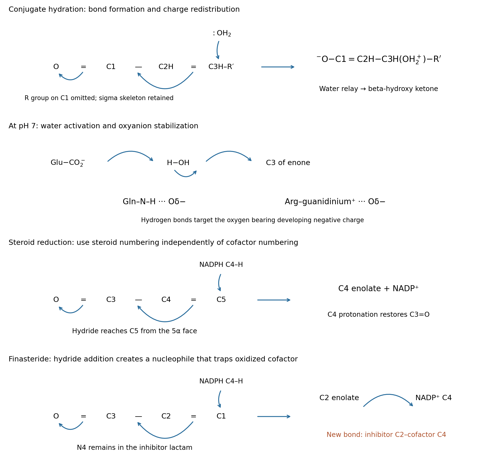

<h1 id="b10/a/i/solution">Solution</h1>

↑ **Parent:** [I](../i.md)

Use C1 for the carbonyl [carbon](../../../../../../carbon.md), C2 for the adjacent [carbon](../../../../../../carbon.md), and C3 for the beta [carbon](../../../../../../carbon.md) of the reactive [enone](../../../../../../enone.md) fragment $\mathrm{R{-}C1(=O){-}C2H{=}C3H{-}R'}$. **[water](../../../../../../water.md) adds conjugately at C3, giving a beta-hydroxy ketone.** The [oxygen](../../../../../../oxygen.md) [lone pair](../../../../../../lone-pair.md) of neutral [water](../../../../../../water.md) attacks C3; move the C2=C3 pi pair toward C1–C2 and the carbonyl pi pair onto [oxygen](../../../../../../oxygen.md). This produces the charge-separated [enolate](../../../../../../enolate.md)–oxonium intermediate

$$
\mathrm{R{-}C1(O^-){=}C2H{-}C3H(OH_2^+){-}R'}.
$$

A second [water](../../../../../../water.md) molecule can relay a [proton](../../../../../../proton.md) from the newly attached oxonium [oxygen](../../../../../../oxygen.md) to the [enolate](../../../../../../enolate.md) system. Using the carbon-centered [resonance structure](../../../../../../resonance-structure.md), reform C1=O and protonate C2 while the donating O–H bond returns its pair to the added [oxygen](../../../../../../oxygen.md). Equivalently, [oxygen](../../../../../../oxygen.md) protonation first gives an [enol](../../../../../../enol.md), followed by water-mediated [keto-enol tautomerism](../../../../../../keto-enol-tautomerism.md). Either path yields a neutral beta-hydroxy ketone and regenerates the relay [water](../../../../../../water.md). There is no need to introduce externally supplied H$^+$ or OH$^-$; solvent molecules perform the [proton](../../../../../../proton.md) transfers. The uncatalyzed charge separation has a large barrier, so this mechanism describes a slow formal pathway, not a claim of rapid hydration in pure [water](../../../../../../water.md).

**[Figure 4](#b10/a/i/image-reactive-fragment-mechanisms-for-conjugate-hydration-steroid-reduction-and-finasteride-trapping). Reactive-fragment mechanisms for conjugate hydration, steroid reduction and finasteride trapping**.

## ↑ Ancestors (14)

1. [I](../i.md)
2. [A](../../a.md)
3. [B10](../../../b10.md)
4. [Paper 2](../../../../paper-2-split.md)
5. [2025](../../../../split.md)
6. [Past exam of the chemistry B course of the University of Cambridge](../../../../../split.md)
7. [Chemistry B course of the University of Cambridge](../../../../../../chemistry-b-course-of-the-university-of-cambridge.md)
8. [Year 2 of the natural sciences course of the University of Cambridge](../../../../../../year-2-of-the-natural-sciences-course-of-the-university-of-cambridge.md)
9. [Year of the natural sciences course of the University of Cambridge](../../../../../../year-of-the-natural-sciences-course-of-the-university-of-cambridge.md)
10. [Natural sciences course of the University of Cambridge](../../../../../../natural-sciences-course-of-the-university-of-cambridge.md)
11. [Course of the University of Cambridge](../../../../../../course-of-the-university-of-cambridge.md)
12. [University of Cambridge](../../../../../../university-of-cambridge-split.md)
13. [List of universities](../../../../../../list-of-universities.md)
14. [Codex Wiki](../../../../../../split.md)
