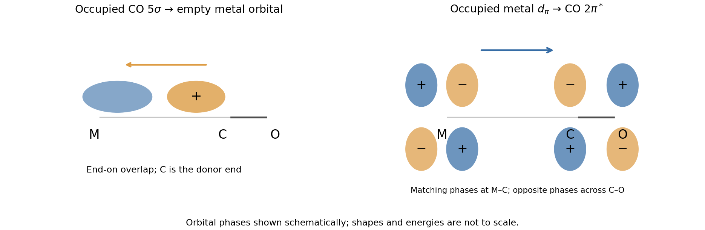

<h1 id="b7/b/i/solution">Solution</h1>

↑ **Parent:** [I](../i.md)

A [carbonyl ligand](../../../../../../carbonyl-ligand.md) binds through [carbon](../../../../../../carbon.md), whose occupied $5\sigma$ [molecular orbital](../../../../../../molecular-orbital.md) has a substantial outward-facing [carbon](../../../../../../carbon.md) lobe. Overlap with an empty metal orbital along the M–C axis gives ligand-to-metal [sigma donation](../../../../../../sigma-donation.md). Conversely, an occupied metal $d_\pi$ orbital overlaps sideways with an empty CO $2\pi^*$ [antibonding molecular orbital](../../../../../../antibonding-orbital.md), giving metal-to-ligand [pi backbonding](../../../../../../pi-backbonding.md). There are two mutually perpendicular pi channels. The original orbital schematic below shows one of them; $+$ and $-$ denote orbital phase, not [electric charge](../../../../../../electric-charge-split.md).

**[Figure 1](#b7/b/i/image-carbonyl-sigma-donation-and-one-pi-backbonding-channel). Carbonyl sigma donation and one pi-backbonding channel**.

The interactions are synergic: donation makes [electron](../../../../../../electron.md) density available at the metal, and backbonding helps accommodate it while strengthening the metal–[carbon](../../../../../../carbon.md) interaction. Occupying CO $\pi^*$ reduces the C–O [bond order](../../../../../../bond-order.md), lengthens that bond and lowers its [bond force constant](../../../../../../bond-force-constant.md). Therefore stronger [pi backbonding](../../../../../../pi-backbonding.md) generally lowers the carbonyl stretching [spectroscopic wavenumber](../../../../../../spectroscopic-wavenumber.md) even while strengthening the M–C attachment.

## ↑ Ancestors (14)

1. [I](../i.md)
2. [B](../../b.md)
3. [B7](../../../b7.md)
4. [Paper 2](../../../../paper-2-split.md)
5. [2025](../../../../split.md)
6. [Past exam of the chemistry B course of the University of Cambridge](../../../../../split.md)
7. [Chemistry B course of the University of Cambridge](../../../../../../chemistry-b-course-of-the-university-of-cambridge.md)
8. [Year 2 of the natural sciences course of the University of Cambridge](../../../../../../year-2-of-the-natural-sciences-course-of-the-university-of-cambridge.md)
9. [Year of the natural sciences course of the University of Cambridge](../../../../../../year-of-the-natural-sciences-course-of-the-university-of-cambridge.md)
10. [Natural sciences course of the University of Cambridge](../../../../../../natural-sciences-course-of-the-university-of-cambridge.md)
11. [Course of the University of Cambridge](../../../../../../course-of-the-university-of-cambridge.md)
12. [University of Cambridge](../../../../../../university-of-cambridge-split.md)
13. [List of universities](../../../../../../list-of-universities.md)
14. [Codex Wiki](../../../../../../split.md)
