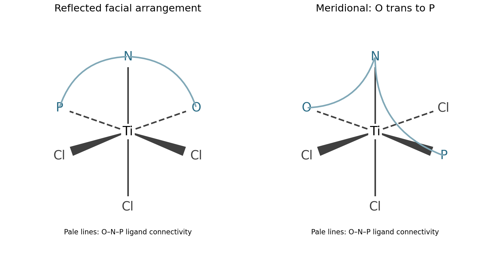

<h1 id="b8/a/iii/solution">Solution</h1>

↑ **Parent:** [Iii](../iii.md)

**The mirror-image facial complex and the meridional complex** provide the two requested [stereoisomers](../../../../../../stereoisomer.md). Let O, N and P denote the three attached atoms of the same unsymmetrical chelate. The original has these atoms on one octahedral face and the three chlorides on the opposite face. Its reflected facial arrangement is an [enantiomer](../../../../../../enantiomer.md): the O,N,P donor sequence reverses handedness and cannot be restored by a proper rotation. In the meridional arrangement, O and P are trans, and the two adjacent chelate links O–N and N–P remain cis. The following original coordination diagrams specify the ligand positions; lines joining donor labels represent the ligand's connectivity, with its organic backbone suppressed.

**[Figure 2](#b8/a/iii/image-an-alternative-facial-enantiomer-and-a-meridional-arrangement-of-the-o-n-p-titanium-chelate). An alternative facial enantiomer and a meridional arrangement of the O,N,P titanium chelate**.

The meridional structure is a [geometric isomer](../../../../../../geometric-isomer.md), not the reflected facial structure. Distorting chelate rings without changing these donor positions does not by itself supply a new coordination stereoisomer.

## ↑ Ancestors (14)

1. [Iii](../iii.md)
2. [A](../../a.md)
3. [B8](../../../b8.md)
4. [Paper 2](../../../../paper-2-split.md)
5. [2025](../../../../split.md)
6. [Past exam of the chemistry B course of the University of Cambridge](../../../../../split.md)
7. [Chemistry B course of the University of Cambridge](../../../../../../chemistry-b-course-of-the-university-of-cambridge.md)
8. [Year 2 of the natural sciences course of the University of Cambridge](../../../../../../year-2-of-the-natural-sciences-course-of-the-university-of-cambridge.md)
9. [Year of the natural sciences course of the University of Cambridge](../../../../../../year-of-the-natural-sciences-course-of-the-university-of-cambridge.md)
10. [Natural sciences course of the University of Cambridge](../../../../../../natural-sciences-course-of-the-university-of-cambridge.md)
11. [Course of the University of Cambridge](../../../../../../course-of-the-university-of-cambridge.md)
12. [University of Cambridge](../../../../../../university-of-cambridge-split.md)
13. [List of universities](../../../../../../list-of-universities.md)
14. [Codex Wiki](../../../../../../split.md)
