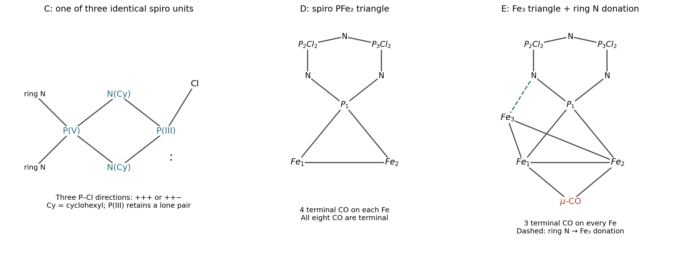

<h1 id="b9/c/solution">Solution</h1>

↑ **Parent:** [C](../c.md)

**$B=\mathrm{N_3P_3(NHCy)_6}$**, with two cyclohexylamino substituents on each original phosphorus. All six P–Cl bonds have been replaced; the six N–H bonds of those substituents remain. Each equivalent of [triethylamine](../../../../../triethylamine.md) traps one equivalent of HCl.

**$C$ contains three four-membered $\mathrm{P^{V}{-}N(Cy){-}P^{III}(Cl){-}N(Cy)}$ spiro rings**, one at each original ring phosphorus. Each PCl$_3$ joins the two geminal NHCy groups: replacement of two of its chlorides forms two new P–N bonds and releases two HCl, consuming both N–H [protons](../../../../../proton.md). The new phosphorus retains one chloride and a [lone pair](../../../../../lone-pair.md), making it three-coordinate P(III); the original six-membered $\mathrm{P_3N_3}$ ring retains P(V). The product formula is $\mathrm{N_3P_3\{(NCy)_2PCl\}_3}$. For each spiro ring, the original phosphorus is bonded to both exocyclic nitrogens, and each of those nitrogens is bonded to the same new PCl center; the braces do not indicate a simple linear substituent.

The three new P–Cl directions permit **an all-cis isomer and a cis,trans isomer**. Relative to the central ring, write these as $(+,+,+)$ and $(+,+,-)$, with cyclic relabeling giving equivalent choices. Reversing all signs does not create a third relative configuration. This describes the configuration pattern; puckering and substituent conformations are additional structural details.

**[Figure 3](#b9/c/image-spiro-ring-connectivity-and-the-electron-counted-diiron-and-triiron-phosphazene-products). Spiro-ring connectivity and the electron-counted diiron and triiron phosphazene products**.

## ↑ Ancestors (13)

1. [C](../c.md)
2. [B9](../../b9.md)
3. [Paper 2](../../../paper-2-split.md)
4. [2025](../../../split.md)
5. [Past exam of the chemistry B course of the University of Cambridge](../../../../split.md)
6. [Chemistry B course of the University of Cambridge](../../../../../chemistry-b-course-of-the-university-of-cambridge.md)
7. [Year 2 of the natural sciences course of the University of Cambridge](../../../../../year-2-of-the-natural-sciences-course-of-the-university-of-cambridge.md)
8. [Year of the natural sciences course of the University of Cambridge](../../../../../year-of-the-natural-sciences-course-of-the-university-of-cambridge.md)
9. [Natural sciences course of the University of Cambridge](../../../../../natural-sciences-course-of-the-university-of-cambridge.md)
10. [Course of the University of Cambridge](../../../../../course-of-the-university-of-cambridge.md)
11. [University of Cambridge](../../../../../university-of-cambridge-split.md)
12. [List of universities](../../../../../list-of-universities.md)
13. [Codex Wiki](../../../../../split.md)
