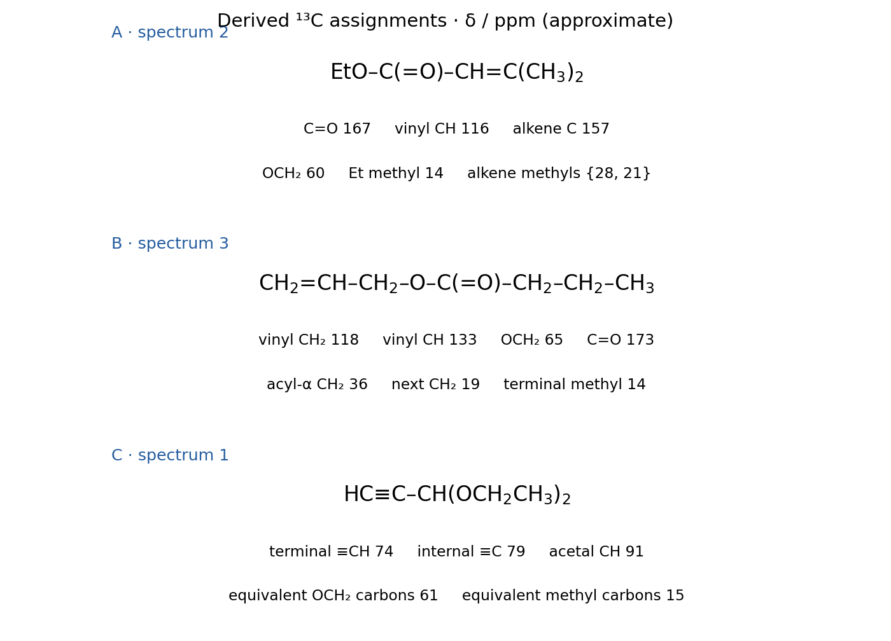
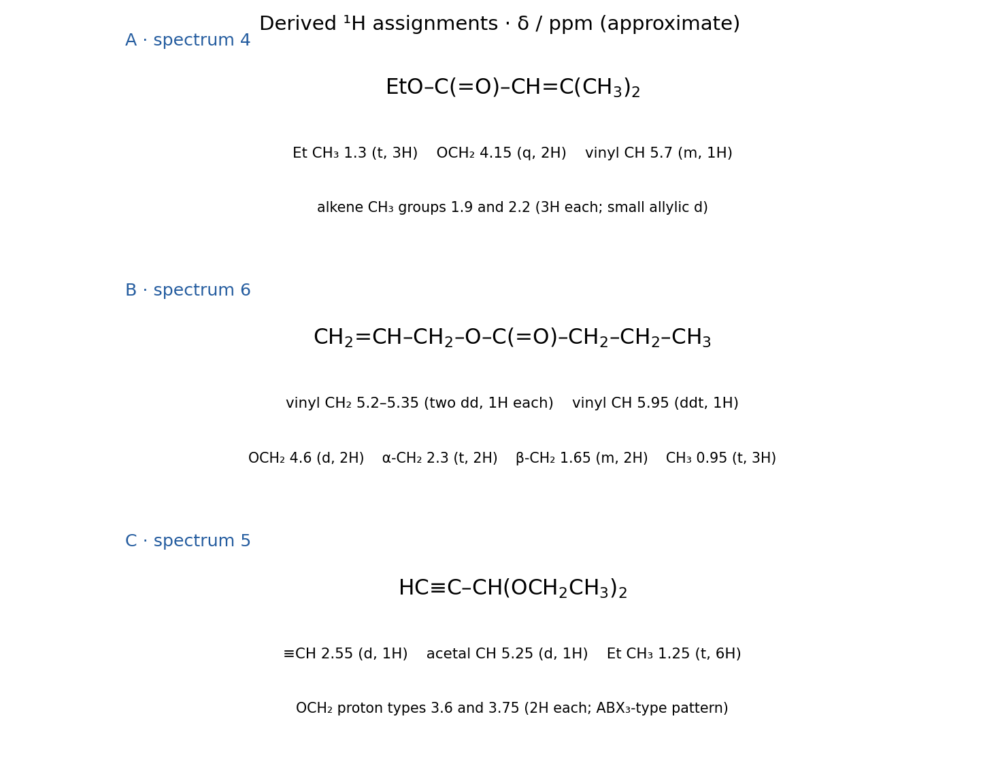
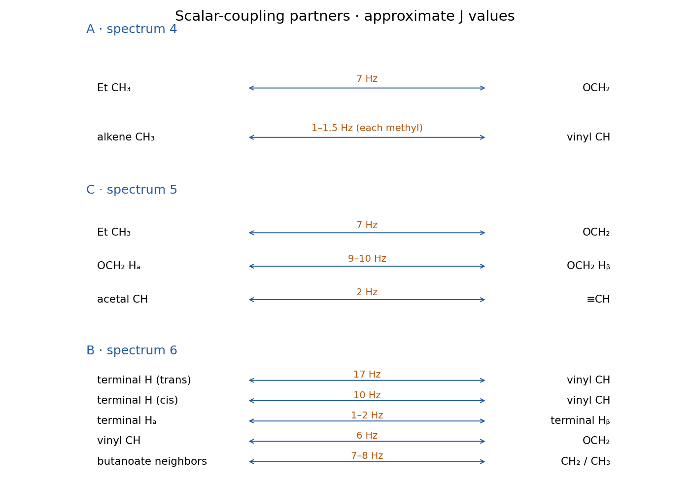
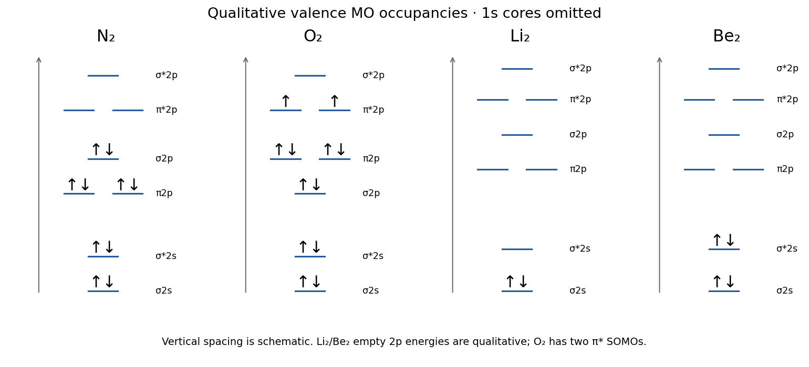
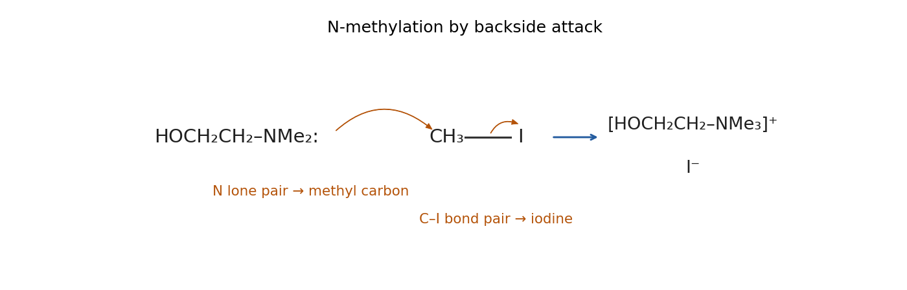
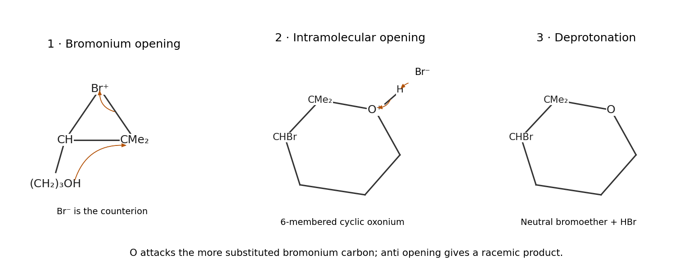
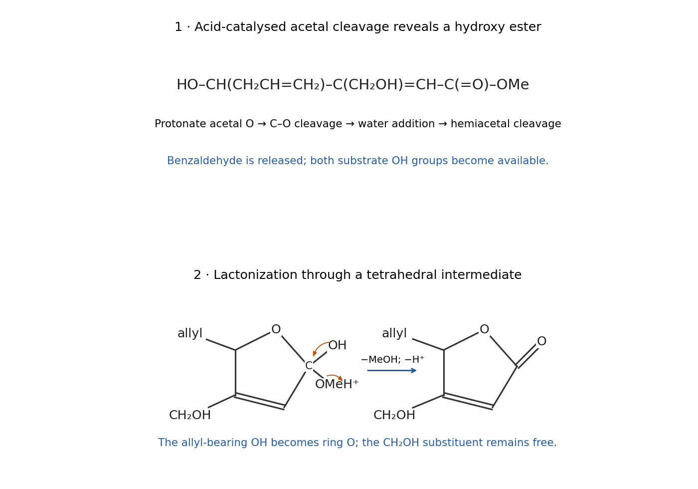
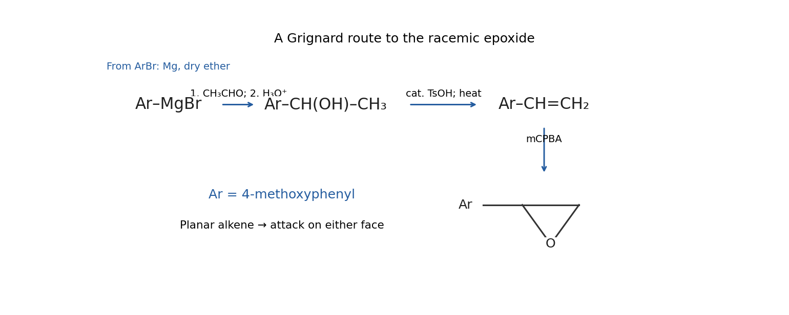
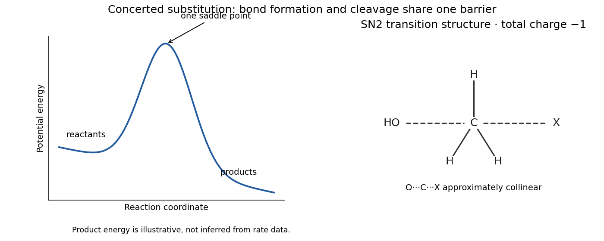

# Paper 1

↑ **Parent:** [2021](../2021.md)

[Original paper, released PDF pages 251–260](https://www.whatdotheyknow.com/request/natural_science_tripos_exam_pape/response/2610591/attach/3/FOI%202024%20208%20Ye%20materials.pdf?cookie_passthrough=1#page=251)

Student suggested answers are advertised on Chemistry Moodle, but complete worked coverage of this exact 2021 paper remains unverified.[Printed page 11, past-paper and suggested-answer archive](../../chemistry-bibliography.md#part-ia-course-guide-2026-by-the-university-of-cambridge-department-of-chemistry)

**Table of contents**

- [1](#1)
  - [a](#1/a)
    - [Solution](#1/a/solution)
  - [b](#1/b)
    - [Solution](#1/b/solution)
  - [c](#1/c)
    - [i](#1/c/i)
      - [Solution](#1/c/i/solution)
    - [ii](#1/c/ii)
      - [Solution](#1/c/ii/solution)
    - [iii](#1/c/iii)
      - [Solution](#1/c/iii/solution)
- [2](#2)
  - [a](#2/a)
    - [i](#2/a/i)
      - [Solution](#2/a/i/solution)
    - [ii](#2/a/ii)
      - [Solution](#2/a/ii/solution)
    - [iii](#2/a/iii)
      - [Solution](#2/a/iii/solution)
    - [iv](#2/a/iv)
      - [Solution](#2/a/iv/solution)
    - [v](#2/a/v)
      - [Solution](#2/a/v/solution)
    - [vi](#2/a/vi)
      - [Solution](#2/a/vi/solution)
  - [b](#2/b)
    - [i](#2/b/i)
      - [Solution](#2/b/i/solution)
    - [ii](#2/b/ii)
      - [Solution](#2/b/ii/solution)
    - [iii](#2/b/iii)
      - [Solution](#2/b/iii/solution)
- [3](#3)
  - [a](#3/a)
    - [i](#3/a/i)
      - [Solution](#3/a/i/solution)
    - [ii](#3/a/ii)
      - [Solution](#3/a/ii/solution)
  - [b](#3/b)
    - [i](#3/b/i)
      - [Solution](#3/b/i/solution)
    - [ii](#3/b/ii)
      - [Solution](#3/b/ii/solution)
  - [c](#3/c)
    - [Solution](#3/c/solution)
- [4](#4)
  - [a](#4/a)
    - [Solution](#4/a/solution)
  - [b](#4/b)
    - [Solution](#4/b/solution)
  - [c](#4/c)
    - [Solution](#4/c/solution)
  - [d](#4/d)
    - [i](#4/d/i)
      - [Solution](#4/d/i/solution)
    - [ii](#4/d/ii)
      - [Solution](#4/d/ii/solution)
  - [e](#4/e)
    - [Solution](#4/e/solution)
- [5](#5)
  - [a](#5/a)
    - [i](#5/a/i)
      - [Solution](#5/a/i/solution)
    - [ii](#5/a/ii)
      - [Solution](#5/a/ii/solution)
  - [b](#5/b)
    - [i](#5/b/i)
      - [Solution](#5/b/i/solution)
    - [ii](#5/b/ii)
      - [Solution](#5/b/ii/solution)
    - [iii](#5/b/iii)
      - [Solution](#5/b/iii/solution)
    - [iv](#5/b/iv)
      - [Solution](#5/b/iv/solution)
  - [c](#5/c)
    - [i](#5/c/i)
      - [Solution](#5/c/i/solution)
    - [ii](#5/c/ii)
      - [Solution](#5/c/ii/solution)
- [6](#6)
  - [a](#6/a)
    - [i](#6/a/i)
      - [Solution](#6/a/i/solution)
    - [ii](#6/a/ii)
      - [Solution](#6/a/ii/solution)
  - [b](#6/b)
    - [Solution](#6/b/solution)
  - [c](#6/c)
    - [i](#6/c/i)
      - [Solution](#6/c/i/solution)
    - [ii](#6/c/ii)
      - [Solution](#6/c/ii/solution)

## 1

↑ **Parent:** [Paper 1](paper-1.md)

<h3 id="1/a">a</h3>

↑ **Parent:** [1](#1)

<h4 id="1/a/solution">Solution</h4>

↑ **Parent:** [A](#1/a)

**A: conjugated [ester](../../chemical-substance.md#ester); B: unconjugated [ester](../../chemical-substance.md#ester); C: terminal [alkyne](../../chemical-substance.md#alkyne) [acetal](../../chemical-substance.md#acetal).**

A has a strong [ester](../../chemical-substance.md#ester) C=O band at roughly $1715$–$1730\,\mathrm{cm^{-1}}$, lowered by [conjugation](../../group-action.md#conjugation) with C=C. B's unconjugated [ester](../../chemical-substance.md#ester) [carbonyl](../../chemical-bond.md#carbonyl-group) is nearer $1735$–$1750\,\mathrm{cm^{-1}}$; it also has terminal-alkene features, including the approximately $990/910\,\mathrm{cm^{-1}}$ pair.

C has **no [carbonyl](../../chemical-bond.md#carbonyl-group) band**. Its terminal [alkyne](../../chemical-substance.md#alkyne) gives a relatively sharp sp C-H stretch near $3300\,\mathrm{cm^{-1}}$ and a usually weaker C≡C feature near $2100$–$2150\,\mathrm{cm^{-1}}$. C-O stretching alone is less diagnostic because [esters](../../chemical-substance.md#ester) and the [acetal](../../chemical-substance.md#acetal) all contain C-O bonds. The numbers are characteristic ranges, not exact frequencies inferred from an unprinted IR trace.

<h3 id="1/b">b</h3>

↑ **Parent:** [1](#1)

<h4 id="1/b/solution">Solution</h4>

↑ **Parent:** [B](#1/b)

**[Carbon-13 NMR](../../nuclear-magnetic-resonance.md#carbon-13-nmr) spectra: 1 = C, 2 = A, 3 = B.** Approximate shifts, read from the printed axes, are shown in the annotated structures.

**[Figure 1](#1/b/image-derived-carbon-assignments-for-the-three-isomers-excluding-the-solvent-signal-near-77-ppm). Derived carbon assignments for the three isomers, excluding the solvent signal near 77 ppm**.

- **C:** $\mathrm{HC{\equiv}C-CH(OCH_2CH_3)_2}$ has five [carbon](../../chemical-substance.md#carbon) environments: [acetal](../../chemical-substance.md#acetal) CH near $91$; substituted/terminal [alkyne](../../chemical-substance.md#alkyne) [carbons](../../chemical-substance.md#carbon) near $79$ and $74$; OCH$_2$ near $61$; and methyl near $15\,\mathrm{ppm}$. One [alkyne](../../chemical-substance.md#alkyne) signal is close to the CDCl$_3$ [solvent](../../mixture.md#solvent) region, which must not be counted as a new molecular environment.
- **A:** $\mathrm{EtOCO-CH=C(CH_3)_2}$ has [ester](../../chemical-substance.md#ester) [carbonyl](../../chemical-bond.md#carbonyl-group) near $167$, substituted [alkene](../../chemical-substance.md#alkene) C near $157$, vinyl CH near $116$, OCH$_2$ near $60$, two nonequivalent [alkene](../../chemical-substance.md#alkene) methyls near $28$ and $21$, and ethoxy methyl near $14\,\mathrm{ppm}$.
- **B:** $\mathrm{CH_2=CH-CH_2-OCO-CH_2-CH_2-CH_3}$ has [carbonyl](../../chemical-bond.md#carbonyl-group) near $173$, vinyl CH near $133$, terminal vinyl CH$_2$ near $118$, OCH$_2$ near $65$, acyl-alpha CH$_2$ near $36$, the next CH$_2$ near $19$, and terminal methyl near $14\,\mathrm{ppm}$.

The two methyls in A are chemically distinct because one is cis and the other trans to each substituent at the other [alkene](../../chemical-substance.md#alkene) [carbon](../../chemical-substance.md#carbon). Their two measured shifts are secure; assigning an individual methyl to a particular side of the drawn double bond requires an additional stereospecific shift argument or experiment, so their spatial interchange is left explicit.

<h3 id="1/c">c</h3>

↑ **Parent:** [1](#1)

<h4 id="1/c/i">i</h4>

↑ **Parent:** [C](#1/c)

<h5 id="1/c/i/solution">Solution</h5>

↑ **Parent:** [I](#1/c/i)

**[Proton nuclear magnetic resonance](../../nuclear-magnetic-resonance.md#proton-nuclear-magnetic-resonance) spectra: 4 = A, 5 = C, 6 = B.**

Spectrum 4 has one vinyl [proton](../../physics.md#proton), two alkene-methyl groups and an [ethoxy group](../../chemistry.md#ethoxy-group). Spectrum 5 has one [acetal](../../chemical-substance.md#acetal) [proton](../../physics.md#proton), one terminal-alkyne [proton](../../physics.md#proton) and two equivalent [ethoxy groups](../../chemistry.md#ethoxy-group). Spectrum 6 has the three-proton terminal-alkene pattern and the allylic OCH$_2$ group, together with the butanoate chain.

<h4 id="1/c/ii">ii</h4>

↑ **Parent:** [C](#1/c)

<h5 id="1/c/ii/solution">Solution</h5>

↑ **Parent:** [Ii](#1/c/ii)

**[Figure 2](#1/c/ii/image-approximate-proton-shifts-and-coupling-patterns-derived-from-the-printed-spectra). Approximate proton shifts and coupling patterns derived from the printed spectra**.

**A, spectrum 4:** ethoxy CH$_3$ at about $1.3$ is a [NMR triplet](../../nuclear-magnetic-resonance.md#nmr-triplet), and OCH$_2$ at about $4.15$ is a [NMR quartet](../../nuclear-magnetic-resonance.md#nmr-quartet). The two [alkene](../../chemical-substance.md#alkene) methyls at about $1.9$ and $2.2$ each integrate to three [protons](../../physics.md#proton); they are apparent [NMR singlets](../../nuclear-magnetic-resonance.md#nmr-singlet) on the overview but have small allylic [NMR doublet](../../nuclear-magnetic-resonance.md#nmr-doublet) splitting. The vinyl CH at about $5.7$ is correspondingly a narrow [NMR multiplet](../../nuclear-magnetic-resonance.md#nmr-multiplet), formally a [quartet of quartets](../../nuclear-magnetic-resonance.md#quartet-of-quartets) when its two methyl couplings are unequal, or approximately a [NMR septet](../../nuclear-magnetic-resonance.md#nmr-septet) if they coincide. A broadened overview must not be used to declare all those small couplings exactly zero.

**C, spectrum 5:** the [acetal](../../chemical-substance.md#acetal) CH at about $5.25$ and terminal C≡CH at about $2.55$ each integrate to one [proton](../../physics.md#proton) and show their small mutual long-range [NMR doublet](../../nuclear-magnetic-resonance.md#nmr-doublet) splitting. The ethoxy methyls give a six-proton [NMR triplet](../../nuclear-magnetic-resonance.md#nmr-triplet) near $1.25$. The OCH$_2$ region has two sets near $3.6$ and $3.75$, each integrating to two [protons](../../physics.md#proton). These are an [ABX3 spin system](../../nuclear-magnetic-resonance.md#abx3-spin-system): [geminal coupling](../../nuclear-magnetic-resonance.md#geminal-coupling) and coupling to CH$_3$ produce approximately one [doublet of quartets](../../nuclear-magnetic-resonance.md#doublet-of-quartets) for each [proton](../../physics.md#proton) type, with second-order distortion in the expanded trace. Treating the whole region as one ideal four-proton [NMR quartet](../../nuclear-magnetic-resonance.md#nmr-quartet) misses the printed structure.

**B, spectrum 6:** the internal [alkene](../../chemical-substance.md#alkene) CH near $5.95$ is a [doublet of doublets of triplets](../../nuclear-magnetic-resonance.md#doublet-of-doublets-of-triplets) from trans/cis coupling to CH$_2$ and [vicinal coupling](../../nuclear-magnetic-resonance.md#vicinal-coupling) to OCH$_2$. The two terminal [alkene](../../chemical-substance.md#alkene) [protons](../../physics.md#proton) near $5.2$–$5.35$ are distinct [doublet of doublets](../../nuclear-magnetic-resonance.md#doublet-of-doublets)-type signals, with possible additional small allylic splitting. OCH$_2$ near $4.6$ is principally a [NMR doublet](../../nuclear-magnetic-resonance.md#nmr-doublet). The acyl-alpha CH$_2$ near $2.3$ is a [NMR triplet](../../nuclear-magnetic-resonance.md#nmr-triplet), the middle CH$_2$ near $1.65$ an approximate [NMR sextet](../../nuclear-magnetic-resonance.md#nmr-sextet) or overlapping [NMR triplet](../../nuclear-magnetic-resonance.md#nmr-triplet) of quartets, and the terminal methyl near $0.95$ a [NMR triplet](../../nuclear-magnetic-resonance.md#nmr-triplet).

<h4 id="1/c/iii">iii</h4>

↑ **Parent:** [C](#1/c)

<h5 id="1/c/iii/solution">Solution</h5>

↑ **Parent:** [Iii](#1/c/iii)

**[Figure 3](#1/c/iii/image-coupling-partners-and-approximate-coupling-constants-with-line-separations-converted-using-300-hz-per-ppm). Coupling partners and approximate coupling constants, with line separations converted using 300 Hz per ppm**.

**A:** ethoxy CH$_2$ ↔ CH$_3$, $J\simeq7\,\mathrm{Hz}$; vinyl CH ↔ each [alkene](../../chemical-substance.md#alkene) methyl, small $^4J\simeq1$–$1.5\,\mathrm{Hz}$.

**C:** ethoxy CH$_2$ ↔ CH$_3$, about $7\,\mathrm{Hz}$; the two OCH$_2$ [proton](../../physics.md#proton) types have a [geminal coupling](../../nuclear-magnetic-resonance.md#geminal-coupling) of about $9$–$10\,\mathrm{Hz}$; [acetal](../../chemical-substance.md#acetal) CH ↔ C≡CH has $^4J\simeq2\,\mathrm{Hz}$.

**B:** internal vinyl CH ↔ trans terminal H, about $17\,\mathrm{Hz}$; ↔ cis terminal H, about $10\,\mathrm{Hz}$; terminal CH$_2$ [geminal coupling](../../nuclear-magnetic-resonance.md#geminal-coupling) about $1$–$2\,\mathrm{Hz}$. Vinyl CH ↔ OCH$_2$ is about $6\,\mathrm{Hz}$. Both vicinal links along the butanoate alkyl chain are about $7$–$8\,\mathrm{Hz}$.

Use $J=300\,\Delta\delta$ when a separation is measured in ppm. Thus $0.057\,\mathrm{ppm}$ corresponds to about $17\,\mathrm{Hz}$, whereas $0.023\,\mathrm{ppm}$ corresponds to about $7\,\mathrm{Hz}$. These are approximate readings, not a fitted [spin](../../angular-momentum-operator.md#spin) simulation.

The small four-bond splittings illustrate [allylic scalar coupling](../../nuclear-magnetic-resonance.md#allylic-scalar-coupling) and [acetal-alkyne long-range coupling](../../nuclear-magnetic-resonance.md#acetal-alkyne-long-range-coupling).

## 2

↑ **Parent:** [Paper 1](paper-1.md)

<h3 id="2/a">a</h3>

↑ **Parent:** [2](#2)

<h4 id="2/a/i">i</h4>

↑ **Parent:** [A](#2/a)

<h5 id="2/a/i/solution">Solution</h5>

↑ **Parent:** [I](#2/a/i)

**[Figure 4](#2/a/i/image-qualitative-valence-molecular-orbital-occupancies-for-nitrogen-oxygen-lithium-and-beryllium-dimers). Qualitative valence molecular-orbital occupancies for nitrogen, oxygen, lithium and beryllium dimers**.

Suppress the filled 1s core pair, which contributes zero net [bond order](../../chemistry.md#bond-order). For N$_2$, use the valence ordering

$$
\sigma_{2s}<\sigma_{2s}^*<\pi_{2p}<\sigma_{2p_z}
<\pi_{2p}^*<\sigma_{2p_z}^*
$$

and occupy it as $(\sigma_{2s})^2(\sigma_{2s}^*)^2(\pi_{2p})^4(\sigma_{2p_z})^2$.

For O$_2$, the ordering of the bonding 2p levels is reversed: $\sigma_{2p_z}<\pi_{2p}$. Occupancy is $(\sigma_{2s})^2(\sigma_{2s}^*)^2(\sigma_{2p_z})^2(\pi_{2p})^4(\pi_{2p_x}^*)^1(\pi_{2p_y}^*)^1$, with parallel [spins](../../angular-momentum-operator.md#spin) in the two degenerate antibonding pi orbitals.

Li$_2$ has $(\sigma_{2s})^2$; Be$_2$ has $(\sigma_{2s})^2(\sigma_{2s}^*)^2$ in the elementary valence description. Empty 2p-derived levels must also be included to discuss mixing and Be$_2$'s weak bonding; their precise energies are not set by this qualitative diagram.

<h4 id="2/a/ii">ii</h4>

↑ **Parent:** [A](#2/a)

<h5 id="2/a/ii/solution">Solution</h5>

↑ **Parent:** [Ii](#2/a/ii)

**N$_2$:** [Homo](../../organism.md#homo) $\sigma_{2p_z}$; [LUMO](../../chemistry.md#lowest-unoccupied-molecular-orbital) the degenerate $\pi_{2p}^*$ pair.

**O$_2$:** the two $\pi_{2p}^*$ orbitals are the highest occupied, singly occupied spatial orbitals. The next completely empty spatial orbital is $\sigma_{2p_z}^*$. An added [electron](../../physics.md#electron) can instead occupy the opposite-spin vacancy in a singly occupied pi-star orbital; this distinction matters if “[LUMO](../../chemistry.md#lowest-unoccupied-molecular-orbital)” is being used for an electron-addition [spin](../../angular-momentum-operator.md#spin) orbital.

**Li$_2$:** [Homo](../../organism.md#homo) $\sigma_{2s}$; next empty sigma orbital conventionally denoted $\sigma_{2s}^*$ in this elementary diagram. **Be$_2$:** [Homo](../../organism.md#homo) $\sigma_{2s}^*$; the low empty 2p manifold supplies the [LUMO](../../chemistry.md#lowest-unoccupied-molecular-orbital) candidates, drawn as $\pi_{2p}$ in the stated light-diatomic ordering. Mixing makes these labels descriptions of dominant atomic-orbital character, not strictly unmixed atomic functions.

This distinction is the [open-shell frontier orbital convention](../../chemistry.md#open-shell-frontier-orbital-convention).

<h4 id="2/a/iii">iii</h4>

↑ **Parent:** [A](#2/a)

<h5 id="2/a/iii/solution">Solution</h5>

↑ **Parent:** [Iii](#2/a/iii)

Use $b=(N_{\rm bonding}-N_{\rm antibonding})/2$:

$$
\boxed{b(\mathrm{N_2})=3,\quad b(\mathrm{O_2})=2,\quad
b(\mathrm{Li_2})=1,\quad b(\mathrm{Be_2})=0}
$$

in the elementary configurations. The zero for Be$_2$ is a limitation of this occupancy count, not proof that its measured interaction potential is everywhere repulsive.

<h4 id="2/a/iv">iv</h4>

↑ **Parent:** [A](#2/a)

<h5 id="2/a/iv/solution">Solution</h5>

↑ **Parent:** [Iv](#2/a/iv)

Both Be$_2$'s occupied bonding and antibonding 2s levels cancel in the simplest diagram. [Beryllium](../../chemical-substance.md#beryllium)'s relatively accessible empty 2p orbitals allow mixing and correlated configurations to change that cancellation and produce a **weak bond**. An s-only single-configuration picture is therefore insufficient; spectroscopy and accurate correlated calculations establish its binding.[Beryllium dimer caught in the act of bonding by Jeremy M. Merritt and colleagues](../../chemistry-bibliography.md#beryllium-dimer-caught-in-the-act-of-bonding-by-jeremy-m-merritt-and-colleagues)

For He$_2$, $(\sigma_{1s})^2(\sigma_{1s}^*)^2$ similarly gives zero elementary [covalent bond](../../covalent-bond.md) order, but the empty-shell excitation gap is much larger and there is no comparable low-energy 2s/2p near-degeneracy. Thus it has **no ordinary stable [covalent bond](../../covalent-bond.md)**.

The literal claim that He$_2$ does not exist needs qualification: an extraordinarily weak, cold van der Waals [helium dimer](../../molecule.md#helium-dimer) has been observed. That does not contradict the zero covalent-bond-order diagram.[The weakest bond: experimental observation of helium dimer by Fei Luo and colleagues](../../chemistry-bibliography.md#the-weakest-bond-experimental-observation-of-helium-dimer-by-fei-luo-and-colleagues)

The [beryllium dimer](../../molecule.md#beryllium-dimer) and [helium dimer](../../molecule.md#helium-dimer) illustrate two physically different ways that the elementary bond-order picture can miss weak binding.

<h4 id="2/a/v">v</h4>

↑ **Parent:** [A](#2/a)

<h5 id="2/a/v/solution">Solution</h5>

↑ **Parent:** [V](#2/a/v)

**No ordinary [covalent bond](../../covalent-bond.md) is expected.** He's filled 1s orbital is very low in energy, whereas Be supplies another filled shell and much higher empty valence orbitals. Mixing the two occupied s combinations gives no net elementary bond-order gain, and their large energy mismatch limits useful shared covalent character. A very weak dispersion-bound encounter is a different possibility; the answer concerns a conventional [covalent bond](../../covalent-bond.md).

<h4 id="2/a/vi">vi</h4>

↑ **Parent:** [A](#2/a)

<h5 id="2/a/vi/solution">Solution</h5>

↑ **Parent:** [Vi](#2/a/vi)

BeLi has **three [valence electrons](../../chemical-bond.md#valence-electron)**: two occupy a bonding sigma orbital and the third its higher partner. The elementary [bond order](../../chemistry.md#bond-order) is therefore **$1/2$**, with one [unpaired electron](../../chemistry.md#unpaired-electron): expect a relatively weak, paramagnetic, doublet [diatomic molecule](../../molecule.md#diatomic-molecule). Because Be attracts valence charge more strongly than Li, the bond is polar toward Be. This is a qualitative prediction, not a numerical dissociation energy.

This is the elementary picture of the [lithium beryllium diatomic molecule](../../molecule.md#lithium-beryllium-diatomic-molecule).

<h3 id="2/b">b</h3>

↑ **Parent:** [2](#2)

<h4 id="2/b/i">i</h4>

↑ **Parent:** [B](#2/b)

<h5 id="2/b/i/solution">Solution</h5>

↑ **Parent:** [I](#2/b/i)

The reacting **[Homo](../../organism.md#homo) is the tertiary-amine [nitrogen](../../chemical-substance.md#nitrogen) [lone pair](../../covalent-bond.md#lone-pair)**. The relevant **[LUMO](../../chemistry.md#lowest-unoccupied-molecular-orbital) is the C-I [antibonding orbital](../../chemistry.md#antibonding-orbital), $\sigma^*_{\mathrm{C-I}}$, of MeI**. Backside lone-pair donation into that orbital forms N-C while weakening C-I. The neutral OH group is not first converted to an alkoxide in the stated reaction.

<h4 id="2/b/ii">ii</h4>

↑ **Parent:** [B](#2/b)

<h5 id="2/b/ii/solution">Solution</h5>

↑ **Parent:** [Ii](#2/b/ii)

**[Figure 5](#2/b/ii/image-nitrogen-lone-pair-attack-and-iodide-departure-form-choline-iodide). Nitrogen lone-pair attack and iodide departure form choline iodide**.

Draw a curly arrow from the [nitrogen](../../chemical-substance.md#nitrogen) [lone pair](../../covalent-bond.md#lone-pair) to methyl [carbon](../../chemical-substance.md#carbon), and a second from the C-I bond to I:

$$
\mathrm{HOCH_2CH_2NMe_2+MeI
\longrightarrow[HOCH_2CH_2NMe_3]^+I^-}.
$$

This is concerted **[SN2](../../chemical-reaction.md#sn2-reaction) quaternization**. The product is [choline](../../chemical-substance.md#choline) iodide; [nitrogen](../../chemical-substance.md#nitrogen) has four [carbon](../../chemical-substance.md#carbon) substituents and positive charge, while the [alcohol](../../chemical-substance.md#alcohol) remains OH.

<h4 id="2/b/iii">iii</h4>

↑ **Parent:** [B](#2/b)

<h5 id="2/b/iii/solution">Solution</h5>

↑ **Parent:** [Iii](#2/b/iii)

**[Acetonitrile](../../chemical-substance.md#acetonitrile)** is suitable: it dissolves the organic reagents, is polar enough to stabilize the developing ionic products and is an aprotic, relatively unreactive medium. It does not strongly hydrogen-bond-solvate the amine [lone pair](../../covalent-bond.md#lone-pair) or compete efficiently as the methylating [nucleophile](../../chemical-reaction.md#nucleophile). Sufficient solubility and chemical compatibility matter as well as polarity.

## 3

↑ **Parent:** [Paper 1](paper-1.md)

<h3 id="3/a">a</h3>

↑ **Parent:** [3](#3)

<h4 id="3/a/i">i</h4>

↑ **Parent:** [A](#3/a)

<h5 id="3/a/i/solution">Solution</h5>

↑ **Parent:** [I](#3/a/i)

**A is dimethyl [ether](../../chemical-substance.md#ether), $\mathrm{CH_3OCH_3}$**, with NaCl as the corresponding salt byproduct. Backside methoxide attack on methyl chloride gives an [SN2](../../chemical-reaction.md#sn2-reaction) substitution:

$$
v=k[\mathrm{CH_3Cl}][\mathrm{MeO^-}].
$$

The rate is bimolecular because both reactants participate in the elementary bond-forming/bond-breaking event.

<h4 id="3/a/ii">ii</h4>

↑ **Parent:** [A](#3/a)

<h5 id="3/a/ii/solution">Solution</h5>

↑ **Parent:** [Ii](#3/a/ii)

All comparisons assume the same temperature and comparable reagent thermodynamic activities in [methanol](../../chemical-substance.md#methanol).

- **Iodomethane:** faster, because iodide is a better [leaving group](../../chemical-reaction.md#leaving-group) and the C-I bond is more readily broken than C-Cl.
- **1-Chloropropane:** slower than methyl chloride for [SN2](../../chemical-reaction.md#sn2-reaction), because its ethyl substituent crowds backside approach and raises the substitution barrier. It is still a primary substrate, so [SN2](../../chemical-reaction.md#sn2-reaction) remains plausible.
- **MeSNa:** generally faster substitution with methanethiolate than methoxide in this [protic solvent](../../mixture.md#protic-solvent). Sulfur is more polarizable and its larger anion is less strongly hydrogen-bond-solvated, making it a better [nucleophile](../../chemical-reaction.md#nucleophile) here. This must not be inferred simply from basicity: methanethiolate is the weaker base.

<h3 id="3/b">b</h3>

↑ **Parent:** [3](#3)

<h4 id="3/b/i">i</h4>

↑ **Parent:** [B](#3/b)

<h5 id="3/b/i/solution">Solution</h5>

↑ **Parent:** [I](#3/b/i)

**[Figure 6](#3/b/i/image-bromonium-formation-and-intramolecular-opening-give-the-six-membered-cyclic-bromoether). Bromonium formation and intramolecular opening give the six-membered cyclic bromoether**.

The [alkene](../../chemical-substance.md#alkene) [pi bond](../../covalent-bond.md#pi-bond) attacks Br$_2$ as the Br-Br bond breaks to bromide, forming a bridged, unsymmetrical **[bromonium ion](../../chemistry.md#bromonium-ion)**. The [carbon](../../chemical-substance.md#carbon) bearing the two [methyl groups](../../chemistry.md#methyl-group) has greater carbocation-like character.

The tethered [alcohol](../../chemical-substance.md#alcohol) [oxygen](../../chemical-substance.md#oxygen) attacks that [carbon](../../chemical-substance.md#carbon) from the side opposite the bromine bridge. Its [lone pair](../../covalent-bond.md#lone-pair) forms the new O-C bond while the attacked C-Br bridge bond opens, giving a six-membered cyclic oxonium ion. Bromide or [solvent](../../mixture.md#solvent) removes the O-H [proton](../../physics.md#proton) to give the neutral bromoether.

This explains why O becomes attached at the more substituted [alkene](../../chemical-substance.md#alkene) [carbon](../../chemical-substance.md#carbon) while Br remains at the other [carbon](../../chemical-substance.md#carbon). Polar [solvent](../../mixture.md#solvent) assists charge separation, and intramolecular capture competes effectively with external bromide attack. Opening is anti; attack on the two faces of the achiral starting material gives a racemic product at the newly formed CHBr stereocentre.

The ring-forming step is [bromoetherification](../../chemical-reaction.md#bromoetherification).

<h4 id="3/b/ii">ii</h4>

↑ **Parent:** [B](#3/b)

<h5 id="3/b/ii/solution">Solution</h5>

↑ **Parent:** [Ii](#3/b/ii)

**[Figure 7](#3/b/ii/image-benzylidene-acetal-hydrolysis-releases-a-diol-that-closes-to-an-unsaturated-gamma-lactone). Benzylidene-acetal hydrolysis releases a diol that closes to an unsaturated gamma-lactone**.

First hydrolyze the benzylidene [acetal](../../chemical-substance.md#acetal). Protonate one [acetal](../../chemical-substance.md#acetal) [oxygen](../../chemical-substance.md#oxygen) and break its bond to the Ph-CH centre, giving one free [alcohol](../../chemical-substance.md#alcohol) and a benzylic [oxocarbenium ion](../../chemical-substance.md#oxocarbenium-ion). Water attacks that centre; [proton](../../physics.md#proton) transfers give a [hemiacetal](../../chemical-substance.md#hemiacetal). Protonate the remaining acetal-derived OR group and cleave it to release the second [alcohol](../../chemical-substance.md#alcohol) and **[benzaldehyde](../../chemical-substance.md#benzaldehyde)**.

The resulting unsaturated hydroxy [ester](../../chemical-substance.md#ester) is

$$
\mathrm{HO-CH(CH_2CH{=}CH_2)-C(CH_2OH){=}CH-C(O)OMe}.
$$

The OH on the allyl-substituted methine is gamma to the [ester](../../chemical-substance.md#ester) [carbonyl](../../chemical-bond.md#carbonyl-group). [Protonation](../../chemical-reaction.md#protonation) of that [carbonyl](../../chemical-bond.md#carbonyl-group) enables intramolecular OH attack to give a five-membered [tetrahedral intermediate](../../chemical-kinetics.md#tetrahedral-intermediate). [Proton](../../physics.md#proton) transfer to methoxy and collapse expel [methanol](../../chemical-substance.md#methanol), followed by [deprotonation](../../acid-base-chemistry.md#deprotonation) to give the **alpha,beta-unsaturated gamma-lactone**.

The other liberated OH remains CH$_2$OH. Both C=C units survive: one is the allyl substituent and the other becomes the [lactone](../../chemical-substance.md#lactone)'s conjugated double bond. [Hydrolysis](../../chemical-reaction.md#hydrolysis) to a hydroxy acid followed by [lactonization](../../chemical-reaction.md#lactonization) is an alternative sequence under the aqueous acid; direct acid-catalysed intramolecular [ester](../../chemical-substance.md#ester) exchange gives the same atom mapping.

<h3 id="3/c">c</h3>

↑ **Parent:** [3](#3)

<h4 id="3/c/solution">Solution</h4>

↑ **Parent:** [C](#3/c)

Let $\mathrm{Ar}=p\!-\!\mathrm{MeOC_6H_4}$. One standard route is:

$$
\mathrm{ArBr}
\xrightarrow[\text{dry ether or THF}]{Mg}\mathrm{ArMgBr}
\xrightarrow[\text{then aqueous workup}]{CH_3CHO}
\mathrm{ArCH(OH)CH_3}
\xrightarrow[\Delta]{\text{catalytic }p\text{-TsOH}}
\mathrm{ArCH{=}CH_2}
\xrightarrow{mCPBA}\mathrm{ArCH{-}CH_2}
$$

where the last two [carbons](../../chemical-substance.md#carbon) are joined through [oxygen](../../chemical-substance.md#oxygen) to form the **[epoxide](../../chemical-substance.md#epoxide)** shown in the product drawing.

**[Figure 8](#3/c/image-grignard-addition-dehydration-and-epoxidation-furnish-the-methoxy-substituted-styrene-oxide). Grignard addition, dehydration and epoxidation furnish the methoxy-substituted styrene oxide**.

Use rigorously dry conditions for Grignard formation/addition; quench only after the [aldehyde](../../chemical-substance.md#aldehyde) addition. [Dehydration](../../chemical-reaction.md#dehydration) gives the styrene, and peracid [oxidation](../../chemical-reaction.md#oxidation) transfers [oxygen](../../chemical-substance.md#oxygen) across its double bond. The methoxy substituent is compatible with this sequence. No asymmetric reagent is specified, so the target [epoxide](../../chemical-substance.md#epoxide) is racemic.

## 4

↑ **Parent:** [Paper 1](paper-1.md)

<h3 id="4/a">a</h3>

↑ **Parent:** [4](#4)

<h4 id="4/a/solution">Solution</h4>

↑ **Parent:** [A](#4/a)

Write both [electrode](../../electrochemistry.md#electrode) reactions first as [reductions](../../chemical-reaction.md#reduction-chemistry):

$$
\mathrm{CH_3COO^-+5H^++4e^-\longrightarrow C_2H_5OH+H_2O},
$$

$$
\mathrm{CeO_2+4H^++e^-\longrightarrow Ce^{3+}+2H_2O}.
$$

The **conventional cell reaction** runs with [oxidation](../../chemical-reaction.md#oxidation) on the left and [reduction](../../chemical-reaction.md#reduction-chemistry) on the right. Reverse the first equation and multiply the second by four:

$$
\boxed{\mathrm{C_2H_5OH+4CeO_2+11H^+
\longrightarrow CH_3COO^-+4Ce^{3+}+7H_2O}}.
$$

Four [electrons](../../physics.md#electron) pass through the external circuit per reaction as written. This direction consumes the oxide; deposition requires the reverse [electrolysis](../../electrochemistry.md#electrolysis) direction.

<h3 id="4/b">b</h3>

↑ **Parent:** [4](#4)

<h4 id="4/b/solution">Solution</h4>

↑ **Parent:** [B](#4/b)

$$
E^\circ=E^\circ_{\rm right}-E^\circ_{\rm left}
=1.660-(-0.285)=\boxed{1.945\,\mathrm V}.
$$

With $n=4$,

$$
\Delta_rG^\circ=-nFE^\circ
=-4(96485)(1.945)
=\boxed{-7.51\times10^5\,\mathrm{J\,mol^{-1}}}.
$$

Thus the **conventional forward reaction is spontaneous under standard conditions**, dissolving CeO$_2$ while oxidizing [ethanol](../../biology.md#ethanol). Oxide deposition is its reverse and needs external electrical work; its intention does not change the sign convention.

<h3 id="4/c">c</h3>

↑ **Parent:** [4](#4)

<h4 id="4/c/solution">Solution</h4>

↑ **Parent:** [C](#4/c)

Measure the reversible cell potential at several temperatures while maintaining standard-state thermodynamic activities and the same phases. From $\Delta_rG^\circ=-nFE^\circ$ and $\Delta_rS^\circ=-(\partial\Delta_rG^\circ/\partial T)_p$,

$$
\boxed{\Delta_rS^\circ=nF\left(\frac{\partial E^\circ}{\partial T}\right)_p}.
$$

The sign of the slope gives the sign of the standard reaction [entropy](../../entropy.md). Measuring a loaded cell voltage without correcting polarization would not give this reversible thermodynamic derivative.

<h3 id="4/d">d</h3>

↑ **Parent:** [4](#4)

<h4 id="4/d/i">i</h4>

↑ **Parent:** [D](#4/d)

<h5 id="4/d/i/solution">Solution</h5>

↑ **Parent:** [I](#4/d/i)

Pure solid CeO$_2$ and liquid water have unit [thermodynamic activity](../../chemical-potential.md#thermodynamic-activity) in the stated approximation, so

$$
Q=\frac{a_{\rm Ce^{3+}}^4a_{\rm CH_3COO^-}}
{a_{\rm C_2H_5OH}a_{\rm H^+}^{11}},
\qquad
\boxed{E=E^\circ-\frac{RT}{4F}\ln Q}.
$$

The power 11 and the four-electron denominator follow from the balanced conventional reaction; using the deposition reaction without reversing the potential would give inconsistent signs.

<h4 id="4/d/ii">ii</h4>

↑ **Parent:** [D](#4/d)

<h5 id="4/d/ii/solution">Solution</h5>

↑ **Parent:** [Ii](#4/d/ii)

The fixed nonproton [thermodynamic activity](../../chemical-potential.md#thermodynamic-activity) ratio is $(0.1)^4(0.3)/(3\times10^{-6})=10$. Hence

$$
Q=10\,10^{11\,{\rm pH}},\qquad
E=1.945-\frac{RT\ln10}{4F}(1+11\,{\rm pH}).
$$

Using the supplied constants at $298\,\mathrm K$,

$$
\boxed{E\simeq1.9302-0.1626\,{\rm pH}\quad\mathrm V}.
$$

At [pH](../../acid-base-chemistry.md#ph) 7, **$E\simeq0.792\,\mathrm V$**. This is the formal fixed-thermodynamic activity calculation requested; actual cerium speciation and thermodynamic activities would need to remain compatible with the chosen [pH](../../acid-base-chemistry.md#ph) to realize it experimentally.

<h3 id="4/e">e</h3>

↑ **Parent:** [4](#4)

<h4 id="4/e/solution">Solution</h4>

↑ **Parent:** [E](#4/e)

**[Passivation](../../electrochemistry.md#passivation) by the oxide film** is a likely cause. As poorly conducting CeO$_2$ covers [palladium](../../chemical-substance.md#palladium) and thickens, [electron](../../physics.md#electron) transport through the deposit becomes difficult and the interfacial resistance rises. Transport of ions/defects through the film can also become limiting.

Thus abundant cerium in bulk solution does not guarantee continued interfacial deposition. The film can block the electronic or ionic path required to grow more oxide.

This is an [oxide-film transport limitation](../../electrochemistry.md#oxide-film-transport-limitation) during [cerium dioxide electrodeposition](../../electrochemistry.md#cerium-dioxide-electrodeposition).

## 5

↑ **Parent:** [Paper 1](paper-1.md)

<h3 id="5/a">a</h3>

↑ **Parent:** [5](#5)

<h4 id="5/a/i">i</h4>

↑ **Parent:** [A](#5/a)

<h5 id="5/a/i/solution">Solution</h5>

↑ **Parent:** [I](#5/a/i)

For the stated single elementary step and constant reaction volume,

$$
v=-\frac{d[\mathrm{MeX}]}{dt}
=-\frac{d[\mathrm{OH^-}]}{dt}
=\frac{d[\mathrm{MeOH}]}{dt}
=\frac{d[\mathrm{X^-}]}{dt}
=\boxed{k[\mathrm{MeX}][\mathrm{OH^-}]}.
$$

The equal magnitudes follow from the unit stoichiometric coefficients. In the buffered case this [hydroxide](../../chemistry.md#hydroxide) consumption is balanced by buffer chemistry; the measured total [hydroxide](../../chemistry.md#hydroxide) [concentration](../../mathematical-physics.md#concentration) can then remain constant.

<h4 id="5/a/ii">ii</h4>

↑ **Parent:** [A](#5/a)

<h5 id="5/a/ii/solution">Solution</h5>

↑ **Parent:** [Ii](#5/a/ii)

$$
\boxed{[k]=\mathrm{dm^3\,mol^{-1}\,s^{-1}}}
$$

because a second-order [concentration](../../mathematical-physics.md#concentration) product must give a rate in $\mathrm{mol\,dm^{-3}s^{-1}}$.

<h3 id="5/b">b</h3>

↑ **Parent:** [5](#5)

<h4 id="5/b/i">i</h4>

↑ **Parent:** [B](#5/b)

<h5 id="5/b/i/solution">Solution</h5>

↑ **Parent:** [I](#5/b/i)

At $25^\circ\mathrm C$, $[\mathrm{OH^-}]=10^{{\rm pH}-14}\,\mathrm{mol\,dm^{-3}}$ in the usual dilute-solution [thermodynamic activity](../../chemical-potential.md#thermodynamic-activity) approximation. Therefore **A: $10^{-2}\,\mathrm M$; B: $10^{-4}\,\mathrm M$; C: $10^{-4}\,\mathrm M$**. These are initial [concentrations](../../mathematical-physics.md#concentration); only C is actively buffered at its stated value.

<h4 id="5/b/ii">ii</h4>

↑ **Parent:** [B](#5/b)

<h5 id="5/b/ii/solution">Solution</h5>

↑ **Parent:** [Ii](#5/b/ii)

Let $x=[\mathrm{MeX}]$ and $x_0=10^{-4}\,\mathrm M$.

- **A:** OH$^-$ starts in 100-fold excess, so its consumption changes its [concentration](../../mathematical-physics.md#concentration) by at most about 1%. Set $h\simeq h_0=0.01\,\mathrm M$: $-dx/dt=k h_0x$, a [pseudo-first-order reaction](../../chemical-kinetics.md#pseudo-first-order-reaction) law.
- **B:** initially $h_0=x_0$. [Stoichiometry](../../chemical-reaction.md#stoichiometry) preserves $h=x$ while [hydroxide](../../chemistry.md#hydroxide) dominates water autoionization, giving $-dx/dt=kx^2$. It is **not** [pseudo-first-order reaction](../../chemical-kinetics.md#pseudo-first-order-reaction) merely because its initial [pH](../../acid-base-chemistry.md#ph) equals C's.
- **C:** adequate buffer capacity keeps $h=10^{-4}\,\mathrm M$ constant despite consumption: $-dx/dt=khx$, again [pseudo-first-order reaction](../../chemical-kinetics.md#pseudo-first-order-reaction). Assume buffer components do not react with MeX or change the effective [rate constant](../../chemical-kinetics.md#rate-constant) appreciably.

<h4 id="5/b/iii">iii</h4>

↑ **Parent:** [B](#5/b)

<h5 id="5/b/iii/solution">Solution</h5>

↑ **Parent:** [Iii](#5/b/iii)

**A and C:** integrate $dx/x=-k h_{\rm const}\,dt$:

$$
\boxed{x(t)=x_0e^{-k h_{\rm const}t}},
$$

using $h_{\rm const}=10^{-2}\,\mathrm M$ for A and $10^{-4}\,\mathrm M$ for C.

**B:** integrate $dx/x^2=-k\,dt$:

$$
\frac1{x(t)}-\frac1{x_0}=kt,\qquad
\boxed{x(t)=\frac{x_0}{1+kx_0t}}.
$$

For completeness, unbuffered unequal initial [concentrations](../../mathematical-physics.md#concentration) obey $h=x+\delta$, $\delta=h_0-x_0$, and the exact expression is

$$
\ln\frac{h(t)x_0}{x(t)h_0}=k\delta t.
$$

It approaches the equimolar second-order expression as $\delta\to0$ and the excess-hydroxide exponential when depletion is negligible.

The unequal-concentration expression is the [unequal-concentration second-order integration](../../chemical-kinetics.md#unequal-concentration-second-order-integration) formula.

<h4 id="5/b/iv">iv</h4>

↑ **Parent:** [B](#5/b)

<h5 id="5/b/iv/solution">Solution</h5>

↑ **Parent:** [Iv](#5/b/iv)

Set $x=0.1x_0$:

$$
\boxed{t_{90,A}\simeq\frac{\ln10}{k(10^{-2}\,\mathrm M)}},
\qquad
\boxed{t_{90,B}=\frac9{k(10^{-4}\,\mathrm M)}},
$$

$$
\boxed{t_{90,C}=\frac{\ln10}{k(10^{-4}\,\mathrm M)}}.
$$

The corresponding numerical [concentration](../../mathematical-physics.md#concentration) factors are approximately $230.3$, $90000$ and $23026\,\mathrm{M^{-1}}$, each divided by $k$. Thus A is about 100 times faster than C at this conversion, while B takes about $9/\ln10=3.91$ times as long as C because its [hydroxide](../../chemistry.md#hydroxide) is depleted.

<h3 id="5/c">c</h3>

↑ **Parent:** [5](#5)

<h4 id="5/c/i">i</h4>

↑ **Parent:** [C](#5/c)

<h5 id="5/c/i/solution">Solution</h5>

↑ **Parent:** [I](#5/c/i)

**[Figure 9](#5/c/i/image-single-barrier-substitution-profile-and-the-trigonal-bipyramidal-sn2-transition-structure). Single-barrier substitution profile and the trigonal-bipyramidal SN2 transition structure**.

Draw one maximum for the concerted [SN2 reaction](../../chemical-reaction.md#sn2-reaction) step, with no intermediate minimum. Its transition structure is

$$
\boxed{\left[\mathrm{HO\cdots CH_3\cdots X}\right]^\ddagger}
$$

with O-C forming and C-X breaking, both shown as partial bonds. O-C-X is approximately linear, and the three C-H bonds lie in the equatorial plane. The overall charge is $-1$, distributed over the entering and [leaving groups](../../chemical-reaction.md#leaving-group).

The sketch illustrates an exergonic case; the elementary-step description alone does not supply a numerical reaction energy or determine the product-reactant energy difference for every possible X.

<h4 id="5/c/ii">ii</h4>

↑ **Parent:** [C](#5/c)

<h5 id="5/c/ii/solution">Solution</h5>

↑ **Parent:** [Ii](#5/c/ii)

A **transition structure is a [saddle point](../../analysis.md#saddle-point)** on the potential-energy surface: motion along the [reaction coordinate](../../chemical-kinetics.md#reaction-coordinate) lowers energy in either direction. It has one unstable vibrational direction and no intermediate residence basin.

An **intermediate is a local minimum**, separated from neighboring states by barriers, with a finite lifetime. It may be short-lived, but that does not make it a transition structure. The elementary [SN2 reaction](../../chemical-reaction.md#sn2-reaction) step has a transition structure and no distinct bonded intermediate.

## 6

↑ **Parent:** [Paper 1](paper-1.md)

<h3 id="6/a">a</h3>

↑ **Parent:** [6](#6)

<h4 id="6/a/i">i</h4>

↑ **Parent:** [A](#6/a)

<h5 id="6/a/i/solution">Solution</h5>

↑ **Parent:** [I](#6/a/i)

**C-C is strongest; N-N is much weaker despite [nitrogen](../../chemical-substance.md#nitrogen)'s smaller size.** [Carbon](../../chemical-substance.md#carbon)'s effective nuclear attraction and good overlap of compact second-row valence orbitals favor a strong C-C [sigma bond](../../covalent-bond.md#sigma-bond). The larger, more electron-deficient [boron](../../chemical-substance.md#boron) centres give less effective B-B bonding in the stated molecule, despite its relatively high-s-character trigonal bonding.

In hydrazine, the two neighboring [nitrogen](../../chemical-substance.md#nitrogen) [lone pairs](../../covalent-bond.md#lone-pair) strongly repel one another, destabilizing the N-N bond. Bond strength therefore cannot be predicted from atomic size alone; lone-pair repulsion explains the especially low N-N value.

This illustrates [bonding trends in second-period single bonds](../../chemical-bond.md#bonding-trends-in-second-period-single-bonds).

<h4 id="6/a/ii">ii</h4>

↑ **Parent:** [A](#6/a)

<h5 id="6/a/ii/solution">Solution</h5>

↑ **Parent:** [Ii](#6/a/ii)

The expected order is **B-F \> C-F \> N-F**.

B-F has a large favorable polar/ionic contribution because electron-deficient [boron](../../chemical-substance.md#boron) and [fluorine](../../chemical-substance.md#fluorine) have a large [electronegativity](../../electronegativity.md) difference. [Fluorine](../../chemical-substance.md#fluorine) lone-pair donation into [boron](../../chemical-substance.md#boron)'s empty 2p orbital can additionally strengthen bonding in planar BF$_3$. C-F is a strong, polar second-row [sigma bond](../../covalent-bond.md#sigma-bond), but tetrahedral CF$_4$ has no equivalent empty [carbon](../../chemical-substance.md#carbon) 2p acceptor for that pi donation.

N-F has less favorable bond polarity and substantial repulsion between [nitrogen](../../chemical-substance.md#nitrogen) and [fluorine](../../chemical-substance.md#fluorine) [lone pairs](../../covalent-bond.md#lone-pair), making it weaker. Invoking occupied [boron](../../chemical-substance.md#boron) d orbitals is unnecessary and inappropriate for this second-row comparison.

<h3 id="6/b">b</h3>

↑ **Parent:** [6](#6)

<h4 id="6/b/solution">Solution</h4>

↑ **Parent:** [B](#6/b)

**Group 6:** cohesion increases from [chromium](../../chemical-substance.md#chromium) to [molybdenum](../../chemical-substance.md#molybdenum) to [tungsten](../../chemical-substance.md#tungsten). partially occupied d bands make a major contribution to metallic cohesion. Relative to localized 3d orbitals in Cr, more extended 4d/5d orbitals support stronger overlap and broader bonding bands. Strong 5d bonding and the compact dimensions associated with lanthanide/relativistic effects help make W especially cohesive.

**Group 11:** cohesion increases from [silver](../../chemical-substance.md#silver) to [copper](../../chemical-substance.md#copper) to [gold](../../chemical-substance.md#gold). the filled d shell changes the balance from Group 6. Going from Cu to larger Ag weakens overlap and lowers cohesion. [Gold](../../chemical-substance.md#gold) reverses that simple size trend: relativistic 6s stabilization/contraction, changes in the 5d orbitals and stronger s-d participation enhance bonding. A size-only argument cannot explain Au exceeding both Ag and Cu.

**Group 15, As \> Sb \> Bi:** bonding in these elemental solids involves directional p-orbital interactions. Increasing size and longer separations weaken overlap down the group, reducing [enthalpy of atomization](../../chemistry.md#enthalpy-of-atomization). Changes in detailed solid structure and relativistic effects refine the numbers, but the underlying weakening of p-derived bonding explains the trend.

[Enthalpy of atomization](../../chemistry.md#enthalpy-of-atomization) measures removal from the entire standard-state solid to gaseous ground-state atoms; it is not simply the dissociation energy of one selected diatomic bond.

<h3 id="6/c">c</h3>

↑ **Parent:** [6](#6)

<h4 id="6/c/i">i</h4>

↑ **Parent:** [C](#6/c)

<h5 id="6/c/i/solution">Solution</h5>

↑ **Parent:** [I](#6/c/i)

**[Graphite](../../chemical-substance.md#graphite):** each [carbon](../../chemical-substance.md#carbon) forms three strong in-plane [sigma bonds](../../covalent-bond.md#sigma-bond) in an sp$^2$ honeycomb layer. The remaining p orbitals form delocalized pi bands, allowing electrical conduction especially along the layers. Much weaker interlayer attraction permits sliding, explaining softness without implying weak in-plane C-C bonds.

**Carborundum is [silicon](../../chemical-substance.md#silicon) carbide, SiC.** A suitable structure is a three-dimensional, tetrahedrally coordinated covalent network: each Si has four C neighbors and each C four Si neighbors. Strong directional bonding in all directions resists slip and gives hardness. Its filled bonding states are separated from empty states by a substantial [band gap](../../bloch-s-theorem.md#band-gap), giving low conductivity when pure and undoped.

“Non-conductor” is the intended contrast with [graphite](../../chemical-substance.md#graphite); SiC is more precisely a [wide-bandgap semiconductor](../../semiconductor.md#wide-bandgap-semiconductor), whose conductivity can change with doping and temperature.

<h4 id="6/c/ii">ii</h4>

↑ **Parent:** [C](#6/c)

<h5 id="6/c/ii/solution">Solution</h5>

↑ **Parent:** [Ii](#6/c/ii)

[Potassium](../../chemical-substance.md#potassium) intercalates between [graphite](../../chemical-substance.md#graphite) layers and **donates [electron](../../physics.md#electron) density to the graphitic pi system**. Occupation of formerly less populated electronic states raises the mobile-carrier density, increasing [electrical conductivity](../../electric-charge.md#electrical-conductivity) under the stated comparison.

The gain is electronic doping of the [carbon](../../chemical-substance.md#carbon) framework, rather than a claim that [potassium](../../chemical-substance.md#potassium) strengthens every C-C bond or simply acts as a separate wire through the sample. Intercalation also changes layer separation and scattering, so conductivity depends on both carrier population and [mobility](../../critical-phenomenon.md#order-parameter-mobility).

The material is [potassium graphite](../../chemical-substance.md#potassium-graphite), a [graphite intercalation compound](../../chemical-substance.md#graphite-intercalation-compound).

## ↑ Ancestors (10)

1. [2021](../2021.md)
2. [Past exam of the chemistry course of the year 1 of the natural sciences course of the University of Cambridge](../../past-exam-of-the-chemistry-course-of-the-year-1-of-the-natural-sciences-course-of-the-university-of-cambridge.md)
3. [Chemistry course of the year 1 of the natural sciences course of the University of Cambridge](../../university-of-cambridge.md#chemistry-course-of-the-year-1-of-the-natural-sciences-course-of-the-university-of-cambridge)
4. [Year 1 of the natural sciences course of the University of Cambridge](../../university-of-cambridge.md#year-1-of-the-natural-sciences-course-of-the-university-of-cambridge)
5. [Year of the natural sciences course of the University of Cambridge](../../university-of-cambridge.md#year-of-the-natural-sciences-course-of-the-university-of-cambridge)
6. [Natural sciences course of the University of Cambridge](../../university-of-cambridge.md#natural-sciences-course-of-the-university-of-cambridge)
7. [Course of the University of Cambridge](../../university-of-cambridge.md#course-of-the-university-of-cambridge)
8. [University of Cambridge](../../university-of-cambridge.md)
9. [List of universities](../../README.md#list-of-universities)
10. [Codex Wiki](../../README.md)
