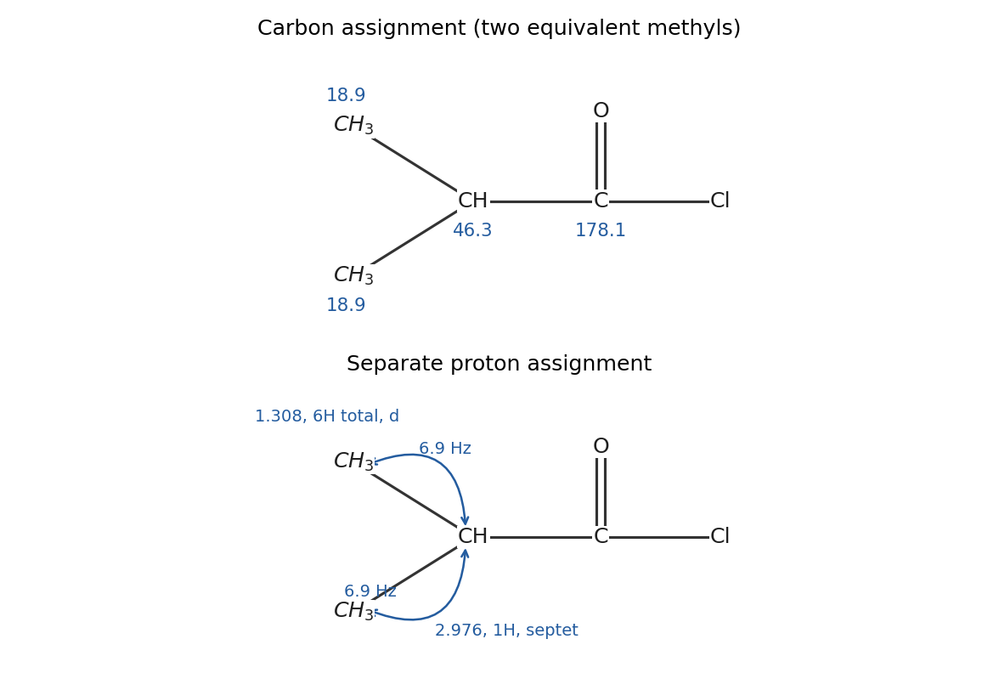
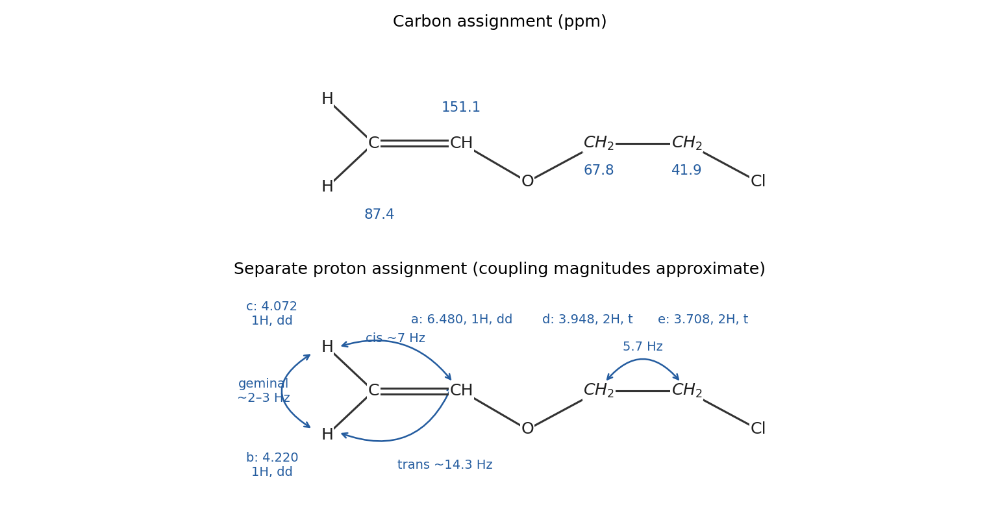
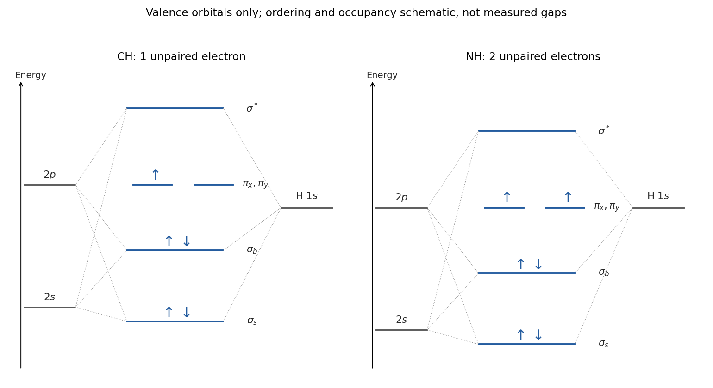
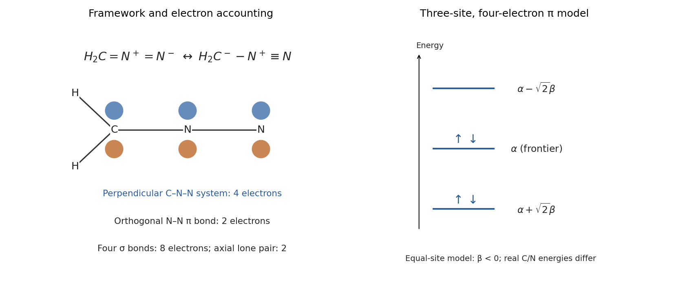
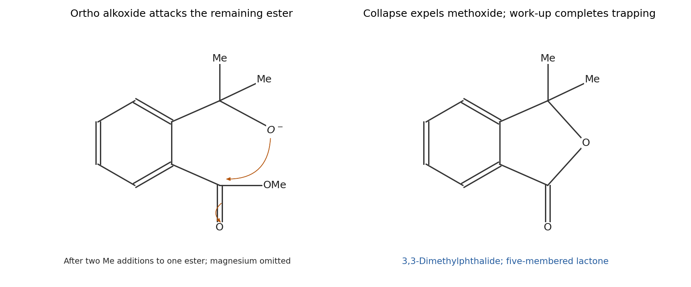
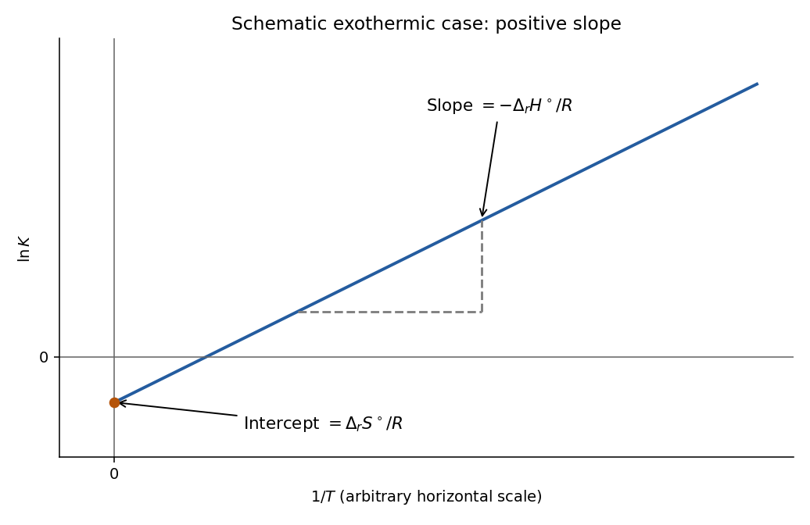
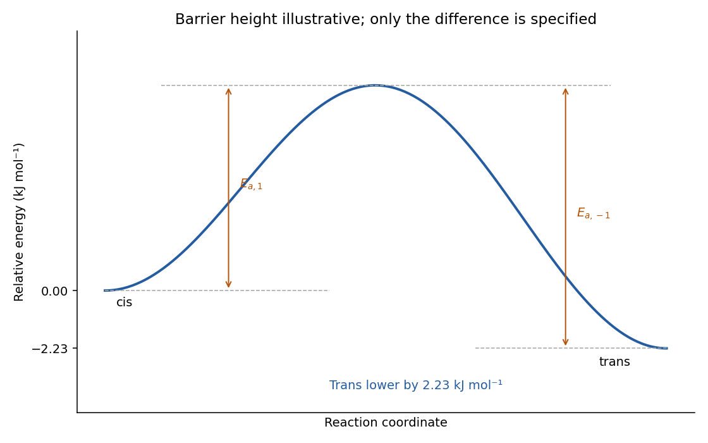
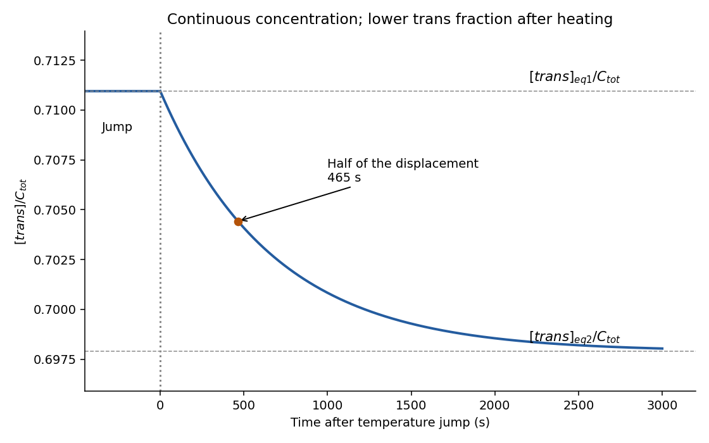
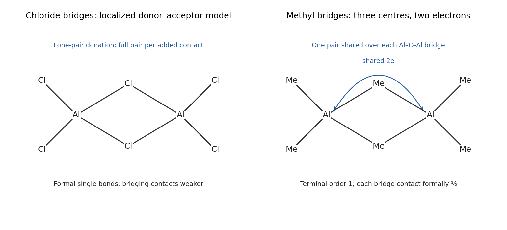

# Paper 1

↑ **Parent:** [2022](../2022.md)

[Original paper, released PDF pages 1–13](https://www.whatdotheyknow.com/request/nst_chemistry_past_papers_2022/response/2088679/attach/3/FOI%202022%20476%20Whittaker%20materials.pdf?cookie_passthrough=1#page=1)

**Table of contents**

- [1](#1)
  - [a](#1/a)
    - [i](#1/a/i)
      - [Solution](#1/a/i/solution)
    - [ii](#1/a/ii)
      - [Solution](#1/a/ii/solution)
    - [iii](#1/a/iii)
      - [Solution](#1/a/iii/solution)
  - [b](#1/b)
    - [i](#1/b/i)
      - [Solution](#1/b/i/solution)
    - [ii](#1/b/ii)
      - [Solution](#1/b/ii/solution)
    - [iii](#1/b/iii)
      - [Solution](#1/b/iii/solution)
  - [c](#1/c)
    - [i](#1/c/i)
      - [Solution](#1/c/i/solution)
    - [ii](#1/c/ii)
      - [Solution](#1/c/ii/solution)
    - [iii](#1/c/iii)
      - [Solution](#1/c/iii/solution)
    - [iv](#1/c/iv)
      - [Solution](#1/c/iv/solution)
- [2](#2)
  - [a](#2/a)
    - [Solution](#2/a/solution)
  - [b](#2/b)
    - [Solution](#2/b/solution)
  - [c](#2/c)
    - [Solution](#2/c/solution)
  - [d](#2/d)
    - [Solution](#2/d/solution)
  - [e](#2/e)
    - [Solution](#2/e/solution)
  - [f](#2/f)
    - [Solution](#2/f/solution)
  - [g](#2/g)
    - [Solution](#2/g/solution)
  - [h](#2/h)
    - [Solution](#2/h/solution)
  - [i](#2/i)
    - [Solution](#2/i/solution)
- [3](#3)
  - [a](#3/a)
    - [Solution](#3/a/solution)
  - [b](#3/b)
    - [i](#3/b/i)
      - [Solution](#3/b/i/solution)
    - [ii](#3/b/ii)
      - [Solution](#3/b/ii/solution)
  - [c](#3/c)
    - [Solution](#3/c/solution)
- [4](#4)
  - [a](#4/a)
    - [i](#4/a/i)
      - [Solution](#4/a/i/solution)
    - [ii](#4/a/ii)
      - [Solution](#4/a/ii/solution)
    - [iii](#4/a/iii)
      - [Solution](#4/a/iii/solution)
    - [iv](#4/a/iv)
      - [Solution](#4/a/iv/solution)
    - [v](#4/a/v)
      - [Solution](#4/a/v/solution)
    - [vi](#4/a/vi)
      - [Solution](#4/a/vi/solution)
    - [vii](#4/a/vii)
      - [Solution](#4/a/vii/solution)
  - [b](#4/b)
    - [i](#4/b/i)
      - [Solution](#4/b/i/solution)
    - [ii](#4/b/ii)
      - [Solution](#4/b/ii/solution)
- [5](#5)
  - [a](#5/a)
    - [i](#5/a/i)
      - [Solution](#5/a/i/solution)
    - [ii](#5/a/ii)
      - [Solution](#5/a/ii/solution)
    - [iii](#5/a/iii)
      - [Solution](#5/a/iii/solution)
  - [b](#5/b)
    - [i](#5/b/i)
      - [Solution](#5/b/i/solution)
    - [ii](#5/b/ii)
      - [Solution](#5/b/ii/solution)
  - [c](#5/c)
    - [i](#5/c/i)
      - [Solution](#5/c/i/solution)
    - [ii](#5/c/ii)
      - [Solution](#5/c/ii/solution)
    - [iii](#5/c/iii)
      - [Solution](#5/c/iii/solution)
  - [d](#5/d)
    - [Solution](#5/d/solution)
  - [e](#5/e)
    - [i](#5/e/i)
      - [Solution](#5/e/i/solution)
    - [ii](#5/e/ii)
      - [Solution](#5/e/ii/solution)
- [6](#6)
  - [a](#6/a)
    - [i](#6/a/i)
      - [Solution](#6/a/i/solution)
    - [ii](#6/a/ii)
      - [Solution](#6/a/ii/solution)
    - [iii](#6/a/iii)
      - [Solution](#6/a/iii/solution)
    - [iv](#6/a/iv)
      - [Solution](#6/a/iv/solution)
  - [b](#6/b)
    - [i](#6/b/i)
      - [Solution](#6/b/i/solution)
    - [ii](#6/b/ii)
      - [Solution](#6/b/ii/solution)
  - [c](#6/c)
    - [Solution](#6/c/solution)

## 1

↑ **Parent:** [Paper 1](paper-1.md)

<h3 id="1/a">a</h3>

↑ **Parent:** [1](#1)

<h4 id="1/a/i">i</h4>

↑ **Parent:** [A](#1/a)

<h5 id="1/a/i/solution">Solution</h5>

↑ **Parent:** [I](#1/a/i)

**A is [3-Chlorobutan-2-one](../../chemical-substance.md#3-chlorobutan-2-one), $\mathrm{CH_3C(=O)CH(Cl)CH_3}$.** Counting [chlorine](../../chemical-substance.md#chlorine) as one [hydrogen](../../chemical-substance.md#hydrogen) in the index of [index of hydrogen deficiency](../../chemical-substance.md#degree-of-unsaturation) gives $(2\times4+2-7-1)/2=1$. A single [carbonyl](../../chemical-bond.md#carbonyl-group) accounts for that unsaturation; the resonance at $203.2$ ppm identifies a [ketone](../../chemical-substance.md#ketone), while the $59.0$ ppm methine bears [chlorine](../../chemical-substance.md#chlorine).

The [carbon-13 NMR](../../nuclear-magnetic-resonance.md#carbon-13-nmr) assignments are $\delta_C=203.2$ for $\mathrm{C=O}$, $25.7$ for $\mathrm{CH_3CO}$, $59.0$ for $\mathrm{CHCl}$ and $20.1$ ppm for $\mathrm{CH(Cl)CH_3}$. The four distinct [carbon](../../chemical-substance.md#carbon) environments agree with the unsymmetrical structure. The small signal near 77 ppm belongs to the usual deuterated chloroform [solvent](../../mixture.md#solvent), rather than to a fifth [carbon](../../chemical-substance.md#carbon) of A.

<h4 id="1/a/ii">ii</h4>

↑ **Parent:** [A](#1/a)

<h5 id="1/a/ii/solution">Solution</h5>

↑ **Parent:** [Ii](#1/a/ii)

The strong $1724\,\mathrm{cm^{-1}}$ absorption is the [carbonyl stretching vibration](../../chemistry.md#carbonyl-stretching-vibration) of a saturated [ketone](../../chemical-substance.md#ketone). Its exact [wavenumber](../../wave-equation.md#wavenumber) depends on substitution and measurement conditions; the important discrimination is that it is far below the high-frequency [acyl chloride](../../chemical-substance.md#acyl-chloride) band in B and is accompanied by a [carbonyl](../../chemical-bond.md#carbonyl-group) [carbon-13 NMR](../../nuclear-magnetic-resonance.md#carbon-13-nmr) resonance near 200 ppm.

<h4 id="1/a/iii">iii</h4>

↑ **Parent:** [A](#1/a)

<h5 id="1/a/iii/solution">Solution</h5>

↑ **Parent:** [Iii](#1/a/iii)

Write the proton-labelled structure as $\mathrm{CH_3^{a}C(=O)CH^{b}(Cl)CH_3^{c}}$. The assignments are

$$
\begin{array}{c|c|c|c}
\text{site}&\delta_H/\mathrm{ppm}&\text{integral}&\text{multiplicity}\\\hline
a&2.334&3&\text{singlet}\\
b&4.3365&1&\text{quartet}\\
c&1.6065&3&\text{doublet}
\end{array}
$$

The [NMR quartet](../../nuclear-magnetic-resonance.md#nmr-quartet) is centred at $(4.371+4.302)/2=4.3365$ ppm; each adjacent line differs by $0.023$ ppm. The [NMR doublet](../../nuclear-magnetic-resonance.md#nmr-doublet) has the same spacing, $1.618-1.595=0.023$ ppm. At 300 MHz,

$$
\boxed{{}^3J_{bc}=300(0.023)=6.9\,\mathrm{Hz}.}
$$

Three equivalent methyl [protons](../../physics.md#proton) split $b$ into a $1:3:3:1$ [NMR quartet](../../nuclear-magnetic-resonance.md#nmr-quartet); the single methine [proton](../../physics.md#proton) splits $c$ into a $1:1$ [NMR doublet](../../nuclear-magnetic-resonance.md#nmr-doublet). No resolved [long-range scalar coupling](../../nuclear-magnetic-resonance.md#long-range-scalar-coupling) splits the acetyl methyl, giving its [NMR singlet](../../nuclear-magnetic-resonance.md#nmr-singlet). The integrals total seven [protons](../../physics.md#proton).

**[Figure 1](#1/a/iii/image-independent-original-carbon-and-proton-assignments-for-a-with-the-measured-methine-methyl-coupling). Independent original carbon and proton assignments for A, with the measured methine–methyl coupling**.

<h3 id="1/b">b</h3>

↑ **Parent:** [1](#1)

<h4 id="1/b/i">i</h4>

↑ **Parent:** [B](#1/b)

<h5 id="1/b/i/solution">Solution</h5>

↑ **Parent:** [I](#1/b/i)

**B is [2-Methylpropanoyl chloride](../../chemical-substance.md#2-methylpropanoyl-chloride), $\mathrm{(CH_3)_2CHC(=O)Cl}$.** The single index of [index of hydrogen deficiency](../../chemical-substance.md#degree-of-unsaturation) is supplied by the [carbonyl](../../chemical-bond.md#carbonyl-group). Its relatively high-frequency [infrared spectroscopy](../../chemistry.md#infrared-spectroscopy) band identifies an [acyl chloride](../../chemical-substance.md#acyl-chloride), while two equivalent [methyl groups](../../chemistry.md#methyl-group) explain why four [carbons](../../chemical-substance.md#carbon) produce only three [carbon-13 NMR](../../nuclear-magnetic-resonance.md#carbon-13-nmr) resonances.

Assign $\delta_C=178.1$ to the [acyl chloride](../../chemical-substance.md#acyl-chloride) [carbonyl](../../chemical-bond.md#carbonyl-group), $46.3$ to the methine and $18.9$ ppm to both [methyl groups](../../chemistry.md#methyl-group). Their [chemical equivalence in NMR](../../nuclear-magnetic-resonance.md#chemical-equivalence-in-nmr) follows from the symmetry of the isopropyl fragment in this achiral environment.

<h4 id="1/b/ii">ii</h4>

↑ **Parent:** [B](#1/b)

<h5 id="1/b/ii/solution">Solution</h5>

↑ **Parent:** [Ii](#1/b/ii)

The strong $1810\,\mathrm{cm^{-1}}$ band is an [acyl chloride](../../chemical-substance.md#acyl-chloride) [carbonyl stretching vibration](../../chemistry.md#carbonyl-stretching-vibration). Compared with an [ester](../../chemical-substance.md#ester), donation from a [chlorine](../../chemical-substance.md#chlorine) [lone pair](../../covalent-bond.md#lone-pair) into the [carbonyl](../../chemical-bond.md#carbonyl-group) [antibonding molecular orbital](../../chemistry.md#antibonding-orbital) is relatively ineffective, while [chlorine](../../chemical-substance.md#chlorine)'s [inductive effect](../../chemical-bond.md#inductive-effect) withdraws [electron](../../physics.md#electron) density. The resulting stronger effective [carbonyl](../../chemical-bond.md#carbonyl-group) force constant places the absorption above an ordinary saturated [ketone](../../chemical-substance.md#ketone) band. Bond polarity alone is not a universal quantitative frequency rule.

<h4 id="1/b/iii">iii</h4>

↑ **Parent:** [B](#1/b)

<h5 id="1/b/iii/solution">Solution</h5>

↑ **Parent:** [Iii](#1/b/iii)

The two [methyl groups](../../chemistry.md#methyl-group) give one six-[proton](../../physics.md#proton) [NMR doublet](../../nuclear-magnetic-resonance.md#nmr-doublet) centred at $(1.319+1.296)/2=1.3075$ ppm. The methine gives a one-[proton](../../physics.md#proton) [NMR septet](../../nuclear-magnetic-resonance.md#nmr-septet) centred near $2.976$ ppm. The latter is split by six equivalent methyl [protons](../../physics.md#proton), producing the first-order $1:6:15:20:15:6:1$ intensity pattern.

$$
\boxed{{}^3J_{\mathrm{CH,CH_3}}\simeq6.9\,\mathrm{Hz}.}
$$

This follows exactly from the methyl doublet spacing, $300(0.023)$, and approximately from the successive septet spacings, which alternate between $0.022$ and $0.024$ ppm within the precision of the printed labels. There is no methylene triplet or quartet: the six-[proton](../../physics.md#proton) integral and septet establish the branched skeleton.

**[Figure 2](#1/b/iii/image-independent-original-carbon-and-proton-assignments-for-b-both-equivalent-methyl-groups-couple-to-the-methine). Independent original carbon and proton assignments for B; both equivalent methyl groups couple to the methine**.

<h3 id="1/c">c</h3>

↑ **Parent:** [1](#1)

<h4 id="1/c/i">i</h4>

↑ **Parent:** [C](#1/c)

<h5 id="1/c/i/solution">Solution</h5>

↑ **Parent:** [I](#1/c/i)

**C is [2-Chloroethyl vinyl ether](../../chemical-substance.md#2-chloroethyl-vinyl-ether), $\mathrm{CH_2=CH-O-CH_2-CH_2Cl}$.** There is one [alkene](../../chemical-substance.md#alkene) and no [carbonyl](../../chemical-bond.md#carbonyl-group). Assign the [carbon-13 NMR](../../nuclear-magnetic-resonance.md#carbon-13-nmr) resonances as

$$
\begin{array}{c|c}
\text{site}&\delta_C/\mathrm{ppm}\\\hline
\mathrm{CH_2=}&87.4\\
\mathrm{=CH-O}&151.1\\
\mathrm{OCH_2}&67.8\\
\mathrm{CH_2Cl}&41.9
\end{array}
$$

The strongly differentiated pair of [alkene](../../chemical-substance.md#alkene) shifts is characteristic of a [vinyl ether](../../chemical-substance.md#vinyl-ether); interpreting $151.1$ ppm as a [carbonyl](../../chemical-bond.md#carbonyl-group) would leave the unusually shielded unsaturated $87.4$ ppm [carbon](../../chemical-substance.md#carbon) and the three distinct vinylic [protons](../../physics.md#proton) unexplained.

<h4 id="1/c/ii">ii</h4>

↑ **Parent:** [C](#1/c)

<h5 id="1/c/ii/solution">Solution</h5>

↑ **Parent:** [Ii](#1/c/ii)

The $1621\,\mathrm{cm^{-1}}$ absorption is predominantly the [carbon–carbon double-bond stretching vibration](../../chemistry.md#carbon-carbon-double-bond-stretching-vibration) of the electron-rich [vinyl ether](../../chemical-substance.md#vinyl-ether). [resonance donation](../../covalent-bond.md#resonance-donation) from an [oxygen](../../chemical-substance.md#oxygen) [lone pair](../../covalent-bond.md#lone-pair) changes both its frequency and its [electric dipole moment](../../electrostatics.md#electric-dipole-moment) variation during stretching. There is no [carbonyl](../../chemical-bond.md#carbonyl-group) in the assigned structure, consistent with the absence of a [carbon-13 NMR](../../nuclear-magnetic-resonance.md#carbon-13-nmr) signal in the usual [ketone](../../chemical-substance.md#ketone) or [acyl chloride](../../chemical-substance.md#acyl-chloride) region.

<h4 id="1/c/iii">iii</h4>

↑ **Parent:** [C](#1/c)

<h5 id="1/c/iii/solution">Solution</h5>

↑ **Parent:** [Iii](#1/c/iii)

Let $a$ be the internal vinylic [proton](../../physics.md#proton), $b$ the terminal [proton](../../physics.md#proton) trans to $a$, $c$ the terminal [proton](../../physics.md#proton) cis to $a$, $d$ the oxygen-bound methylene and $e$ the chlorine-bound methylene. The assignments are

$$
\begin{array}{c|c|c|c}
\text{site}&\delta_H/\mathrm{ppm}&\text{integral}&\text{multiplicity}\\\hline
a&6.480&1&\text{doublet of doublets}\\
b&4.220&1&\text{doublet of doublets}\\
c&4.072&1&\text{doublet of doublets}\\
d&3.948&2&\text{triplet}\\
e&3.708&2&\text{triplet}
\end{array}
$$

For the $a$ [doublet of doublets](../../nuclear-magnetic-resonance.md#doublet-of-doublets), pairing corresponding lines gives $J_{ab}\simeq300[(6.516-6.468)+(6.492-6.445)]/2=14.25$ Hz and $J_{ac}\simeq300[(6.516-6.492)+(6.468-6.445)]/2=7.05$ Hz. The larger value identifies [trans vinylic coupling](../../nuclear-magnetic-resonance.md#trans-vinylic-coupling); the smaller identifies [cis vinylic coupling](../../nuclear-magnetic-resonance.md#cis-vinylic-coupling). The $b$ resonance confirms the large splitting, approximately $14.25$ Hz, and has a small [geminal coupling](../../nuclear-magnetic-resonance.md#geminal-coupling) to $c$.

The small spacings are not perfectly reciprocal if treated as exact [First-order NMR multiplets](../../nuclear-magnetic-resonance.md#first-order-nmr-multiplet): the $b$ lines imply $|J_{bc}|\simeq2.55$ Hz, whereas the $c$ lines imply $|J_{bc}|\simeq2.10$ Hz and $J_{ac}\simeq6.60$ Hz. Thus report **$J_{ab}\simeq14.3$ Hz, $J_{ac}\simeq7$ Hz and $|J_{bc}|\simeq2$–$3$ Hz**, rather than asserting incompatible exact constants. Printed precision and departures from a simple first-order pattern limit this line-picking estimate; a full spin-system fit would be needed for refined values. Splittings alone do not establish the signs of these couplings.

The two [methylene groups](../../chemistry.md#methylene-group) split one another into approximate [NMR triplets](../../nuclear-magnetic-resonance.md#nmr-triplet), with $J_{de}\simeq300(3.727-3.708)=5.7$ Hz; the oxygen-bound triplet gives approximately the same value from its rounded line labels. The three vinylic [protons](../../physics.md#proton) plus two methylenes give the required seven-[proton](../../physics.md#proton) integral. The terminal vinylic [protons](../../physics.md#proton) are [diastereotopic](../../stereochemistry.md#diastereotopic), because replacing one or the other creates different alkene geometries.

**[Figure 3](#1/c/iii/image-original-carbon-and-separate-proton-assignments-for-c-including-trans-cis-geminal-and-methylene-coupling-paths). Original carbon and separate proton assignments for C, including trans, cis, geminal and methylene coupling paths**.

<h4 id="1/c/iv">iv</h4>

↑ **Parent:** [C](#1/c)

<h5 id="1/c/iv/solution">Solution</h5>

↑ **Parent:** [Iv](#1/c/iv)

The [vinyl ether](../../chemical-substance.md#vinyl-ether) has an important [resonance contributor](../../covalent-bond.md#resonance-structure)

$$
\mathrm{CH_2=CH-O-R\ \leftrightarrow\ {}^-CH_2-CH=O^+-R},\qquad R=\mathrm{CH_2CH_2Cl}.
$$

Donation from [oxygen](../../chemical-substance.md#oxygen) into the [conjugated system](../../chemical-bond.md#conjugated-system) increases [electron](../../physics.md#electron) density at the terminal unsaturated [carbon](../../chemical-substance.md#carbon), helping explain its unusually shielded $\delta_C=87.4$ ppm and its terminal [protons](../../physics.md#proton) near 4.1–4.2 ppm. The directly oxygen-bound unsaturated [carbon](../../chemical-substance.md#carbon) is strongly deshielded at $151.1$ ppm; its [proton](../../physics.md#proton) at $6.480$ ppm also experiences the [oxygen](../../chemical-substance.md#oxygen) substituent and [alkene](../../chemical-substance.md#alkene) magnetic anisotropy. These trends are consistent with the whole delocalized electronic structure; a [chemical shift](../../nuclear-magnetic-resonance.md#chemical-shift) is not simply a meter for an atom's [partial atomic charge](../../chemical-bond.md#partial-atomic-charge).

For the saturated part, the stronger local deshielding by [oxygen](../../chemical-substance.md#oxygen) places $\mathrm{OCH_2}$ at $\delta_C=67.8$, $\delta_H\simeq3.948$, while $\mathrm{CH_2Cl}$ lies at $41.9$ and $3.708$ ppm. The two terminal vinylic [protons](../../physics.md#proton) have different geometrical relationships to the [oxygen](../../chemical-substance.md#oxygen) substituent and therefore different [chemical shifts](../../nuclear-magnetic-resonance.md#chemical-shift) as well as different [vicinal couplings](../../nuclear-magnetic-resonance.md#vicinal-coupling).

## 2

↑ **Parent:** [Paper 1](paper-1.md)

<h3 id="2/a">a</h3>

↑ **Parent:** [2](#2)

<h4 id="2/a/solution">Solution</h4>

↑ **Parent:** [A](#2/a)

The one-electron species are $\mathrm{C^{5+}}$ and $\mathrm{N^{6+}}$, so there is no [electron](../../physics.md#electron)–[electron](../../physics.md#electron) screening and the nuclear charges remain $Z=6$ and $7$.

$$
\boxed{E_{n=2}(\mathrm{C^{5+}})=-13.6\frac{6^2}{4}=-122.4\,\mathrm{eV},\qquad E_{n=2}(\mathrm{N^{6+}})=-13.6\frac{7^2}{4}=-166.6\,\mathrm{eV}.}
$$

Within the stated [hydrogen-like ion](../../atomic-physics.md#hydrogen-like-ion) model, $2s$ and all three $2p$ [atomic orbitals](../../chemistry.md#atomic-orbital) of a given species have the same energy. The energy zero is a separated [electron](../../physics.md#electron) and the residual nucleus.

<h3 id="2/b">b</h3>

↑ **Parent:** [2](#2)

<h4 id="2/b/solution">Solution</h4>

↑ **Parent:** [B](#2/b)

The configurations are $\mathrm{C}:1s^22s^22p^2$ and $\mathrm{N}:1s^22s^22p^3$. A simple complete-core-screening estimate subtracts the two $1s$ [electrons](../../physics.md#electron), giving **$Z_{\rm eff}\approx4$ for [carbon](../../chemical-substance.md#carbon) and $5$ for [nitrogen](../../chemical-substance.md#nitrogen)**. This neglects screening by the other valence [electrons](../../physics.md#electron), and is an explicitly rough estimate.

A more systematic estimate using [Slater's rules](../../chemistry.md#slater-s-rules) includes $0.85$ for each $1s$ [electron](../../physics.md#electron) and $0.35$ for each other [electron](../../physics.md#electron) in the $2s,2p$ group:

$$
Z_{\rm eff}(\mathrm C)=6-[2(0.85)+3(0.35)]=3.25,\qquad Z_{\rm eff}(\mathrm N)=7-[2(0.85)+4(0.35)]=3.90.
$$

Both models predict the important trend: [nitrogen](../../chemical-substance.md#nitrogen)'s valence shell experiences a greater [effective nuclear charge](../../chemistry.md#effective-nuclear-charge). There is no unique numerical [effective nuclear charge](../../chemistry.md#effective-nuclear-charge) without specifying an orbital and a screening prescription; the one-electron formula in (a) does not by itself define neutral-atom orbital energies.[1930, printed pp. 58–59: screening prescription and grouping of ns and np electrons](../../chemistry-bibliography.md#atomic-shielding-constants-by-john-c-slater)

<h3 id="2/c">c</h3>

↑ **Parent:** [2](#2)

<h4 id="2/c/solution">Solution</h4>

↑ **Parent:** [C](#2/c)

The $2s$ [atomic orbital](../../chemistry.md#atomic-orbital) is spherically symmetric and has one [radial node](../../chemistry.md#radial-node). A real $2p$ [atomic orbital](../../chemistry.md#atomic-orbital) has two lobes of opposite [quantum phase](../../quantum-system.md#quantum-phase), one [atomic-orbital nodal plane](../../chemistry.md#atomic-orbital-nodal-plane) through the nucleus and no [radial node](../../chemistry.md#radial-node). The three spatial orientations $2p_x,2p_y,2p_z$ remain degenerate in a spherically symmetric atom when external fields and fine structure are neglected.

In a many-electron atom, $2s$ penetrates the screened core more effectively than $2p$, experiences a stronger attraction and is lower in energy: **$\varepsilon_{2s}<\varepsilon_{2p}$**. The [hydrogen-like ion](../../atomic-physics.md#hydrogen-like-ion) degeneracy therefore does not survive screening. Both valence orbital types are generally more tightly bound and spatially contracted in [nitrogen](../../chemical-substance.md#nitrogen) than in [carbon](../../chemical-substance.md#carbon), because of the larger [effective nuclear charge](../../chemistry.md#effective-nuclear-charge). These are central-field orbital statements; the detailed atomic multiplet structure also involves [electron](../../physics.md#electron) repulsion and [Hund's rules](../../chemistry.md#hund-s-rules).

<h3 id="2/d">d</h3>

↑ **Parent:** [2](#2)

<h4 id="2/d/solution">Solution</h4>

↑ **Parent:** [D](#2/d)

Take the bond axis as $z$. The heavy-atom $2s$ and $2p_z$ [atomic orbitals](../../chemistry.md#atomic-orbital) can mix with [hydrogen](../../chemical-substance.md#hydrogen) $1s$ to make three sigma-symmetry [molecular orbitals](../../chemistry.md#molecular-orbital). In the qualitative valence ordering, these are a low predominantly heavy-atom $2s$ level, a bonding $\sigma$ level and a higher $\sigma^*$ level. The perpendicular $2p_x,2p_y$ orbitals form a degenerate approximately nonbonding $\pi$ pair because [hydrogen](../../chemical-substance.md#hydrogen) has no valence orbitals of the matching sideways symmetry. The filled heavy-atom $1s$ core is omitted from the diagram.

Counting valence [electrons](../../physics.md#electron) gives

$$
\mathrm{CH}:\quad(\sigma_s)^2(\sigma_b)^2(\pi_x,\pi_y)^1,\qquad
\mathrm{NH}:\quad(\sigma_s)^2(\sigma_b)^2(\pi_x)^1(\pi_y)^1.
$$

Thus **both exhibit [paramagnetism](../../electromagnetism.md#paramagnetism): CH has one unpaired [electron](../../physics.md#electron) and NH has two in its ground state.** For NH, [Hund's rules](../../chemistry.md#hund-s-rules) favour separate parallel-spin occupation of the two degenerate $\pi$ orbitals. The corresponding observed ground terms are $X\,{}^2\Pi$ and $X\,{}^3\Sigma^-$; the total [bond order](../../chemistry.md#bond-order) is approximately one in this simple sigma-bond/nonbonding-pi description.[Methylidyne, CAS 3315-37-5, and Imidogen, CAS 13774-92-0: diatomic constants, ground-state rows](../../chemistry-bibliography.md#nist-chemistry-webbook-srd-69)

The nitrogen-derived orbital energies lie lower than the corresponding carbon-derived ones on an approximate common energy scale, while the isolated [hydrogen](../../chemical-substance.md#hydrogen) $1s$ reference is unchanged. The bonding orbitals consequently have different polarizations and mixing coefficients; drawing identical energies for C and N would miss the screening trend. The figure specifies ordering and occupancy, not measured gaps or a numerical prediction from (a).

**[Figure 4](#2/d/image-original-qualitative-valence-molecular-orbital-diagrams-of-ch-and-nh-with-one-and-two-unpaired-electrons). Original qualitative valence molecular-orbital diagrams of CH and NH with one and two unpaired electrons**.

<h3 id="2/e">e</h3>

↑ **Parent:** [2](#2)

<h4 id="2/e/solution">Solution</h4>

↑ **Parent:** [E](#2/e)

The framework has a planar $\mathrm{H_2C}$ group attached to a straight C–N–N axis. Two useful octet [resonance contributors](../../covalent-bond.md#resonance-structure) are

$$
\boxed{\mathrm{H_2C=N^+=N^-\ \leftrightarrow\ H_2C^--N^+\equiv N}.}
$$

In the left contributor, the terminal [nitrogen](../../chemical-substance.md#nitrogen) has two [lone pairs](../../covalent-bond.md#lone-pair); in the right, the terminal [nitrogen](../../chemical-substance.md#nitrogen) and [carbon](../../chemical-substance.md#carbon) each have one. Each formula has 16 valence [electrons](../../physics.md#electron) and zero net [electric charge](../../electric-charge.md). The double-headed resonance arrow changes the electronic allocation while retaining the same nuclear framework; these are not two different equilibrium species.

<h3 id="2/f">f</h3>

↑ **Parent:** [2](#2)

<h4 id="2/f/solution">Solution</h4>

↑ **Parent:** [F](#2/f)

An internally consistent elementary [orbital hybridisation](../../chemistry.md#orbital-hybridization) model is **$sp^2$ at [carbon](../../chemical-substance.md#carbon) and $sp$ at both [nitrogen](../../chemical-substance.md#nitrogen) atoms; the hydrogens use $1s$ orbitals**. The three [carbon](../../chemical-substance.md#carbon) hybrids form two C–H [sigma bonds](../../covalent-bond.md#sigma-bond) and one C–N [sigma bond](../../covalent-bond.md#sigma-bond), leaving one perpendicular [p orbital](../../chemistry.md#p-orbital). The central [nitrogen](../../chemical-substance.md#nitrogen) uses opposite $sp$ hybrids for its two collinear sigma connections, leaving two perpendicular [p orbitals](../../chemistry.md#p-orbital) for the two pi systems.

At terminal [nitrogen](../../chemical-substance.md#nitrogen), one $sp$ hybrid points toward the central [nitrogen](../../chemical-substance.md#nitrogen) and the other houses an axial [lone pair](../../covalent-bond.md#lone-pair). One perpendicular [p orbital](../../chemistry.md#p-orbital) forms the second, N–N-only pi system; the other participates in the three-atom C–N–N pi system. This description remains the same across both [resonance contributors](../../covalent-bond.md#resonance-structure); counting lone-pair domains in just one drawing and assigning a different terminal hybridisation to each contributor would obscure the delocalization. [orbital hybridisation](../../chemistry.md#orbital-hybridization) is a useful choice of localized basis, not a uniquely measurable label: advanced treatments of [diazomethane](../../chemical-substance.md#diazomethane) require a superposition of bonding patterns.[Abstract: limitations of single bonding patterns and multiconfigurational description](../../chemistry-bibliography.md#on-the-electronic-structure-of-the-diazomethane-molecule-by-andre-g-h-barbosa-and-joao-g-s-monteiro)

<h3 id="2/g">g</h3>

↑ **Parent:** [2](#2)

<h4 id="2/g/solution">Solution</h4>

↑ **Parent:** [G](#2/g)

The four [sigma bonds](../../covalent-bond.md#sigma-bond) are the two C–H connections, C–N and N–N, containing eight electrons. A terminal-nitrogen axial [lone pair](../../covalent-bond.md#lone-pair) contains two more. Of the remaining six electrons, two occupy an N–N [pi bond](../../covalent-bond.md#pi-bond) lying in the molecular plane, while four occupy a perpendicular [three-centre four-electron pi bond](../../covalent-bond.md#three-centre-four-electron-pi-bond) extending over C–N–N. There are therefore 16 [valence electrons](../../chemical-bond.md#valence-electron) in total.

For orientation, a three-site model with equal on-site energy $\alpha$ and adjacent interaction $\beta<0$ gives perpendicular pi levels at $\alpha+\sqrt2\beta$, $\alpha$, and $\alpha-\sqrt2\beta$. The lower two are doubly occupied and the upper is empty. The middle level has a terminal-end combination with little central-atom amplitude; unequal C and N orbital energies change its coefficients and make it only approximately nonbonding.

The **[highest occupied molecular orbital](../../chemistry.md#highest-occupied-molecular-orbital) is the upper occupied perpendicular pi orbital**, with substantial [carbon](../../chemical-substance.md#carbon) amplitude, broadly above the strongly bonding sigma framework and the lower occupied pi orbitals. It is not the terminal axial [nitrogen](../../chemical-substance.md#nitrogen) [lone pair](../../covalent-bond.md#lone-pair). Real [diazomethane](../../chemical-substance.md#diazomethane) has C–N bonding and N–N antibonding character in this frontier orbital, rather than being an exactly nonbonding equal-site model. Photoelectron and Rydberg-state experiments support this assignment.[Abstract and discussion of ionization: removal from a C–N-bonding, N–N-antibonding pi orbital](../../chemistry-bibliography.md#vibronic-structure-and-ion-core-interactions-in-rydberg-states-of-diazomethane-an-experimental-and-theoretical-investigation-by-igor-fedorov-and-others)

**[Figure 5](#2/g/image-original-qualitative-decomposition-of-diazomethane-into-four-sigma-bonds-an-axial-lone-pair-and-two-perpendicular-pi-systems). Original qualitative decomposition of diazomethane into four sigma bonds, an axial lone pair and two perpendicular pi systems**.

<h3 id="2/h">h</h3>

↑ **Parent:** [2](#2)

<h4 id="2/h/solution">Solution</h4>

↑ **Parent:** [H](#2/h)

An intense band near $2088\,\mathrm{cm^{-1}}$ is consistent with the high-frequency coupled C–N–N stretching motion of a [diazo group](../../chemistry.md#diazo-group), with substantial N–N multiple-bond character. It lies above a typical isolated C=N double-bond stretch, and supports contributions with a strong N–N connection. It does not establish that the molecule is a literal localized C–N single bond plus an unperturbed N≡N triple bond: a [normal mode](../../wave-equation.md#normal-mode) moves the coupled framework, and the [resonance contributors](../../covalent-bond.md#resonance-structure) describe one electronic structure.

Protonation at the nucleophilic [carbon](../../chemical-substance.md#carbon) gives **[methyldiazonium](../../chemical-substance.md#methyldiazonium), $\mathrm{CH_3-N^+\equiv N}$**. The carbon-rich [highest occupied molecular orbital](../../chemistry.md#highest-occupied-molecular-orbital) and the carbon-negative [resonance contributor](../../covalent-bond.md#resonance-structure) rationalize this site. Subsequent displacement of [molecular nitrogen](../../chemical-substance.md#molecular-nitrogen) can be strongly favourable; the initial protonation product still contains both nitrogens.

<h3 id="2/i">i</h3>

↑ **Parent:** [2](#2)

<h4 id="2/i/solution">Solution</h4>

↑ **Parent:** [I](#2/i)

First, [proton transfer](../../acid-base-chemistry.md#proton-transfer) from [acetic acid](../../chemical-substance.md#acetic-acid) to the [carbon](../../chemical-substance.md#carbon) of [diazomethane](../../chemical-substance.md#diazomethane) gives [methyldiazonium](../../chemical-substance.md#methyldiazonium) and an [acetate ion](../../chemical-substance.md#acetate-ion):

$$
\mathrm{CH_2N_2+CH_3CO_2H\longrightarrow[CH_3N_2]^++CH_3CO_2^-}.
$$

Draw an electron-pair arrow from [carbon](../../chemical-substance.md#carbon), using the carbon-negative [resonance contributor](../../covalent-bond.md#resonance-structure), to the acidic [hydrogen](../../chemical-substance.md#hydrogen), and another from the acid O–H bond to [oxygen](../../chemical-substance.md#oxygen). Second, an acetate [oxygen](../../chemical-substance.md#oxygen) attacks the diazonium methyl [carbon](../../chemical-substance.md#carbon) by an [SN2 reaction](../../chemical-reaction.md#sn2-reaction); an arrow from the C–N bond to [nitrogen](../../chemical-substance.md#nitrogen) expels neutral $\mathrm{N_2}$:

$$
\boxed{\mathrm{CH_3CO_2^-+[CH_3-N^+\equiv N]\longrightarrow CH_3CO_2CH_3+N_2}.}
$$

The acid's hydroxyl [hydrogen](../../chemical-substance.md#hydrogen) has become the third [hydrogen](../../chemical-substance.md#hydrogen) of the newly installed [methyl group](../../chemistry.md#methyl-group). This is a methyl-transfer sequence driven by formation of [molecular nitrogen](../../chemical-substance.md#molecular-nitrogen), without forming a free methyl [carbocation](../../chemical-substance.md#carbocation) or invoking [Fischer esterification](../../chemical-reaction.md#fischer-esterification).

**[Figure 6](#2/i/image-original-electron-flow-drawing-for-carbon-protonation-followed-by-acetate-displacement-of-nitrogen). Original electron-flow drawing for carbon protonation followed by acetate displacement of nitrogen**.

## 3

↑ **Parent:** [Paper 1](paper-1.md)

<h3 id="3/a">a</h3>

↑ **Parent:** [3](#3)

<h4 id="3/a/solution">Solution</h4>

↑ **Parent:** [A](#3/a)

For the ordinary [ester](../../chemical-substance.md#ester), the [carbon](../../chemical-substance.md#carbon) nucleophile of a [grignard reagent](../../chemical-substance.md#grignard-reagent) attacks the [carbonyl](../../chemical-bond.md#carbonyl-group) [carbon](../../chemical-substance.md#carbon) and moves the C=O pi pair onto [oxygen](../../chemical-substance.md#oxygen). Collapse of the [tetrahedral intermediate](../../chemical-kinetics.md#tetrahedral-intermediate) expels [ethoxide](../../mathematical-biology.md#ethoxide), transiently giving $\mathrm{R^1COR}$. This [ketone](../../chemical-substance.md#ketone) is more electrophilic than the starting [ester](../../chemical-substance.md#ester) because it lacks an alkoxy group's stabilizing [resonance donation](../../covalent-bond.md#resonance-donation). A second equivalent of the [grignard reagent](../../chemical-substance.md#grignard-reagent) therefore adds to it before isolation:

$$
\mathrm{R^1CO_2Et\ \longrightarrow\ R^1C(O^-)(OEt)R\ \longrightarrow\ R^1COR\ \longrightarrow\ R^1C(O^-)(R)_2\ \xrightarrow{H^+}\ R^1C(OH)(R)_2}.
$$

The negatively charged intermediates are associated with [magnesium](../../chemical-substance.md#magnesium) counterions. Merely reducing the amount of reagent to one equivalent does not generally trap the [ketone](../../chemical-substance.md#ketone) selectively; it can leave unreacted [ester](../../chemical-substance.md#ester) together with the double-addition product.

In the first successful preparation, [magnesium](../../chemical-substance.md#magnesium) insertion into the primary C–Br bond gives **n-butylmagnesium [bromide](../../chemistry.md#bromide)**. The [carbon](../../chemical-substance.md#carbon) chain has four carbons, so its acetylation produces **hexan-2-one, $\mathrm{CH_3CO(CH_2)_3CH_3}$**, not pentan-2-one. Attack on [acetic anhydride](../../chemical-substance.md#acetic-anhydride) forms $\mathrm{CH_3C(O^-)(nBu)OCOCH_3}$. Coordination of the anhydride-derived oxygens to [magnesium](../../chemical-substance.md#magnesium) can stabilize this tetrahedral addition complex. Under suitably cold, controlled-addition conditions it survives sufficiently to delay release of the free [ketone](../../chemical-substance.md#ketone) until aqueous work-up has destroyed the remaining [grignard reagent](../../chemical-substance.md#grignard-reagent). Protonation followed by collapse releases acetate/[acetic acid](../../chemical-substance.md#acetic-acid) and the [ketone](../../chemical-substance.md#ketone).

This interpretation has direct experimental precedent: [Melvin S. Newman](../../chemistry.md#melvin-s-newman) and [William T. Booth Jr.](../../chemistry.md#william-t-booth-jr) obtained methyl ketones by cold addition of [grignard reagents](../../chemical-substance.md#grignard-reagent) to [acetic anhydride](../../chemical-substance.md#acetic-anhydride), attributing selectivity to a persistent addition complex. The [temperature](../../temperature.md) and reagent-addition regime are genuine conditions on the explanation, rather than proof that an anhydride can never undergo overaddition; the exam scheme omits them.[1945, printed p. 154: proposed intermediate I and low-temperature dependence](../../chemistry-bibliography.md#the-preparation-of-ketones-from-grignard-reagents-by-melvin-s-newman-and-william-t-booth-jr)

For the [benzonitrile](../../chemical-substance.md#benzonitrile) route, n-butyl attacks the [nitrile](../../chemical-substance.md#nitrile) [carbon](../../chemical-substance.md#carbon) and one C≡N pi pair moves to [nitrogen](../../chemical-substance.md#nitrogen), producing the [magnesium](../../chemical-substance.md#magnesium) [ketimine](../../chemistry.md#ketimine) salt $\mathrm{PhC(nBu)=N^-MgBr^+}$. This anionic nitrogen-containing intermediate resists a second [nucleophilic addition](../../chemical-reaction.md#nucleophilic-addition) much more than a neutral [carbonyl](../../chemical-bond.md#carbonyl-group) does. The **[ketone](../../chemical-substance.md#ketone) $\mathrm{PhC(=O)nBu}$ appears only during acidic aqueous work-up**, after organomagnesium has been quenched. Protonation gives the [iminium ion](../../chemical-substance.md#iminium); water attacks its [carbon](../../chemical-substance.md#carbon), [proton](../../physics.md#proton) transfers give a [carbinolamine](../../chemical-substance.md#carbinolamine), and C–N cleavage from its nitrogen-protonated form produces the protonated [ketone](../../chemical-substance.md#ketone) and [ammonia](../../chemical-substance.md#ammonia), followed by deprotonation. In the acidic mixture [ammonia](../../chemical-substance.md#ammonia) is present largely as [ammonium](../../chemistry.md#ammonium). This sequence explains why [nitrile](../../chemical-substance.md#nitrile) addition stops at a [ketone](../../chemical-substance.md#ketone) without requiring the [ketone](../../chemical-substance.md#ketone) itself to be resistant to [grignard reagents](../../chemical-substance.md#grignard-reagent).

The atom-labelled hydrolysis sequence is

$$
\begin{aligned}
\mathrm{PhC(nBu)=N^-}&\xrightarrow{2H^+}\mathrm{PhC(nBu)=NH_2^+}\\
&\xrightarrow{H_2O}\mathrm{PhC(nBu)(OH_2^+)NH_2}\\
&\xrightarrow{\text{proton transfers}}\mathrm{PhC(nBu)(OH)NH_3^+}\\
&\longrightarrow\mathrm{PhC(nBu)=OH^++NH_3}\longrightarrow\mathrm{PhC(nBu)=O}.
\end{aligned}
$$

Water's [lone pair](../../covalent-bond.md#lone-pair) attacks the iminium carbon while its C=N pi pair moves to [nitrogen](../../chemical-substance.md#nitrogen); the [carbinolamine](../../chemical-substance.md#carbinolamine) oxygen then reforms C=O while the C–N pair moves to the departing protonated amino group. Final deprotonation gives the neutral [ketone](../../chemical-substance.md#ketone). The arrows involving protonation and hydrolysis also exchange protons with the acidic aqueous reservoir; the condensed sequence tracks the carbon–nitrogen and carbon–oxygen transformations rather than displaying every solvent molecule.

**[Figure 7](#3/a/image-original-electron-flow-summary-contrasting-ester-overaddition-with-anhydride-trapping-and-nitrile-hydrolysis). Original electron-flow summary contrasting ester overaddition with anhydride trapping and nitrile hydrolysis**.

<h3 id="3/b">b</h3>

↑ **Parent:** [3](#3)

<h4 id="3/b/i">i</h4>

↑ **Parent:** [B](#3/b)

<h5 id="3/b/i/solution">Solution</h5>

↑ **Parent:** [I](#3/b/i)

The two starting [ester](../../chemical-substance.md#ester) groups are adjacent on the [benzene](../../chemical-substance.md#benzene) ring. Select one [ester](../../chemical-substance.md#ester) [carbon](../../chemical-substance.md#carbon) as the site receiving both incoming [methyl groups](../../chemistry.md#methyl-group). A first methyl addition gives a [tetrahedral intermediate](../../chemical-kinetics.md#tetrahedral-intermediate); its collapse expels [methoxide](../../mathematical-biology.md#methoxide) to give the ortho-substituted [ketone](../../chemical-substance.md#ketone) $\mathrm{o\!-!MeO_2C-C_6H_4-C(=O)Me}$. A second methyl addition produces $\mathrm{o\!-!MeO_2C-C_6H_4-C(O^-)Me_2}$, with the [alkoxide](../../mathematical-biology.md#alkoxide) bound to [magnesium](../../chemical-substance.md#magnesium).

The newly generated [oxygen](../../chemical-substance.md#oxygen) is now positioned to attack the remaining [ester](../../chemical-substance.md#ester) intramolecularly. Draw an arrow from its [lone pair](../../covalent-bond.md#lone-pair) to that [ester](../../chemical-substance.md#ester) [carbonyl](../../chemical-bond.md#carbonyl-group) and another from the C=O [pi bond](../../covalent-bond.md#pi-bond) to its [oxygen](../../chemical-substance.md#oxygen). Collapse of the resulting [tetrahedral intermediate](../../chemical-kinetics.md#tetrahedral-intermediate) reforms the [carbonyl](../../chemical-bond.md#carbonyl-group) and expels [methoxide](../../mathematical-biology.md#methoxide), closing a five-membered [lactone](../../chemical-substance.md#lactone). Protonation of magnesium-bound species in the work-up gives **[3,3-Dimethylphthalide](../../chemical-substance.md#3-3-dimethylphthalide)**. Equivalently, protonation can first give the ortho hydroxy [ester](../../chemical-substance.md#ester), followed by acid-assisted [lactonization](../../chemical-reaction.md#lactonization) with loss of methanol; both descriptions show the same required bond formation.

The [oxygen](../../chemical-substance.md#oxygen) in the new ring is the [oxygen](../../chemical-substance.md#oxygen) of the first [ester](../../chemical-substance.md#ester)'s original [carbonyl](../../chemical-bond.md#carbonyl-group); the surviving [lactone](../../chemical-substance.md#lactone) [carbonyl](../../chemical-bond.md#carbonyl-group) comes from the second [ester](../../chemical-substance.md#ester). The product retains the six ring carbons and both original acyl carbons, loses the two [ester](../../chemical-substance.md#ester) methoxy carbons, and gains two carbons from [methylmagnesium bromide](../../chemical-substance.md#methylmagnesium-bromide). The favourable intramolecular five-membered closure accounts for the displayed product. It does not make the isolated [lactone](../../chemical-substance.md#lactone) universally inert to a large excess of [grignard reagent](../../chemical-substance.md#grignard-reagent); stoichiometry and trapping/work-up conditions matter.

**[Figure 8](#3/b/i/image-original-sequence-of-two-methyl-additions-followed-by-five-membered-lactone-closure-with-oxygen-provenance-retained). Original sequence of two methyl additions followed by five-membered lactone closure, with oxygen provenance retained**.

<h4 id="3/b/ii">ii</h4>

↑ **Parent:** [B](#3/b)

<h5 id="3/b/ii/solution">Solution</h5>

↑ **Parent:** [Ii](#3/b/ii)

The [oxygen](../../chemical-substance.md#oxygen) substituent changes position through a [halohydrin](../../chemical-substance.md#halohydrin)–[epoxide](../../chemical-substance.md#epoxide) sequence. First, [hydroxide](../../chemistry.md#hydroxide) attacks the acetate [carbonyl](../../chemical-bond.md#carbonyl-group) of $\mathrm{BrCH_2C(Me)_2OAc}$, giving a [tetrahedral intermediate](../../chemical-kinetics.md#tetrahedral-intermediate). Collapse expels the substrate [alkoxide](../../mathematical-biology.md#alkoxide), and [proton transfer](../../acid-base-chemistry.md#proton-transfer) gives $\mathrm{BrCH_2C(Me)_2OH}$ plus acetate. This is [saponification](../../chemical-reaction.md#saponification), breaking the acyl–[oxygen](../../chemical-substance.md#oxygen) bond rather than replacing [bromide](../../chemistry.md#bromide) directly with [hydroxide](../../chemistry.md#hydroxide).

A small equilibrium population of $\mathrm{BrCH_2C(Me)_2O^-}$ undergoes intramolecular [SN2 reaction](../../chemical-reaction.md#sn2-reaction) at the adjacent primary [carbon](../../chemical-substance.md#carbon): the O [lone pair](../../covalent-bond.md#lone-pair) attacks $\mathrm{CH_2Br}$ and its C–Br pair leaves with [bromide](../../chemistry.md#bromide). The result is **[2,2-Dimethyloxirane](../../chemical-substance.md#2-2-dimethyloxirane)**. Addition of HBr protonates the ring [oxygen](../../chemical-substance.md#oxygen). [bromide](../../chemistry.md#bromide) then attacks preferentially at the more substituted [carbon](../../chemical-substance.md#carbon), where the protonated ring has greater [carbocation](../../chemical-substance.md#carbocation) character, breaking that C–O bond and leaving [oxygen](../../chemical-substance.md#oxygen) attached to the former primary [carbon](../../chemical-substance.md#carbon):

$$
\mathrm{BrCH_2C(Me)_2OH\ \longrightarrow\ (CH_2)O(CMe_2)\ \xrightarrow{HBr}\ HOCH_2C(Br)(Me)_2}.
$$

The middle formula denotes a three-membered [epoxide](../../chemical-substance.md#epoxide), not an open-chain ether. Acidic opening of this highly unsymmetrical [epoxide](../../chemical-substance.md#epoxide) has the opposite regioselectivity to a simple basic nucleophilic opening at its less substituted [carbon](../../chemical-substance.md#carbon).

Finally, the primary [alcohol](../../chemical-substance.md#alcohol) [oxygen](../../chemical-substance.md#oxygen) attacks [acetyl chloride](../../chemical-substance.md#acetyl-chloride). The [tetrahedral intermediate](../../chemical-kinetics.md#tetrahedral-intermediate) collapses with [chloride](../../chemistry.md#chloride) departure, and [triethylamine](../../chemical-substance.md#triethylamine) removes the O–H [proton](../../physics.md#proton) and captures HCl. The product is **$\mathrm{AcOCH_2C(Br)(Me)_2}$**. [oxygen](../../chemical-substance.md#oxygen) is carried through the [epoxide](../../chemical-substance.md#epoxide) to the other [carbon](../../chemical-substance.md#carbon); it is not necessary to invent a methyl migration or a carbon-skeleton rearrangement.

**[Figure 9](#3/b/ii/image-original-electron-flow-drawing-for-bromohydrin-cyclization-acid-directed-epoxide-opening-and-reacylation). Original electron-flow drawing for bromohydrin cyclization, acid-directed epoxide opening and reacylation**.

<h3 id="3/c">c</h3>

↑ **Parent:** [3](#3)

<h4 id="3/c/solution">Solution</h4>

↑ **Parent:** [C](#3/c)

Disconnect the new bond between the two six-carbon units. One portion of [bromocyclohexane](../../chemical-substance.md#bromocyclohexane) supplies a [grignard reagent](../../chemical-substance.md#grignard-reagent); another supplies [cyclohexene oxide](../../chemical-substance.md#cyclohexene-oxide):

$$
\begin{aligned}
\mathrm{C_6H_{11}Br}&\xrightarrow{\mathrm{Mg,\ dry\ ether}}\mathrm{C_6H_{11}MgBr},\\
\mathrm{C_6H_{11}Br}&\xrightarrow{\mathrm{base,\ heat}}\mathrm{cyclohexene}\xrightarrow{\mathrm{peracid}}\mathrm{cyclohexene\ oxide}.
\end{aligned}
$$

A bulky strong base can favour [E2 elimination](../../chemical-reaction.md#e2-elimination) in the alkene-forming step; a peracid such as [meta-chloroperoxybenzoic acid](../../chemical-substance.md#meta-chloroperoxybenzoic-acid) provides [epoxidation](../../chemical-reaction.md#epoxidation). None of its carbons enters the target.

Treat [cyclohexene oxide](../../chemical-substance.md#cyclohexene-oxide) with [cyclohexylmagnesium bromide](../../chemical-substance.md#cyclohexylmagnesium-bromide), then perform acidic aqueous work-up. Backside attack on one [epoxide](../../chemical-substance.md#epoxide) [carbon](../../chemical-substance.md#carbon) breaks its C–O bond and installs cyclohexyl opposite the retained [oxygen](../../chemical-substance.md#oxygen). Protonation of the [oxygen](../../chemical-substance.md#oxygen) gives **trans-2-cyclohexylcyclohexan-1-ol**, the required relative configuration. The two six-carbon reactant portions supply all 12 target carbons. An achiral synthesis produces a [racemic mixture](../../stereochemistry.md#racemic-mixture) trans pair; obtaining only the particular [enantiomer](../../stereochemistry.md#enantiomer) represented by the drawing would require resolution or an enantioselective step. The useful stable chair can place the two large trans-1,2 substituents approximately diequatorial.

**[Figure 10](#3/c/image-original-two-branch-synthesis-from-bromocyclohexane-and-anti-epoxide-opening-to-the-trans-alcohol). Original two-branch synthesis from bromocyclohexane and anti epoxide opening to the trans alcohol**.

## 4

↑ **Parent:** [Paper 1](paper-1.md)

<h3 id="4/a">a</h3>

↑ **Parent:** [4](#4)

<h4 id="4/a/i">i</h4>

↑ **Parent:** [A](#4/a)

<h5 id="4/a/i/solution">Solution</h5>

↑ **Parent:** [I](#4/a/i)

$$
\boxed{pV=nRT.}
$$

Here $p$ is absolute [pressure](../../pressure.md), $V$ is [volume](../../thermodynamics.md#volume-thermodynamics), $n$ is [amount of substance](../../physics.md#amount-of-substance) in [moles](../../physics.md#mole-unit), $R$ is the [molar gas constant](../../ideal-gas.md#molar-gas-constant) and $T$ is absolute [thermodynamic temperature](../../second-law-of-thermodynamics.md#thermodynamic-temperature) in kelvin. This is the [ideal gas law](../../ideal-gas.md#ideal-gas-law); consistent SI units give [pressure](../../pressure.md) in pascals, volume in cubic metres and $R$ in $\mathrm{J\,mol^{-1}\,K^{-1}}$.

<h4 id="4/a/ii">ii</h4>

↑ **Parent:** [A](#4/a)

<h5 id="4/a/ii/solution">Solution</h5>

↑ **Parent:** [Ii](#4/a/ii)

The [ideal gas](../../ideal-gas.md) model takes the particles' own volume to be negligible compared with the container volume and neglects intermolecular interactions except during idealized elastic collisions. These assumptions remove excluded-volume and attractive-force corrections to the [ideal gas law](../../ideal-gas.md#ideal-gas-law). A classical dilute gas also requires that quantum-statistical effects be negligible, but the first two are the requested mechanical assumptions.

<h4 id="4/a/iii">iii</h4>

↑ **Parent:** [A](#4/a)

<h5 id="4/a/iii/solution">Solution</h5>

↑ **Parent:** [Iii](#4/a/iii)

The **[standard enthalpy of formation](../../chemistry.md#standard-enthalpy-of-formation)** is the [enthalpy](../../enthalpy.md) change on forming exactly one [mole](../../physics.md#mole-unit) of the specified compound in its stated [standard state](../../chemical-potential.md#standard-state) from its constituent [chemical elements](../../chemical-substance.md#chemical-element) in their reference states at the same specified [temperature](../../temperature.md). The reference states are normally the stable elemental forms at the standard [pressure](../../pressure.md). A [standard state](../../chemical-potential.md#standard-state) does not itself mean 298 K; [temperature](../../temperature.md) must be stated separately.

<h4 id="4/a/iv">iv</h4>

↑ **Parent:** [A](#4/a)

<h5 id="4/a/iv/solution">Solution</h5>

↑ **Parent:** [Iv](#4/a/iv)

The [Clausius statement of the second law](../../second-law-of-thermodynamics.md#clausius-statement-of-the-second-law) forbids a cyclic device whose sole effect is transfer of [heat](../../heat.md) from a colder [thermal reservoir](../../thermal-equilibrium.md#heat-bath) to a hotter one. The [Kelvin-Planck statement of the second law](../../second-law-of-thermodynamics.md#kelvin-planck-statement-of-the-second-law) forbids a cyclic device whose sole effect is complete conversion of [heat](../../heat.md) drawn from a single [thermal reservoir](../../thermal-equilibrium.md#heat-bath) into [work](../../energy.md#work). These are equivalent formulations of the [Second law of thermodynamics](../../second-law-of-thermodynamics.md); an ordinary refrigerator is allowed because supplied [work](../../energy.md#work) is an additional effect.

<h4 id="4/a/v">v</h4>

↑ **Parent:** [A](#4/a)

<h5 id="4/a/v/solution">Solution</h5>

↑ **Parent:** [V](#4/a/v)

For $\mathrm{C_6H_6(l)\rightarrow6C(graphite)+3H_2(g)}$, reversing the standard formation reaction gives $\Delta_rG^\circ=-124.3\,\mathrm{kJ\,mol^{-1}}$. Thus decomposition is thermodynamically favoured under the corresponding standard conditions. **[benzene](../../chemical-substance.md#benzene) persists because it is kinetically stable on the laboratory timescale.** Breaking and reorganizing its bonding framework requires access to high-[activation energy](../../chemical-kinetics.md#activation-energy) pathways, and suitable reactive intermediates or catalysts are absent under ordinary storage conditions. A negative [Gibbs free energy](../../thermodynamic-potential.md#gibbs-free-energy) change specifies the favoured thermodynamic direction, not a rapid [reaction rate](../../chemical-kinetics.md#reaction-rate); thermal energy does not automatically overcome a large barrier.

<h4 id="4/a/vi">vi</h4>

↑ **Parent:** [A](#4/a)

<h5 id="4/a/vi/solution">Solution</h5>

↑ **Parent:** [Vi](#4/a/vi)

Combining $\Delta_rG^\circ=\Delta_rH^\circ-T\Delta_rS^\circ$ with the equilibrium relation gives

$$
\boxed{\ln K=-\frac{\Delta_rH^\circ}{R}\frac1T+\frac{\Delta_rS^\circ}{R}.}
$$

If [reaction enthalpy](../../enthalpy.md#reaction-enthalpy) and [reaction entropy](../../entropy.md#reaction-entropy) are approximately constant over the measurement interval, a plot of $y=\ln K$ against $x=1/T$ is straight, with **slope $-\Delta_rH^\circ/R$ and intercept $\Delta_rS^\circ/R$**. An exothermic reaction therefore has a positive slope. In the more general local form, the [Gibbs–Helmholtz equation](../../thermodynamic-potential.md#gibbs-helmholtz-equation) gives

$$
\frac{\mathrm d\ln K}{\mathrm d(1/T)}=-\frac{\Delta_rH^\circ(T)}R,
$$

which is the [Van't Hoff equation](../../chemical-potential.md#van-t-hoff-equation) without assuming a constant [enthalpy](../../enthalpy.md).

Use a dimensionless [equilibrium constant](../../chemical-potential.md#equilibrium-constant) built from [thermodynamic activities](../../chemical-potential.md#thermodynamic-activity). Measure sufficiently separated temperatures after verifying true equilibrium, and avoid phase changes or a changing chemical reaction. Temperature-dependent [heat capacities](../../heat.md#heat-capacity) cause curvature: the fitted straight-line slope then estimates an interval-dependent [enthalpy](../../enthalpy.md). Small errors in the equilibrium measurements can produce large slope errors over a narrow $1/T$ range. The [entropy](../../entropy.md) intercept is particularly sensitive because $1/T=0$ requires distant extrapolation, and slope/intercept errors are correlated. A numerical line through a few points is not, by itself, evidence that all these assumptions hold.

**[Figure 11](#4/a/vi/image-original-schematic-van-t-hoff-plot-showing-how-slope-and-intercept-encode-enthalpy-and-entropy). Original schematic van't Hoff plot showing how slope and intercept encode enthalpy and entropy**.

<h4 id="4/a/vii">vii</h4>

↑ **Parent:** [A](#4/a)

<h5 id="4/a/vii/solution">Solution</h5>

↑ **Parent:** [Vii](#4/a/vii)

The [exponential function](../../calculus.md#exponential-function) makes modest [Gibbs free energy](../../thermodynamic-potential.md#gibbs-free-energy) differences correspond to extreme equilibrium ratios. At 298 K, $RT\simeq2.48\,\mathrm{kJ\,mol^{-1}}$; for example,

$$
\Delta_rG^\circ=+100\,\mathrm{kJ\,mol^{-1}}\Rightarrow K\simeq3.0\times10^{-18},\qquad
\Delta_rG^\circ=-100\,\mathrm{kJ\,mol^{-1}}\Rightarrow K\simeq3.4\times10^{17}.
$$

The minor equilibrium component may therefore lie below detection, or a species' required [thermodynamic activity](../../chemical-potential.md#thermodynamic-activity) may be experimentally inaccessible. Apparently complete conversion supplies a bound on $K$, rather than an accurate finite value. Additionally, some reactions do not reach [chemical equilibrium](../../chemical-potential.md#chemical-equilibrium) within a practicable observation [time](../../classical-mechanics.md#time-in-physics) because of kinetic barriers. The thermodynamic identity still holds even when direct room-temperature determination of both sides of the equilibrium ratio fails.

<h3 id="4/b">b</h3>

↑ **Parent:** [4](#4)

<h4 id="4/b/i">i</h4>

↑ **Parent:** [B](#4/b)

<h5 id="4/b/i/solution">Solution</h5>

↑ **Parent:** [I](#4/b/i)

For red-to-yellow conversion, subtract the red values from the yellow values:

$$
\Delta_rH^\circ=(-90.2)-(-90.7)=+0.5\,\mathrm{kJ\,mol^{-1}},\qquad
\Delta_rS^\circ=73.0-72.0=+1.0\,\mathrm{J\,K^{-1}\,mol^{-1}}.
$$

Hence

$$
\boxed{\Delta_rG^\circ(T)=500-T\quad\mathrm{J\,mol^{-1}},\qquad\Delta_rG^\circ(298\,\mathrm K)=+202\,\mathrm{J\,mol^{-1}}\simeq+0.20\,\mathrm{kJ\,mol^{-1}}.}
$$

The positive value makes the red form the lower-[Gibbs free energy](../../thermodynamic-potential.md#gibbs-free-energy) form at 298 K within the supplied bulk-phase model. The calculation uses 298 K as the conventional reference [temperature](../../temperature.md); the paper supplies no separate numerical [temperature](../../temperature.md) for this subpart. Keeping [enthalpy](../../enthalpy.md) and [entropy](../../entropy.md) in the same energy units is essential.

<h4 id="4/b/ii">ii</h4>

↑ **Parent:** [B](#4/b)

<h5 id="4/b/ii/solution">Solution</h5>

↑ **Parent:** [Ii](#4/b/ii)

At coexistence of the two pure solid forms, their [chemical potentials](../../chemical-potential.md) are equal and $\Delta_rG^\circ=0$. Treating the tabulated [enthalpy](../../enthalpy.md) and [entropy](../../entropy.md) differences as constant gives

$$
\boxed{T_{\rm tr}=\frac{\Delta_rH^\circ}{\Delta_rS^\circ}=\frac{500}{1.0}=500\,\mathrm{K}\simeq227\,{}^\circ\mathrm{C}.}
$$

Above this [temperature](../../temperature.md) the model favours the higher-entropy yellow form; below it the red form is favoured. This is a prediction from the given thermodynamic data, not a guarantee of an immediately visible colour change: kinetic trapping, particle-size effects and temperature-dependent [heat](../../heat.md) capacities are not included. A ratio of masses of two coexisting pure solids is not the [equilibrium constant](../../chemical-potential.md#equilibrium-constant), since their bulk solid activities are each unity.

## 5

↑ **Parent:** [Paper 1](paper-1.md)

<h3 id="5/a">a</h3>

↑ **Parent:** [5](#5)

<h4 id="5/a/i">i</h4>

↑ **Parent:** [A](#5/a)

<h5 id="5/a/i/solution">Solution</h5>

↑ **Parent:** [I](#5/a/i)

With the forward direction defined as cis-to-trans, the elementary steps have rates $k_1[\mathrm{cis}]$ and $k_{-1}[\mathrm{trans}]$. One trans molecule is gained per forward event and lost per reverse event, so

$$
\boxed{\frac{\mathrm d[\mathrm{trans}]}{\mathrm dt}=k_1[\mathrm{cis}]-k_{-1}[\mathrm{trans}].}
$$

Each [rate constant](../../chemical-kinetics.md#rate-constant) has units $\mathrm{s^{-1}}$, and the right side has units of [concentration](../../mathematical-physics.md#concentration) per unit [time](../../classical-mechanics.md#time-in-physics). This net rate can have either sign, even though the individual event rates are nonnegative.

<h4 id="5/a/ii">ii</h4>

↑ **Parent:** [A](#5/a)

<h5 id="5/a/ii/solution">Solution</h5>

↑ **Parent:** [Ii](#5/a/ii)

At [chemical equilibrium](../../chemical-potential.md#chemical-equilibrium), the forward and reverse event rates are equal, rather than both reactions stopping:

$$
k_1[\mathrm{cis}]_{\rm eq}=k_{-1}[\mathrm{trans}]_{\rm eq}.
$$

For the dilute-solution [concentration](../../mathematical-physics.md#concentration) model,

$$
\boxed{K_{\rm eq}=\frac{[\mathrm{trans}]_{\rm eq}}{[\mathrm{cis}]_{\rm eq}}=\frac{k_1}{k_{-1}}.}
$$

The ratio is dimensionless because both [concentrations](../../mathematical-physics.md#concentration) and both [rate constants](../../chemical-kinetics.md#rate-constant) have matching units. An exact thermodynamic [equilibrium constant](../../chemical-potential.md#equilibrium-constant) uses activities; here the common standard [concentration](../../mathematical-physics.md#concentration) and ideal-solution activity coefficients cancel.

<h4 id="5/a/iii">iii</h4>

↑ **Parent:** [A](#5/a)

<h5 id="5/a/iii/solution">Solution</h5>

↑ **Parent:** [Iii](#5/a/iii)

Let $C_{\rm tot}=[\mathrm{cis}]+[\mathrm{trans}]$, which is conserved for this closed one-to-one [isomerization](../../chemical-reaction.md#isomerization) at fixed volume. Substitute $[\mathrm{cis}]_{298}=C_{\rm tot}-[\mathrm{trans}]_{298}$ into the equilibrium ratio:

$$
[\mathrm{trans}]_{298}=K_{\rm eq}(C_{\rm tot}-[\mathrm{trans}]_{298}).
$$

Therefore

$$
\boxed{[\mathrm{trans}]_{298}=\frac{K_{\rm eq}}{1+K_{\rm eq}}C_{\rm tot},\qquad[\mathrm{cis}]_{298}=\frac{1}{1+K_{\rm eq}}C_{\rm tot}.}
$$

The equilibrium split is independent of having started with pure cis, provided equilibration is complete and no side reaction changes the total [concentration](../../mathematical-physics.md#concentration).

<h3 id="5/b">b</h3>

↑ **Parent:** [5](#5)

<h4 id="5/b/i">i</h4>

↑ **Parent:** [B](#5/b)

<h5 id="5/b/i/solution">Solution</h5>

↑ **Parent:** [I](#5/b/i)

The forward and reverse pathways pass through the same [transition state](../../chemical-kinetics.md#transition-state). Measured from the cis minimum, the forward barrier is $E_{a,1}$; measured from the trans minimum, the reverse barrier is $E_{a,-1}$. Since $E_{a,-1}=E_{a,1}+2.23\,\mathrm{kJ\,mol^{-1}}$, the trans minimum lies **$2.23\,\mathrm{kJ\,mol^{-1}}$ below the cis minimum** in the elementary energy-profile model:

$$
E_{\rm trans}-E_{\rm cis}=E_{a,1}-E_{a,-1}=-2.23\,\mathrm{kJ\,mol^{-1}}.
$$

The absolute barrier heights cannot be deduced from their difference. The following original profile uses an arbitrary transition-state height and labels that distinction explicitly.

**[Figure 12](#5/b/i/image-original-elementary-energy-profile-with-trans-below-cis-and-the-reverse-barrier-larger-by-2-23-kj-per-mole). Original elementary energy profile with trans below cis and the reverse barrier larger by 2.23 kJ per mole**.

<h4 id="5/b/ii">ii</h4>

↑ **Parent:** [B](#5/b)

<h5 id="5/b/ii/solution">Solution</h5>

↑ **Parent:** [Ii](#5/b/ii)

The equal [Arrhenius prefactors](../../chemical-kinetics.md#pre-exponential-factor) cancel in the ratio:

$$
K_{298}=\frac{Ae^{-E_{a,1}/RT}}{Ae^{-E_{a,-1}/RT}}
=\exp\!\left(\frac{E_{a,-1}-E_{a,1}}{RT}\right)
=\exp\!\left(\frac{2230}{8.3145\times298}\right).
$$

Hence **$K_{298}=2.46$**, favouring trans, with trans fraction $K/(1+K)=0.71095$. The factor 1000 converting the barrier difference from kilojoules to joules is essential.

<h3 id="5/c">c</h3>

↑ **Parent:** [5](#5)

<h4 id="5/c/i">i</h4>

↑ **Parent:** [C](#5/c)

<h5 id="5/c/i/solution">Solution</h5>

↑ **Parent:** [I](#5/c/i)

At the higher [temperature](../../temperature.md) the same equilibrium rate balance gives

$$
\boxed{k'_{-1}=\frac{k'_1}{K_{318}}=\frac{1.04\times10^{-3}}{2.31}=4.50\times10^{-4}\,\mathrm{s^{-1}}.}
$$

This is a reverse [first-order rate constant](../../chemical-kinetics.md#first-order-rate-constant), not the net relaxation rate, which includes both elementary directions.

<h4 id="5/c/ii">ii</h4>

↑ **Parent:** [C](#5/c)

<h5 id="5/c/ii/solution">Solution</h5>

↑ **Parent:** [Ii](#5/c/ii)

**The [temperature](../../temperature.md) increase shifts the equilibrium towards cis.** The ratio $[\mathrm{trans}]/[\mathrm{cis}]$ decreases from about $2.46$ to $2.31$, so the trans fraction falls from $0.71095$ to $2.31/3.31=0.69789$. Trans remains the more abundant isomer; “favours cis” describes the direction of the change, rather than requiring cis to become the majority.

<h4 id="5/c/iii">iii</h4>

↑ **Parent:** [C](#5/c)

<h5 id="5/c/iii/solution">Solution</h5>

↑ **Parent:** [Iii](#5/c/iii)

Integrating the [Van't Hoff equation](../../chemical-potential.md#van-t-hoff-equation) with approximately constant [reaction enthalpy](../../enthalpy.md#reaction-enthalpy) gives

$$
\ln\!\left(\frac{K_{318}}{K_{298}}\right)=-\frac{\Delta_rH^\circ}{R}\left(\frac1{318}-\frac1{298}\right).
$$

Using the full calculated $K_{298}=2.4596538\ldots$ yields

$$
\boxed{\Delta_rH^\circ=-8.3145\frac{\ln(2.31/2.4596538\ldots)}{1/318-1/298}=-2.47\,\mathrm{kJ\,mol^{-1}}.}
$$

The negative sign agrees with the decrease of $K$ on heating. This is the two-temperature estimate from the supplied equilibrium data. It is not exactly the $-2.23\,\mathrm{kJ\,mol^{-1}}$ implied by treating equal prefactors and a fixed activation-energy difference as exact throughout the interval: that stricter model predicts $K_{318}=2.3243$ rather than $2.31$. The data and idealizations are therefore only approximately mutually consistent; no rounding of intermediate calculations can make both numerical [enthalpy](../../enthalpy.md) estimates identical.

<h3 id="5/d">d</h3>

↑ **Parent:** [5](#5)

<h4 id="5/d/solution">Solution</h4>

↑ **Parent:** [D](#5/d)

Eliminate cis using $[\mathrm{cis}]=C_{\rm tot}-[\mathrm{trans}]$:

$$
\frac{\mathrm d[\mathrm{trans}]}{\mathrm dt}
=k'_1C_{\rm tot}-(k'_1+k'_{-1})[\mathrm{trans}].
$$

Thus

$$
\boxed{c_1=k'_1=1.04\times10^{-3}\,\mathrm{s^{-1}},\qquad c_2=k'_1+k'_{-1}=1.4902\times10^{-3}\,\mathrm{s^{-1}}.}
$$

Both directions restore the perturbed distribution: an excess of trans both increases its reverse consumption and reduces cis available for forward formation. This explains why the [chemical relaxation time](../../chemical-potential.md#chemical-relaxation-time) is $1/(k'_1+k'_{-1})$, rather than the reciprocal of only one [rate constant](../../chemical-kinetics.md#rate-constant).

<h3 id="5/e">e</h3>

↑ **Parent:** [5](#5)

<h4 id="5/e/i">i</h4>

↑ **Parent:** [E](#5/e)

<h5 id="5/e/i/solution">Solution</h5>

↑ **Parent:** [I](#5/e/i)

Take the rapid [temperature jump](../../chemical-kinetics.md#temperature-jump) to occur at $t=0$. Neglect thermal expansion as in the stated constant-$C_{\rm tot}$ model. The composition is initially unchanged, so the curve is continuous through $t=0$, with

$$
\frac{[\mathrm{trans}]_{\rm eq1}}{C_{\rm tot}}=0.71095,\qquad
\frac{[\mathrm{trans}]_{\rm eq2}}{C_{\rm tot}}=0.69789.
$$

It is horizontal at the first value before the jump, then **decreases exponentially towards the lower second plateau**, without overshoot:

$$
\frac{[\mathrm{trans}](t)}{C_{\rm tot}}=0.69789+0.01307\,e^{-0.0014902t}\quad(t\ge0).
$$

The initial post-jump slope is negative, and the curve is concave upward. A discontinuous vertical step in the composition would incorrectly make a finite reaction happen instantaneously.

**[Figure 13](#5/e/i/image-original-normalized-trans-concentration-relaxation-curve-continuous-at-the-temperature-jump-and-approaching-its-new-lower-plateau). Original normalized trans-concentration relaxation curve, continuous at the temperature jump and approaching its new lower plateau**.

<h4 id="5/e/ii">ii</h4>

↑ **Parent:** [E](#5/e)

<h5 id="5/e/ii/solution">Solution</h5>

↑ **Parent:** [Ii](#5/e/ii)

Subtract the new equilibrium [concentration](../../mathematical-physics.md#concentration) and divide by the initial displacement:

$$
\frac{[\mathrm{trans}](t)-[\mathrm{trans}]_{\rm eq2}}{[\mathrm{trans}]_{\rm eq1}-[\mathrm{trans}]_{\rm eq2}}
=e^{-(k'_1+k'_{-1})t}.
$$

At the halfway [concentration](../../mathematical-physics.md#concentration) this ratio is $1/2$, so

$$
\boxed{t_{1/2}=\frac{\ln2}{k'_1+k'_{-1}}=465\,\mathrm s\simeq7.75\,\mathrm{min}.}
$$

This is the half-time of the displacement from equilibrium. It is not the [time](../../classical-mechanics.md#time-in-physics) for the absolute trans [concentration](../../mathematical-physics.md#concentration) to fall to half its initial value; that value lies far below the attainable new equilibrium plateau. The corresponding [chemical relaxation time](../../chemical-potential.md#chemical-relaxation-time) is $671$ s.

## 6

↑ **Parent:** [Paper 1](paper-1.md)

<h3 id="6/a">a</h3>

↑ **Parent:** [6](#6)

<h4 id="6/a/i">i</h4>

↑ **Parent:** [A](#6/a)

<h5 id="6/a/i/solution">Solution</h5>

↑ **Parent:** [I](#6/a/i)

In molecular [boron trichloride](../../chemical-substance.md#boron-trichloride), [boron](../../chemical-substance.md#boron) uses three approximately $sp^2$ hybrids to form three equivalent B–Cl [sigma bonds](../../covalent-bond.md#sigma-bond) in a trigonal plane. Its perpendicular empty $2p$ orbital can accept [electron](../../physics.md#electron) density from the compatible combination of filled [chlorine](../../chemical-substance.md#chlorine) $3p$ [lone pairs](../../covalent-bond.md#lone-pair). The resulting [pi donation](../../covalent-bond.md#pi-donation) is delocalized over the three B–Cl connections.

In the elementary model, one net [pi bond](../../covalent-bond.md#pi-bond) is distributed over three equivalent [sigma bonds](../../covalent-bond.md#sigma-bond), giving **formal average B–Cl [bond order](../../chemistry.md#bond-order) $1+1/3=4/3$**. The corresponding [resonance contributors](../../covalent-bond.md#resonance-structure) each put a B=Cl connection in a different position, with formal negative [boron](../../chemical-substance.md#boron) and positive donating [chlorine](../../chemical-substance.md#chlorine). They do not mean one experimentally distinct double bond and two single bonds. The $4/3$ value is the idealized sigma-plus-delocalized-pi bookkeeping value; a computed bond index need not equal that exact rational number.

<h4 id="6/a/ii">ii</h4>

↑ **Parent:** [A](#6/a)

<h5 id="6/a/ii/solution">Solution</h5>

↑ **Parent:** [Ii](#6/a/ii)

The dimer has four terminal chlorides and two [bridging chloride ligands](../../chemistry.md#bridging-chloride-ligand). Each [aluminium](../../chemical-substance.md#aluminium) is approximately tetrahedrally surrounded by two terminal and two bridging chlorines. A [chlorine](../../chemical-substance.md#chlorine) [lone pair](../../covalent-bond.md#lone-pair) from one $\mathrm{AlCl_3}$ fragment donates into an empty orbital of the other [Lewis acid](../../acid-base-chemistry.md#lewis-acid) centre; reciprocal donation closes the four-membered $\mathrm{Al_2Cl_2}$ ring.

The localized [coordinate covalent bond](../../covalent-bond.md#coordinate-covalent-bond) model has **single Al–Cl bonds, formal [bond order](../../chemistry.md#bond-order) one, for both terminal and bridging connections**. Donation describes the origin of a pair, not half an electron-pair bond. A bridge [chlorine](../../chemical-substance.md#chlorine) has two bonded pairs and two remaining [lone pairs](../../covalent-bond.md#lone-pair) in this all-single-bond Lewis accounting; the original terminal chlorines have three [lone pairs](../../covalent-bond.md#lone-pair). Bridging contacts are longer and weaker than terminal ones, so equal formal order does not imply equal strength or equal numerical quantum-chemical bond indices. In particular, these [chloride](../../chemistry.md#chloride) bridges should not be assigned the electron-deficient methyl-bridge half-bonds of (b).

<h4 id="6/a/iii">iii</h4>

↑ **Parent:** [A](#6/a)

<h5 id="6/a/iii/solution">Solution</h5>

↑ **Parent:** [Iii](#6/a/iii)

Dimerization lowers [enthalpy](../../enthalpy.md) by letting the coordinatively unsaturated [aluminium](../../chemical-substance.md#aluminium) centres accept [chlorine](../../chemical-substance.md#chlorine) lone-pair donation. Effective intramolecular Cl-to-Al pi stabilization of the monomer is relatively weak, while [aluminium](../../chemical-substance.md#aluminium)'s larger size accommodates four-coordinate geometry and two [chloride](../../chemistry.md#chloride) bridges. At room [temperature](../../temperature.md) this bonding gain can outweigh the [entropy](../../entropy.md) penalty of associating two molecules.

In [boron trichloride](../../chemical-substance.md#boron-trichloride), the compact short B–Cl framework supports appreciable ligand-to-boron [pi donation](../../covalent-bond.md#pi-donation), stabilizing the planar monomer. Its smaller [boron](../../chemical-substance.md#boron) centre also makes the crowded four-coordinate bridged arrangement less favourable. Thus dimerization must be assessed from the balance of monomer stabilization, bridge-bond formation, structural strain and [entropy](../../entropy.md); merely counting six electrons around each monomeric centre would incorrectly predict identical association for both. [orbital overlap](../../chemistry.md#orbital-overlap) depends on radial extent, bond length and energy matching, not just whether two orbitals share the same principal quantum number.

<h4 id="6/a/iv">iv</h4>

↑ **Parent:** [A](#6/a)

<h5 id="6/a/iv/solution">Solution</h5>

↑ **Parent:** [Iv](#6/a/iv)

**Heating increases the monomer fraction through $\mathrm{Al_2Cl_6(g)\rightleftharpoons2AlCl_3(g)}$.** Dissociation breaks the bridge interactions and gains translational [entropy](../../entropy.md) by making two gas molecules from one. Its [enthalpy](../../enthalpy.md) cost becomes easier to offset at higher [temperature](../../temperature.md). The qualitative statement concerns the molecular gas-phase equilibrium at the stated conditions, rather than every solid or liquid phase of [aluminium chloride](../../chemical-substance.md#aluminium-chloride).

<h3 id="6/b">b</h3>

↑ **Parent:** [6](#6)

<h4 id="6/b/i">i</h4>

↑ **Parent:** [B](#6/b)

<h5 id="6/b/i/solution">Solution</h5>

↑ **Parent:** [I](#6/b/i)

The four terminal [methyl groups](../../chemistry.md#methyl-group) form ordinary Al–C [sigma bonds](../../covalent-bond.md#sigma-bond), with formal [bond order](../../chemistry.md#bond-order) one. Each of the two bridging methyl carbons connects the two [aluminium](../../chemical-substance.md#aluminium) centres through a [three-centre two-electron bond](../../chemical-bond.md#three-centre-two-electron-bond). One occupied bonding combination extends over Al–C–Al; the other combinations are unoccupied in the simple electron-deficient bridge model. A single shared pair therefore supplies one bond in total across the two contacts, giving **formal Al–C bridge [bond order](../../chemistry.md#bond-order) $1/2$ per contact**, compared with one for terminal Al–C.

Each [aluminium](../../chemical-substance.md#aluminium) has approximately tetrahedral, $sp^3$-like orbital directions. A terminal methyl [carbon](../../chemical-substance.md#carbon) uses $sp^3$-like orbitals for its three C–H bonds and its Al–C bond. A bridging methyl [carbon](../../chemical-substance.md#carbon) still uses three directed orbitals for C–H bonding, while its remaining approximately $sp^3$ hybrid overlaps with orbitals on both [aluminium](../../chemical-substance.md#aluminium) atoms. This shared bridge avoids placing five independent ordinary two-electron bonds around [carbon](../../chemical-substance.md#carbon). The hybrid labels are idealized and the bridge geometry is distorted; the four occupied C–H/bridge orbital directions are not equivalent to five localized [carbon](../../chemical-substance.md#carbon) bonds.

The total valence count provides a useful check: $2(3)+6(4)+18(1)=48$ electrons. Eighteen C–H bonds use 36, four terminal Al–C bonds use eight, and two three-centre bridges use four. A description assigning a full two-electron bond to each of the four bridging contacts would require too many electrons.

**[Figure 14](#6/b/i/image-original-comparison-of-chloride-lone-pair-bridges-and-electron-deficient-methyl-bridges-with-their-different-electron-accounting). Original comparison of chloride lone-pair bridges and electron-deficient methyl bridges, with their different electron accounting**.

<h4 id="6/b/ii">ii</h4>

↑ **Parent:** [B](#6/b)

<h5 id="6/b/ii/solution">Solution</h5>

↑ **Parent:** [Ii](#6/b/ii)

At low [temperature](../../temperature.md) the four terminal [methyl groups](../../chemistry.md#methyl-group) contain 12 equivalent protons and the two bridging methyls contain six, giving the **$2:1$ pair of singlets**. On warming, terminal and bridging positions interchange rapidly on the [NMR timescale](../../nuclear-magnetic-resonance.md#nmr-timescale). A [methyl group](../../chemistry.md#methyl-group) then samples both environments during the observation, producing a single population-weighted resonance, $\delta_{\rm av}=(2\delta_{\rm term}+\delta_{\rm bridge})/3$. This [Chemical exchange in NMR](../../nuclear-magnetic-resonance.md#chemical-exchange-in-nmr) is not merely faster rotation of each methyl about its own Al–C direction, which cannot turn a terminal site into a bridge.

The [concentration](../../mathematical-physics.md#concentration) independence argues against a rate-limiting collision between two intact dimers. An intramolecular bridge-opening and reclosing rearrangement can exchange which methyls are bridges; a unimolecular dissociation followed by rapid reassociation is another mechanism whose observed rate could be [concentration](../../mathematical-physics.md#concentration) independent. **The spectra establish rapid site exchange, but not a unique elementary exchange pathway.** A variable-temperature line-shape analysis or exchange experiment would be needed to distinguish detailed mechanisms. Primary organoaluminium studies describe the same low-temperature resolution and warm-temperature averaging, while considering dimer dissociation.[1968, printed p. 137, introduction: separate methyl environments and temperature-induced averaging](../../chemistry-bibliography.md#organoaluminium-compounds-xiii-association-through-aryl-and-phenylethynyl-bridges-by-e-a-jeffery-and-others)

<h3 id="6/c">c</h3>

↑ **Parent:** [6](#6)

<h4 id="6/c/solution">Solution</h4>

↑ **Parent:** [C](#6/c)

The simplest assignment is **two phenylethynyl bridges and four equivalent terminal [methyl groups](../../chemistry.md#methyl-group)**, represented as $\mathrm{Al_2Me_4(\mu-C\equiv CPh)_2}$. All 12 methyl protons then occupy the same class of environment, accounting for the single nonaromatic singlet without requiring methyl bridge/terminal averaging. The phenyl protons account for the aromatic-region signals; the metal-bound acetylide has no terminal acetylenic [hydrogen](../../chemical-substance.md#hydrogen).

An [alkynyl bridge](../../chemistry.md#alkynyl-bridge) has electronic possibilities unavailable to a saturated methyl: in addition to sigma attachment from its [carbon](../../chemical-substance.md#carbon) end to one [Lewis acid](../../acid-base-chemistry.md#lewis-acid) centre, its occupied C≡C pi system can donate to the other [aluminium](../../chemical-substance.md#aluminium). A delocalized sigma/pi description stabilizes the phenylethynyl-bridged arrangement while keeping the [methyl groups](../../chemistry.md#methyl-group) terminal. One must not draw an unchanged localized triple bond plus two independent full ordinary Al–C bonds at the same [carbon](../../chemical-substance.md#carbon) and count all of them as separate two-electron bonds. The exact distribution of sigma and pi donation requires structural or orbital evidence; this NMR observation alone does not supply a numerical bridge [bond order](../../chemistry.md#bond-order).

The absence of [concentration](../../mathematical-physics.md#concentration) or [temperature](../../temperature.md) dependence is consistent with this preferred arrangement throughout the measured range. It is not proof that the molecule has no motion: exchange between symmetry-equivalent terminal positions, or exchange remaining fast throughout that range, could be spectroscopically invisible. Phenylethynyl bridging in this particular dimethylaluminium dimer has independent primary NMR precedent.[1968, printed p. 137, summary: phenylethynyl groups bridge dimethyl(phenylethynyl)aluminium dimers](../../chemistry-bibliography.md#organoaluminium-compounds-xiii-association-through-aryl-and-phenylethynyl-bridges-by-e-a-jeffery-and-others)

## ↑ Ancestors (10)

1. [2022](../2022.md)
2. [Past exam of the chemistry course of the year 1 of the natural sciences course of the University of Cambridge](../../past-exam-of-the-chemistry-course-of-the-year-1-of-the-natural-sciences-course-of-the-university-of-cambridge.md)
3. [Chemistry course of the year 1 of the natural sciences course of the University of Cambridge](../../university-of-cambridge.md#chemistry-course-of-the-year-1-of-the-natural-sciences-course-of-the-university-of-cambridge)
4. [Year 1 of the natural sciences course of the University of Cambridge](../../university-of-cambridge.md#year-1-of-the-natural-sciences-course-of-the-university-of-cambridge)
5. [Year of the natural sciences course of the University of Cambridge](../../university-of-cambridge.md#year-of-the-natural-sciences-course-of-the-university-of-cambridge)
6. [Natural sciences course of the University of Cambridge](../../university-of-cambridge.md#natural-sciences-course-of-the-university-of-cambridge)
7. [Course of the University of Cambridge](../../university-of-cambridge.md#course-of-the-university-of-cambridge)
8. [University of Cambridge](../../university-of-cambridge.md)
9. [List of universities](../../README.md#list-of-universities)
10. [Codex Wiki](../../README.md)
