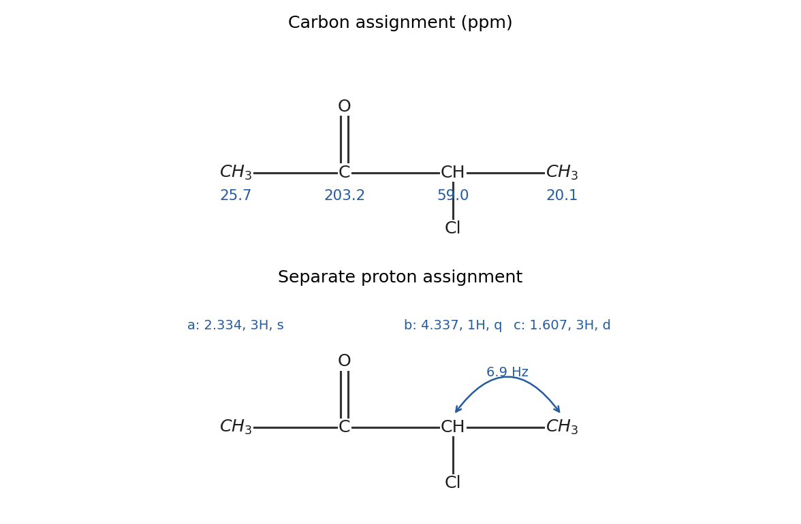

<h1 id="1/a/iii/solution">Solution</h1>

↑ **Parent:** [Iii](../iii.md)

Write the proton-labelled structure as $\mathrm{CH_3^{a}C(=O)CH^{b}(Cl)CH_3^{c}}$. The assignments are

$$
\begin{array}{c|c|c|c}
\text{site}&\delta_H/\mathrm{ppm}&\text{integral}&\text{multiplicity}\\\hline
a&2.334&3&\text{singlet}\\
b&4.3365&1&\text{quartet}\\
c&1.6065&3&\text{doublet}
\end{array}
$$

The [NMR quartet](../../../../../../nmr-quartet.md) is centred at $(4.371+4.302)/2=4.3365$ ppm; each adjacent line differs by $0.023$ ppm. The [NMR doublet](../../../../../../nmr-doublet.md) has the same spacing, $1.618-1.595=0.023$ ppm. At 300 MHz,

$$
\boxed{{}^3J_{bc}=300(0.023)=6.9\,\mathrm{Hz}.}
$$

Three equivalent methyl [protons](../../../../../../proton.md) split $b$ into a $1:3:3:1$ [NMR quartet](../../../../../../nmr-quartet.md); the single methine [proton](../../../../../../proton.md) splits $c$ into a $1:1$ [NMR doublet](../../../../../../nmr-doublet.md). No resolved [long-range scalar coupling](../../../../../../long-range-scalar-coupling.md) splits the acetyl methyl, giving its [NMR singlet](../../../../../../nmr-singlet.md). The integrals total seven [protons](../../../../../../proton.md).

**[Figure 1](#1/a/iii/image-independent-original-carbon-and-proton-assignments-for-a-with-the-measured-methine-methyl-coupling). Independent original carbon and proton assignments for A, with the measured methine–methyl coupling**.

## ↑ Ancestors (14)

1. [Iii](../iii.md)
2. [A](../../a.md)
3. [1](../../../1.md)
4. [Paper 1](../../../../paper-1-split.md)
5. [2022](../../../../split.md)
6. [Past exam of the chemistry course of the year 1 of the natural sciences course of the University of Cambridge](../../../../../split.md)
7. [Chemistry course of the year 1 of the natural sciences course of the University of Cambridge](../../../../../../chemistry-course-of-the-year-1-of-the-natural-sciences-course-of-the-university-of-cambridge.md)
8. [Year 1 of the natural sciences course of the University of Cambridge](../../../../../../year-1-of-the-natural-sciences-course-of-the-university-of-cambridge.md)
9. [Year of the natural sciences course of the University of Cambridge](../../../../../../year-of-the-natural-sciences-course-of-the-university-of-cambridge.md)
10. [Natural sciences course of the University of Cambridge](../../../../../../natural-sciences-course-of-the-university-of-cambridge.md)
11. [Course of the University of Cambridge](../../../../../../course-of-the-university-of-cambridge.md)
12. [University of Cambridge](../../../../../../university-of-cambridge-split.md)
13. [List of universities](../../../../../../list-of-universities.md)
14. [Codex Wiki](../../../../../../split.md)
