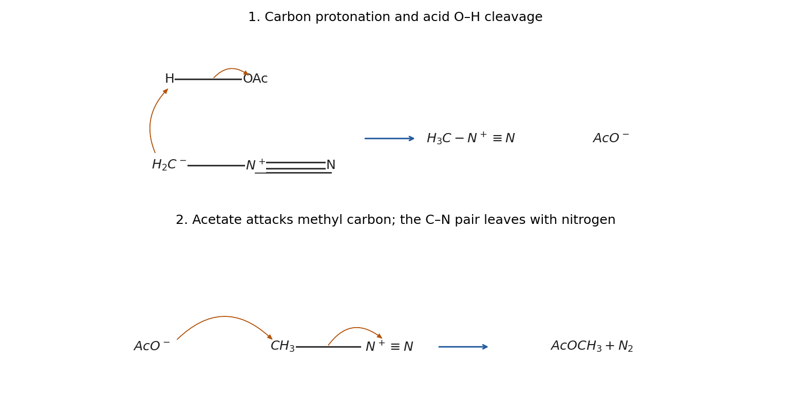

<h1 id="2/i/solution">Solution</h1>

↑ **Parent:** [I](../i.md)

First, [proton transfer](../../../../../proton-transfer.md) from [acetic acid](../../../../../acetic-acid.md) to the [carbon](../../../../../carbon.md) of [diazomethane](../../../../../diazomethane.md) gives [methyldiazonium](../../../../../methyldiazonium.md) and an [acetate ion](../../../../../acetate-ion.md):

$$
\mathrm{CH_2N_2+CH_3CO_2H\longrightarrow[CH_3N_2]^++CH_3CO_2^-}.
$$

Draw an electron-pair arrow from [carbon](../../../../../carbon.md), using the carbon-negative [resonance contributor](../../../../../resonance-structure.md), to the acidic [hydrogen](../../../../../hydrogen.md), and another from the acid O–H bond to [oxygen](../../../../../oxygen.md). Second, an acetate [oxygen](../../../../../oxygen.md) attacks the diazonium methyl [carbon](../../../../../carbon.md) by an [SN2 reaction](../../../../../sn2-reaction.md); an arrow from the C–N bond to [nitrogen](../../../../../nitrogen.md) expels neutral $\mathrm{N_2}$:

$$
\boxed{\mathrm{CH_3CO_2^-+[CH_3-N^+\equiv N]\longrightarrow CH_3CO_2CH_3+N_2}.}
$$

The acid's hydroxyl [hydrogen](../../../../../hydrogen.md) has become the third [hydrogen](../../../../../hydrogen.md) of the newly installed [methyl group](../../../../../methyl-group.md). This is a methyl-transfer sequence driven by formation of [molecular nitrogen](../../../../../molecular-nitrogen.md), without forming a free methyl [carbocation](../../../../../carbocation.md) or invoking [Fischer esterification](../../../../../fischer-esterification.md).

**[Figure 6](#2/i/image-original-electron-flow-drawing-for-carbon-protonation-followed-by-acetate-displacement-of-nitrogen). Original electron-flow drawing for carbon protonation followed by acetate displacement of nitrogen**.

## ↑ Ancestors (13)

1. [I](../i.md)
2. [2](../../2.md)
3. [Paper 1](../../../paper-1-split.md)
4. [2022](../../../split.md)
5. [Past exam of the chemistry course of the year 1 of the natural sciences course of the University of Cambridge](../../../../split.md)
6. [Chemistry course of the year 1 of the natural sciences course of the University of Cambridge](../../../../../chemistry-course-of-the-year-1-of-the-natural-sciences-course-of-the-university-of-cambridge.md)
7. [Year 1 of the natural sciences course of the University of Cambridge](../../../../../year-1-of-the-natural-sciences-course-of-the-university-of-cambridge.md)
8. [Year of the natural sciences course of the University of Cambridge](../../../../../year-of-the-natural-sciences-course-of-the-university-of-cambridge.md)
9. [Natural sciences course of the University of Cambridge](../../../../../natural-sciences-course-of-the-university-of-cambridge.md)
10. [Course of the University of Cambridge](../../../../../course-of-the-university-of-cambridge.md)
11. [University of Cambridge](../../../../../university-of-cambridge-split.md)
12. [List of universities](../../../../../list-of-universities.md)
13. [Codex Wiki](../../../../../split.md)
