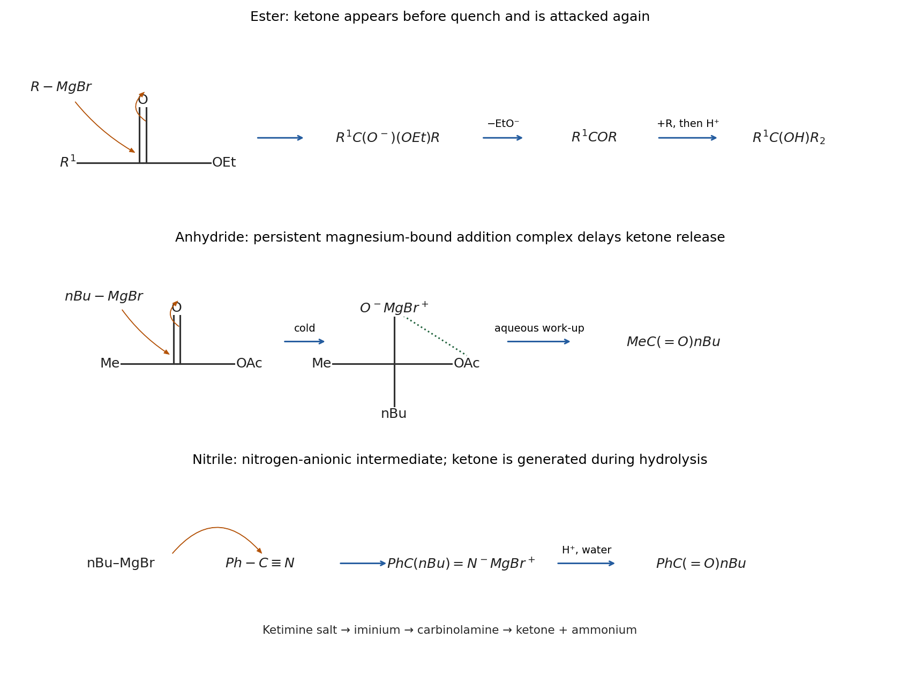

<h1 id="3/a/solution">Solution</h1>

↑ **Parent:** [A](../a.md)

For the ordinary [ester](../../../../../ester.md), the [carbon](../../../../../carbon.md) nucleophile of a [grignard reagent](../../../../../grignard-reagent.md) attacks the [carbonyl](../../../../../carbonyl-group.md) [carbon](../../../../../carbon.md) and moves the C=O pi pair onto [oxygen](../../../../../oxygen.md). Collapse of the [tetrahedral intermediate](../../../../../tetrahedral-intermediate.md) expels [ethoxide](../../../../../ethoxide.md), transiently giving $\mathrm{R^1COR}$. This [ketone](../../../../../ketone.md) is more electrophilic than the starting [ester](../../../../../ester.md) because it lacks an alkoxy group's stabilizing [resonance donation](../../../../../resonance-donation.md). A second equivalent of the [grignard reagent](../../../../../grignard-reagent.md) therefore adds to it before isolation:

$$
\mathrm{R^1CO_2Et\ \longrightarrow\ R^1C(O^-)(OEt)R\ \longrightarrow\ R^1COR\ \longrightarrow\ R^1C(O^-)(R)_2\ \xrightarrow{H^+}\ R^1C(OH)(R)_2}.
$$

The negatively charged intermediates are associated with [magnesium](../../../../../magnesium.md) counterions. Merely reducing the amount of reagent to one equivalent does not generally trap the [ketone](../../../../../ketone.md) selectively; it can leave unreacted [ester](../../../../../ester.md) together with the double-addition product.

In the first successful preparation, [magnesium](../../../../../magnesium.md) insertion into the primary C–Br bond gives **n-butylmagnesium [bromide](../../../../../bromide.md)**. The [carbon](../../../../../carbon.md) chain has four carbons, so its acetylation produces **hexan-2-one, $\mathrm{CH_3CO(CH_2)_3CH_3}$**, not pentan-2-one. Attack on [acetic anhydride](../../../../../acetic-anhydride.md) forms $\mathrm{CH_3C(O^-)(nBu)OCOCH_3}$. Coordination of the anhydride-derived oxygens to [magnesium](../../../../../magnesium.md) can stabilize this tetrahedral addition complex. Under suitably cold, controlled-addition conditions it survives sufficiently to delay release of the free [ketone](../../../../../ketone.md) until aqueous work-up has destroyed the remaining [grignard reagent](../../../../../grignard-reagent.md). Protonation followed by collapse releases acetate/[acetic acid](../../../../../acetic-acid.md) and the [ketone](../../../../../ketone.md).

This interpretation has direct experimental precedent: [Melvin S. Newman](../../../../../melvin-s-newman.md) and [William T. Booth Jr.](../../../../../william-t-booth-jr.md) obtained methyl ketones by cold addition of [grignard reagents](../../../../../grignard-reagent.md) to [acetic anhydride](../../../../../acetic-anhydride.md), attributing selectivity to a persistent addition complex. The [temperature](../../../../../temperature-split.md) and reagent-addition regime are genuine conditions on the explanation, rather than proof that an anhydride can never undergo overaddition; the exam scheme omits them.[1945, printed p. 154: proposed intermediate I and low-temperature dependence](../../../../../the-preparation-of-ketones-from-grignard-reagents-by-melvin-s-newman-and-william-t-booth-jr.md)

For the [benzonitrile](../../../../../benzonitrile.md) route, n-butyl attacks the [nitrile](../../../../../nitrile.md) [carbon](../../../../../carbon.md) and one C≡N pi pair moves to [nitrogen](../../../../../nitrogen.md), producing the [magnesium](../../../../../magnesium.md) [ketimine](../../../../../ketimine.md) salt $\mathrm{PhC(nBu)=N^-MgBr^+}$. This anionic nitrogen-containing intermediate resists a second [nucleophilic addition](../../../../../nucleophilic-addition.md) much more than a neutral [carbonyl](../../../../../carbonyl-group.md) does. The **[ketone](../../../../../ketone.md) $\mathrm{PhC(=O)nBu}$ appears only during acidic aqueous work-up**, after organomagnesium has been quenched. Protonation gives the [iminium ion](../../../../../iminium.md); water attacks its [carbon](../../../../../carbon.md), [proton](../../../../../proton.md) transfers give a [carbinolamine](../../../../../carbinolamine.md), and C–N cleavage from its nitrogen-protonated form produces the protonated [ketone](../../../../../ketone.md) and [ammonia](../../../../../ammonia.md), followed by deprotonation. In the acidic mixture [ammonia](../../../../../ammonia.md) is present largely as [ammonium](../../../../../ammonium.md). This sequence explains why [nitrile](../../../../../nitrile.md) addition stops at a [ketone](../../../../../ketone.md) without requiring the [ketone](../../../../../ketone.md) itself to be resistant to [grignard reagents](../../../../../grignard-reagent.md).

The atom-labelled hydrolysis sequence is

$$
\begin{aligned}
\mathrm{PhC(nBu)=N^-}&\xrightarrow{2H^+}\mathrm{PhC(nBu)=NH_2^+}\\
&\xrightarrow{H_2O}\mathrm{PhC(nBu)(OH_2^+)NH_2}\\
&\xrightarrow{\text{proton transfers}}\mathrm{PhC(nBu)(OH)NH_3^+}\\
&\longrightarrow\mathrm{PhC(nBu)=OH^++NH_3}\longrightarrow\mathrm{PhC(nBu)=O}.
\end{aligned}
$$

Water's [lone pair](../../../../../lone-pair.md) attacks the iminium carbon while its C=N pi pair moves to [nitrogen](../../../../../nitrogen.md); the [carbinolamine](../../../../../carbinolamine.md) oxygen then reforms C=O while the C–N pair moves to the departing protonated amino group. Final deprotonation gives the neutral [ketone](../../../../../ketone.md). The arrows involving protonation and hydrolysis also exchange protons with the acidic aqueous reservoir; the condensed sequence tracks the carbon–nitrogen and carbon–oxygen transformations rather than displaying every solvent molecule.

**[Figure 7](#3/a/image-original-electron-flow-summary-contrasting-ester-overaddition-with-anhydride-trapping-and-nitrile-hydrolysis). Original electron-flow summary contrasting ester overaddition with anhydride trapping and nitrile hydrolysis**.

## ↑ Ancestors (13)

1. [A](../a.md)
2. [3](../../3.md)
3. [Paper 1](../../../paper-1-split.md)
4. [2022](../../../split.md)
5. [Past exam of the chemistry course of the year 1 of the natural sciences course of the University of Cambridge](../../../../split.md)
6. [Chemistry course of the year 1 of the natural sciences course of the University of Cambridge](../../../../../chemistry-course-of-the-year-1-of-the-natural-sciences-course-of-the-university-of-cambridge.md)
7. [Year 1 of the natural sciences course of the University of Cambridge](../../../../../year-1-of-the-natural-sciences-course-of-the-university-of-cambridge.md)
8. [Year of the natural sciences course of the University of Cambridge](../../../../../year-of-the-natural-sciences-course-of-the-university-of-cambridge.md)
9. [Natural sciences course of the University of Cambridge](../../../../../natural-sciences-course-of-the-university-of-cambridge.md)
10. [Course of the University of Cambridge](../../../../../course-of-the-university-of-cambridge.md)
11. [University of Cambridge](../../../../../university-of-cambridge-split.md)
12. [List of universities](../../../../../list-of-universities.md)
13. [Codex Wiki](../../../../../split.md)
