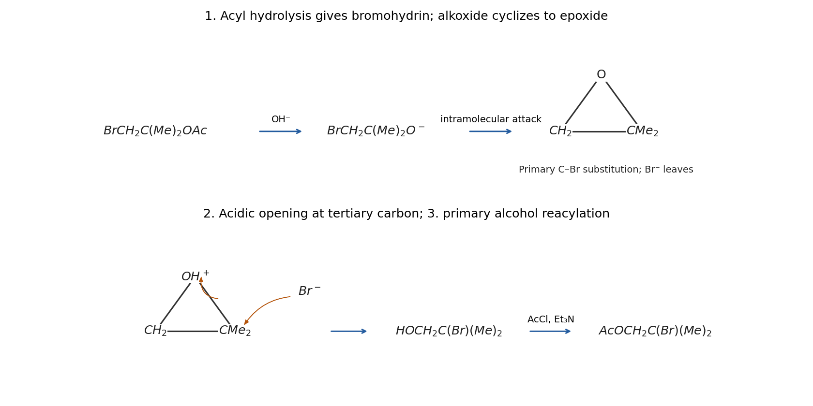

<h1 id="3/b/ii/solution">Solution</h1>

↑ **Parent:** [Ii](../ii.md)

The [oxygen](../../../../../../oxygen.md) substituent changes position through a [halohydrin](../../../../../../halohydrin.md)–[epoxide](../../../../../../epoxide.md) sequence. First, [hydroxide](../../../../../../hydroxide.md) attacks the acetate [carbonyl](../../../../../../carbonyl-group.md) of $\mathrm{BrCH_2C(Me)_2OAc}$, giving a [tetrahedral intermediate](../../../../../../tetrahedral-intermediate.md). Collapse expels the substrate [alkoxide](../../../../../../alkoxide.md), and [proton transfer](../../../../../../proton-transfer.md) gives $\mathrm{BrCH_2C(Me)_2OH}$ plus acetate. This is [saponification](../../../../../../saponification.md), breaking the acyl–[oxygen](../../../../../../oxygen.md) bond rather than replacing [bromide](../../../../../../bromide.md) directly with [hydroxide](../../../../../../hydroxide.md).

A small equilibrium population of $\mathrm{BrCH_2C(Me)_2O^-}$ undergoes intramolecular [SN2 reaction](../../../../../../sn2-reaction.md) at the adjacent primary [carbon](../../../../../../carbon.md): the O [lone pair](../../../../../../lone-pair.md) attacks $\mathrm{CH_2Br}$ and its C–Br pair leaves with [bromide](../../../../../../bromide.md). The result is **[2,2-Dimethyloxirane](../../../../../../2-2-dimethyloxirane.md)**. Addition of HBr protonates the ring [oxygen](../../../../../../oxygen.md). [bromide](../../../../../../bromide.md) then attacks preferentially at the more substituted [carbon](../../../../../../carbon.md), where the protonated ring has greater [carbocation](../../../../../../carbocation.md) character, breaking that C–O bond and leaving [oxygen](../../../../../../oxygen.md) attached to the former primary [carbon](../../../../../../carbon.md):

$$
\mathrm{BrCH_2C(Me)_2OH\ \longrightarrow\ (CH_2)O(CMe_2)\ \xrightarrow{HBr}\ HOCH_2C(Br)(Me)_2}.
$$

The middle formula denotes a three-membered [epoxide](../../../../../../epoxide.md), not an open-chain ether. Acidic opening of this highly unsymmetrical [epoxide](../../../../../../epoxide.md) has the opposite regioselectivity to a simple basic nucleophilic opening at its less substituted [carbon](../../../../../../carbon.md).

Finally, the primary [alcohol](../../../../../../alcohol.md) [oxygen](../../../../../../oxygen.md) attacks [acetyl chloride](../../../../../../acetyl-chloride.md). The [tetrahedral intermediate](../../../../../../tetrahedral-intermediate.md) collapses with [chloride](../../../../../../chloride.md) departure, and [triethylamine](../../../../../../triethylamine.md) removes the O–H [proton](../../../../../../proton.md) and captures HCl. The product is **$\mathrm{AcOCH_2C(Br)(Me)_2}$**. [oxygen](../../../../../../oxygen.md) is carried through the [epoxide](../../../../../../epoxide.md) to the other [carbon](../../../../../../carbon.md); it is not necessary to invent a methyl migration or a carbon-skeleton rearrangement.

**[Figure 9](#3/b/ii/image-original-electron-flow-drawing-for-bromohydrin-cyclization-acid-directed-epoxide-opening-and-reacylation). Original electron-flow drawing for bromohydrin cyclization, acid-directed epoxide opening and reacylation**.

## ↑ Ancestors (14)

1. [Ii](../ii.md)
2. [B](../../b.md)
3. [3](../../../3.md)
4. [Paper 1](../../../../paper-1-split.md)
5. [2022](../../../../split.md)
6. [Past exam of the chemistry course of the year 1 of the natural sciences course of the University of Cambridge](../../../../../split.md)
7. [Chemistry course of the year 1 of the natural sciences course of the University of Cambridge](../../../../../../chemistry-course-of-the-year-1-of-the-natural-sciences-course-of-the-university-of-cambridge.md)
8. [Year 1 of the natural sciences course of the University of Cambridge](../../../../../../year-1-of-the-natural-sciences-course-of-the-university-of-cambridge.md)
9. [Year of the natural sciences course of the University of Cambridge](../../../../../../year-of-the-natural-sciences-course-of-the-university-of-cambridge.md)
10. [Natural sciences course of the University of Cambridge](../../../../../../natural-sciences-course-of-the-university-of-cambridge.md)
11. [Course of the University of Cambridge](../../../../../../course-of-the-university-of-cambridge.md)
12. [University of Cambridge](../../../../../../university-of-cambridge-split.md)
13. [List of universities](../../../../../../list-of-universities.md)
14. [Codex Wiki](../../../../../../split.md)
