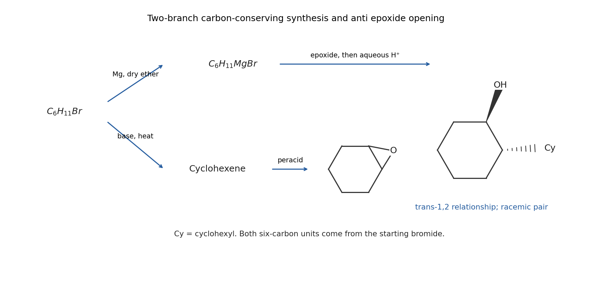

<h1 id="3/c/solution">Solution</h1>

↑ **Parent:** [C](../c.md)

Disconnect the new bond between the two six-carbon units. One portion of [bromocyclohexane](../../../../../bromocyclohexane.md) supplies a [grignard reagent](../../../../../grignard-reagent.md); another supplies [cyclohexene oxide](../../../../../cyclohexene-oxide.md):

$$
\begin{aligned}
\mathrm{C_6H_{11}Br}&\xrightarrow{\mathrm{Mg,\ dry\ ether}}\mathrm{C_6H_{11}MgBr},\\
\mathrm{C_6H_{11}Br}&\xrightarrow{\mathrm{base,\ heat}}\mathrm{cyclohexene}\xrightarrow{\mathrm{peracid}}\mathrm{cyclohexene\ oxide}.
\end{aligned}
$$

A bulky strong base can favour [E2 elimination](../../../../../e2-elimination.md) in the alkene-forming step; a peracid such as [meta-chloroperoxybenzoic acid](../../../../../meta-chloroperoxybenzoic-acid.md) provides [epoxidation](../../../../../epoxidation.md). None of its carbons enters the target.

Treat [cyclohexene oxide](../../../../../cyclohexene-oxide.md) with [cyclohexylmagnesium bromide](../../../../../cyclohexylmagnesium-bromide.md), then perform acidic aqueous work-up. Backside attack on one [epoxide](../../../../../epoxide.md) [carbon](../../../../../carbon.md) breaks its C–O bond and installs cyclohexyl opposite the retained [oxygen](../../../../../oxygen.md). Protonation of the [oxygen](../../../../../oxygen.md) gives **trans-2-cyclohexylcyclohexan-1-ol**, the required relative configuration. The two six-carbon reactant portions supply all 12 target carbons. An achiral synthesis produces a [racemic mixture](../../../../../racemic-mixture.md) trans pair; obtaining only the particular [enantiomer](../../../../../enantiomer.md) represented by the drawing would require resolution or an enantioselective step. The useful stable chair can place the two large trans-1,2 substituents approximately diequatorial.

**[Figure 10](#3/c/image-original-two-branch-synthesis-from-bromocyclohexane-and-anti-epoxide-opening-to-the-trans-alcohol). Original two-branch synthesis from bromocyclohexane and anti epoxide opening to the trans alcohol**.

## ↑ Ancestors (13)

1. [C](../c.md)
2. [3](../../3.md)
3. [Paper 1](../../../paper-1-split.md)
4. [2022](../../../split.md)
5. [Past exam of the chemistry course of the year 1 of the natural sciences course of the University of Cambridge](../../../../split.md)
6. [Chemistry course of the year 1 of the natural sciences course of the University of Cambridge](../../../../../chemistry-course-of-the-year-1-of-the-natural-sciences-course-of-the-university-of-cambridge.md)
7. [Year 1 of the natural sciences course of the University of Cambridge](../../../../../year-1-of-the-natural-sciences-course-of-the-university-of-cambridge.md)
8. [Year of the natural sciences course of the University of Cambridge](../../../../../year-of-the-natural-sciences-course-of-the-university-of-cambridge.md)
9. [Natural sciences course of the University of Cambridge](../../../../../natural-sciences-course-of-the-university-of-cambridge.md)
10. [Course of the University of Cambridge](../../../../../course-of-the-university-of-cambridge.md)
11. [University of Cambridge](../../../../../university-of-cambridge-split.md)
12. [List of universities](../../../../../list-of-universities.md)
13. [Codex Wiki](../../../../../split.md)
