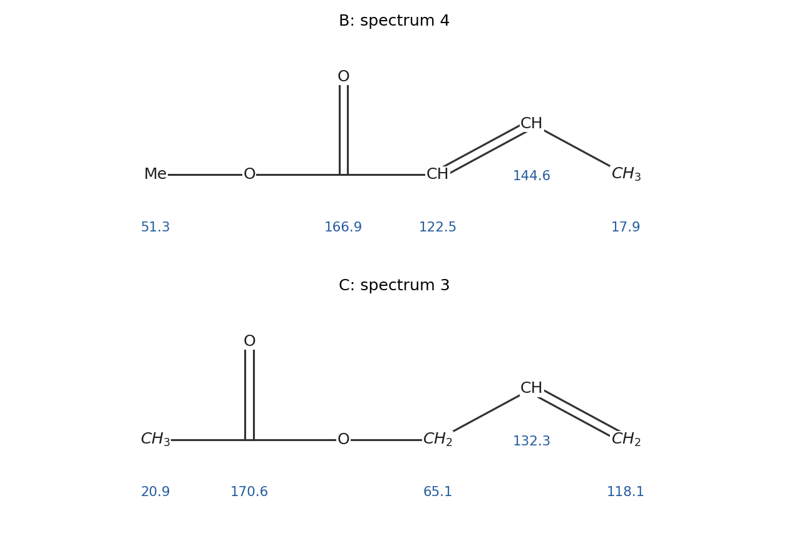
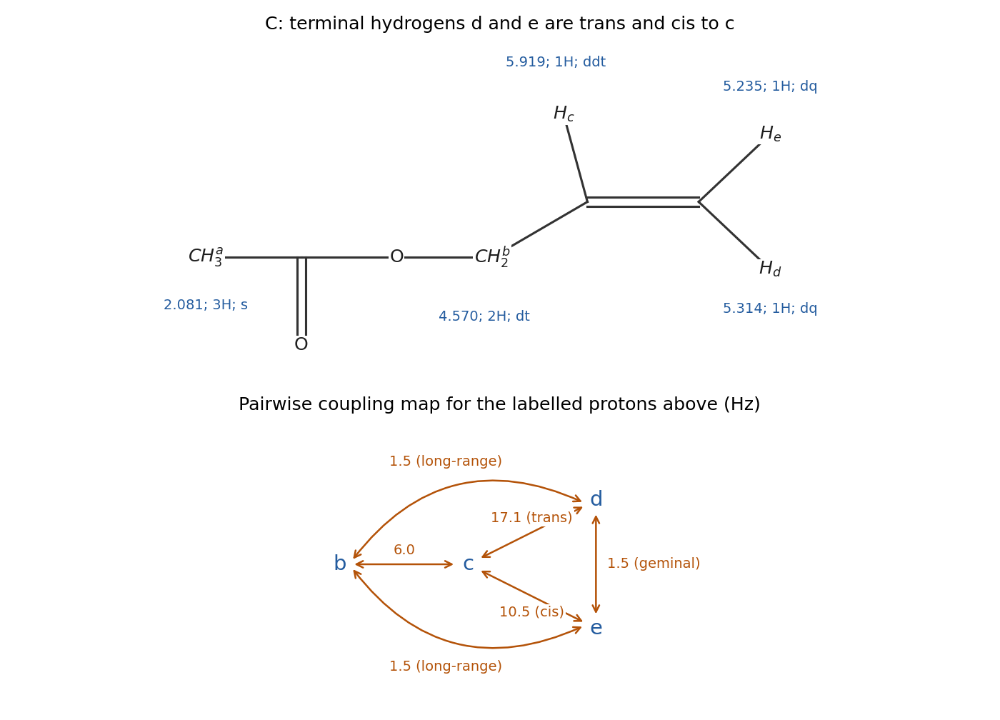
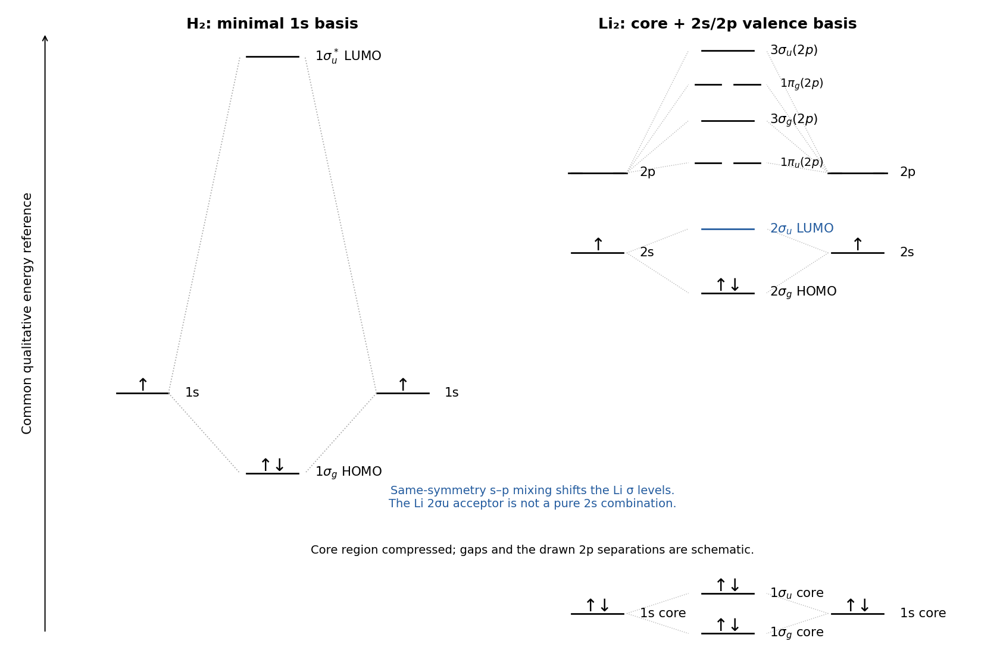
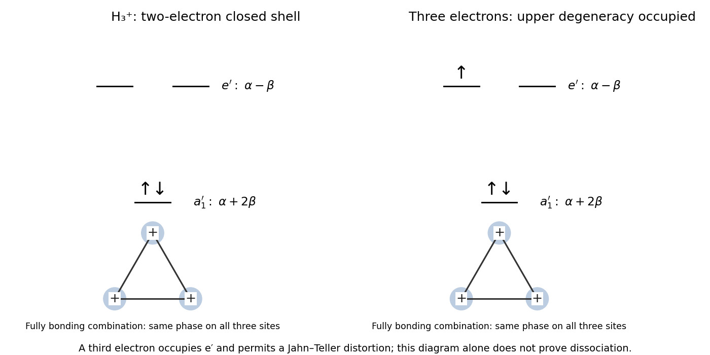
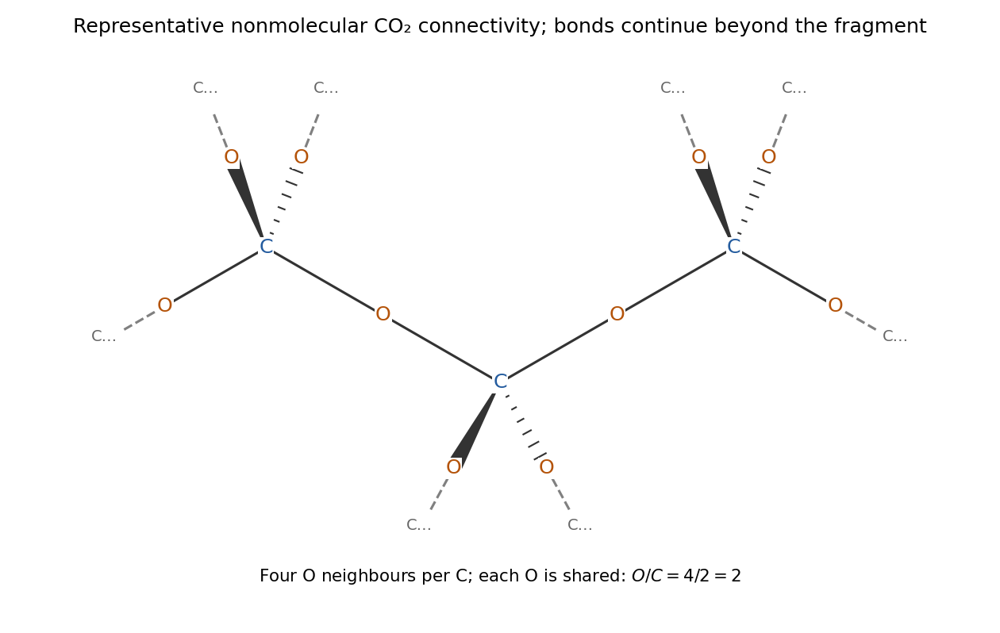

# Paper 1

↑ **Parent:** [2023](../2023.md)

[Original paper, released PDF pages 30–41](https://www.whatdotheyknow.com/request/request_for_nst_past_papers/response/3572306/attach/4/FOI%202026%20862%20Stack%20materials.pdf?cookie_passthrough=1#page=30)

**Table of contents**

- [1](#1)
  - [a](#1/a)
    - [i](#1/a/i)
      - [Solution](#1/a/i/solution)
    - [ii](#1/a/ii)
      - [Solution](#1/a/ii/solution)
  - [b](#1/b)
    - [i](#1/b/i)
      - [Solution](#1/b/i/solution)
    - [ii](#1/b/ii)
      - [Solution](#1/b/ii/solution)
    - [iii](#1/b/iii)
      - [Solution](#1/b/iii/solution)
  - [c](#1/c)
    - [i](#1/c/i)
      - [Solution](#1/c/i/solution)
    - [ii](#1/c/ii)
      - [Solution](#1/c/ii/solution)
- [2](#2)
  - [a](#2/a)
    - [i](#2/a/i)
      - [Solution](#2/a/i/solution)
    - [ii](#2/a/ii)
      - [Solution](#2/a/ii/solution)
    - [iii](#2/a/iii)
      - [Solution](#2/a/iii/solution)
    - [iv](#2/a/iv)
      - [Solution](#2/a/iv/solution)
    - [v](#2/a/v)
      - [Solution](#2/a/v/solution)
  - [b](#2/b)
    - [i](#2/b/i)
      - [Solution](#2/b/i/solution)
    - [ii](#2/b/ii)
      - [Solution](#2/b/ii/solution)
    - [iii](#2/b/iii)
      - [Solution](#2/b/iii/solution)
    - [iv](#2/b/iv)
      - [Solution](#2/b/iv/solution)
- [3](#3)
  - [a](#3/a)
    - [Solution](#3/a/solution)
  - [b](#3/b)
    - [Solution](#3/b/solution)
  - [c](#3/c)
    - [Solution](#3/c/solution)
  - [d](#3/d)
    - [Solution](#3/d/solution)
- [4](#4)
  - [a](#4/a)
    - [Solution](#4/a/solution)
  - [b](#4/b)
    - [Solution](#4/b/solution)
  - [c](#4/c)
    - [Solution](#4/c/solution)
  - [d](#4/d)
    - [Solution](#4/d/solution)
- [5](#5)
  - [a](#5/a)
    - [i](#5/a/i)
      - [Solution](#5/a/i/solution)
    - [ii](#5/a/ii)
      - [Solution](#5/a/ii/solution)
  - [b](#5/b)
    - [i](#5/b/i)
      - [Solution](#5/b/i/solution)
    - [ii](#5/b/ii)
      - [Solution](#5/b/ii/solution)
  - [c](#5/c)
    - [i](#5/c/i)
      - [Solution](#5/c/i/solution)
    - [ii](#5/c/ii)
      - [Solution](#5/c/ii/solution)
    - [iii](#5/c/iii)
      - [Solution](#5/c/iii/solution)
    - [iv](#5/c/iv)
      - [Solution](#5/c/iv/solution)
    - [v](#5/c/v)
      - [Solution](#5/c/v/solution)
- [6](#6)
  - [a](#6/a)
    - [Solution](#6/a/solution)
  - [b](#6/b)
    - [i](#6/b/i)
      - [Solution](#6/b/i/solution)
    - [ii](#6/b/ii)
      - [Solution](#6/b/ii/solution)
  - [c](#6/c)
    - [Solution](#6/c/solution)
  - [d](#6/d)
    - [Solution](#6/d/solution)
  - [e](#6/e)
    - [Solution](#6/e/solution)

## 1

↑ **Parent:** [Paper 1](paper-1.md)

<h3 id="1/a">a</h3>

↑ **Parent:** [1](#1)

<h4 id="1/a/i">i</h4>

↑ **Parent:** [A](#1/a)

<h5 id="1/a/i/solution">Solution</h5>

↑ **Parent:** [I](#1/a/i)

**A is [pentane-2,3-dione](../../chemical-substance.md#pentane-2-3-dione), $\mathrm{CH_3C(=O)C(=O)CH_2CH_3}$.** Its index of [hydrogen](../../chemical-substance.md#hydrogen) deficiency is $(2\times5+2-8)/2=2$, accounted for by two [ketone](../../chemical-substance.md#ketone) carbonyls. The two resonances near 200 ppm, together with the three saturated [carbon](../../chemical-substance.md#carbon) signals and the [proton](../../physics.md#proton) integrals, identify an unsymmetrical [adjacent diketone](../../chemical-substance.md#adjacent-diketone) rather than an [ester](../../chemical-substance.md#ester) or an alkene-containing structure.

The assignments are the carbonyl-adjacent methyl at $\delta_C=23.7$, the methylene at $29.2$, and the terminal ethyl methyl at $7.0$ ppm. The two [carbonyl](../../chemical-bond.md#carbonyl-group) carbons give $197.5$ and $199.8$ ppm. **Their individual ordering is not uniquely established by the supplied one-dimensional spectra**; either ordering between the methyl-side and ethyl-side carbonyls should be kept tentative without a correlation or another independent assignment. In the displayed [attached proton test](../../nuclear-magnetic-resonance.md#attached-proton-test) phase convention, the two methyls have one sign, while the methylene and the nonprotonated carbonyls have the opposite sign. The solvent signal near 77 ppm is not a sixth [carbon](../../chemical-substance.md#carbon) of A.

**[Figure 1](#1/a/i/image-original-structural-assignment-of-the-five-carbon-environments-in-a-the-two-carbonyl-shifts-are-an-unordered-pair). Original structural assignment of the five carbon environments in A; the two carbonyl shifts are an unordered pair**.

<h4 id="1/a/ii">ii</h4>

↑ **Parent:** [A](#1/a)

<h5 id="1/a/ii/solution">Solution</h5>

↑ **Parent:** [Ii](#1/a/ii)

Label the acetyl methyl $a$, the methylene $b$, and the terminal methyl $c$ in $\mathrm{CH_3^{a}C(=O)C(=O)CH_2^{b}CH_3^{c}}$. The assignments are

$$
\begin{array}{c|c|c|c}
\text{group}&\delta_H/\mathrm{ppm}&\text{integral}&\text{multiplicity}\\\hline
a&2.345&3&\text{singlet}\\
b&2.779&2&\text{quartet}\\
c&1.090&3&\text{triplet}
\end{array}
$$

The [NMR multiplet centre](../../nuclear-magnetic-resonance.md#nmr-multiplet-centre) of the [NMR quartet](../../nuclear-magnetic-resonance.md#nmr-quartet) is the mean of its outer lines, $(2.815+2.743)/2=2.779$ ppm. Its adjacent lines differ by 0.024 ppm; the [NMR triplet](../../nuclear-magnetic-resonance.md#nmr-triplet) has the same spacing. Therefore

$$
\boxed{{}^3J_{bc}=300(0.024)=7.2\,\mathrm{Hz}.}
$$

The two groups, through [vicinal coupling](../../nuclear-magnetic-resonance.md#vicinal-coupling), split one another into the expected $1:3:3:1$ [NMR quartet](../../nuclear-magnetic-resonance.md#nmr-quartet) and $1:2:1$ [NMR triplet](../../nuclear-magnetic-resonance.md#nmr-triplet). The acetyl methyl has no resolved neighbouring [proton](../../physics.md#proton) across its adjacent [carbonyl](../../chemical-bond.md#carbonyl-group) and appears as a [NMR singlet](../../nuclear-magnetic-resonance.md#nmr-singlet). The integrals sum to eight [protons](../../physics.md#proton).

**[Figure 2](#1/a/ii/image-original-separate-proton-assignment-for-a-with-the-measured-methylene-methyl-coupling). Original separate proton assignment for A with the measured methylene–methyl coupling**.

<h3 id="1/b">b</h3>

↑ **Parent:** [1](#1)

<h4 id="1/b/i">i</h4>

↑ **Parent:** [B](#1/b)

<h5 id="1/b/i/solution">Solution</h5>

↑ **Parent:** [I](#1/b/i)

**B gives spectrum 4.** Number the unsaturated acyl chain from its [carbonyl](../../chemical-bond.md#carbonyl-group) [carbon](../../chemical-substance.md#carbon). For $\mathrm{MeO-C(=O)-CH=CH-CH_3}$, the assignments are

$$
\delta_C(\mathrm{C=O})=166.9,\quad
\delta_C(\alpha\text{-CH})=122.5,\quad
\delta_C(\beta\text{-CH})=144.6,\quad
\delta_C(\mathrm{CH_3})=17.9,\quad
\delta_C(\mathrm{OCH_3})=51.3\ \mathrm{ppm}.
$$

The strongly deshielded beta [carbon](../../chemical-substance.md#carbon) and relatively shielded alpha [carbon](../../chemical-substance.md#carbon) reflect polarization of the [conjugated ester](../../chemical-substance.md#conjugated-ester). All four protonated carbons here are CH or methyl environments and share one [attached proton test](../../nuclear-magnetic-resonance.md#attached-proton-test) phase, whereas the [carbonyl](../../chemical-bond.md#carbonyl-group) has the opposite phase. The methoxy [resonance](../../dynamical-systems.md#resonance) is decisive: B has an O-bound methyl, not an O-bound methylene.

**[Figure 3](#1/b/i/image-original-carbon-assignment-structures-for-b-and-c-showing-the-distinction-between-a-conjugated-acyl-group-and-an-allyl-alcohol-derived-group). Original carbon-assignment structures for B and C, showing the distinction between a conjugated acyl group and an allyl alcohol-derived group**.

<h4 id="1/b/ii">ii</h4>

↑ **Parent:** [B](#1/b)

<h5 id="1/b/ii/solution">Solution</h5>

↑ **Parent:** [Ii](#1/b/ii)

**C gives spectrum 3.** For [allyl acetate](../../chemical-substance.md#allyl-acetate), $\mathrm{CH_3C(=O)OCH_2CH=CH_2}$, assign

$$
\delta_C(\mathrm{C=O})=170.6,\quad
\delta_C(\mathrm{COCH_3})=20.9,\quad
\delta_C(\mathrm{OCH_2})=65.1,\quad
\delta_C(\mathrm{CH=})=132.3,\quad
\delta_C(\mathrm{=CH_2})=118.1\ \mathrm{ppm}.
$$

The 65.1-ppm [resonance](../../dynamical-systems.md#resonance) is the oxygen-bound methylene. Its [attached proton test](../../nuclear-magnetic-resonance.md#attached-proton-test) phase matches the [terminal alkene](../../chemical-substance.md#terminal-alkene) methylene and the nonprotonated [carbonyl](../../chemical-bond.md#carbonyl-group), while the [alkene](../../chemical-substance.md#alkene) CH and acetyl methyl have the opposite phase. The [carbonyl](../../chemical-bond.md#carbonyl-group) is not conjugated with the [alkene](../../chemical-substance.md#alkene) because [oxygen](../../chemical-substance.md#oxygen) and a saturated methylene interrupt the carbon–carbon conjugated path. This explains its higher [carbonyl](../../chemical-bond.md#carbonyl-group) shift relative to B without requiring the two [esters](../../chemical-substance.md#ester) to have identical electronic environments.

<h4 id="1/b/iii">iii</h4>

↑ **Parent:** [B](#1/b)

<h5 id="1/b/iii/solution">Solution</h5>

↑ **Parent:** [Iii](#1/b/iii)

**B should have a lower [carbonyl](../../chemical-bond.md#carbonyl-group) stretching frequency because its [ester](../../chemical-substance.md#ester) [carbonyl](../../chemical-bond.md#carbonyl-group) is conjugated with a C=C bond.** A typical diagnostic comparison is a [conjugated ester](../../chemical-substance.md#conjugated-ester) [carbonyl](../../chemical-bond.md#carbonyl-group) around $1715$–$1730\,\mathrm{cm^{-1}}$ for B versus a nonconjugated [ester](../../chemical-substance.md#ester) [carbonyl](../../chemical-bond.md#carbonyl-group) around $1740$–$1750\,\mathrm{cm^{-1}}$ for C; the precise positions depend on the measurement conditions. [conjugation](../../group-action.md#conjugation) distributes the pi bonding over the acyl fragment and lowers the effective [carbonyl](../../chemical-bond.md#carbonyl-group) [bond force constant](../../molecule.md#bond-force-constant).

C also has a [terminal alkene](../../chemical-substance.md#terminal-alkene), giving characteristic out-of-plane C–H bending features near 990 and $910\,\mathrm{cm^{-1}}$. B has an internal, trans-disubstituted [alkene](../../chemical-substance.md#alkene), for which a band near $965\,\mathrm{cm^{-1}}$ is useful. Both compounds contain [ester](../../chemical-substance.md#ester) C–O bonds and [alkene](../../chemical-substance.md#alkene) C–H bonds, so merely observing those general features would not distinguish them. The [carbonyl](../../chemical-bond.md#carbonyl-group) comparison plus the [alkene](../../chemical-substance.md#alkene) substitution pattern is the stronger identification.

<h3 id="1/c">c</h3>

↑ **Parent:** [1](#1)

<h4 id="1/c/i">i</h4>

↑ **Parent:** [C](#1/c)

<h5 id="1/c/i/solution">Solution</h5>

↑ **Parent:** [I](#1/c/i)

Use $a$ for the acetyl methyl, $b$ for the O-bound [methylene group](../../chemistry.md#methylene-group) pair, $c$ for the internal vinyl [proton](../../physics.md#proton), and $d,e$ for the terminal vinyl [protons](../../physics.md#proton) respectively trans and cis to $c$. The assignments are

$$
\begin{array}{c|c|c|l}
\text{protons}&\delta_H/\mathrm{ppm}&\text{integral}&\text{resolved pattern}\\\hline
a&2.081&3&\text{singlet}\\
b&4.570&2&\text{doublet of triplets}\\
c&5.919&1&\text{doublet of doublets of triplets}\\
d&5.314&1&\text{doublet of apparent quartets}\\
e&5.235&1&\text{doublet of apparent quartets}
\end{array}
$$

The two terminal [protons](../../physics.md#proton) are [diastereotopic](../../stereochemistry.md#diastereotopic): one is cis and the other trans to $c$, so they have different shifts and different [vicinal couplings](../../nuclear-magnetic-resonance.md#vicinal-coupling). Each terminal [proton](../../physics.md#proton) also couples through [geminal coupling](../../nuclear-magnetic-resonance.md#geminal-coupling) to the other and through [long-range scalar coupling](../../nuclear-magnetic-resonance.md#long-range-scalar-coupling) to the two $b$ [protons](../../physics.md#proton). When those small couplings coincide, an underlying [doublet of doublets](../../nuclear-magnetic-resonance.md#doublet-of-doublets) of [NMR triplets](../../nuclear-magnetic-resonance.md#nmr-triplet) collapses to the observed [NMR doublet](../../nuclear-magnetic-resonance.md#nmr-doublet) of apparent [NMR quartets](../../nuclear-magnetic-resonance.md#nmr-quartet). The O-bound [protons](../../physics.md#proton) are [enantiotopic](../../stereochemistry.md#enantiotopicity) and have [chemical equivalence in NMR](../../nuclear-magnetic-resonance.md#chemical-equivalence-in-nmr) in this achiral environment; they are split by $c$ and by the two terminal [protons](../../physics.md#proton). The integrated terminal envelope contains two [protons](../../physics.md#proton), not two equivalent [protons](../../physics.md#proton) at one shift.

**[Figure 4](#1/c/i/image-original-stereochemically-labelled-proton-structure-for-c-with-all-resolved-vicinal-geminal-and-long-range-couplings). Original stereochemically labelled proton structure for C with all resolved vicinal, geminal and long-range couplings**.

<h4 id="1/c/ii">ii</h4>

↑ **Parent:** [C](#1/c)

<h5 id="1/c/ii/solution">Solution</h5>

↑ **Parent:** [Ii](#1/c/ii)

**The large vinyl couplings are 17.1 Hz trans and 10.5 Hz cis; the O-methylene-to-vinyl coupling is 6.0 Hz.** At this field, convert every separation by $J/\mathrm{Hz}=300\,\Delta\delta/\mathrm{ppm}$. Comparing the centres of corresponding terminal-proton submultiplets gives

$$
\begin{aligned}
{}^3J_{cd}&=300(5.350-5.293)=\boxed{17.1\,\mathrm{Hz}},\\
{}^3J_{ce}&=300(5.260-5.225)=\boxed{10.5\,\mathrm{Hz}},\\
{}^3J_{bc}&=300(4.585-4.565)=\boxed{6.0\,\mathrm{Hz}}.
\end{aligned}
$$

The repeated 0.005-ppm fine spacing from [allylic scalar coupling](../../nuclear-magnetic-resonance.md#allylic-scalar-coupling) and [geminal coupling](../../nuclear-magnetic-resonance.md#geminal-coupling) gives the magnitudes

$$
\boxed{|{}^2J_{de}|\simeq|{}^4J_{bd}|\simeq|{}^4J_{be}|\simeq1.5\,\mathrm{Hz}.}
$$

For example, splitting by a geminal [proton](../../physics.md#proton) and two equivalent long-range-coupled methylene [protons](../../physics.md#proton), all with the same magnitude, produces overlapping lines with intensities $1:3:3:1$. The 6-Hz splitting of $b$ creates two such small [NMR triplets](../../nuclear-magnetic-resonance.md#nmr-triplet) centred at 4.580 and 4.560 ppm. An independent check comes from the internal-vinyl multiplet: a centre at 5.919 ppm with splittings 17.1, 10.5 and 6.0 Hz, the last to two equivalent [protons](../../physics.md#proton), reproduces all twelve labelled line positions. The spectrum determines these coupling magnitudes, not their algebraic signs.

## 2

↑ **Parent:** [Paper 1](paper-1.md)

<h3 id="2/a">a</h3>

↑ **Parent:** [2](#2)

<h4 id="2/a/i">i</h4>

↑ **Parent:** [A](#2/a)

<h5 id="2/a/i/solution">Solution</h5>

↑ **Parent:** [I](#2/a/i)

**The reactive occupied orbital of [ethoxide](../../mathematical-biology.md#ethoxide) is an [oxygen](../../chemical-substance.md#oxygen) [lone pair](../../covalent-bond.md#lone-pair); the acyl [electrophile](../../chemical-reaction.md#electrophile) accepts into its [carbonyl](../../chemical-bond.md#carbonyl-group) $\pi^*$ orbital.** Draw the [ethoxide](../../mathematical-biology.md#ethoxide) [lone pair](../../covalent-bond.md#lone-pair) as a directional oxygen-centred lobe directed toward an [electrophile](../../chemical-reaction.md#electrophile). In a lithium-ion-pair picture the low unoccupied acceptor on [lithium](../../chemical-substance.md#lithium) is an empty, diffuse Li-centred orbital, with 2s/2p character depending on coordination. It should not be confused with an occupied Li–O covalent bonding pair.

For [methyl acetate](../../chemical-substance.md#methyl-acetate), the occupied frontier donor is principally an [oxygen](../../chemical-substance.md#oxygen) nonbonding orbital, mixed with the [ester](../../chemical-substance.md#ester) orbital system. Its low-lying reactive acceptor is $\pi^*(\mathrm{C=O})$, with opposite phases on [carbon](../../chemical-substance.md#carbon) and [oxygen](../../chemical-substance.md#oxygen) and a relatively large accepting lobe on the [carbonyl](../../chemical-bond.md#carbonyl-group) [carbon](../../chemical-substance.md#carbon). The corresponding sketch must show a [node](../../dynamical-systems.md#node-dynamical-systems) between the [carbonyl](../../chemical-bond.md#carbonyl-group) atoms. These are chemically useful frontier-orbital descriptions; [lithium](../../chemical-substance.md#lithium) [alkoxide](../../mathematical-biology.md#alkoxide) aggregation and [ethanol](../../biology.md#ethanol) solvation make a unique isolated-molecule orbital energy diagram an oversimplification.

**[Figure 5](#2/a/i/image-original-frontier-orbital-sketches-and-the-two-complementary-donor-acceptor-contacts-in-the-ester-lithium-ethoxide-encounter). Original frontier-orbital sketches and the two complementary donor–acceptor contacts in the ester–lithium ethoxide encounter**.

<h4 id="2/a/ii">ii</h4>

↑ **Parent:** [A](#2/a)

<h5 id="2/a/ii/solution">Solution</h5>

↑ **Parent:** [Ii](#2/a/ii)

**The product-forming pairing is $n(\mathrm{EtO^-})\to\pi^*(\mathrm{C=O})$.** Orient an occupied [ethoxide](../../mathematical-biology.md#ethoxide) [oxygen](../../chemical-substance.md#oxygen) lobe toward the large [carbon](../../chemical-substance.md#carbon) lobe of the [carbonyl](../../chemical-bond.md#carbonyl-group) acceptor with matching phase. An oblique approach permits constructive overlap while the [pi bond](../../covalent-bond.md#pi-bond) weakens; this is the usual [Bürgi-Dunitz trajectory](../../chemical-reaction.md#burgi-dunitz-trajectory) to acyl [carbon](../../chemical-substance.md#carbon). The high-energy occupied orbital on the anion makes [ethoxide](../../mathematical-biology.md#ethoxide) the stronger electron-pair donor than the neutral [ester](../../chemical-substance.md#ester) [oxygen](../../chemical-substance.md#oxygen).

The reverse frontier pairing, $n(\mathrm{ester\ O})\to\mathrm{empty\ Li}$, gives oxygen-to-lithium coordination. It is a plausible stabilizing contact and can coexist with the first interaction, rather than constituting an alternative way to replace the [ester](../../chemical-substance.md#ester) alkoxy group. In the elementary frontier picture, the anionic donor-to-carbonyl interaction is the important pairing for the new [covalent bond](../../covalent-bond.md) and is favoured by its donor strength and appropriate accepting coefficient at [carbon](../../chemical-substance.md#carbon). The Li contact can polarize the [carbonyl](../../chemical-bond.md#carbonyl-group) and organize the reacting pair. Precise energy-gap rankings require a specified solvated [lithium](../../chemical-substance.md#lithium) species; the sketches alone do not justify pretending that [lithium](../../chemical-substance.md#lithium) coordination cannot occur.

<h4 id="2/a/iii">iii</h4>

↑ **Parent:** [A](#2/a)

<h5 id="2/a/iii/solution">Solution</h5>

↑ **Parent:** [Iii](#2/a/iii)

**The mechanism is [nucleophilic addition](../../chemical-reaction.md#nucleophilic-addition) followed by elimination of [methoxide](../../mathematical-biology.md#methoxide).** An [ethoxide](../../mathematical-biology.md#ethoxide) [oxygen](../../chemical-substance.md#oxygen) [lone pair](../../covalent-bond.md#lone-pair) attacks the [carbonyl](../../chemical-bond.md#carbonyl-group) [carbon](../../chemical-substance.md#carbon), while the C=O pi pair moves to [oxygen](../../chemical-substance.md#oxygen):

$$
\mathrm{MeC(=O)OMe+EtO^-\rightleftharpoons MeC(O^-)(OMe)(OEt)}.
$$

The tetrahedral intermediate collapses when its anionic [oxygen](../../chemical-substance.md#oxygen) reforms the [carbonyl](../../chemical-bond.md#carbonyl-group) and the C–OMe bond breaks with its electron pair going to the methoxy [oxygen](../../chemical-substance.md#oxygen):

$$
\mathrm{MeC(O^-)(OMe)(OEt)\rightleftharpoons MeC(=O)OEt+MeO^-}.
$$

[lithium](../../chemical-substance.md#lithium) is a coordinating counterion; it does not supply an electron pair to the acyl [carbon](../../chemical-substance.md#carbon). [proton](../../physics.md#proton) exchange with [ethanol](../../biology.md#ethanol) connects the [methoxide](../../mathematical-biology.md#methoxide) produced to the [ethoxide](../../mathematical-biology.md#ethoxide) catalyst pool and gives [methanol](../../chemical-substance.md#methanol), so the net solvent-mediated exchange is [methyl acetate](../../chemical-substance.md#methyl-acetate) plus [ethanol](../../biology.md#ethanol) to ethyl acetate plus [methanol](../../chemical-substance.md#methanol). The reversibility of the elementary acyl steps is important: changing an alkoxy group is not automatically an irreversible reaction.

**[Figure 6](#2/a/iii/image-original-curved-arrow-addition-elimination-mechanism-for-ethoxide-catalysed-ester-exchange). Original curved-arrow addition–elimination mechanism for ethoxide-catalysed ester exchange**.

<h4 id="2/a/iv">iv</h4>

↑ **Parent:** [A](#2/a)

<h5 id="2/a/iv/solution">Solution</h5>

↑ **Parent:** [Iv](#2/a/iv)

**[ethanol](../../biology.md#ethanol) undergoes [proton transfer](../../acid-base-chemistry.md#proton-transfer) with the [methoxide](../../mathematical-biology.md#methoxide) produced.** The [oxygen](../../chemical-substance.md#oxygen) [lone pair](../../covalent-bond.md#lone-pair) of [methoxide](../../mathematical-biology.md#methoxide) attacks the hydroxyl [proton](../../physics.md#proton) of [ethanol](../../biology.md#ethanol), while the [ethanol](../../biology.md#ethanol) O–H bond pair returns to its [oxygen](../../chemical-substance.md#oxygen):

$$
\mathrm{MeO^-+EtOH\rightleftharpoons MeOH+EtO^-}.
$$

The [alcohol](../../chemical-substance.md#alcohol) acidities are similar, so this is an equilibrium, not an overwhelmingly one-way [deprotonation](../../acid-base-chemistry.md#deprotonation) determined solely by intrinsic acidity. The large [ethanol](../../biology.md#ethanol) reservoir and initially small [methanol](../../chemical-substance.md#methanol) [concentration](../../mathematical-physics.md#concentration) nevertheless matter. This exchange means that [lithium ethoxide](../../mathematical-biology.md#lithium-ethoxide) need not be consumed stoichiometrically in the net transesterification. Neutral [ethanol](../../biology.md#ethanol) can also participate in [proton](../../physics.md#proton) shuttling; it is not acting as a reducing reagent or as a substrate for elimination under these conditions.

<h4 id="2/a/v">v</h4>

↑ **Parent:** [A](#2/a)

<h5 id="2/a/v/solution">Solution</h5>

↑ **Parent:** [V](#2/a/v)

**Excess [ethanol](../../biology.md#ethanol) drives a reversible [ester](../../chemical-substance.md#ester) exchange mainly through the actual mixture composition, not through a large new bond-energy advantage.** The net reaction exchanges one [ester](../../chemical-substance.md#ester) and one [alcohol](../../chemical-substance.md#alcohol) for a closely related [ester](../../chemical-substance.md#ester) and [alcohol](../../chemical-substance.md#alcohol). It preserves the main bond types and has no obvious large exothermicity. Solvation and [ion](../../chemistry.md#ion) pairing can contribute to its [enthalpy](../../enthalpy.md), but there is no basis here for asserting a large negative standard reaction [enthalpy](../../enthalpy.md).

There are two [molecules](../../molecule.md) on each side, so an increase in particle count is not the [entropy](../../entropy.md) explanation. Instead use

$$
\Delta_rG=\Delta_rG^\circ+RT\ln Q,\qquad
Q=\frac{a_{\rm ethyl\ acetate}a_{\rm methanol}}{a_{\rm methyl\ acetate}a_{\rm ethanol}}.
$$

With [ethanol](../../biology.md#ethanol) as the solvent and little [methanol](../../chemical-substance.md#methanol) initially, the [reaction quotient](../../chemical-potential.md#reaction-quotient) is small; product formation and mixing lower the [Gibbs free energy](../../thermodynamic-potential.md#gibbs-free-energy) until the exchange equilibrium is reached. [ethanol](../../biology.md#ethanol) can be treated approximately as having fixed activity near its pure-solvent value, rather than assigned an arbitrarily enormous activity, while [methanol](../../chemical-substance.md#methanol) remains dilute. This composition-dependent chemical-potential contribution is the appropriate entropic/mixing argument. It explains forward conversion under these conditions without claiming that $\Delta_rS^\circ$ must be positive, or that complete conversion follows without an [equilibrium constant](../../chemical-potential.md#equilibrium-constant) or removal of [methanol](../../chemical-substance.md#methanol).

<h3 id="2/b">b</h3>

↑ **Parent:** [2](#2)

<h4 id="2/b/i">i</h4>

↑ **Parent:** [B](#2/b)

<h5 id="2/b/i/solution">Solution</h5>

↑ **Parent:** [I](#2/b/i)

**Both dimers have two [electrons](../../physics.md#electron) in a valence sigma-bonding orbital and a formal valence [bond order](../../chemistry.md#bond-order) of one.** For [hydrogen](../../chemical-substance.md#hydrogen) the minimal-basis configuration is $(1\sigma_g)^2$, with the $1s$-derived $1\sigma_g$ as [highest occupied molecular orbital](../../chemistry.md#highest-occupied-molecular-orbital) and $1\sigma_u^*$ as [LUMO](../../chemistry.md#lowest-unoccupied-molecular-orbital). The bonding combination has no internuclear [node](../../dynamical-systems.md#node-dynamical-systems); the antibonding combination does.

For [lithium](../../chemical-substance.md#lithium), include the filled core pair of levels as well as the valence levels:

$$
\mathrm{Li_2}:\ (1\sigma_g)^2(1\sigma_u)^2(2\sigma_g)^2.
$$

The first two orbitals are predominantly core $1s$ combinations whose bonding and antibonding occupations cancel in a simple bond-order count. The [highest occupied molecular orbital](../../chemistry.md#highest-occupied-molecular-orbital) is predominantly $\sigma_g(2s)$, denoted $2\sigma_g$; the [LUMO](../../chemistry.md#lowest-unoccupied-molecular-orbital) is $2\sigma_u$, predominantly the antibonding $2s$ combination but modified by mixing with compatible $2p$ contributions. The nearby empty $2p$-derived sigma and pi levels must also be shown. Only orbitals of matching symmetry mix, so this does not mean that every $2s$ combination mixes with every $2p$ combination.

On a common qualitative energy reference, [hydrogen](../../chemical-substance.md#hydrogen) $1s$ is much lower than [lithium](../../chemical-substance.md#lithium)'s valence $2s$, while [lithium](../../chemical-substance.md#lithium)'s core $1s$ levels lie much deeper. The Li valence bonding–antibonding separation is smaller, consistent with its longer and weaker bond. The figure uses a compressed core region and schematic gaps, not measured orbital energies. The role of symmetry-compatible [s–p orbital mixing](../../chemistry.md#s-p-orbital-mixing) in the first-row diatomics is illustrated in institutional molecular-orbital notes.[pp. 1–2: s–p mixing and first-row orbital ordering](../../chemistry-bibliography.md#diatomic-mos-by-timothy-hughbanks)

**[Figure 7](#2/b/i/image-original-common-reference-qualitative-orbital-diagrams-for-hydrogen-and-lithium-dimers-including-lithium-2p-derived-levels-and-core-occupancies). Original common-reference qualitative orbital diagrams for hydrogen and lithium dimers, including lithium 2p-derived levels and core occupancies**.

<h4 id="2/b/ii">ii</h4>

↑ **Parent:** [B](#2/b)

<h5 id="2/b/ii/solution">Solution</h5>

↑ **Parent:** [Ii](#2/b/ii)

**Two [electrons](../../physics.md#electron) can occupy a fully bonding orbital delocalized equally over all three [hydrogen](../../chemical-substance.md#hydrogen) atoms.** Three $1s$ [atomic orbitals](../../chemistry.md#atomic-orbital) on an equilateral triangle form one totally symmetric $a_1'$ combination and a degenerate pair $e'$ of higher orbitals. In an orthonormal equal-interaction model with diagonal energy $\alpha$ and off-diagonal $\beta<0$,

$$
E(a_1')=\alpha+2\beta,\qquad E(e')=\alpha-\beta.
$$

The lower orbital is proportional to $1s_A+1s_B+1s_C$, with constructive overlap along every edge. Its two [electrons](../../physics.md#electron) give a [three-centre two-electron bond](../../chemical-bond.md#three-centre-two-electron-bond) and equivalent interactions between every pair of nuclei. At the equilibrium distance, this bonding competes with nuclear [Coulomb force](../../electrostatics.md#coulomb-force) to favour the symmetric triangular arrangement. The occupied shell is nondegenerate and closed, so there is no first-order Jahn-Teller incentive to distinguish the three edges. A straight-line or localized single-bond description would miss that equally shared bonding pattern.

**[Figure 8](#2/b/ii/image-original-three-site-orbital-filling-for-the-two-electron-cation-and-the-effect-of-a-third-electron-on-a-degenerate-triangular-shell). Original three-site orbital filling for the two-electron cation and the effect of a third electron on a degenerate triangular shell**.

<h4 id="2/b/iii">iii</h4>

↑ **Parent:** [B](#2/b)

<h5 id="2/b/iii/solution">Solution</h5>

↑ **Parent:** [Iii](#2/b/iii)

**The third electron must enter the higher, degenerate and partly antibonding orbital pair rather than the already filled fully bonding orbital.** At an equilateral geometry the configuration becomes $(a_1')^2(e')^1$. This weakens the collective bonding and creates [orbital degeneracy](../../chemistry.md#orbital-degeneracy), so a distortion can lower the singly occupied component and localize bonding. Along the ground-state [reaction coordinate](../../chemical-kinetics.md#reaction-coordinate), formation of a normal two-electron H–H bond with a separated [hydrogen](../../chemical-substance.md#hydrogen) atom becomes favourable.

The result is ground-state dissociation to $\mathrm{H_2+H}$, not loss of a [proton](../../physics.md#proton) from the cation or formation of three isolated atoms. One should not claim that adding one electron exactly cancels two bonding [electrons](../../physics.md#electron): a simple three-orbital count alone does not predict a zero [bond order](../../chemistry.md#bond-order) or prove dissociation. The important qualitative changes are occupancy of an antibonding/degenerate level and access to a lower-energy dimer-plus-atom arrangement. A complete dissociation statement requires the potential-energy surface, including nuclear repulsion; electronically excited neutral H$_3$ states are a separate issue.

<h4 id="2/b/iv">iv</h4>

↑ **Parent:** [B](#2/b)

<h5 id="2/b/iv/solution">Solution</h5>

↑ **Parent:** [Iv](#2/b/iv)

**Li$_3$ can retain a bound triangular framework, but an equilateral triangle with three [valence electrons](../../chemical-bond.md#valence-electron) is Jahn-Teller unstable.** The six [core electrons](../../chemistry.md#core-electron) are effectively spectators. In the simplest triangular valence model, two [electrons](../../physics.md#electron) occupy the fully bonding level and one occupies the degenerate upper pair. Making one edge different splits that pair; the single electron occupies the lower component, giving an electronic stabilization that can outweigh the cost of a small distortion. An isosceles triangle is sufficient to lift the degeneracy, so three different edge lengths are not required.

The two 2.8-Å contacts are close to, but slightly longer than, the 2.7-Å dimer bond, while the 3.5-Å edge is much weaker. Delocalization and partial antibonding occupation explain why these cannot be treated as three independent full-strength Li–Li single bonds. [lithium](../../chemical-substance.md#lithium)'s nearby valence $2p$ functions provide additional polarization and mixing channels absent from a [hydrogen](../../chemical-substance.md#hydrogen) $1s$-only description, allowing a more flexible multicentre electronic structure. The existence of a bound minimum, unlike ground-state H$_3$, is an energetic fact rather than a consequence of three-electron counting alone. Calculated Li$_3$ surfaces show bound states, a [conical intersection](../../chemical-kinetics.md#conical-intersection) and Jahn-Teller coupling.[Abstract and potential-energy-surface analysis](../../chemistry-bibliography.md#a-diabatic-representation-of-the-two-lowest-electronic-states-of-li3-by-elham-nour-ghassemi-and-others)

## 3

↑ **Parent:** [Paper 1](paper-1.md)

<h3 id="3/a">a</h3>

↑ **Parent:** [3](#3)

<h4 id="3/a/solution">Solution</h4>

↑ **Parent:** [A](#3/a)

**The ordering is allyl chloride $>$ 1-chloropropane $>$ 2-chloropropane.** Iodide is a good [nucleophile](../../chemical-reaction.md#nucleophile) but a weak base, and [polar aprotic solvent](../../mixture.md#polar-aprotic-solvent) [acetone](../../chemical-substance.md#acetone) favours its [SN2 reaction](../../chemical-reaction.md#sn2-reaction). [SN2 reaction](../../chemical-reaction.md#sn2-reaction) and C–Cl cleavage occur in one step; precipitation of [sodium chloride](../../chemical-substance.md#sodium-chloride) can also favour halide exchange without changing the basic steric comparison.

The primary saturated chloride supplies the reference rate. Allyl chloride is also primary, but its neighbouring pi system stabilizes the developing delocalized electronic structure in the substitution [transition state](../../chemical-kinetics.md#transition-state). It can therefore react about 64 times faster without requiring a free allylic [carbocation](../../chemical-substance.md#carbocation). The secondary chloride is sterically crowded at the attacked [carbon](../../chemical-substance.md#carbon), making backside approach and the crowded [transition state](../../chemical-kinetics.md#transition-state) less favourable; its rate is about 0.02 times the primary value. The [leaving group](../../chemical-reaction.md#leaving-group) and [nucleophile](../../chemical-reaction.md#nucleophile) are the same in the comparison, so assigning the ordering to different halide leaving groups would be incorrect. If prefactor differences are neglected, $\Delta\Delta G^\ddagger=-RT\ln(k/k_{\rm ref})$ at 333 K gives roughly $-11.5$ and $+10.8\,\mathrm{kJ\,mol^{-1}}$ for the allylic and secondary substrates respectively: modest barrier changes produce large rate ratios.

<h3 id="3/b">b</h3>

↑ **Parent:** [3](#3)

<h4 id="3/b/solution">Solution</h4>

↑ **Parent:** [B](#3/b)

**The first product is $\mathrm{BrCH=C(CH_3)CH_2CH_2OCH_3}$, with the original [alkene](../../chemical-substance.md#alkene) geometry retained.** [methoxide](../../mathematical-biology.md#methoxide) attacks the primary saturated [carbon](../../chemical-substance.md#carbon) bearing [bromine](../../chemical-substance.md#bromine) from the backside. Its [oxygen](../../chemical-substance.md#oxygen) [lone pair](../../covalent-bond.md#lone-pair) forms the new C–O bond as the C–Br bonding pair leaves with [bromide](../../chemistry.md#bromide). The other [bromine](../../chemical-substance.md#bromine) is vinylic, directly bonded to an sp$^2$ [carbon](../../chemical-substance.md#carbon): ordinary [SN2 reaction](../../chemical-reaction.md#sn2-reaction) is unfavourable there, and ionization would require an unstable vinyl cation. Thus the primary alkyl [bromide](../../chemistry.md#bromide) is replaced selectively, rather than replacing the [vinylic halide](../../chemical-substance.md#vinylic-halide) or moving the double bond. There is no observable inversion label at the attacked [carbon](../../chemical-substance.md#carbon) because it is a methylene.

**The second product is [sodium 4-propoxybutane-1-sulfonate](../../chemistry.md#sodium-4-propoxybutane-1-sulfonate), $\mathrm{Na^+\,{}^-O_3S(CH_2)_4OCH_2CH_2CH_3}$.** [sodium hydride](../../chemical-substance.md#sodium-hydride) first removes the [alcohol](../../chemical-substance.md#alcohol) [proton](../../physics.md#proton), giving [propoxide](../../mathematical-biology.md#propoxide) and [hydrogen](../../chemical-substance.md#hydrogen). The [propoxide](../../mathematical-biology.md#propoxide) [oxygen](../../chemical-substance.md#oxygen) then attacks the primary ring [carbon](../../chemical-substance.md#carbon) bonded to the ring [oxygen](../../chemical-substance.md#oxygen); simultaneous cleavage of that carbon–oxygen bond opens the [sultone](../../chemical-substance.md#sultone). The departing ring [oxygen](../../chemical-substance.md#oxygen) remains attached to [sulfur](../../chemical-substance.md#sulfur) as part of the resonance-stabilized [sulfonate](../../chemistry.md#sulfonate) anion. The [carbon](../../chemical-substance.md#carbon) attached directly to [sulfur](../../chemical-substance.md#sulfur) is not the substitution site, because cleavage there would not expel the same stable [sulfonate](../../chemistry.md#sulfonate) [leaving group](../../chemical-reaction.md#leaving-group). This is carbon-centred ring opening of a cyclic [sulfonate ester](../../chemical-substance.md#sulfonate-ester), not addition across an S=O bond.

**[Figure 9](#3/b/image-original-electron-pair-arrows-for-selective-primary-carbon-substitution-and-propoxide-opening-of-the-four-carbon-sultone). Original electron-pair arrows for selective primary-carbon substitution and propoxide opening of the four-carbon sultone**.

<h3 id="3/c">c</h3>

↑ **Parent:** [3](#3)

<h4 id="3/c/solution">Solution</h4>

↑ **Parent:** [C](#3/c)

**Aqueous base selectively converts the [methyl ester](../../chemical-substance.md#methyl-ester) to a [carboxylate](../../chemical-substance.md#carboxylate), and brief acidification gives the corresponding monoacid while retaining the [tert-Butyl ester](../../chemical-substance.md#tert-butyl-ester).** At the methyl-ester end, a hydroxide [lone pair](../../covalent-bond.md#lone-pair) attacks the acyl [carbon](../../chemical-substance.md#carbon) and the [carbonyl](../../chemical-bond.md#carbonyl-group) pi pair moves to [oxygen](../../chemical-substance.md#oxygen). The tetrahedral intermediate collapses as the [oxygen](../../chemical-substance.md#oxygen) anion reforms C=O and the acyl C–OMe bond breaks to [methoxide](../../mathematical-biology.md#methoxide). [proton transfer](../../acid-base-chemistry.md#proton-transfer) then gives the [carboxylate](../../chemical-substance.md#carboxylate) and [methanol](../../chemical-substance.md#methanol). [carboxylate](../../chemical-substance.md#carboxylate) formation makes the net [saponification](../../chemical-reaction.md#saponification) effectively irreversible under the basic conditions; [protonation](../../chemical-reaction.md#protonation) protonates that [carboxylate](../../chemical-substance.md#carboxylate).

The [tert-Butyl ester](../../chemical-substance.md#tert-butyl-ester) reacts more slowly under these conditions because its bulky alkoxy group hinders acyl attack, and [tert-butoxide](../../mathematical-biology.md#tert-butoxide) is a stronger base and poorer [leaving group](../../chemical-reaction.md#leaving-group) than [methoxide](../../mathematical-biology.md#methoxide). The [selectivity](../../chemical-reaction.md#selectivity) is kinetic, not an assertion that tert-butyl [esters](../../chemical-substance.md#ester) can never undergo base hydrolysis. The work-up should be sufficiently mild and brief to avoid the separate acid-labile pathway.

**Anhydrous [trifluoroacetic acid](../../chemical-substance.md#trifluoroacetic-acid) instead removes the tert-butyl group, leaving the [methyl ester](../../chemical-substance.md#methyl-ester).** [protonation](../../chemical-reaction.md#protonation) activates the [ester](../../chemical-substance.md#ester); in a useful reactive [protonation](../../chemical-reaction.md#protonation) form the alkoxy [oxygen](../../chemical-substance.md#oxygen) bears the [proton](../../physics.md#proton). The O–C(tert-butyl) bond then cleaves with its electron pair going to [oxygen](../../chemical-substance.md#oxygen), producing the [carboxylic acid](../../chemical-substance.md#carboxylic-acid) and a tert-butyl-cation-like fragment. Loss of a methyl [proton](../../physics.md#proton) gives 2-methylpropene and regenerates the acid catalyst. Carbonyl-oxygen [protonation](../../chemical-reaction.md#protonation) and charge delocalization can precede cleavage; drawing alkoxy-oxygen [protonation](../../chemical-reaction.md#protonation) is a transparent way of tracking the bonds broken. The key distinction is **alkyl–oxygen cleavage** here versus **acyl–oxygen cleavage** in the base reaction. Methyl-cation formation is strongly unfavourable, and without water ordinary acid-catalysed methyl-ester hydrolysis is not available. No water is required to account for the tert-butyl deprotection or its [alkene](../../chemical-substance.md#alkene) by-product.

**[Figure 10](#3/c/image-original-mechanisms-contrasting-tetrahedral-acyl-substitution-with-acid-promoted-tert-butyl-alkyl-oxygen-cleavage). Original mechanisms contrasting tetrahedral acyl substitution with acid-promoted tert-butyl alkyl–oxygen cleavage**.

<h3 id="3/d">d</h3>

↑ **Parent:** [3](#3)

<h4 id="3/d/solution">Solution</h4>

↑ **Parent:** [D](#3/d)

**Build the phenethyl [grignard reagent](../../chemical-substance.md#grignard-reagent), use one portion to make a phenethyl-substituted [ester](../../chemical-substance.md#ester), and add two further equivalents to that [ester](../../chemical-substance.md#ester).** Write $R=\mathrm{PhCH_2CH_2}$; the target is $\mathrm{R_3COH}$, so all three [carbon](../../chemical-substance.md#carbon) substituents must be phenethyl, not benzyl.

[hydroboration](../../chemical-reaction.md#hydroboration) followed by [oxidation](../../chemical-reaction.md#oxidation) of [styrene](../../chemical-substance.md#styrene) gives $\mathrm{PhCH_2CH_2OH}$: use $\mathrm{BH_3}$ in a suitable [ether](../../chemical-substance.md#ether), followed by alkaline [hydrogen](../../chemical-substance.md#hydrogen) peroxide. The [Anti-Markovnikov addition](../../chemical-reaction.md#anti-markovnikov-addition) regiochemistry is essential; acid-catalysed [Markovnikov addition](../../chemical-reaction.md#markovnikov-addition) of water would give the wrong [alcohol](../../chemical-substance.md#alcohol). Convert the primary [alcohol](../../chemical-substance.md#alcohol) to $\mathrm{PhCH_2CH_2Br}$ with [phosphorus tribromide](../../chemical-substance.md#phosphorus-tribromide), then form $\mathrm{RMgBr}$ with [magnesium](../../chemical-substance.md#magnesium) in dry [ether](../../chemical-substance.md#ether). The organomagnesium reagent must be prepared and used without a [protic solvent](../../mixture.md#protic-solvent).

[carboxylate](../../chemical-substance.md#carboxylate) one portion with [carbon dioxide](../../chemical-substance.md#carbon-dioxide) and acidify to obtain $\mathrm{RCO_2H}$, then esterify with [ethanol](../../biology.md#ethanol) under acid catalysis to give $\mathrm{RCO_2Et}$. Treat the isolated [ester](../../chemical-substance.md#ester) with at least two equivalents of another portion of $\mathrm{RMgBr}$ and then perform an aqueous acidic work-up:

$$
\mathrm{RCO_2Et\xrightarrow[\text{then aqueous acid}]{2\,RMgBr}R_3COH}.
$$

The first addition to the [ester](../../chemical-substance.md#ester) gives a [ketone](../../chemical-substance.md#ketone) after [ethoxide](../../mathematical-biology.md#ethoxide) elimination; the second addition gives the tertiary [alkoxide](../../mathematical-biology.md#alkoxide). Work-up supplies its OH [proton](../../physics.md#proton). The extra central [carbon](../../chemical-substance.md#carbon) comes from [carbon dioxide](../../chemical-substance.md#carbon-dioxide), and each original [styrene](../../chemical-substance.md#styrene) contributes one intact eight-carbon phenethyl unit. The resulting [carbon](../../chemical-substance.md#carbon) count is $1+3\times8=25$, matching the target skeleton.

## 4

↑ **Parent:** [Paper 1](paper-1.md)

<h3 id="4/a">a</h3>

↑ **Parent:** [4](#4)

<h4 id="4/a/solution">Solution</h4>

↑ **Parent:** [A](#4/a)

Let $G$ be [Gibbs free energy](../../thermodynamic-potential.md#gibbs-free-energy), $H$ [enthalpy](../../enthalpy.md) and $T$ [thermodynamic temperature](../../second-law-of-thermodynamics.md#thermodynamic-temperature) for a fixed amount and composition of material, with the [derivative](../../calculus.md#derivative) taken at constant [pressure](../../pressure.md). Apply the [Gibbs–Helmholtz equation](../../thermodynamic-potential.md#gibbs-helmholtz-equation) to the standard molar reaction quantities, obtained by summing product minus reactant contributions with their stoichiometric coefficients:

$$
\frac{\mathrm d}{\mathrm dT}\left(\frac{\Delta_rG^\circ}{T}\right)=-\frac{\Delta_rH^\circ}{T^2}.
$$

Define $K(T)$ as the dimensionless thermodynamic [equilibrium constant](../../chemical-potential.md#equilibrium-constant) expressed using activities in specified standard states. Since $\Delta_rG^\circ=-RT\ln K$, where $R$ is the [molar gas constant](../../ideal-gas.md#molar-gas-constant),

$$
-R\frac{\mathrm d\ln K}{\mathrm dT}=-\frac{\Delta_rH^\circ}{T^2},\qquad
\boxed{\frac{\mathrm d\ln K}{\mathrm dT}=\frac{\Delta_rH^\circ}{RT^2}.}
$$

If the reaction [enthalpy](../../enthalpy.md) is constant over the interval, [integration](../../integral.md) gives

$$
\boxed{\ln\frac{K(T_2)}{K(T_1)}=-\frac{\Delta_rH^\circ}{R}\left(\frac1{T_2}-\frac1{T_1}\right).}
$$

This is the requested [Van't Hoff equation](../../chemical-potential.md#van-t-hoff-equation). For an exothermic reaction, increasing [temperature](../../temperature.md) decreases $K$. Although the name “isochore” is often used in this context, the displayed [enthalpy](../../enthalpy.md) form follows from standard Gibbs energies and the stated constant-pressure Gibbs–Helmholtz identity; the analogous ideal-gas [concentration](../../mathematical-physics.md#concentration) form involves [internal energy](../../internal-energy.md) when the [temperature](../../temperature.md) dependence of standard [concentration](../../mathematical-physics.md#concentration) is retained.

<h3 id="4/b">b</h3>

↑ **Parent:** [4](#4)

<h4 id="4/b/solution">Solution</h4>

↑ **Parent:** [B](#4/b)

The two remaining [partial pressures](../../ideal-gas.md#partial-pressure) sum to $200-160=40$ bar. Their ratio therefore gives $p_{\mathrm{N_2}}=10$ bar and $p_{\mathrm{NH_3}}=30$ bar. With the ideal-gas activity approximation $a_i=p_i/p^\circ$ and $p^\circ=1$ bar,

$$
K_{800}=\frac{(30/1)^2}{(10/1)(160/1)^3}
=\boxed{2.1973\times10^{-5}}.
$$

The [equilibrium constant](../../chemical-potential.md#equilibrium-constant) is dimensionless: pressures enter as ratios to the standard [pressure](../../pressure.md). Blindly substituting pressures in pascals into an unnormalized expression would give a different, incorrect thermodynamic $K$.

The standard reaction [enthalpy](../../enthalpy.md) is $2(-45.90)=-91.80\,\mathrm{kJ\,mol^{-1}}$ per mole of reaction as written, because the elements are in their reference states. Thus

$$
\begin{aligned}
\ln\frac{K_{298}}{K_{800}}
&=-\frac{-91800}{8.3145}\left(\frac1{298}-\frac1{800}\right),\\
K_{298}&=\boxed{2.7466\times10^5}\simeq2.75\times10^5.
\end{aligned}
$$

This calculation uses the supplied constant-enthalpy simplification. At 200 bar, an accurate thermodynamic treatment would use [chemical fugacities](../../chemical-potential.md#chemical-fugacity) rather than ideal [partial pressures](../../ideal-gas.md#partial-pressure); no [chemical fugacity](../../chemical-potential.md#chemical-fugacity) coefficients are supplied. The [iron](../../chemical-substance.md#iron) catalyst changes the approach to equilibrium, not its thermodynamic value.

<h3 id="4/c">c</h3>

↑ **Parent:** [4](#4)

<h4 id="4/c/solution">Solution</h4>

↑ **Parent:** [C](#4/c)

Using the [equilibrium constant](../../chemical-potential.md#equilibrium-constant) calculated without premature rounding,

$$
\Delta_rG^\circ_{298}=-RT\ln K_{298}
=\boxed{-31.03\,\mathrm{kJ\,mol^{-1}}}.
$$

Then $\Delta_rG^\circ=\Delta_rH^\circ-T\Delta_rS^\circ$ gives

$$
\Delta_rS^\circ_{298}
=\frac{-91800-(-31029.18)}{298}
=\boxed{-203.93\,\mathrm{J\,K^{-1}\,mol^{-1}}}.
$$

The sign agrees with the reduction in gas stoichiometric amount. The standard reaction [entropy](../../entropy.md) is not the absolute [entropy](../../entropy.md) of ammonia: its stoichiometric coefficient is two. Therefore

$$
\begin{aligned}
2S_m^\circ(\mathrm{NH_3})-191.61-3(130.68)&=-203.93,\\
\boxed{S_m^\circ(\mathrm{NH_3},298\,\mathrm K)}&=\boxed{189.86\,\mathrm{J\,K^{-1}\,mol^{-1}}}.
\end{aligned}
$$

This is an absolute [standard molar entropy](../../entropy.md#standard-molar-entropy) inferred within the paper's thermodynamic approximations, not a claim that elemental gases have zero absolute [entropy](../../entropy.md). Only their standard enthalpies of formation are zero in this calculation.

<h3 id="4/d">d</h3>

↑ **Parent:** [4](#4)

<h4 id="4/d/solution">Solution</h4>

↑ **Parent:** [D](#4/d)

For a reversible [temperature](../../temperature.md) change at constant [pressure](../../pressure.md) and fixed composition, $\mathrm dS_m=\delta q_{\rm rev,m}/T$ and $\delta q_{\rm rev,m}=C_{p,m}\,\mathrm dT$. Hence

$$
\mathrm dS_m^\circ=\frac{C_{p,m}^\circ(T)}{T}\,\mathrm dT.
$$

With $T_0=298\,\mathrm K$, termwise [integration](../../integral.md) yields

$$
\boxed{\begin{aligned}
S_m^\circ(T)-S_m^\circ(T_0)
={}&a\ln\frac{T}{T_0}+b(T-T_0)+\frac c2(T^2-T_0^2)\\
&+\frac d3(T^3-T_0^3)-\frac e2(T^{-2}-T_0^{-2}).
\end{aligned}}
$$

The last sign follows from integrating $eT^{-3}$, not $eT^{-2}$. Every term has units $\mathrm{J\,K^{-1}\,mol^{-1}}$; the logarithm has a dimensionless argument. Inserting 800 K gives an [entropy](../../entropy.md) increase of $41.733\,\mathrm{J\,K^{-1}\,mol^{-1}}$, and therefore

$$
\boxed{S_m^\circ(\mathrm{NH_3},800\,\mathrm K)=231.59\,\mathrm{J\,K^{-1}\,mol^{-1}}.}
$$

The standard [pressure](../../pressure.md) remains fixed during this [integration](../../integral.md); the 200-bar equilibrium mixture is not the [standard state](../../chemical-potential.md#standard-state). Differentiating the integrated expression recovers $C_p/T$, providing a check on all five terms. Using the ammonia heat-capacity polynomial here does not retroactively replace the explicitly requested constant-reaction-enthalpy approximation in the preceding equilibrium calculation.

## 5

↑ **Parent:** [Paper 1](paper-1.md)

<h3 id="5/a">a</h3>

↑ **Parent:** [5](#5)

<h4 id="5/a/i">i</h4>

↑ **Parent:** [A](#5/a)

<h5 id="5/a/i/solution">Solution</h5>

↑ **Parent:** [I](#5/a/i)

**The products lie below the reactants, while the [transition state](../../chemical-kinetics.md#transition-state) lies above both.** On an energy-versus-reaction-coordinate plot, the forward [activation energy](../../chemical-kinetics.md#activation-energy) is the vertical separation $E_{\rm TS}-E_{\rm R}$, not the difference between product and reactant energies. For an exothermic elementary path, $\Delta E=E_{\rm P}-E_{\rm R}<0$, and the reverse barrier is $E_{a,-}=E_{a,+}-\Delta E>E_{a,+}$.

**[Figure 11](#5/a/i/image-original-schematic-exothermic-energy-profile-with-reactant-product-transition-state-and-forward-barrier-labels). Original schematic exothermic energy profile with reactant, product, transition-state and forward-barrier labels**.

<h4 id="5/a/ii">ii</h4>

↑ **Parent:** [A](#5/a)

<h5 id="5/a/ii/solution">Solution</h5>

↑ **Parent:** [Ii](#5/a/ii)

The [Arrhenius equation](../../chemical-kinetics.md#arrhenius-equation) is

$$
\boxed{k(T)=A\exp\left(-\frac{E_a}{RT}\right)}.
$$

The exponential gives the strongly temperature-dependent energetic factor. For a simple bimolecular collision picture, $A$ collects the encounter frequency per reactant [concentration](../../mathematical-physics.md#concentration) and the fraction of encounters with a suitable orientation and other dynamical requirements. Thus a collision is not automatically a successful reaction even when its energy is sufficient.

$A$ has the same units as $k$, which depend on the [rate law](../../chemical-kinetics.md#rate-law); it is not always a frequency in $\mathrm{s^{-1}}$. More generally it is an effective prefactor containing statistical and dynamical contributions rather than a literal universal collision count. Treating it as [temperature](../../temperature.md) independent is the approximation requested here.

<h3 id="5/b">b</h3>

↑ **Parent:** [5](#5)

<h4 id="5/b/i">i</h4>

↑ **Parent:** [B](#5/b)

<h5 id="5/b/i/solution">Solution</h5>

↑ **Parent:** [I](#5/b/i)

Rearrange the Arrhenius relation using the molar [activation energy](../../chemical-kinetics.md#activation-energy) and the [molar gas constant](../../ideal-gas.md#molar-gas-constant):

$$
\begin{aligned}
A&=k_3\exp\left(\frac{E_a}{RT}\right)\\
&=(1.933\times10^{-14})\exp\left(\frac{4905}{8.3145\times298}\right),\\
\boxed{A}&=\boxed{1.400\times10^{-13}\,\mathrm{dm^3\,molecule^{-1}\,s^{-1}}}.
\end{aligned}
$$

The exponent is dimensionless. There is no Avogadro factor in it because both $E_a$ and $R$ are expressed per mole; the molecular [concentration](../../mathematical-physics.md#concentration) convention only determines the units of the prefactor.

<h4 id="5/b/ii">ii</h4>

↑ **Parent:** [B](#5/b)

<h5 id="5/b/ii/solution">Solution</h5>

↑ **Parent:** [Ii](#5/b/ii)

For forward and reverse elementary reactions at equilibrium, the two rates are equal. Both directions have two reactant particles and use the same [concentration](../../mathematical-physics.md#concentration) convention, so the conversion factors cancel and $K_{\rm eq}=k_3/k_{-3}$. Therefore

$$
\boxed{k_{-3}=\frac{1.933\times10^{-14}}{7.244\times10^{33}}
=2.668\times10^{-48}\,\mathrm{dm^3\,molecule^{-1}\,s^{-1}}.}
$$

For molar rather than molecular number [concentration](../../mathematical-physics.md#concentration), the bimolecular [rate constant](../../chemical-kinetics.md#rate-constant) is multiplied by the [Avogadro constant](../../physics.md#avogadro-constant):

$$
\boxed{k_{-3}=2.668\times10^{-48}(6.022\times10^{23})
=1.607\times10^{-24}\,\mathrm{dm^3\,mol^{-1}\,s^{-1}}.}
$$

Only one factor is needed: converting the two [concentration](../../mathematical-physics.md#concentration) factors contributes $N_A^2$, while converting the production rate from [molecules](../../molecule.md) to moles removes one factor.

<h3 id="5/c">c</h3>

↑ **Parent:** [5](#5)

<h4 id="5/c/i">i</h4>

↑ **Parent:** [C](#5/c)

<h5 id="5/c/i/solution">Solution</h5>

↑ **Parent:** [I](#5/c/i)

**Step 1 is initiation; steps 2 and 3 are propagation; step 4 is termination.** Initiation dissociates a [chlorine](../../chemical-substance.md#chlorine) [molecule](../../molecule.md) into two [chlorine](../../chemical-substance.md#chlorine) [free radicals](../../chemistry.md#radical-chemistry). Each propagation step consumes one [free radical](../../chemistry.md#radical-chemistry) and creates another, carrying the chain forward without destroying its [free radical](../../chemistry.md#radical-chemistry) carrier overall. Termination removes two [chlorine](../../chemical-substance.md#chlorine) [free radicals](../../chemistry.md#radical-chemistry) by recombination.

The inert collision partner accepts or supplies energy as needed and is regenerated. It is not a [free radical](../../chemistry.md#radical-chemistry) chain carrier or a net reagent. Adding the two propagation steps cancels the [hydrogen](../../chemical-substance.md#hydrogen) and [chlorine](../../chemical-substance.md#chlorine) [free radicals](../../chemistry.md#radical-chemistry) and gives one complete conversion of [hydrogen](../../chemical-substance.md#hydrogen) plus [chlorine](../../chemical-substance.md#chlorine) to two [molecules](../../molecule.md) of [hydrogen chloride](../../electronegativity.md#hydrogen-chloride).

<h4 id="5/c/ii">ii</h4>

↑ **Parent:** [C](#5/c)

<h5 id="5/c/ii/solution">Solution</h5>

↑ **Parent:** [Ii](#5/c/ii)

**The reverse elementary [rate constant](../../chemical-kinetics.md#rate-constant) is extraordinarily small at 298 K.** Its reaction would require [hydrogen chloride](../../electronegativity.md#hydrogen-chloride) and a [chlorine](../../chemical-substance.md#chlorine) [free radical](../../chemistry.md#radical-chemistry) to produce a [hydrogen](../../chemical-substance.md#hydrogen) [free radical](../../chemistry.md#radical-chemistry) and [chlorine](../../chemical-substance.md#chlorine), reversing a highly exothermic propagation step. The value found above makes this channel negligible for the intended reacting mixture compared with forward propagation.

A large [equilibrium constant](../../chemical-potential.md#equilibrium-constant) alone does not permit a reverse reaction to be ignored under every conceivable composition: if forward reactants were exhausted, [concentration](../../mathematical-physics.md#concentration) ratios would matter. The simplification applies during the forward chain-reaction regime specified, rather than constituting a universal statement about all late-time or imposed reverse conditions.

<h4 id="5/c/iii">iii</h4>

↑ **Parent:** [C](#5/c)

<h5 id="5/c/iii/solution">Solution</h5>

↑ **Parent:** [Iii](#5/c/iii)

**Apply the [steady-state approximation in chemical kinetics](../../chemical-kinetics.md#steady-state-approximation-in-chemical-kinetics) to the [hydrogen](../../chemical-substance.md#hydrogen) and [chlorine](../../chemical-substance.md#chlorine) [free radicals](../../chemistry.md#radical-chemistry).** After a short initiation transient their formation and consumption can balance while the stable reactants continue to be depleted and [hydrogen chloride](../../electronegativity.md#hydrogen-chloride) accumulates. Accordingly set $\mathrm d[\mathrm H]/\mathrm dt\simeq0$ and $\mathrm d[\mathrm{Cl}]/\mathrm dt\simeq0$.

This does not mean the [free radicals](../../chemistry.md#radical-chemistry) are absent or that the whole mixture is at equilibrium. [hydrogen](../../chemical-substance.md#hydrogen) and [chlorine](../../chemical-substance.md#chlorine) [molecules](../../molecule.md) and the [hydrogen chloride](../../electronegativity.md#hydrogen-chloride) product generally cannot all be assigned steady concentrations over appreciable conversion. The inert-body [concentration](../../mathematical-physics.md#concentration) can be treated as an imposed or slowly varying bath quantity; it is not an intermediate to which a [free radical](../../chemistry.md#radical-chemistry) balance must be applied.

<h4 id="5/c/iv">iv</h4>

↑ **Parent:** [C](#5/c)

<h5 id="5/c/iv/solution">Solution</h5>

↑ **Parent:** [Iv](#5/c/iv)

Let $r_i$ be the event rate for step $i$, so

$$
r_1=k_1[\mathrm M][\mathrm{Cl_2}],\quad
r_2=k_2[\mathrm{Cl}][\mathrm{H_2}],\quad
r_3=k_3[\mathrm H][\mathrm{Cl_2}],\quad
r_4=k_4[\mathrm{Cl}]^2[\mathrm M].
$$

The [free radical](../../chemistry.md#radical-chemistry) balances, including the factors of two for initiation and termination, are

$$
\begin{aligned}
0&\simeq r_2-r_3,\\
0&\simeq2r_1-r_2+r_3-2r_4.
\end{aligned}
$$

Thus $r_2=r_3$ and $r_1=r_4$, giving

$$
[\mathrm{Cl}]=\sqrt{\frac{k_1[\mathrm{Cl_2}]}{k_4}},\qquad
[\mathrm H]=\frac{k_2[\mathrm{Cl}][\mathrm{H_2}]}{k_3[\mathrm{Cl_2}]}.
$$

Both propagation events form [hydrogen chloride](../../electronegativity.md#hydrogen-chloride), so

$$
\boxed{\frac{\mathrm d[\mathrm{HCl}]}{\mathrm dt}
=2k_2\sqrt{\frac{k_1}{k_4}}[\mathrm{H_2}][\mathrm{Cl_2}]^{1/2}.}
$$

**The orders are one in [hydrogen](../../chemical-substance.md#hydrogen), one half in [chlorine](../../chemical-substance.md#chlorine) and three halves overall**, with $k_{\rm obs}=2k_2\sqrt{k_1/k_4}$ when the observed rate is HCl formation. If the rate is instead defined as the stoichiometrically normalized reaction rate, half that formation rate, the prefactor lacks the factor two. The bath [concentration](../../mathematical-physics.md#concentration) cancels because the same M-assisted initiation and recombination control the [free radical](../../chemistry.md#radical-chemistry) pool. The result does not require $k_2=k_3$; different [free radical](../../chemistry.md#radical-chemistry) concentrations make their steady fluxes equal. For molar [concentration](../../mathematical-physics.md#concentration), $k_{\rm obs}$ has units $\mathrm{dm^{3/2}\,mol^{-1/2}\,s^{-1}}$.

<h4 id="5/c/v">v</h4>

↑ **Parent:** [C](#5/c)

<h5 id="5/c/v/solution">Solution</h5>

↑ **Parent:** [V](#5/c/v)

Using bonds broken minus bonds formed, the enthalpies per mole of elementary events are

$$
\begin{array}{c|r}
\text{step}&\Delta H_i/\mathrm{kJ\,mol^{-1}}\\\hline
1&+242\\
2&436-431=+5\\
3&242-431=-189\\
4&-242
\end{array}
$$

Under the [steady-state approximation in chemical kinetics](../../chemical-kinetics.md#steady-state-approximation-in-chemical-kinetics), initiation and termination have equal event rates, so their [enthalpy](../../enthalpy.md) contributions cancel. The two propagation steps also have equal flux, and their combined [enthalpy](../../enthalpy.md) is $5-189=\boxed{-184\,\mathrm{kJ\,mol^{-1}}}$ per overall reaction producing two moles of HCl. **Step 3 dominates the [heat](../../heat.md) release**; the small endothermic contribution of step 2 only slightly offsets it.

An insulated vessel cannot remove this released energy as [heat](../../heat.md), so its [temperature](../../temperature.md) rises as reaction proceeds. In a rigid vessel the precise energy balance uses reaction [internal energy](../../internal-energy.md) and constant-volume [heat](../../heat.md) capacities, whereas a constant-pressure adiabatic balance uses [enthalpy](../../enthalpy.md); the strong exothermic conclusion is the same. Warming changes the [rate constants](../../chemical-kinetics.md#rate-constant), and activated initiation and propagation can accelerate, producing positive thermal feedback and potentially a rapid [temperature](../../temperature.md) rise. A numerical final [temperature](../../temperature.md) or a claim of an inevitable explosion is not justified without composition, [heat](../../heat.md) capacities and heat-loss information. The initially assumed 298-K [rate constants](../../chemical-kinetics.md#rate-constant) cannot remain fixed throughout an appreciable adiabatic [temperature](../../temperature.md) rise.

## 6

↑ **Parent:** [Paper 1](paper-1.md)

<h3 id="6/a">a</h3>

↑ **Parent:** [6](#6)

<h4 id="6/a/solution">Solution</h4>

↑ **Parent:** [A](#6/a)

**The large drop from [carbon](../../chemical-substance.md#carbon) to [silicon](../../chemical-substance.md#silicon) is the main trend; the smaller reversals at Ge and Pb reflect changes in shielding and valence-electron binding.** [Allen electronegativity](../../electronegativity.md#allen-electronegativity) is based on the mean [binding energy](../../energy.md#binding-energy) of [valence electrons](../../chemical-bond.md#valence-electron) in free ground-state atoms, rather than an arbitrary charge-transfer count. Moving to larger principal shells generally makes the [valence electrons](../../chemical-bond.md#valence-electron) more diffuse and more shielded, reducing their attraction to the nucleus. [carbon](../../chemical-substance.md#carbon)'s compact second-shell valence orbitals therefore give particularly high [electronegativity](../../electronegativity.md).

The intervening filled 3d shell shields imperfectly, increasing effective nuclear attraction in [germanium](../../chemical-substance.md#germanium) relative to a simple smooth extrapolation from [silicon](../../chemical-substance.md#silicon). This helps explain Ge being slightly above Si rather than below it. Increased size then lowers Sn relative to Ge. The filled inner d and f shells and relativistic stabilization of [lead](../../chemical-substance.md#lead)'s 6s [electrons](../../physics.md#electron) modify the next step; contraction and stronger binding of the 6s contribution help Pb lie slightly above Sn. The small reversals should not obscure the much larger C-to-Si change. The spectroscopic definition includes both occupied s and p valence contributions, so the relativistic s effect can influence the Allen average even though not every electron participates equally in every bond.[Definition of the valence-shell spectroscopic average](../../chemistry-bibliography.md#electronegativity-is-the-average-one-electron-energy-of-the-valence-shell-electrons-in-ground-state-free-atoms-by-leland-c-allen)

<h3 id="6/b">b</h3>

↑ **Parent:** [6](#6)

<h4 id="6/b/i">i</h4>

↑ **Parent:** [B](#6/b)

<h5 id="6/b/i/solution">Solution</h5>

↑ **Parent:** [I](#6/b/i)

**The valence configurations are $\mathrm C:2s^22p^2$, $\mathrm{Si}:3s^23p^2$, and $\mathrm{Pb}:6s^26p^2$.** Their full closed-shell cores are respectively $[\mathrm{He}]$, $[\mathrm{Ne}]$, and $[\mathrm{Xe}]4f^{14}5d^{10}$. The filled 4f and 5d subshells of [lead](../../chemical-substance.md#lead) are not the outer valence configuration requested.

<h4 id="6/b/ii">ii</h4>

↑ **Parent:** [B](#6/b)

<h5 id="6/b/ii/solution">Solution</h5>

↑ **Parent:** [Ii](#6/b/ii)

**[carbon](../../chemical-substance.md#carbon) uses strong 2s/2p-derived covalent bonding, whereas retention or involvement of the low-energy Pb 6s pair distinguishes the two [lead](../../chemical-substance.md#lead) oxides.** In CO, [carbon](../../chemical-substance.md#carbon) has an approximately triple-bonded description with one [carbon](../../chemical-substance.md#carbon) [lone pair](../../covalent-bond.md#lone-pair); the latter has substantial 2s character, while the sigma and two pi bonding combinations involve the valence shell, particularly [carbon](../../chemical-substance.md#carbon) 2p orbitals for the pi bonds. In CO$_2$, [carbon](../../chemical-substance.md#carbon) is formally in [oxidation state](../../chemical-reaction.md#oxidation-state) +4 and its four [valence electrons](../../chemical-bond.md#valence-electron) participate in two strongly covalent C=O double-bond frameworks. A localized account uses sp hybrids for sigma bonding and two [p orbitals](../../chemistry.md#p-orbital) for the pi systems. [oxidation](../../chemical-reaction.md#oxidation) states are bookkeeping devices here: neither [molecule](../../molecule.md) contains a bare C$^{2+}$ or C$^{4+}$ [ion](../../chemistry.md#ion).

In PbO, the Pb(II) description removes or employs mainly the two 6p [electrons](../../physics.md#electron), retaining a relatively low-energy 6s$^2$ pair. In PbO$_2$, the Pb(IV) description additionally involves those two 6s [electrons](../../physics.md#electron). The stabilization and poor availability of that pair underlie the [inert-pair effect](../../chemical-substance.md#inert-pair-effect) and the relative preference for Pb(II) chemistry. “Inert” does not mean that the 6s [electrons](../../physics.md#electron) have zero influence on bonding or shape: mixing with [oxygen](../../chemical-substance.md#oxygen) states and empty Pb states can make the Pb(II) [lone pair](../../covalent-bond.md#lone-pair) stereochemically active. The more ionic formal electron counts in the [lead](../../chemical-substance.md#lead) oxides and the covalent molecular-orbital description of the [carbon](../../chemical-substance.md#carbon) oxides are complementary models, not literal assignments of individual [electrons](../../physics.md#electron) to immutable [atomic orbitals](../../chemistry.md#atomic-orbital).[Abstract and electronic-density analysis: oxygen-dependent lone-pair activity in PbO](../../chemistry-bibliography.md#the-origin-of-the-stereochemically-active-pb-ii-lone-pair-dft-calculations-on-pbo-and-pbs-by-aron-walsh-and-graeme-w-watson)

<h3 id="6/c">c</h3>

↑ **Parent:** [6](#6)

<h4 id="6/c/solution">Solution</h4>

↑ **Parent:** [C](#6/c)

**CO and CO$_2$ are discrete [molecules](../../molecule.md), whereas the other oxides gain stability from extended bonding or ionic lattices.** [carbon](../../chemical-substance.md#carbon)'s compact 2p orbitals overlap effectively with [oxygen](../../chemical-substance.md#oxygen) 2p orbitals, allowing strong multiple bonds that satisfy the valence requirements within small [molecules](../../molecule.md). Intermolecular forces between CO or CO$_2$ [molecules](../../molecule.md) are much weaker than those internal bonds, so low condensation temperatures and gaseous states at room conditions are unsurprising. CO$_2$ is nonpolar overall but still has [London dispersion forces](../../force.md#london-dispersion-force) and interactions between [electric quadrupoles](../../electrostatics.md#electric-quadrupole); “nonpolar” does not mean no attraction.

For larger Group 14 atoms, overlap with [oxygen](../../chemical-substance.md#oxygen) 2p orbitals is less effective for strong localized multiple bonding. SiO$_2$ instead forms an extended network of SiO$_4$ [tetrahedra](../../euclidean-geometry.md#tetrahedron) with each [oxygen](../../chemical-substance.md#oxygen) bridging two [silicon](../../chemical-substance.md#silicon) atoms. Breaking or melting the network involves much more than separating intact SiO$_2$ [molecules](../../molecule.md). The Si–O [electronegativity](../../electronegativity.md) difference is $3.61-1.92=1.69$, so these are strongly polar [covalent bonds](../../covalent-bond.md) rather than evidence for a molecular solid.

For Pb–O the difference is $3.61-1.85=1.76$, and ionic Pb$^{2+}$/O$^{2-}$ or Pb$^{4+}$/O$^{2-}$ descriptions provide useful starting points, with appreciable covalent contributions. PbO has layered structures with asymmetric [oxygen](../../chemical-substance.md#oxygen) coordination consistent with a stereochemically active 6s$^2$ pair. A common PbO$_2$ structure is rutile-like, with PbO$_6$ octahedra linked through [oxygen](../../chemical-substance.md#oxygen). Extended lattice interactions account for their solid states.[Geometry and Electronic Structure: rutile PbO2, six-coordinate Pb and three-coordinate O](https://doi.org/10.1103/PhysRevLett.107.246402) The similar Si–O and Pb–O [electronegativity](../../electronegativity.md) differences show why a single difference threshold cannot determine the entire bonding type, [coordination number](../../ionic-bonding.md#coordination-number) or structure.

<h3 id="6/d">d</h3>

↑ **Parent:** [6](#6)

<h4 id="6/d/solution">Solution</h4>

↑ **Parent:** [D](#6/d)

**A suitable representative structure is a three-dimensional network of corner-sharing CO$_4$ [tetrahedra](../../euclidean-geometry.md#tetrahedron), with C–O single bonds.** Each [carbon](../../chemical-substance.md#carbon) is four-coordinate; every bridging [oxygen](../../chemical-substance.md#oxygen) is bonded to two carbons. Sharing four oxygens between two [tetrahedra](../../euclidean-geometry.md#tetrahedron) gives $4/2=2$ oxygens per [carbon](../../chemical-substance.md#carbon), so the network retains empirical formula CO$_2$ without containing separate O=C=O [molecules](../../molecule.md).

High [pressure](../../pressure.md) favours a compact, highly coordinated network through its smaller molar volume: at fixed [temperature](../../temperature.md), increasing [pressure](../../pressure.md) changes relative Gibbs energies according to $\mathrm d(\Delta G)=\Delta V\,\mathrm dp$. Heating helps overcome the large reconstructive barrier to breaking and redistributing molecular pi bonding and establishing an extended single-bond network. It should not be argued that high [temperature](../../temperature.md) by itself favours the lower-entropy network. Nor is merely freezing molecular CO$_2$ sufficient: dry ice remains a molecular solid.

The sketch shows connectivity and local tetrahedral coordination, not a unique predicted [crystal structure](../../physical-chemistry.md#crystal-structure). Real [amorphous carbonia](../../chemical-substance.md#amorphous-carbonia) need not have perfect periodic order or exclusively one coordination environment. The original [carbonia](../../chemical-substance.md#amorphous-carbonia) experiments combined high-pressure preparation with infrared, Raman and diffraction evidence for loss of molecular character and formation of an amorphous network.[Abstract: spectroscopy and diffraction evidence for amorphous nonmolecular CO2](../../chemistry-bibliography.md#amorphous-silica-like-carbon-dioxide-by-mario-santoro-and-others)

**[Figure 12](#6/d/image-original-representative-corner-sharing-tetrahedral-co2-network-fragment-terminal-bonds-continue-into-the-solid). Original representative corner-sharing tetrahedral CO2 network fragment; terminal bonds continue into the solid**.

<h3 id="6/e">e</h3>

↑ **Parent:** [6](#6)

<h4 id="6/e/solution">Solution</h4>

↑ **Parent:** [E](#6/e)

**Amine [nitrogen](../../chemical-substance.md#nitrogen) binds the [carbon](../../chemical-substance.md#carbon) end of CO$_2$; Mg$^{2+}$ binds through [oxygen](../../chemical-substance.md#oxygen).** The polarized C=O bonds make [carbon](../../chemical-substance.md#carbon) electrophilic and [oxygen](../../chemical-substance.md#oxygen) electron rich. An amine [nitrogen](../../chemical-substance.md#nitrogen) [lone pair](../../covalent-bond.md#lone-pair) therefore donates toward [carbon](../../chemical-substance.md#carbon), potentially giving a carbamate-like adduct after [proton transfer](../../acid-base-chemistry.md#proton-transfer). The hard [Lewis acid](../../acid-base-chemistry.md#lewis-acid) Mg$^{2+}$ accepts an [oxygen](../../chemical-substance.md#oxygen) [lone pair](../../covalent-bond.md#lone-pair), either from coordinated CO$_2$ or from an [oxygen](../../chemical-substance.md#oxygen) of a captured [carbamate](../../chemical-substance.md#carbamate) species. Simply reversing these assignments because [nitrogen](../../chemical-substance.md#nitrogen) and [oxygen](../../chemical-substance.md#oxygen) both have [lone pairs](../../covalent-bond.md#lone-pair) would put two electron-pair donors together without accounting for the electrophilic site.

The local binding pattern does not by itself determine the full proton-transfer state or whether cooperative chains form; those depend on the framework and amine arrangement. A documented diamine-appended framework shows cooperative carbon-dioxide insertion and [ammonium carbamate chain](../../chemical-substance.md#ammonium-carbamate-chain) formation, illustrating one possible implementation.[Adsorption mechanism and ammonium-carbamate-chain assignment](../../chemistry-bibliography.md#cooperative-insertion-of-co2-in-diamine-appended-metal-organic-frameworks-by-thomas-m-mcdonald-and-others)

To regenerate the material, lower the CO$_2$ [chemical potential](../../chemical-potential.md) using reduced [pressure](../../pressure.md) or a CO$_2$-free purge, and, where binding is exothermic, [heat](../../heat.md) the framework to favour [desorption](../../physical-chemistry.md#desorption). The [temperature](../../temperature.md) must remain compatible with framework stability. This reverses [adsorption](../../physical-chemistry.md#adsorption) or reversible [chemisorption](../../physical-chemistry.md#chemisorption); it does not require permanently destroying the [metal–organic framework](../../chemistry.md#metal-organic-framework).

## ↑ Ancestors (10)

1. [2023](../2023.md)
2. [Past exam of the chemistry course of the year 1 of the natural sciences course of the University of Cambridge](../../past-exam-of-the-chemistry-course-of-the-year-1-of-the-natural-sciences-course-of-the-university-of-cambridge.md)
3. [Chemistry course of the year 1 of the natural sciences course of the University of Cambridge](../../university-of-cambridge.md#chemistry-course-of-the-year-1-of-the-natural-sciences-course-of-the-university-of-cambridge)
4. [Year 1 of the natural sciences course of the University of Cambridge](../../university-of-cambridge.md#year-1-of-the-natural-sciences-course-of-the-university-of-cambridge)
5. [Year of the natural sciences course of the University of Cambridge](../../university-of-cambridge.md#year-of-the-natural-sciences-course-of-the-university-of-cambridge)
6. [Natural sciences course of the University of Cambridge](../../university-of-cambridge.md#natural-sciences-course-of-the-university-of-cambridge)
7. [Course of the University of Cambridge](../../university-of-cambridge.md#course-of-the-university-of-cambridge)
8. [University of Cambridge](../../university-of-cambridge.md)
9. [List of universities](../../README.md#list-of-universities)
10. [Codex Wiki](../../README.md)
