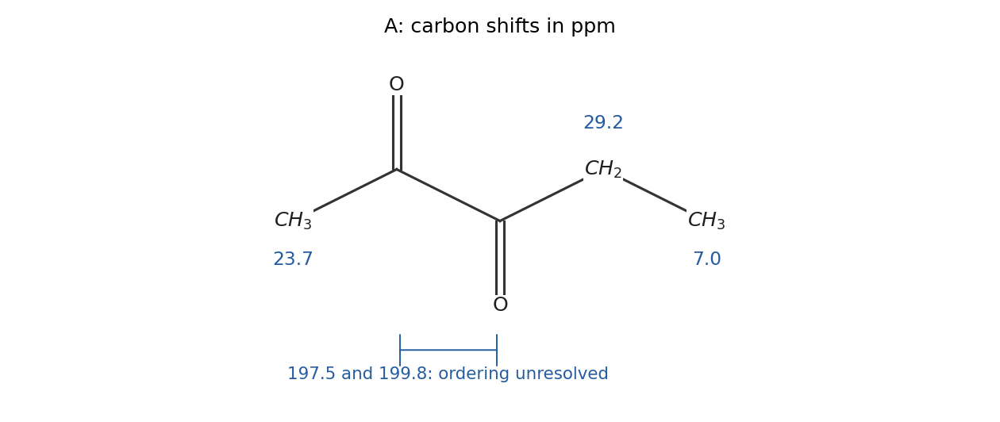

<h1 id="1/a/i/solution">Solution</h1>

↑ **Parent:** [I](../i.md)

**A is [pentane-2,3-dione](../../../../../../pentane-2-3-dione.md), $\mathrm{CH_3C(=O)C(=O)CH_2CH_3}$.** Its index of [hydrogen](../../../../../../hydrogen.md) deficiency is $(2\times5+2-8)/2=2$, accounted for by two [ketone](../../../../../../ketone.md) carbonyls. The two resonances near 200 ppm, together with the three saturated [carbon](../../../../../../carbon.md) signals and the [proton](../../../../../../proton.md) integrals, identify an unsymmetrical [adjacent diketone](../../../../../../adjacent-diketone.md) rather than an [ester](../../../../../../ester.md) or an alkene-containing structure.

The assignments are the carbonyl-adjacent methyl at $\delta_C=23.7$, the methylene at $29.2$, and the terminal ethyl methyl at $7.0$ ppm. The two [carbonyl](../../../../../../carbonyl-group.md) carbons give $197.5$ and $199.8$ ppm. **Their individual ordering is not uniquely established by the supplied one-dimensional spectra**; either ordering between the methyl-side and ethyl-side carbonyls should be kept tentative without a correlation or another independent assignment. In the displayed [attached proton test](../../../../../../attached-proton-test.md) phase convention, the two methyls have one sign, while the methylene and the nonprotonated carbonyls have the opposite sign. The solvent signal near 77 ppm is not a sixth [carbon](../../../../../../carbon.md) of A.

**[Figure 1](#1/a/i/image-original-structural-assignment-of-the-five-carbon-environments-in-a-the-two-carbonyl-shifts-are-an-unordered-pair). Original structural assignment of the five carbon environments in A; the two carbonyl shifts are an unordered pair**.

## ↑ Ancestors (14)

1. [I](../i.md)
2. [A](../../a.md)
3. [1](../../../1.md)
4. [Paper 1](../../../../paper-1-split.md)
5. [2023](../../../../split.md)
6. [Past exam of the chemistry course of the year 1 of the natural sciences course of the University of Cambridge](../../../../../split.md)
7. [Chemistry course of the year 1 of the natural sciences course of the University of Cambridge](../../../../../../chemistry-course-of-the-year-1-of-the-natural-sciences-course-of-the-university-of-cambridge.md)
8. [Year 1 of the natural sciences course of the University of Cambridge](../../../../../../year-1-of-the-natural-sciences-course-of-the-university-of-cambridge.md)
9. [Year of the natural sciences course of the University of Cambridge](../../../../../../year-of-the-natural-sciences-course-of-the-university-of-cambridge.md)
10. [Natural sciences course of the University of Cambridge](../../../../../../natural-sciences-course-of-the-university-of-cambridge.md)
11. [Course of the University of Cambridge](../../../../../../course-of-the-university-of-cambridge.md)
12. [University of Cambridge](../../../../../../university-of-cambridge-split.md)
13. [List of universities](../../../../../../list-of-universities.md)
14. [Codex Wiki](../../../../../../split.md)
