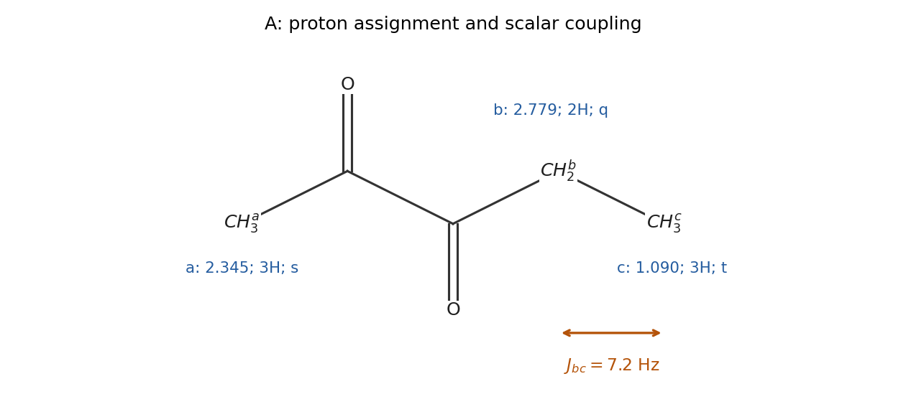

<h1 id="1/a/ii/solution">Solution</h1>

↑ **Parent:** [Ii](../ii.md)

Label the acetyl methyl $a$, the methylene $b$, and the terminal methyl $c$ in $\mathrm{CH_3^{a}C(=O)C(=O)CH_2^{b}CH_3^{c}}$. The assignments are

$$
\begin{array}{c|c|c|c}
\text{group}&\delta_H/\mathrm{ppm}&\text{integral}&\text{multiplicity}\\\hline
a&2.345&3&\text{singlet}\\
b&2.779&2&\text{quartet}\\
c&1.090&3&\text{triplet}
\end{array}
$$

The [NMR multiplet centre](../../../../../../nmr-multiplet-centre.md) of the [NMR quartet](../../../../../../nmr-quartet.md) is the mean of its outer lines, $(2.815+2.743)/2=2.779$ ppm. Its adjacent lines differ by 0.024 ppm; the [NMR triplet](../../../../../../nmr-triplet.md) has the same spacing. Therefore

$$
\boxed{{}^3J_{bc}=300(0.024)=7.2\,\mathrm{Hz}.}
$$

The two groups, through [vicinal coupling](../../../../../../vicinal-coupling.md), split one another into the expected $1:3:3:1$ [NMR quartet](../../../../../../nmr-quartet.md) and $1:2:1$ [NMR triplet](../../../../../../nmr-triplet.md). The acetyl methyl has no resolved neighbouring [proton](../../../../../../proton.md) across its adjacent [carbonyl](../../../../../../carbonyl-group.md) and appears as a [NMR singlet](../../../../../../nmr-singlet.md). The integrals sum to eight [protons](../../../../../../proton.md).

**[Figure 2](#1/a/ii/image-original-separate-proton-assignment-for-a-with-the-measured-methylene-methyl-coupling). Original separate proton assignment for A with the measured methylene–methyl coupling**.

## ↑ Ancestors (14)

1. [Ii](../ii.md)
2. [A](../../a.md)
3. [1](../../../1.md)
4. [Paper 1](../../../../paper-1-split.md)
5. [2023](../../../../split.md)
6. [Past exam of the chemistry course of the year 1 of the natural sciences course of the University of Cambridge](../../../../../split.md)
7. [Chemistry course of the year 1 of the natural sciences course of the University of Cambridge](../../../../../../chemistry-course-of-the-year-1-of-the-natural-sciences-course-of-the-university-of-cambridge.md)
8. [Year 1 of the natural sciences course of the University of Cambridge](../../../../../../year-1-of-the-natural-sciences-course-of-the-university-of-cambridge.md)
9. [Year of the natural sciences course of the University of Cambridge](../../../../../../year-of-the-natural-sciences-course-of-the-university-of-cambridge.md)
10. [Natural sciences course of the University of Cambridge](../../../../../../natural-sciences-course-of-the-university-of-cambridge.md)
11. [Course of the University of Cambridge](../../../../../../course-of-the-university-of-cambridge.md)
12. [University of Cambridge](../../../../../../university-of-cambridge-split.md)
13. [List of universities](../../../../../../list-of-universities.md)
14. [Codex Wiki](../../../../../../split.md)
