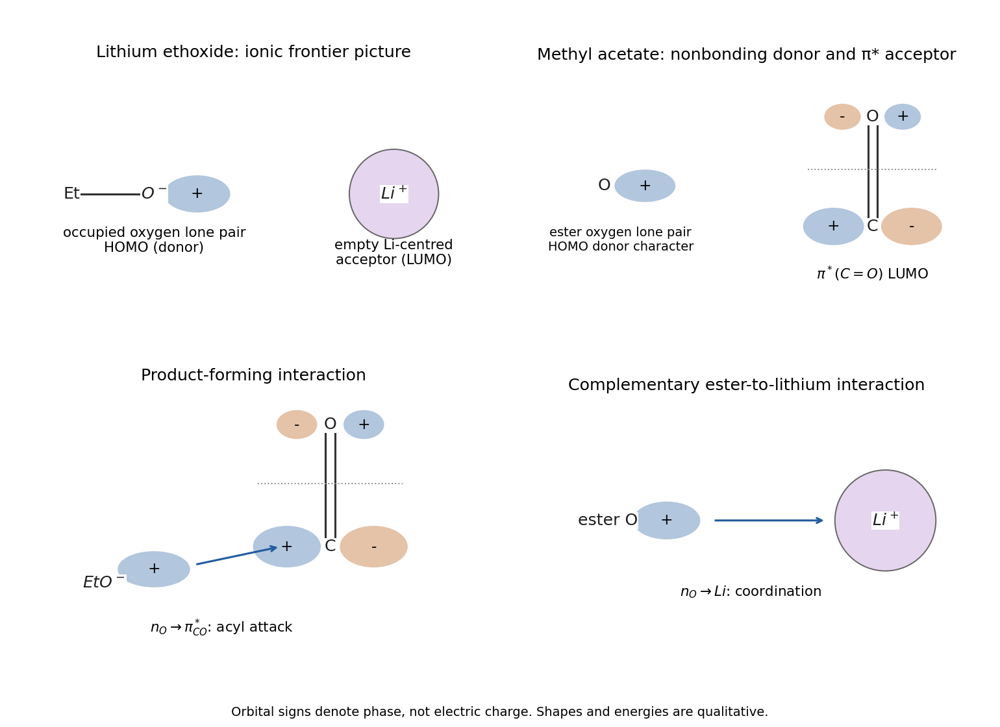

<h1 id="2/a/i/solution">Solution</h1>

↑ **Parent:** [I](../i.md)

**The reactive occupied orbital of [ethoxide](../../../../../../ethoxide.md) is an [oxygen](../../../../../../oxygen.md) [lone pair](../../../../../../lone-pair.md); the acyl [electrophile](../../../../../../electrophile.md) accepts into its [carbonyl](../../../../../../carbonyl-group.md) $\pi^*$ orbital.** Draw the [ethoxide](../../../../../../ethoxide.md) [lone pair](../../../../../../lone-pair.md) as a directional oxygen-centred lobe directed toward an [electrophile](../../../../../../electrophile.md). In a lithium-ion-pair picture the low unoccupied acceptor on [lithium](../../../../../../lithium.md) is an empty, diffuse Li-centred orbital, with 2s/2p character depending on coordination. It should not be confused with an occupied Li–O covalent bonding pair.

For [methyl acetate](../../../../../../methyl-acetate.md), the occupied frontier donor is principally an [oxygen](../../../../../../oxygen.md) nonbonding orbital, mixed with the [ester](../../../../../../ester.md) orbital system. Its low-lying reactive acceptor is $\pi^*(\mathrm{C=O})$, with opposite phases on [carbon](../../../../../../carbon.md) and [oxygen](../../../../../../oxygen.md) and a relatively large accepting lobe on the [carbonyl](../../../../../../carbonyl-group.md) [carbon](../../../../../../carbon.md). The corresponding sketch must show a [node](../../../../../../node-dynamical-systems.md) between the [carbonyl](../../../../../../carbonyl-group.md) atoms. These are chemically useful frontier-orbital descriptions; [lithium](../../../../../../lithium.md) [alkoxide](../../../../../../alkoxide.md) aggregation and [ethanol](../../../../../../ethanol.md) solvation make a unique isolated-molecule orbital energy diagram an oversimplification.

**[Figure 5](#2/a/i/image-original-frontier-orbital-sketches-and-the-two-complementary-donor-acceptor-contacts-in-the-ester-lithium-ethoxide-encounter). Original frontier-orbital sketches and the two complementary donor–acceptor contacts in the ester–lithium ethoxide encounter**.

## ↑ Ancestors (14)

1. [I](../i.md)
2. [A](../../a.md)
3. [2](../../../2.md)
4. [Paper 1](../../../../paper-1-split.md)
5. [2023](../../../../split.md)
6. [Past exam of the chemistry course of the year 1 of the natural sciences course of the University of Cambridge](../../../../../split.md)
7. [Chemistry course of the year 1 of the natural sciences course of the University of Cambridge](../../../../../../chemistry-course-of-the-year-1-of-the-natural-sciences-course-of-the-university-of-cambridge.md)
8. [Year 1 of the natural sciences course of the University of Cambridge](../../../../../../year-1-of-the-natural-sciences-course-of-the-university-of-cambridge.md)
9. [Year of the natural sciences course of the University of Cambridge](../../../../../../year-of-the-natural-sciences-course-of-the-university-of-cambridge.md)
10. [Natural sciences course of the University of Cambridge](../../../../../../natural-sciences-course-of-the-university-of-cambridge.md)
11. [Course of the University of Cambridge](../../../../../../course-of-the-university-of-cambridge.md)
12. [University of Cambridge](../../../../../../university-of-cambridge-split.md)
13. [List of universities](../../../../../../list-of-universities.md)
14. [Codex Wiki](../../../../../../split.md)
