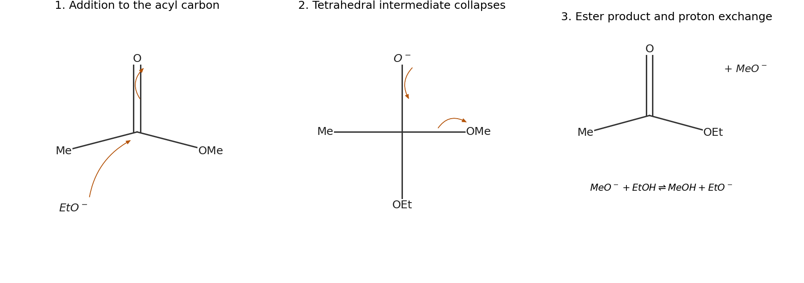

<h1 id="2/a/iii/solution">Solution</h1>

↑ **Parent:** [Iii](../iii.md)

**The mechanism is [nucleophilic addition](../../../../../../nucleophilic-addition.md) followed by elimination of [methoxide](../../../../../../methoxide.md).** An [ethoxide](../../../../../../ethoxide.md) [oxygen](../../../../../../oxygen.md) [lone pair](../../../../../../lone-pair.md) attacks the [carbonyl](../../../../../../carbonyl-group.md) [carbon](../../../../../../carbon.md), while the C=O pi pair moves to [oxygen](../../../../../../oxygen.md):

$$
\mathrm{MeC(=O)OMe+EtO^-\rightleftharpoons MeC(O^-)(OMe)(OEt)}.
$$

The tetrahedral intermediate collapses when its anionic [oxygen](../../../../../../oxygen.md) reforms the [carbonyl](../../../../../../carbonyl-group.md) and the C–OMe bond breaks with its electron pair going to the methoxy [oxygen](../../../../../../oxygen.md):

$$
\mathrm{MeC(O^-)(OMe)(OEt)\rightleftharpoons MeC(=O)OEt+MeO^-}.
$$

[lithium](../../../../../../lithium.md) is a coordinating counterion; it does not supply an electron pair to the acyl [carbon](../../../../../../carbon.md). [proton](../../../../../../proton.md) exchange with [ethanol](../../../../../../ethanol.md) connects the [methoxide](../../../../../../methoxide.md) produced to the [ethoxide](../../../../../../ethoxide.md) catalyst pool and gives [methanol](../../../../../../methanol.md), so the net solvent-mediated exchange is [methyl acetate](../../../../../../methyl-acetate.md) plus [ethanol](../../../../../../ethanol.md) to ethyl acetate plus [methanol](../../../../../../methanol.md). The reversibility of the elementary acyl steps is important: changing an alkoxy group is not automatically an irreversible reaction.

**[Figure 6](#2/a/iii/image-original-curved-arrow-addition-elimination-mechanism-for-ethoxide-catalysed-ester-exchange). Original curved-arrow addition–elimination mechanism for ethoxide-catalysed ester exchange**.

## ↑ Ancestors (14)

1. [Iii](../iii.md)
2. [A](../../a.md)
3. [2](../../../2.md)
4. [Paper 1](../../../../paper-1-split.md)
5. [2023](../../../../split.md)
6. [Past exam of the chemistry course of the year 1 of the natural sciences course of the University of Cambridge](../../../../../split.md)
7. [Chemistry course of the year 1 of the natural sciences course of the University of Cambridge](../../../../../../chemistry-course-of-the-year-1-of-the-natural-sciences-course-of-the-university-of-cambridge.md)
8. [Year 1 of the natural sciences course of the University of Cambridge](../../../../../../year-1-of-the-natural-sciences-course-of-the-university-of-cambridge.md)
9. [Year of the natural sciences course of the University of Cambridge](../../../../../../year-of-the-natural-sciences-course-of-the-university-of-cambridge.md)
10. [Natural sciences course of the University of Cambridge](../../../../../../natural-sciences-course-of-the-university-of-cambridge.md)
11. [Course of the University of Cambridge](../../../../../../course-of-the-university-of-cambridge.md)
12. [University of Cambridge](../../../../../../university-of-cambridge-split.md)
13. [List of universities](../../../../../../list-of-universities.md)
14. [Codex Wiki](../../../../../../split.md)
